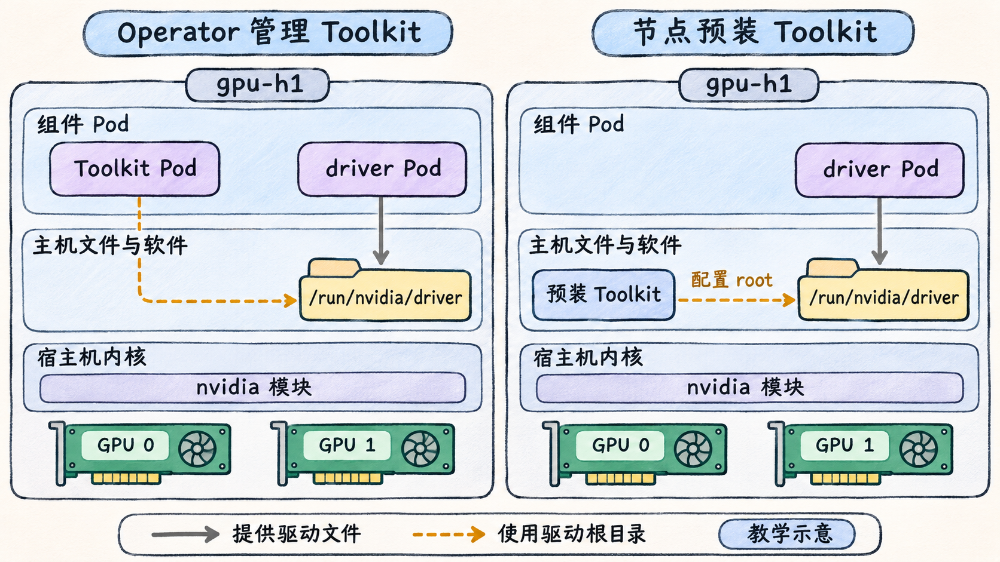

# 预装软件和 Operator 的责任划分

两台 GPU 节点都能枚举设备，其中一台可能由节点镜像提供驱动，另一台可能由 driver Pod 安装驱动。两者的区别会在更换内核、补齐容器运行时配置或升级驱动时显现。以 GPU Operator `v26.7.2` 的 `ClusterPolicy` 为例，判断责任要同时看期望配置、节点上实际运行的组件，以及它们使用的驱动路径。 [NVIDIA 预装组件的部署方式](https://docs.nvidia.com/datacenter/cloud-native/gpu-operator/26.7/getting-started.html#common-deployment-scenarios)

## 驱动与 Toolkit 可以分别预装

以下组合假设同一套 Helm 值覆盖所有由这条策略管理的 GPU 节点，保留 Device Plugin、GFD 和 Validator。表中的 `driver.enabled` 和 `toolkit.enabled` 是 Helm 值，分别映射到 `ClusterPolicy.spec.driver.enabled` 与 `ClusterPolicy.spec.toolkit.enabled`。 [NVIDIA 预装场景](https://docs.nvidia.com/datacenter/cloud-native/gpu-operator/26.7/getting-started.html#common-deployment-scenarios) · [v26.7.2 ClusterPolicy 模板](https://raw.githubusercontent.com/NVIDIA/gpu-operator/v26.7.2/deployments/gpu-operator/templates/clusterpolicy.yaml)

| 节点已有软件 | `driver.enabled` | `toolkit.enabled` | 版本与配置由谁维护 | 现场验证 |
| --- | --- | --- | --- | --- |
| 无预装 | `true` | `true` | Operator 按 CR 协调驱动和 Toolkit | 查看目标节点上的两个组件 Pod、驱动版本和运行时生效配置。 |
| 预装驱动 | `false` | `true` | 节点交付流程维护驱动，Operator 配置 Toolkit | 核对宿主机驱动版本及 Toolkit 使用的驱动根目录。 |
| 驱动与 Toolkit 均预装 | `false` | `false` | 节点交付流程维护两者，负责 CDI 和管理容器所需的运行时配置 | 核对主机上的软件版本、实际 CDI 规格与运行时 handler，再跑节点验证。 |
| 只预装 Toolkit | `true` | `false` | Operator 安装容器化驱动，节点侧维护 Toolkit | 核对预装 Toolkit 指向容器化驱动的安装目录，再验证设备访问。 |

只预装 Toolkit 时，NVIDIA 的默认路径示例要求将 `/etc/nvidia-container-runtime/config.toml` 中的驱动根目录指向 `/run/nvidia/driver`，因为 driver Pod 在那里提供驱动文件。驱动与 Toolkit 均预装时，NVIDIA 的安装示例要求事先配置默认 runtime 为 `nvidia`。按目标场景落实运行时配置，并检查 kubelet 所连接的 containerd 实例实际读到了什么。 [NVIDIA 预装 Toolkit 的两种配置](https://docs.nvidia.com/datacenter/cloud-native/gpu-operator/26.7/getting-started.html#pre-installed-nvidia-gpu-drivers-and-nvidia-container-toolkit)



**图 12-03-01**　两种配置都由 GPU Operator v26.7.2 交付容器化驱动。右侧的 Toolkit 由节点镜像预装，节点侧的 NVIDIA 容器运行时配置需要将驱动根目录指向主机的 `/run/nvidia/driver`。

如果只让 `gpu-h1` 使用预装驱动，而 `gpu-h0` 继续由同一个 `ClusterPolicy` 部署驱动，可在 `gpu-h1` 上使用 `nvidia.com/gpu.deploy.driver=false`。设 `nvidia.com/gpu.deploy.operands=false` 则将该节点排除出 GPU 组件的部署范围，包括仍然需要的 Toolkit 与设备插件。这类部署标签作用于 Operator 协调的 GPU 节点组件，NFD 仍按自身配置工作。保留默认驱动部署时，driver Pod 的 init 容器也会检查预装驱动。检测成功后，它给节点加上阻止 driver Pod 再部署的标签，后续组件仍可利用预装驱动。因此查看 `driver.enabled` 后，还要查目标节点的标签、driver Pod 和实际驱动根目录。 [NVIDIA 节点排除与预装驱动检测](https://docs.nvidia.com/datacenter/cloud-native/gpu-operator/26.7/getting-started.html#common-deployment-scenarios)

复用已部署的 NFD 时，设 `nfd.enabled: false` 以关闭 chart 附带的 NFD。现有 NFD 仍要生成 Operator 可识别的 PCI 标签，并让 GFD 产生的特征能够投影到 Node 标签。在部署之前，可以先比对现有 NFD 的配置和一台 GPU 节点的实际标签。 [NVIDIA 安装前置条件](https://docs.nvidia.com/datacenter/cloud-native/gpu-operator/26.7/getting-started.html#prerequisites) · [v26.7.2 chart 的 NFD 配置](https://raw.githubusercontent.com/NVIDIA/gpu-operator/v26.7.2/deployments/gpu-operator/values.yaml#L593)

## CDI 与管理容器需要核对不同的运行时输入

GPU Operator 从 v25.10.0 起默认启用 CDI。v26.7.2 的控制器在启用 CDI 时为所管理的设备插件设置 `DEVICE_LIST_STRATEGY=cdi-annotations,cdi-cri`，还可以从 `spec.devicePlugin.env` 注入覆盖设置。检查实际 DaemonSet 的环境变量时，把静态模板中的 `envvar` 与控制器处理后的值区分开。对普通整卡 Pod，用 containerd 的 `enable_cdi`、`cdi_spec_dirs` 和实际规格核对已分配设备如何注入。 [GPU Operator CDI 文档](https://docs.nvidia.com/datacenter/cloud-native/gpu-operator/26.7/cdi.html) · [Operator 变换插件清单的源码](https://raw.githubusercontent.com/NVIDIA/gpu-operator/v26.7.2/controllers/object_controls.go#L1442) · [containerd v2.3.0 CRI 配置](https://github.com/containerd/containerd/blob/v2.3.0/docs/cri/config.md)

设备插件和监控组件这类管理容器可能用 `NVIDIA_VISIBLE_DEVICES` 直接取得 GPU 访问权限。在本章 NRI 关闭的配置中，采用这个方式的管理 Pod 设置 `runtimeClassName: nvidia`。需核对 RuntimeClass 对象的 `handler` 与节点的 containerd 是否匹配。普通 Pod 通过 GPU 请求和原生 CDI 取得已分配设备，可以使用普通运行时配置。预装 Toolkit 时，这两种接入各有对应的验收证据。 [CDI 对 GPU 管理容器的要求](https://docs.nvidia.com/datacenter/cloud-native/gpu-operator/26.7/cdi.html#cdi-and-gpu-management-containers) · [Kubernetes RuntimeClass](https://v1-36.docs.kubernetes.io/docs/concepts/containers/runtime-class/)

## 按节点池指定驱动版本

当两个 GPU 池需要各自的驱动版本，可以启用 Helm 值 `driver.nvidiaDriverCRD.enabled: true`。chart 将 `ClusterPolicy.spec.driver.useNvidiaDriverCRD` 设为 `true`，驱动由 `NVIDIADriver` 控制器根据这些 CR 的配置管理，`ClusterPolicy` 继续管 Toolkit 等组件。下面两个教学清单仅展示驱动选择所需字段，版本取自 v26.7.2 的组件矩阵。假定 `gpu-h0` 有 `driver.config=stable`，`gpu-h1` 有 `driver.config=compat`。 [NVIDIADriver 管理与选择规则](https://docs.nvidia.com/datacenter/cloud-native/gpu-operator/26.7/gpu-driver-configuration.html) · [v26.7.2 NVIDIADriver CRD](https://raw.githubusercontent.com/NVIDIA/gpu-operator/v26.7.2/deployments/gpu-operator/crds/nvidia.com_nvidiadrivers.yaml) · [GPU Operator 组件矩阵](https://docs.nvidia.com/datacenter/cloud-native/gpu-operator/26.7/platform-support.html#gpu-operator-component-matrix)

```yaml
apiVersion: nvidia.com/v1alpha1
kind: NVIDIADriver
metadata:
  name: stable
spec:
  driverType: gpu
  repository: nvcr.io/nvidia
  image: driver
  version: "595.91.07"
  nodeSelector:
    driver.config: stable
---
apiVersion: nvidia.com/v1alpha1
kind: NVIDIADriver
metadata:
  name: compat
spec:
  driverType: gpu
  repository: nvcr.io/nvidia
  image: driver
  version: "580.196.07"
  nodeSelector:
    driver.config: compat
```

`gpu-h0` 匹配 `stable`，`gpu-h1` 匹配 `compat`。若另有一台符合驱动部署条件的 `gpu-h2` 缺少 `driver.config` 标签，chart 创建的 `spec.default: true` 实例就会接管它。假设该默认实例沿用 chart 的 `595.91.07`，`gpu-h2` 会采用这个版本，另两台节点继续用各自匹配的配置。默认实例只能有一个，省略节点选择器。若希望未匹配节点由节点交付流程负责，可以设置 `driver.nvidiaDriverCRD.deployDefaultCR: false` 并使用明确的池选择器。 [NVIDIA 默认驱动 CR 的回退规则](https://docs.nvidia.com/datacenter/cloud-native/gpu-operator/26.7/gpu-driver-configuration.html) · [v26.7.2 chart 默认值](https://raw.githubusercontent.com/NVIDIA/gpu-operator/v26.7.2/deployments/gpu-operator/values.yaml)

假设管理员误把 `compat` 的选择器也改成 `driver.config: stable`，两个非默认 CR 将同时命中 `gpu-h0`。v26.7.2 会把受影响的 CR 标为 `notReady`，用 `ConflictingNodeSelector` 表明冲突，并在冲突解决前保留已有的驱动归属。现场可以并排读 CR 的条件、Node 上由 Operator 写入的 `nvidia.com/gpu-operator.driver.owner`，以及 driver DaemonSet 的 Pod 模板选择器，再到节点核实实际驱动版本。 [NVIDIA 驱动归属冲突和排查说明](https://docs.nvidia.com/datacenter/cloud-native/gpu-operator/26.7/gpu-driver-configuration.html)
