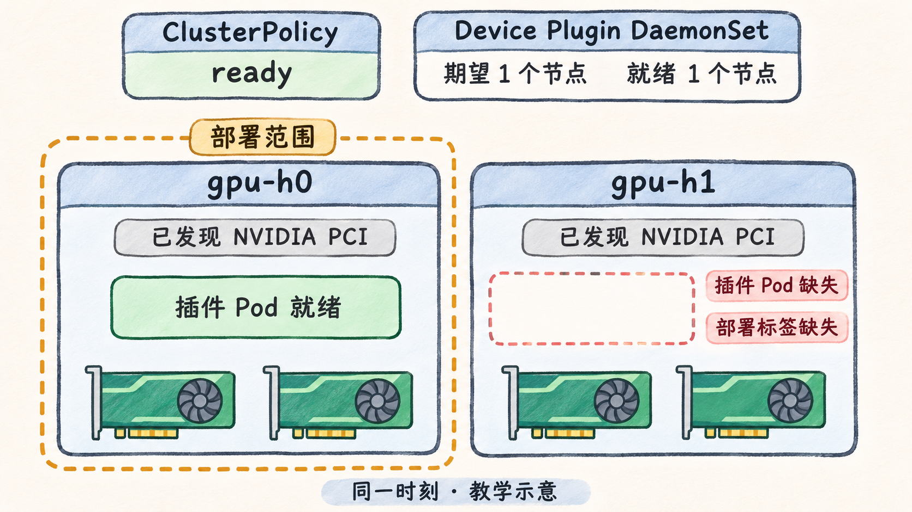

`gpu-h1` 有两张 H100 PCIe，预期通过 GPU Operator `v26.7.2` 部署驱动、Toolkit 和 Device Plugin，再由 containerd 使用 CDI 交付整卡。如果这台节点迟迟没有 GPU 资源，先确认它是否进入了部署范围。找到该节点上的组件 Pod 后，才有意义去读它的启动和注册日志。

## 从 ClusterPolicy 汇总缩小到目标节点

`ClusterPolicy.status.state` 是控制器的协调汇总。v26.7.2 在未观察到 NFD 标签，或有 NFD 标签却未识别到 GPU 节点时，也可报告 `ready`。读取 `status.conditions[]` 的 `type`、`status`、`reason` 与 `message`，可以区分 `NFDLabelsMissing`、`NoGPUNodes` 和 `Reconciled` 等状态原因。汇总描述最近一次协调，可能早于当前节点快照。控制器日志中的 `ClusterPolicy step completed` 及 `state`、`status` 字段可以接着缩小到组件。 [v26.7.2 ClusterPolicy 收尾分支](https://github.com/NVIDIA/gpu-operator/blob/v26.7.2/controllers/clusterpolicy_controller.go#L195)

找到目标组件后，读 DaemonSet 的三个计数。`desiredNumberScheduled` 是按模板应部署的节点数，`currentNumberScheduled` 是其中已经有该 DaemonSet Pod 的节点数，`numberReady` 是其中已有就绪 Pod 的节点数。若三项都是 1 且唯一 Pod 在 `gpu-h0`，这些数字只覆盖 `gpu-h0`。检查 `gpu-h1` 时，应把 DaemonSet 的选择器、亲和性和容忍与 Node 的标签和污点对照。若期望数已变成 2、当前仍为 1，再查 Pod 创建和放置记录。 [Kubernetes DaemonSetStatus](https://v1-36.docs.kubernetes.io/docs/reference/kubernetes-api/apps/daemon-set-v1/#daemonsetstatus) · [插件 DaemonSet 的节点选择](https://raw.githubusercontent.com/NVIDIA/gpu-operator/v26.7.2/assets/state-device-plugin/0500_daemonset.yaml)

**图 12-04-01**　教学快照，卡的外形仅作示意。`ClusterPolicy` 显示 `ready`，插件 DaemonSet 的期望和就绪数均为 1，指的是旧节点 `gpu-h0`。`gpu-h1` 已被 NFD 发现，但尚缺模板所选的 `nvidia.com/gpu.deploy.device-plugin=true`。

已找到 Pod 时，按 `spec.nodeName` 和 `metadata.uid` 对齐对象、事件与日志。`status.initContainerStatuses` 可指出当前失败的 init，事件的 `reason` 和 `message` 可补充失败发生的阶段。若失败容器已经重启，`kubectl logs -n gpu-operator <pod> -c <container> --previous --timestamps` 可读到仍保留的上一实例日志。尖括号是实际 Pod 与容器名。 [NVIDIA Operator 的 Init 排查](https://docs.nvidia.com/datacenter/cloud-native/gpu-operator/26.7/troubleshooting.html#gpu-operator-pods-are-stuck-in-init) · [kubectl logs](https://v1-36.docs.kubernetes.io/docs/reference/kubectl/generated/kubectl_logs/)

## Validator 的检查输入与通过条件

在本章的默认配置中，`nvidia-operator-validator` Pod 依次运行驱动、Toolkit、CUDA 和插件四项 init 检查。每一项使用不同的输入。判断覆盖范围时需读实际 Pod 配置。 [v26.7.2 Validator 模板](https://raw.githubusercontent.com/NVIDIA/gpu-operator/v26.7.2/assets/state-operator-validation/0500_daemonset.yaml) · [v26.7.2 Validator 实现](https://raw.githubusercontent.com/NVIDIA/gpu-operator/v26.7.2/cmd/nvidia-validator/main.go)

| 检查 | 实际执行 | 结果怎样使用 |
| --- | --- | --- |
| `driver-validation` | 检查宿主机驱动，必要时再验证容器化驱动。通过后写 `driver-ready`。 | 从标记中的 `IS_HOST_DRIVER`、`NVIDIA_DRIVER_ROOT` 判断本节点的驱动来源和根目录。 |
| `toolkit-validation` | 在管理容器中运行 `nvidia-smi`，通过后写 `toolkit-ready`。 | 说明这次管理容器能访问驱动与设备，并让正在等该标记的插件继续启动。 |
| `cuda-validation` | 工作负载检查默认开启，创建显式设置 `spec.nodeName` 的 CUDA 验证 Pod。 | 检查选定节点上的 CUDA 测试。固定节点的测试跳过了普通调度器选节点。 |
| `plugin-validation` | 主例检查 Node 的 `status.capacity["nvidia.com/gpu"]` 至少为 1。默认 `WITH_WORKLOAD=false`。 | 通过表明 kubelet 已发布容量。若要验证普通 GPU 请求能否放置并计算，还要读资源余量与业务形态的 Pod。 |

假设两张卡仍在设备列表里，却都被标为不健康。按 Kubernetes 的计数规则，`Capacity=2`，`Allocatable=0`。即使没有其他 Pod 占卡，调度余量也是 `0 − 0 = 0`。如果此时执行默认插件检查，读取的是 2，所以容量检查仍可能通过。要解释为什么新 Pod 无法取得 GPU，应读取插件报送的设备健康状态和 Node 的 `Allocatable`。 [Validator 容量检查](https://github.com/NVIDIA/gpu-operator/blob/v26.7.2/cmd/nvidia-validator/main.go#L1365) · [Kubernetes 不健康设备的资源计数](https://v1-36.docs.kubernetes.io/docs/concepts/extend-kubernetes/compute-storage-net/device-plugins/#device-plugin-and-unhealthy-devices)

若希望 Validator 另外运行申请 GPU 的负载，可通过 chart 值 `validator.plugin.env` 给 `plugin-validation` 的 `WITH_WORKLOAD` 设字符串 `"true"`。测试 Pod 直接指向目标节点，其 init 容器申请一张卡，因而需要节点确实有可分配的设备。第 03 篇用普通 VectorAdd Pod 检验调度、分配和计算的全过程。 [ClusterPolicy 模板](https://github.com/NVIDIA/gpu-operator/blob/v26.7.2/deployments/gpu-operator/templates/clusterpolicy.yaml#L82) · [验证环境变量转换](https://github.com/NVIDIA/gpu-operator/blob/v26.7.2/controllers/object_controls.go#L2299) · [验证 Pod 的 GPU 请求](https://github.com/NVIDIA/gpu-operator/blob/v26.7.2/cmd/nvidia-validator/main.go#L1266)

## 组件启动、资源上报与 CDI 注入的故障证据

表中每行独立改变 `gpu-h1` 的一个观察条件。事件消息采用上游样例，其余是教学快照。 [NVIDIA GPU Operator 故障排查](https://docs.nvidia.com/datacenter/cloud-native/gpu-operator/26.7/troubleshooting.html) · [Kubernetes Device Plugin 接口](https://v1-36.docs.kubernetes.io/docs/concepts/extend-kubernetes/compute-storage-net/device-plugins/)

| 已见证据 | 能定位到哪里 | 下一项取证 |
| --- | --- | --- |
| Toolkit 等 `driver-validation`，driver 主容器曾重启。已能创建沙箱的插件 Pod 停在 `toolkit-validation`。 | 两处 init 都指向更早的驱动依赖。 | 先读 `nvidia-driver-ctr` 上一实例及内核日志，区分包安装和模块加载。若 driver Pod 自身停在 init，检查 `k8s-driver-manager`。 |
| 插件 Pod 已就绪，Node 的两个 GPU 资源键仍缺失。 | 插件主容器已通过其就绪条件，设备上报需要独立证据。 | 查插件的 NVML（NVIDIA Management Library）初始化、枚举和注册，再与 kubelet 收到的设备列表及 Node 的写回时间对应。 |
| 管理 Pod 的 `FailedCreatePodSandBox` 消息含 `no runtime for "nvidia" is configured`。 | 运行时尚未找到 `nvidia` handler，GPU 管理容器未启动。 | 核对 RuntimeClass 的 handler 与 kubelet 所连的 containerd。用 Toolkit 日志和实际环境变量（例如 `CONTAINERD_CONFIG`、`CONTAINERD_SOCKET`）核对配置来源及目标实例，确认目标服务已加载相关设置。 |
| `Capacity/Allocatable` 是 `2/2`，普通测试 Pod 已绑定 `gpu-h1`，应用容器仍在等待创建。 | 节点放置已完成，下一步是设备分配或注入。 | 查 kubelet 分配记录。若已取得 CDI 名称，再查 containerd 是否扫描到能解析该名称的规格。 |
| 测试容器已启动，随后非零退出。 | 已进入应用执行，需从测试记录判断失败点。 | 对照分配的设备 ID、容器可见的设备及 CUDA 日志，确定应用停在初始化还是计算。 |

驱动或运行时接入失败也可能源于维护责任的变化。若某台节点开始使用预装组件，就要先确定由谁提供这些依赖，再去正确的 Pod 或主机路径取证。
