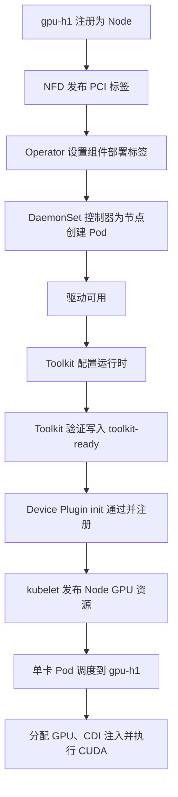

# 新 GPU 节点从注册到可用

假设一个 GPU Operator `v26.7.2` 集群已有 `gpu-h0` 和 CPU 节点 `cpu-0`。新加入的 `gpu-h1` 运行 Ubuntu 24.04 LTS 和 containerd 2.3，有两张健康的 H100 PCIe。集群用 Kubernetes v1.36，按 `ClusterPolicy` 部署驱动、Toolkit 和 Device Plugin，通过 CDI 注入整卡。以下时点是教学快照。验收目标是用同一节点上的证据，确认软硬件已就绪，且普通 Pod 可以请求 GPU 并完成一次计算。

## 组件可以同时出现，启动仍有依赖

1. **发现并选择节点。** kubelet 注册 Node，Kubernetes 按其节点健康状态报告 `Ready`。当 NFD 发布 PCI 标签后，Operator 更新 GPU 组件部署标签，令现有 DaemonSet 将 `gpu-h1` 纳入目标范围。Node 的 `Ready` 条件可以先于 GPU 资源出现。 [Kubernetes Node 状态](https://v1-36.docs.kubernetes.io/docs/reference/node/node-status/) · [Operator 节点识别与状态管理](https://raw.githubusercontent.com/NVIDIA/gpu-operator/v26.7.2/controllers/state_manager.go)
2. **在宿主机准备软件。** driver Pod 安装驱动。Toolkit DaemonSet 的 `driver-validation` init 通过后，Toolkit 才执行运行时配置。Operator Validator 的 `toolkit-validation` 在配置好的管理容器中运行 `nvidia-smi`，成功后写 `/run/nvidia/validations/toolkit-ready`。本章裸金属路径的 Device Plugin init 要等这个标记及 `nvidia` 内核模块。此时 API 上可能早已有插件 Pod，其应用容器仍在等待。 [Toolkit 的 driver-validation](https://raw.githubusercontent.com/NVIDIA/gpu-operator/v26.7.2/assets/state-container-toolkit/0500_daemonset.yaml) · [Validator 实现](https://raw.githubusercontent.com/NVIDIA/gpu-operator/v26.7.2/cmd/nvidia-validator/main.go#L1085) · [Device Plugin 的 toolkit-validation](https://raw.githubusercontent.com/NVIDIA/gpu-operator/v26.7.2/assets/state-device-plugin/0500_daemonset.yaml)
3. **发布可分配资源。** Device Plugin 枚举两张卡、向 kubelet 注册，再通过 `ListAndWatch` 向 kubelet 提供设备 ID 和健康状态。kubelet 将 GPU `Capacity` 与 `Allocatable` 发布到 Node。GFD 标签、监控启动、DaemonSet 和 Node 状态写回各有自己的节奏。下面的快照用来说明证据的含义，现场应以同节点的时间戳检查这些变化。 [Kubernetes v1.36 插件注册和设备状态](https://v1-36.docs.kubernetes.io/docs/concepts/extend-kubernetes/compute-storage-net/device-plugins/#device-plugin-registration)
4. **提交单卡负载。** 调度器根据节点约束和 GPU 资源请求选择 `gpu-h1`。绑定之后，kubelet 在节点内分配设备，containerd 使用 CDI 注入设备，应用开始执行 CUDA 算例。 [Kubernetes GPU 调度](https://v1-36.docs.kubernetes.io/docs/tasks/manage-gpus/scheduling-gpus/) · [GPU Operator CDI 路径](https://docs.nvidia.com/datacenter/cloud-native/gpu-operator/26.7/cdi.html)



## 对照组件覆盖和 GPU 数量

下面假设 `gpu-h0` 始终就绪，`cpu-0` 始终在 Device Plugin 部署范围外，`gpu-h1` 的两个 GPU 状态字段起初均未写入。DaemonSet 列取自 `nvidia-device-plugin-daemonset` 的 `status.desiredNumberScheduled` 和 `status.numberReady`，统计单位为节点。Node 列取 `gpu-h1` 的 `status.capacity["nvidia.com/gpu"]` 和 `status.allocatable["nvidia.com/gpu"]`，统计单位为本例的整卡。 [Kubernetes DaemonSetStatus 字段定义](https://v1-36.docs.kubernetes.io/docs/reference/kubernetes-api/apps/daemon-set-v1/#daemonsetstatus) · [Kubernetes 设备状态如何影响可分配数量](https://v1-36.docs.kubernetes.io/docs/concepts/extend-kubernetes/compute-storage-net/device-plugins/#device-plugin-and-unhealthy-devices)

| 教学时点 | 插件期望节点数 / 就绪节点数 | `gpu-h1` 的 GPU Capacity / Allocatable | 证据支持的判断 |
| --- | ---: | ---: | --- |
| 新节点已注册，部署标签尚未到位 | 1 / 1 | 两键缺失 | 当前插件范围只有旧 GPU 节点。 |
| 新节点已被选中，插件 Pod 仍在 init | 2 / 1 | 两键缺失 | 新节点已进入插件范围，应核对该 Pod 正在等待的条件。 |
| 两张健康整卡已上报 | 2 / 2 | 2 / 2 | kubelet 已在新节点发布设备资源，可以继续验证工作负载。 |

现场可用 `kubectl get node gpu-h1 -o yaml`、`kubectl get ds -n gpu-operator nvidia-device-plugin-daemonset -o yaml` 和 `kubectl get pods -n gpu-operator --field-selector spec.nodeName=gpu-h1 -o wide` 取这三处状态。读数时同时确认 Pod 所在节点和采集时间，才能将聚合计数与个别节点对上。

## 用正常调度的 Pod 验证 CUDA

下面的 Pod 改自 NVIDIA 的 CUDA VectorAdd 示例。假设 `kubernetes.io/hostname=gpu-h1` 唯一匹配目标节点，CPU、内存、污点、权限及镜像获取条件均满足。节点选择器保留了调度过程，`limits` 中的一张 GPU 会作为请求计入调度。假设节点初始没有其他 GPU 请求，调度器计入该 Pod 请求期间，剩余可调度量为 `2 − 1 = 1` 张。两张设备仍健康时，Node 的 `Allocatable` 仍为 2。 [NVIDIA CUDA VectorAdd 示例](https://docs.nvidia.com/datacenter/cloud-native/gpu-operator/26.7/getting-started.html#cuda-vectoradd) · [Kubernetes GPU 请求规则](https://v1-36.docs.kubernetes.io/docs/tasks/manage-gpus/scheduling-gpus/)

```yaml
apiVersion: v1
kind: Pod
metadata:
  name: cuda-vectoradd
spec:
  restartPolicy: Never
  nodeSelector:
    kubernetes.io/hostname: gpu-h1
  containers:
    - name: cuda-vectoradd
      image: nvcr.io/nvidia/k8s/cuda-sample:vectoradd-cuda12.5.0-ubuntu22.04
      resources:
        limits:
          nvidia.com/gpu: 1
```

验证时先确认 Pod 的 `spec.nodeName` 为 `gpu-h1`。Pod 运行期间，可从本机 kubelet 的 PodResources `List` 接口查到该 Pod 和容器关联的 `device_ids`。按插件默认设置，这些 ID 应能与节点上的 GPU UUID 对应。VectorAdd 可能很快退出，分配证据应在运行窗口采集。算例成功时，检查容器终止状态的 `exitCode: 0` 和预期输出中的 `Test PASSED`。这组证据覆盖一次实际的调度、设备分配、注入和 CUDA 运算，范围是被测试的节点、设备与镜像。 [Kubernetes PodResources API](https://v1-36.docs.kubernetes.io/docs/concepts/extend-kubernetes/compute-storage-net/device-plugins/#monitoring-device-plugin-resources) · [v26.7.2 Device Plugin 清单](https://raw.githubusercontent.com/NVIDIA/gpu-operator/v26.7.2/assets/state-device-plugin/0500_daemonset.yaml#L64) · [NVIDIA 示例的预期输出](https://docs.nvidia.com/datacenter/cloud-native/gpu-operator/26.7/getting-started.html#cuda-vectoradd)
