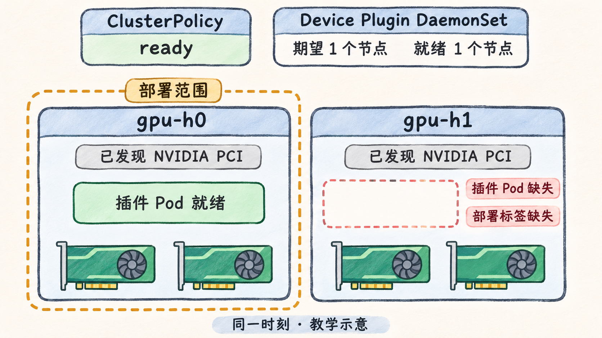

# 用状态和日志定位节点软件故障

新节点迟迟没有 GPU 资源时，先确认它有没有被纳入组件部署范围，再确认该节点的 Pod 在哪里停住。以下以 GPU Operator `v26.7.2`、Kubernetes v1.36、Ubuntu 24.04 LTS、containerd 2.3 和两张 H100 PCIe 的 `gpu-h1` 为例，采用 `ClusterPolicy`、Device Plugin、CDI 和默认关闭的 NRI。表中的现场组合是教学推演，引用的容器名、日志字段与行为来自固定版本源码或 NVIDIA 的故障说明。

## 从集群状态定位到目标节点

`ClusterPolicy.status.state` 是控制器对当前协调结果的汇总。v26.7.2 的实现可以在没发现 NFD 标签，或有 NFD 标签但没发现 GPU 节点时写入 `ready`。遇到这个状态，先看 `status.conditions[]` 中的 `type`、`status`、`reason` 和 `message`，确认是哪些对象完成了协调、是否识别到了 GPU 节点。控制器的 `ClusterPolicy step completed` 日志中有 `state:` 和 `status` 字段，可定位正在协调的组件。 [v26.7.2 ClusterPolicy 状态与日志实现](https://raw.githubusercontent.com/NVIDIA/gpu-operator/v26.7.2/controllers/clusterpolicy_controller.go#L155)

接着读相关 DaemonSet 的三个数。 `desiredNumberScheduled` 表示应有该组件的节点数，`currentNumberScheduled` 表示应部署且已经有该 DaemonSet Pod 的节点数，`numberReady` 表示应部署且已有就绪 Pod 的节点数。假设只有 `gpu-h0` 被选中，三个字段都可以为 1，即使 `gpu-h1` 完全缺少这个组件。需要用 `spec.template.spec` 中的选择条件和 `gpu-h1` 的标签、污点核对覆盖，再查目标节点上的 Pod。 [Kubernetes DaemonSetStatus](https://v1-36.docs.kubernetes.io/docs/reference/kubernetes-api/apps/daemon-set-v1/#daemonsetstatus)



**图 12-05-01**　同一时段的教学快照。 `ClusterPolicy` 显示 `ready`，插件 DaemonSet 的期望与就绪节点数均为 1，这两个数都对应 `gpu-h0`。新节点 `gpu-h1` 已有 NVIDIA PCI 标签，下一步可用 DaemonSet 的选择条件核对缺失的插件部署标签。

采集时先用 `kubectl get pods -n gpu-operator --field-selector spec.nodeName=gpu-h1 -o wide` 缩小范围。再用 Pod 的 `metadata.uid`、`spec.nodeName`、容器名和时间戳串起 Pod 状态、事件和日志。 `status.initContainerStatuses` 能显示当前哪个 init 尚未完成，与事件里的 `reason`、`message` 一起读。若容器已重启且上一实例的日志仍可用，用 `kubectl logs -n gpu-operator <pod> -c <container> --previous --timestamps` 查看上一次失败。 [NVIDIA Operator 日志采集示例](https://docs.nvidia.com/datacenter/cloud-native/gpu-operator/26.7/troubleshooting.html#gpu-operator-pods-are-stuck-in-init) · [Kubernetes kubectl logs](https://v1-36.docs.kubernetes.io/docs/reference/kubectl/generated/kubectl_logs/)

## Validator 的每一步检查了什么

`nvidia-operator-validator` 的 init 容器依次检查驱动、Toolkit、CUDA 和插件。看见 Validator 运行成功时，仍要核对这一版实际执行了哪些检查。下面的默认行为按 v26.7.2 的 DaemonSet 清单和 Validator 实现整理。 [Validator init 容器模板](https://raw.githubusercontent.com/NVIDIA/gpu-operator/v26.7.2/assets/state-operator-validation/0500_daemonset.yaml) · [v26.7.2 Validator 实现](https://raw.githubusercontent.com/NVIDIA/gpu-operator/v26.7.2/cmd/nvidia-validator/main.go)

| 检查 | 输入和结果 | 结果的适用范围 |
| --- | --- | --- |
| `driver-validation` | 优先验证宿主机预装驱动，否则查容器化驱动。成功后写 `driver-ready`，包含 `IS_HOST_DRIVER` 与 `NVIDIA_DRIVER_ROOT`。 | 用结果确认这一节点使用的驱动来源与根目录。 |
| `toolkit-validation` | 在管理容器运行 `nvidia-smi`，成功后写 `toolkit-ready`。 | 证明该容器通过所用的运行时配置访问到了驱动和设备。 |
| `cuda-validation` | 启用工作负载检查时，创建指定 `spec.nodeName` 的 CUDA 验证 Pod。 | 确认目标节点的 CUDA 测试。指定 `nodeName` 已选定节点，普通 GPU 请求的调度另用带节点选择器的单卡 Pod 验收。 |
| `plugin-validation` | 从 Node 的 `status.capacity` 查找数量至少为 1 的 GPU 资源。默认 `WITH_WORKLOAD=false`，启用后创建绑定到目标节点的测试 Pod，其 init 容器的 GPU request 和 limit 均为 1。 | 默认结果证明 kubelet 已发布容量。启用测试后可验证节点上的实际设备分配和访问。 |

例如，两张卡均仍在插件的设备清单中，但都被标为不健康，kubelet 将报告 `Capacity=2`、`Allocatable=0`。若执行到默认插件容量检查，它仍可以通过。此时新 Pod 的整卡调度余量为零，应看插件健康上报及 Node 当前的 `Allocatable`，再判断为何设备不可分配。 [Validator 的容量检查](https://raw.githubusercontent.com/NVIDIA/gpu-operator/v26.7.2/cmd/nvidia-validator/main.go#L1365) · [Kubernetes 不健康设备计数规则](https://v1-36.docs.kubernetes.io/docs/concepts/extend-kubernetes/compute-storage-net/device-plugins/#device-plugin-and-unhealthy-devices)

如果要让插件检查再运行一个申请 GPU 的负载，可在 chart 值里传入下列环境变量。v26.7.2 的模板接收环境变量列表，控制器将其加到 `plugin-validation` init 容器。这类验证需要有卡可供申请。要覆盖调度器的筛选与放置，使用带 GPU 请求和节点选择器的普通 Pod。 [ClusterPolicy 模板](https://raw.githubusercontent.com/NVIDIA/gpu-operator/v26.7.2/deployments/gpu-operator/templates/clusterpolicy.yaml#L82) · [Validator 环境变量转换](https://raw.githubusercontent.com/NVIDIA/gpu-operator/v26.7.2/controllers/object_controls.go#L2299) · [验证 Pod 的 GPU 请求](https://raw.githubusercontent.com/NVIDIA/gpu-operator/v26.7.2/cmd/nvidia-validator/main.go#L1258)

```yaml
validator:
  plugin:
    env:
      - name: WITH_WORKLOAD
        value: "true"
```

## 用下一条证据区分相邻故障层

下面五行是彼此独立的教学快照。每行假定同一时段采集 `gpu-h1` 的 Node、Pod 及相关组件对象。借用的事件消息来自 NVIDIA 故障排查示例。 [NVIDIA 故障排查指南](https://docs.nvidia.com/datacenter/cloud-native/gpu-operator/26.7/troubleshooting.html) · [Kubernetes 设备上报与分配接口](https://v1-36.docs.kubernetes.io/docs/concepts/extend-kubernetes/compute-storage-net/device-plugins/)

| 看到的现象 | 同节点的教学观测 | 下一项取证与判断 |
| --- | --- | --- |
| 策略显示 `ready`，没有插件 Pod | 插件 DaemonSet 的期望数和就绪数均为 1，唯一的 Pod 在 `gpu-h0`。新节点已有 NFD 的 NVIDIA PCI 标签，缺少插件部署标签。 | 先查 Operator 的节点识别与排除设置。若部署标签正确，再查选择器、污点和容忍。若节点已被计入期望数而 Pod 缺失，查 DaemonSet 的创建事件。 |
| Toolkit 与插件均卡在 init | Toolkit 停在 `driver-validation`，插件停在 `toolkit-validation`，同节点的驱动主容器重启两次。 | 先看 `nvidia-driver-ctr` 上一轮日志与内核消息，区分安装失败和模块加载失败。若失败位置改为 driver Pod 的 init，转查 `k8s-driver-manager`。 |
| 插件 Pod 就绪，Node 的 GPU 资源键缺失 | 插件 Pod 已绑定 `gpu-h1` 且 `Ready=True`，该节点的 `capacity`、`allocatable` 均缺少 `nvidia.com/gpu`。 | 读插件的 NVML 初始化、设备枚举和注册日志，再查 kubelet 是否收到设备列表。若已处理列表，继续对照 Node 状态更新时间。 |
| 管理 Pod 无法创建 sandbox | `runtimeClassName` 为 `nvidia`，事件 `FailedCreatePodSandBox` 含 `no runtime for "nvidia" is configured`。 | 核对 RuntimeClass 的 `handler` 和 kubelet 所连接的 containerd。用 Toolkit 日志及 `CONTAINERD_CONFIG`、`CONTAINERD_SOCKET` 确认改的是目标实例的配置且已重载。 |
| 两张卡已上报，单卡 CUDA Pod 仍未完成 | Node 的 GPU 容量和可分配量均为 2，测试 Pod 的 `spec.nodeName` 已写为 `gpu-h1`。 | 查看容器状态和事件，按创建阶段区分 kubelet 分配失败与运行时解析 CDI 失败。容器已启动时，用 PodResources 设备 ID 或可见的 UUID 确认设备，再读 CUDA 输出和退出码。 |

## DRA 用 ResourceSlice 和 Claim 验收

在 `GPUCluster` 管理的 v26.7.2 路径中，先从 `gpu-cluster` 的条件确认 Operator 协调结果，再检查目标节点上的 `nvidia-dra-driver-kubelet-plugin`。用 `ResourceSlice` 检查相应节点的设备库存，用 `DeviceClass` 确认可被引用的设备类。要证明设备真正可用，需要继续看 `nvidia-dra-validator` 使用的 `ResourceClaim`，将 `status.allocation` 中的设备结果与消费该 Claim 的 Pod 及测试结果对齐。设备已发布、Claim 已分配和计算已通过是三个观察点。 [NVIDIA DRA 安装验证](https://docs.nvidia.com/datacenter/cloud-native/gpu-operator/26.7/dra-intro-install.html#validate-installation) · [Kubernetes v1.36 DRA](https://v1-36.docs.kubernetes.io/docs/concepts/scheduling-eviction/dynamic-resource-allocation/)
