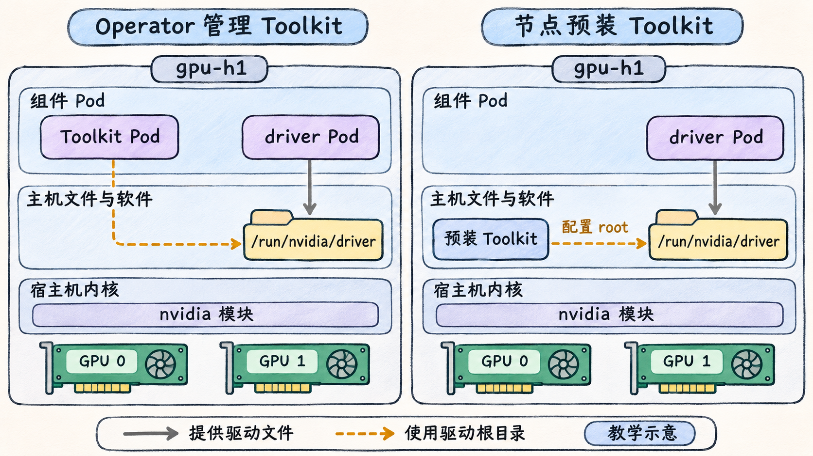

# 预装组件与 NVIDIADriver 的维护责任

在生产集群里，并非所有机器都由 GPU Operator 从零装驱动。追求分钟级冷启动的在线推理池，常把驱动直接打进黄金 OS 镜像。通用训练池或灰度池则偏好由 Operator 托管容器化驱动，甚至要求不同池跑不同版本的驱动分支。

此时两台节点都能跑通 `nvidia-smi`，但表面可用掩盖了一个关键运维问题。**下次升级内核或回滚驱动时，到底该改镜像流水线，还是改 Kubernetes 策略对象？** 要把责任划清，必须吃透全局开关、节点排除、驱动根目录与 `NVIDIADriver` CR。

## 全局组件开关 vs 单节点排除标签

GPU Operator 提供两级粒度控制受管组件——**集群级策略开关**管整体默认行为，**节点级部署标签**管混合池里的例外节点：

- **全池预装驱动（集群级关闭）**：将 Helm 值 `driver.enabled: false` 写入配置，映射为 `ClusterPolicy.spec.driver.enabled: false`。此后 Operator 不再部署 driver DaemonSet。
- **仅部分节点预装驱动（单节点排除）**：保持全局 `driver.enabled: true`，仅在预装驱动节点打上 `nvidia.com/gpu.deploy.driver=false`。该节点跳过 driver Pod，但仍由 Operator 正常部署 Toolkit 与 Device Plugin。
- **整台节点退出 Operator 托管**：打上 `nvidia.com/gpu.deploy.operands=false` 后，Operator 会跳过该节点上全套受管 GPU 组件。不过，NFD 仍按自身配置继续执行硬件发现。

下面对比“全池预装驱动”与“启用驱动 CR 分池管理”两类常见 Helm 配置：

```yaml
# 模式 A：全池宿主机预装驱动，仅由 Operator 托管 Toolkit、Device Plugin 与观测组件
driver:
  enabled: false             # 写入 ClusterPolicy.spec.driver.enabled: false
toolkit:
  enabled: true              # Operator 托管的 Toolkit 自动对接宿主机预装驱动
```

```yaml
# 模式 B：保持 Operator 托管驱动，但交由 NVIDIADriver CR 按节点池分版本管理
driver:
  enabled: true
  nvidiaDriverCRD:
    enabled: true            # 写入 ClusterPolicy.spec.driver.useNvidiaDriverCRD: true
    deployDefaultCR: true    # 设为 false 可让未匹配任何 CR 的节点回退给宿主机维护
```

> [!warning] 常见误区：`driver.enabled: true` 不等于驱动一定来自 driver Pod
> 即使全局开启了驱动托管，driver Pod 的 init 也会自动探测宿主机是否已预装驱动。一旦检出，它会主动写入阻止标签并退让。判断真实驱动来源，须联合核对**策略开关、节点部署标签、driver Pod 落点**与 Validator `driver-ready` 中的 **`IS_HOST_DRIVER` / `NVIDIA_DRIVER_ROOT`**。

## 驱动根目录契约与 Toolkit 运行时接入

把“谁装驱动”和“谁装 Toolkit”拆成两个独立开关，就会组合出四种运维分工。只要关闭任意一项受管开关，对应依赖就由节点镜像团队兜底交付：

| 节点预装情况 | `driver.enabled` | `toolkit.enabled` | 节点维护方必须兜底交付的结果 |
| --- | :---: | :---: | --- |
| 均无预装 | `true` | `true` | 提供受支持的 OS 内核与 containerd，其余全由 Operator 托管 |
| 仅预装驱动 | `false` | `true` | 负责宿主机驱动安装、内核加载与升级；Operator 托管 Toolkit 自动接入 |
| 仅预装 Toolkit | `true` | `false` | 维护预装 Toolkit 与 containerd，并正确指向容器化驱动的文件根目录 |
| 驱动与 Toolkit 均预装 | `false` | `false` | 完整维护驱动与 Toolkit，按要求配置管理容器与业务 Pod 所需的运行时路径 |

其中最容易踩坑的是第三种组合——**“Operator 管驱动 + 节点预装 Toolkit”**。容器化 driver Pod 不会把驱动文件散装到常规系统目录，而是统一提供在节点的 **`/run/nvidia/driver`** 下。

因此，节点预装的 Toolkit 必须在 `/etc/nvidia-container-runtime/config.toml` 中将 `root` 显式指向 `/run/nvidia/driver`。采用原生 CDI 时，也要核对 CDI 规格是否指向真实驱动目录，且配置已加载到 kubelet 所连的 containerd。

当驱动与 Toolkit 均由节点预装时，`v26.7` 文档还要求预先将节点默认 runtime 设为 `nvidia`。



*图 12-05-01：同一两卡节点（图中标为 gpu-h1）在两种 Toolkit 来源下的驱动根目录对照。左右两侧均由 driver Pod 向宿主机内核加载模块并暴露 /run/nvidia/driver；右侧改由宿主机预装 Toolkit 时，节点维护方须显式配置 root 指向该目录。*

验收预装运行时节点时，必须同时覆盖**两类容器**：
1. **GPU 管理容器**（如 Validator、Device Plugin）：在开启 CDI、关闭 NRI 的默认模式下，它们依赖 `NVIDIA_VISIBLE_DEVICES` 与 `runtimeClassName: nvidia`，用来验证 RuntimeClass 到 containerd handler 的映射。
2. **普通整卡业务 Pod**：依赖 Device Plugin 返回的 CDI 引用。`v26.7.2` 开启 CDI 时，Operator 默认把插件 `DEVICE_LIST_STRATEGY` 设为 `cdi-annotations,cdi-cri`（策略可覆盖）。需核对 containerd 生效的 `enable_cdi`、`cdi_spec_dirs` 与规格文件，再用单卡 CUDA Pod 验收。

若平台已提前部署 NFD，可在 Helm 中设 `nfd.enabled: false` 关闭内置 NFD。前提是已有 NFD 既能产出 Operator 识别的 PCI 标签，也能接收 GFD 的 `NodeFeature` 并更新节点标签。

## 用 `NVIDIADriver` CR 治理多版本驱动节点池

假设两个节点池都由 Operator 托管驱动，但稳定生产池需要 `595.91.07`，存量兼容池必须锁在 `580.196.07`。单份 `ClusterPolicy` 只能写一个全局版本，此时就需要引入 **`NVIDIADriver` 自定义资源**。

在 Helm 中设置 `driver.nvidiaDriverCRD.enabled: true` 后，它会映射为 `ClusterPolicy.spec.driver.useNvidiaDriverCRD: true`。

此后，专门的驱动控制器按每份 `NVIDIADriver` CR 分别协调 driver DaemonSet；`ClusterPolicy` 则继续统一管理 Toolkit、Device Plugin 与遥测组件。

以给兼容池打上 `driver.config=compat` 标签为例，其 `NVIDIADriver` 声明如下（稳定池把名称、选择器值与版本换为 `stable` 和 `"595.91.07"` 即可）：

```yaml
apiVersion: nvidia.com/v1alpha1
kind: NVIDIADriver
metadata:
  name: compat                 # 兼容池驱动声明；稳定池可另建 name: stable
spec:
  driverType: gpu              # 驱动类型：标准数据中心 GPU 驱动
  repository: nvcr.io/nvidia
  image: driver
  version: "580.196.07"        # 取自 v26.7 组件矩阵的兼容驱动版本
  nodeSelector:
    driver.config: compat      # 仅匹配带有该节点池标签的 GPU 节点
```

多份 `NVIDIADriver` 共存时，控制器按两条清晰规则裁决节点归属：
- **非默认优先，默认兜底**：控制器先匹配带 `nodeSelector` 的非默认 CR。若新加入的 GPU 节点没有 `driver.config` 标签，chart 默认创建的唯一兜底实例（`spec.default: true`，无选择器）才会接管。如需让未匹配节点归宿主机维护，设 `driver.nvidiaDriverCRD.deployDefaultCR: false`。
- **选择器重叠立即熔断**：若两份非默认 CR 的选择器都写成 `driver.config: stable` 并同时命中同一节点，`v26.7.2` 会把受影响 CR 置为 `notReady` 并报 `ConflictingNodeSelector`。冲突解开前，节点原有的 `nvidia.com/gpu-operator.driver.owner` 归属标签会被保留。

> [!summary] 核心结论
> 厘清混合集群里的维护边界，靠三份证据互相印证：**策略开关与 `NVIDIADriver` CR** 看预期归属，**节点部署/归属标签与 driver DaemonSet** 看调度落点，**Validator 驱动根目录与实载版本**看最终生效结果。

明确每个池由谁装驱动、装哪个版本之后，下一道考验出现在**多操作系统混跑**与**无公网隔离机房**中。下一篇我们顺着镜像仓库与内核包源两条线，把离线与异构节点池的驱动制品链彻底讲透。

> [!info]- 参考资料
> - **预装模式与部署场景**：[NVIDIA 常用部署方式](https://docs.nvidia.com/datacenter/cloud-native/gpu-operator/26.7/getting-started.html#common-deployment-scenarios)、[NVIDIA 预装驱动检测](https://docs.nvidia.com/datacenter/cloud-native/gpu-operator/26.7/getting-started.html#pre-installed-nvidia-gpu-drivers)、[NVIDIA 预装 Toolkit 的配置](https://docs.nvidia.com/datacenter/cloud-native/gpu-operator/26.7/getting-started.html#pre-installed-nvidia-gpu-drivers-and-nvidia-container-toolkit)、[NVIDIA 安装前置条件](https://docs.nvidia.com/datacenter/cloud-native/gpu-operator/26.7/getting-started.html#prerequisites)
> - **CDI 接入与 containerd 配置**：[NVIDIA CDI 支持](https://docs.nvidia.com/datacenter/cloud-native/gpu-operator/26.7/cdi.html)、[NVIDIA 管理容器的运行时要求](https://docs.nvidia.com/datacenter/cloud-native/gpu-operator/26.7/cdi.html#cdi-and-gpu-management-containers)、[containerd v2.3.0 CRI 配置](https://github.com/containerd/containerd/blob/v2.3.0/docs/cri/config.md)、[v26.7.2 插件配置转换](https://github.com/NVIDIA/gpu-operator/blob/v26.7.2/controllers/object_controls.go#L1442)
> - **NVIDIADriver CR 与模板源码**：[NVIDIA 驱动 CR 的配置与分工](https://docs.nvidia.com/datacenter/cloud-native/gpu-operator/26.7/gpu-driver-configuration.html)、[NVIDIA 组件矩阵](https://docs.nvidia.com/datacenter/cloud-native/gpu-operator/26.7/platform-support.html#gpu-operator-component-matrix)、[v26.7.2 ClusterPolicy 模板](https://raw.githubusercontent.com/NVIDIA/gpu-operator/v26.7.2/deployments/gpu-operator/templates/clusterpolicy.yaml)、[ClusterPolicy 驱动 CR 字段映射](https://github.com/NVIDIA/gpu-operator/blob/v26.7.2/deployments/gpu-operator/templates/clusterpolicy.yaml#L151)、[v26.7.2 NVIDIADriver CRD](https://raw.githubusercontent.com/NVIDIA/gpu-operator/v26.7.2/deployments/gpu-operator/crds/nvidia.com_nvidiadrivers.yaml)、[v26.7.2 默认实例模板](https://raw.githubusercontent.com/NVIDIA/gpu-operator/v26.7.2/deployments/gpu-operator/templates/nvidiadriver.yaml)、[节点部署标签源码](https://raw.githubusercontent.com/NVIDIA/gpu-operator/v26.7.2/controllers/state_manager.go)、[GFD v0.20.1 发布逻辑](https://raw.githubusercontent.com/NVIDIA/k8s-device-plugin/v0.20.1/cmd/gpu-feature-discovery/main.go)
