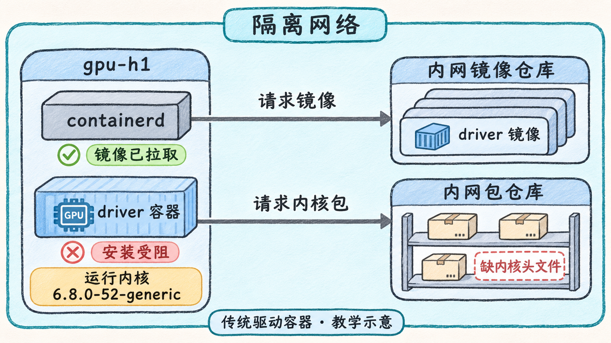

# 离线与异构节点池的部署条件

同一份 GPU Operator 配置可在一台测试机成功，却在新节点上卡在下载或驱动初始化。以 `v26.7.2` 的 Linux Device Plugin 路径为例，评审时分别核对 chart 的来源、节点实际拉取的镜像，以及传统 driver 容器在启动时访问的系统包仓库。镜像名称会受所选组件、驱动模式和节点 OS 影响，软件包还要匹配正在运行的内核。 [NVIDIA 离线安装文档](https://docs.nvidia.com/datacenter/cloud-native/gpu-operator/26.7/install-gpu-operator-air-gapped.html) · [NVIDIA 平台支持矩阵](https://docs.nvidia.com/datacenter/cloud-native/gpu-operator/26.7/platform-support.html)

## 根据最终 Pod 清单判断需要镜像还是内核软件包

**chart 由部署端获取。** 在离线环境中，要让执行 Helm 的一方访问固定版本的 chart，例如随交付物提供打包的 chart，或使用内网可达的 OCI 仓库。渲染 chart 可以列出 Operator、启用的子 chart 和 CR。许多节点组件由 Operator 读 CR 后再生成，镜像清单还要根据实际驱动模式、OS 和生成的工作负载补全。 [GPU Operator 的 Helm 仓库和 OCI chart](https://docs.nvidia.com/datacenter/cloud-native/gpu-operator/26.7/getting-started.html#procedure) · [Helm chart 与依赖](https://helm.sh/docs/topics/charts/)

**节点运行时拉取镜像。** 将 Operator 主容器及 init、NFD、驱动和 driver manager、Toolkit、Device Plugin、GFD、监控、Validator 及测试 Pod 使用的镜像按实际启用项列入清单。组件通常用 `repository`、`image`、`version` 配置地址。需要认证时，按各组件支持的配置或服务账号设置 `imagePullSecrets`，并从目标节点验证仓库、DNS 与证书。即使修改了 Helm 值，也应检查生成的 Pod 中 `containers[]` 与 `initContainers[]` 的实际 `image`。固定标签外，可记录目标仓库的镜像摘要和架构以便复核。驱动的 `version` 在传统模式下是驱动版本，Operator 还会根据平台生成 OS 标签。 [v26.7.2 chart 默认值](https://raw.githubusercontent.com/NVIDIA/gpu-operator/v26.7.2/deployments/gpu-operator/values.yaml) · [NVIDIA 内部镜像仓库配置](https://docs.nvidia.com/datacenter/cloud-native/gpu-operator/26.7/install-gpu-operator-air-gapped.html#local-image-registry) · [Kubernetes 镜像配置](https://v1-36.docs.kubernetes.io/docs/concepts/containers/images/)

**传统 driver 容器启动后可能要安装系统软件包。** 例如 Ubuntu 路径需要能获取与运行内核匹配的 `linux-headers` 等包。离线时可用内网包镜像，将适用发行版的仓库配置放进 Operator 命名空间的 ConfigMap。下方是 `ClusterPolicy` 直接管理传统驱动时的 Helm 值摘录。假定已有名为 `repo-config` 的仓库配置，以及用于私有镜像仓库的 `registry-credentials`。Driver 容器访问包源的凭证和信任配置独立于 Pod 拉镜像所用的 Secret。 [NVIDIA 本地包仓库配置](https://docs.nvidia.com/datacenter/cloud-native/gpu-operator/26.7/install-gpu-operator-air-gapped.html#local-package-repository)

```yaml
driver:
  repository: registry.example.internal/nvidia
  image: driver
  version: "595.91.07"
  imagePullSecrets:
    - registry-credentials
  repoConfig:
    configMapName: repo-config
```

以下是独立的教学变体。两者均假设目标为 Ubuntu 24.04 LTS、x86_64、GPU Operator v26.7.2 的 `gpu-h1`。第一行在容器启动前失败，第二行已进入驱动安装阶段。事件名依照 Kubernetes 定义，软件包和仓库状态是推演输入。 [Kubernetes ImagePullBackOff](https://v1-36.docs.kubernetes.io/docs/concepts/containers/images/#imagepullbackoff) · [NVIDIA 驱动包依赖](https://docs.nvidia.com/datacenter/cloud-native/gpu-operator/26.7/install-gpu-operator-air-gapped.html#local-package-repository)

| 教学观测 | 下一项验证 |
| --- | --- |
| driver Pod 事件先报 `ErrImagePull`，重试进入 `ImagePullBackOff`。 | 比对 Pod 里带 OS 标签的实际镜像地址与内网仓库，结合事件消息检查缺标签、认证、DNS 或证书。 |
| 镜像已拉到，`nvidia-driver-ctr` 的包安装日志显示内网仓库缺目标内核的头文件。假定 `uname -r` 为 `6.8.0-52-generic`。 | 在该容器挂载的包源中查 `linux-headers-6.8.0-52-generic` 及安装所需的其余依赖。仓库即使有别的 6.8 版本，也要对到完整的运行内核版本。 |



**图 12-06-01**　图示为表中第二种故障。Ubuntu 24.04 LTS 节点已成功拉取传统 driver 容器镜像。容器启动后还要从内网包仓库获取与运行内核 `6.8.0-52-generic` 匹配的 `linux-headers-6.8.0-52-generic`。教学场景中该包缺失，驱动安装受阻。

## 预编译驱动把软件包依赖提前到制品构建

预编译驱动容器随镜像带来匹配内核的模块，省去 driver 容器启动时下载编译所需的系统包。直接由 `ClusterPolicy` 管理时，`driver.usePrecompiled: true` 搭配驱动分支，例如 `driver.version: "595"`。按官方的 `<driver-branch>-<linux-kernel-version>-<os-tag>` 规则，上例 Ubuntu 24.04 节点应查找形如 `595-6.8.0-52-generic-ubuntu24.04` 的标签。这个标签是根据教学输入算出的查询目标。实际部署还要核对支持矩阵中的 OS、内核分支、内核变体与驱动分支，并确认目标仓库确有该完整标签和对应架构的镜像，记录其摘要。把运行内核换成另一个补丁版本时，需要重新做这项查找。 [NVIDIA 预编译驱动标签与限制](https://docs.nvidia.com/datacenter/cloud-native/gpu-operator/26.7/precompiled-drivers.html) · [NVIDIA 预编译驱动支持矩阵](https://docs.nvidia.com/datacenter/cloud-native/gpu-operator/26.7/platform-support.html#supported-precompiled-drivers)

## 两个 OS 版本怎样影响驱动 DaemonSet

假定一个池跑 Ubuntu 22.04 LTS，另一个池跑 Ubuntu 24.04 LTS。每个池内只有一种运行内核，两池各有一台符合选择条件的 GPU 节点。现在让同一个 `NVIDIADriver` CR 选中两台节点，使用 `595.91.07` 传统驱动。按 v26.7 的分组规则，传统模式按 CR 和 OS 版本生成 driver DaemonSet，得到 `1 个 CR × 2 种 OS = 2 个 driver DaemonSet`。下表按内核假设和传统镜像命名规则推得。现场可用 `kubectl get ds -n gpu-operator -l app.kubernetes.io/component=nvidia-driver -o yaml` 对照每个 DaemonSet 的节点选择器与实际镜像，再核对各池包仓库。预编译方案还要按内核版本分组。 [NVIDIADriver 的 DaemonSet 分组](https://docs.nvidia.com/datacenter/cloud-native/gpu-operator/26.7/gpu-driver-configuration.html) · [NVIDIA 镜像版本与 OS 标签](https://docs.nvidia.com/datacenter/cloud-native/gpu-operator/26.7/install-gpu-operator-air-gapped.html)

| 同一 CR 覆盖的节点组 | 假定的运行内核 | 预期 driver 镜像标签 | 包源应能提供的头文件软件包 |
| --- | --- | --- | --- |
| Ubuntu 22.04 LTS | `5.15.0-122-generic` | `595.91.07-ubuntu22.04` | `linux-headers-5.15.0-122-generic` |
| Ubuntu 24.04 LTS | `6.8.0-52-generic` | `595.91.07-ubuntu24.04` | `linux-headers-6.8.0-52-generic` |

若由 `ClusterPolicy` 直接配置容器化驱动，NVIDIA 要求运行 GPU 工作负载的节点使用同一 OS 版本。混用 OS 的场景可以选上面的 `NVIDIADriver` 管理方式，也可以按池预装 GPU 驱动，由节点交付流程验证每个池的版本与内核。CPU-only 节点可使用独立的 OS。 [NVIDIA 安装前置条件](https://docs.nvidia.com/datacenter/cloud-native/gpu-operator/26.7/getting-started.html#prerequisites)

## 兼容性以节点池为单位核对

以新节点 `gpu-h1` 的候选配置为例。版本取自本章教学环境和 v26.7.2 组件矩阵，CUDA 镜像选用官方 VectorAdd 示例。Ubuntu 24.04 是节点 OS，验证容器镜像名称中的 `ubuntu22.04` 是镜像的用户态环境。评审两者时，一个要核对节点内核和驱动容器，另一个要核对 CUDA 运行要求与应用的实际执行结果。 [NVIDIA 平台与组件矩阵](https://docs.nvidia.com/datacenter/cloud-native/gpu-operator/26.7/platform-support.html) · [NVIDIA CUDA 兼容性说明](https://docs.nvidia.com/deploy/cuda-compatibility/) · [NVIDIA CUDA VectorAdd 示例](https://docs.nvidia.com/datacenter/cloud-native/gpu-operator/26.7/getting-started.html#cuda-vectoradd)

| 层 | 候选配置 | 现场取证 |
| --- | --- | --- |
| 硬件与 OS | H100 PCIe、x86_64、Ubuntu 24.04 LTS，内核按节点为准 | 核对卡型与架构、`/etc/os-release`、`uname -r` 和对应驱动模式的支持条件。 |
| Kubernetes 与运行时 | Kubernetes v1.36、containerd 2.3、启用 CDI | 核对版本、CRI 运行时的实际配置和 CDI 规格。 |
| 驱动与注入组件 | 默认驱动 `595.91.07`（R595），Toolkit `1.20.1`，Device Plugin 与 GFD `0.20.1` | 对照 chart、CR、实际镜像与摘要、节点加载的驱动版本及插件注册结果。 |
| CUDA 验证镜像 | `nvcr.io/nvidia/k8s/cuda-sample:vectoradd-cuda12.5.0-ubuntu22.04` | 在目标节点取得 GPU 资源、完成容器注入后，核对测试输出和退出码。 |

支持矩阵用于筛选候选组合。节点交付时把所选版本、目标仓库制品、包源和验证结果记在同一份记录里，后续变更内核或驱动时才能从同一基线重新判断。
