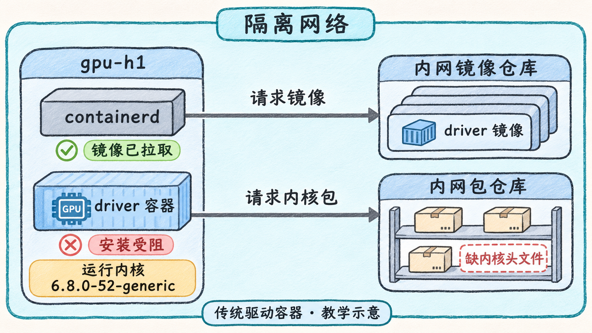

# 离线制品与异构节点池的驱动部署

在无公网访问的私有集群里，运维团队把整套 GPU Operator 镜像同步进了内网仓库，也亲眼看到节点顺利拉下了 driver 镜像。可 driver Pod 偏偏还是启动失败。

原因在于，容器化驱动落地包含**两个独立的交付条件**。先由容器运行时拉下镜像，再把与当前运行内核完全匹配的驱动模块编译或加载进内核。摸清这两段依赖，就能把异构 OS、内网包源与预编译镜像串成一张完整的离线清单。

## 异构 OS 节点池如何生成 driver DaemonSet

把上一篇的“同 OS 不同版本”换成“同版本不同 OS”。假设两台 x86_64 GPU 节点分别运行 Ubuntu 22.04 LTS 与 Ubuntu 24.04 LTS，由同一份 `NVIDIADriver` CR 统一交付 `595.91.07` 传统驱动。

传统驱动容器在节点启动时为当前内核现场准备模块，其镜像按 OS 发行版区分。按 `v26.7` 的分组规则，传统模式下每份驱动 CR 会为**每种匹配的 OS 版本**各生成一个 driver DaemonSet：

$$\text{传统模式 driver DaemonSet 数量} = 1\text{ 个 } \texttt{NVIDIADriver CR} \times 2\text{ 种 OS 版本} = 2\text{ 个}$$

对照两台节点的 OS 与运行内核，可直接推导出它们各自拉取的镜像标签与编译所需的内核头文件包：

| 同一 CR 覆盖的节点与 OS | 运行内核（`uname -r`） | 传统模式派生镜像标签 | 内网包源须提供的头文件包 |
| --- | --- | --- | --- |
| `gpu-h0`（Ubuntu 22.04 LTS） | `5.15.0-122-generic` | `595.91.07-ubuntu22.04` | `linux-headers-5.15.0-122-generic` |
| `gpu-h1`（Ubuntu 24.04 LTS） | `6.8.0-52-generic` | `595.91.07-ubuntu24.04` | `linux-headers-6.8.0-52-generic` |

如果 Ubuntu 24.04 节点池再加入一台内核补丁号不同的机器，传统模式**仍共用同一个 OS 级 DaemonSet**。每台节点上的 driver 容器启动后，各自按 `uname -r` 拉取对应头文件。而预编译模式则还要进一步按内核版本拆分组。

> [!note] 异构 OS 的托管前提
> 若直接由 `ClusterPolicy` 托管容器化驱动而不启用 `NVIDIADriver` CR，NVIDIA 要求所有 GPU worker 保持**同一 OS 版本**（CPU 节点可不同）。混跑多 OS 时，应启用驱动 CR 或按池走宿主机预装。

## 隔离网络的三条制品通路与双阶段排障

把集群放进离线机房，最容易漏掉的不是单个镜像，而是**三个发起方各自访问不同的内网仓库与认证体系**：

| 请求发起方 | 拉取的离线制品 | 交付前核对动作 |
| --- | --- | --- |
| **Helm 部署端** | 固定版本的 GPU Operator chart 及子 chart 依赖 | 验证本地 tgz 包或内网 chart 仓库，先 `helm template` 检查控制器与 CR 初始清单 |
| **节点容器运行时（containerd）** | 控制器、组件 DaemonSet、init 容器与验证 Pod 所需全部镜像 | 合并 chart 清单与 Operator 实际生成的 Pod 清单（含 `initContainers[]`），逐项核对内网仓库地址、架构、标签与摘要 |
| **已启动的传统 driver 容器** | 与节点 `uname -r` 精确匹配的内核头文件及编译依赖包 | 校验内网 apt/yum 包源是否包含目标内核头文件及依赖链，并通过容器日志核对下载、编译与模块加载进度 |

在 `ClusterPolicy` 管理的同型集群中，离线镜像地址、拉取凭证与内网包源通过 Helm 值注入（若改用 `NVIDIADriver` CR，则在对应 CR 中核对；其余组件与验证镜像同理需指向内网仓库）：

```yaml
# Helm values.yaml：隔离网络下传统驱动的镜像仓库与内网包源配置
driver:
  repository: registry.example.internal/nvidia   # 内网镜像仓库前缀（覆盖默认 nvcr.io/nvidia）
  image: driver
  version: "595.91.07"                           # 控制器按节点 OS 自动拼接 -ubuntu24.04 等后缀
  imagePullSecrets:
    - registry-credentials                       # 私有镜像仓库拉取凭证 Secret（也可绑到 ServiceAccount）
  repoConfig:
    configMapName: repo-config                   # 挂载内网 apt/yum 包源与信任配置的 ConfigMap
```

看清这两步请求后，离线 driver Pod 故障即可一刀切开：
1. **卡在启动前（`ErrImagePull` / `ImagePullBackOff`）**：问题出在第一段镜像通道。containerd 无法连接内网仓库、认证失败或完整标签缺失，直接看 Pod 事件里的完整镜像地址即可定位。
2. **镜像已拉通，容器日志报缺包**：问题出在第二段内网包源。传统 driver 容器找不到精确匹配的 `linux-headers-6.8.0-52-generic`。包源里存着其他 `6.8` 头文件也无法替代这一精确依赖。



*图 12-06-01：隔离网络下传统驱动容器的两次独立依赖请求。图中节点（标为 gpu-h1）的 containerd 已成功拉取驱动镜像，但运行中的 driver 容器向内网包仓库请求 6.8.0-52-generic 头文件失败，导致模块编译受阻。*

## 预编译驱动镜像：省掉内网包源，但锁死内核标签

维护内网包源并现场编译驱动，既增加链路复杂度，又拖慢推理扩容或故障替换时的节点就绪速度。如果想**跳过头文件下载与现场编译**，可以改用**预编译驱动容器**，直接把编译好的内核模块打进镜像。

在 `ClusterPolicy` 中启用预编译模式，需设置 `driver.usePrecompiled: true`，并将 `driver.version` 写为驱动分支号（如 `"595"`）。官方标签遵循固定命名规则：

$$\texttt{<driver-branch>-<linux-kernel-version>-<os-tag>}$$

这样一来，原本的运行期包依赖前移成了**精确到内核构建号的镜像标签依赖**：
- 运行内核 `6.8.0-52-generic` 时，R595 查询目标为 `595-6.8.0-52-generic-ubuntu24.04`。
- 一旦内核升到 `6.8.0-53-generic`，查询目标立刻变为 `595-6.8.0-53-generic-ubuntu24.04`。内网仓库中原有的 `-52-generic` 镜像已无法满足新内核。

> [!warning] 常见误区：按规则拼出标签不代表仓库一定有货
> 上述公式只是推导出的查询目标。切换前必须先对照 `v26.7` 预编译支持矩阵（如 Ubuntu 24.04 的 6.8 generic 与 R595），再核实内网镜像仓库中存在该完整标签、目标架构与摘要。

## 支持矩阵核对与节点池验收建档

无论选用传统编译还是预编译模式，节点池上线前都应固化一份可回溯的验收基线：
1. **核对平台矩阵**：确认硬件（H100 PCIe）、OS 与内核（x86_64 Ubuntu 24.04 LTS、`uname -r`）、Kubernetes `v1.36` 及 containerd `2.3.0` 全部落在所选模式的支持范围内。
2. **登记受管镜像**：记录策略对象及实际加载的驱动 `595.91.07`、Toolkit `1.20.1`、Device Plugin 与 GFD `0.20.1` 的镜像与状态。
3. **跑通单卡验收**：用第 03 篇的普通 VectorAdd Pod 验证调度、分配、注入与 CUDA 计算。镜像名里的 `ubuntu22.04` 仅指容器用户态，进程仍运行在 Ubuntu 24.04 宿主机内核上。

> [!summary] 核心结论
> 传统驱动容器是**“按 OS 选镜像 + 启动按精确 `uname -r` 拉头文件”**。预编译驱动容器是**“去掉内网包源，把精确内核号锁进镜像标签”**。离线集群须把内核升级节奏与制品库同步绑定规划。

到此，基于 `ClusterPolicy` 与 Device Plugin 的整套交付链（含预装、多版本、异构与离线变体）已全部打通。集群转向下一代 DRA 路径时，GPU Operator 的管理对象与验收抓手有何变化？下一篇我们展开 `GPUCluster` 托管 DRA。

> [!info]- 参考资料
> - **异构分组、预装前置与支持矩阵**：[NVIDIA 驱动 CR 的 DaemonSet 分组规则](https://docs.nvidia.com/datacenter/cloud-native/gpu-operator/26.7/gpu-driver-configuration.html)、[NVIDIA 安装前置条件](https://docs.nvidia.com/datacenter/cloud-native/gpu-operator/26.7/getting-started.html#prerequisites)、[NVIDIA v26.7 平台与组件矩阵](https://docs.nvidia.com/datacenter/cloud-native/gpu-operator/26.7/platform-support.html)、[NVIDIA CUDA 兼容性](https://docs.nvidia.com/deploy/cuda-compatibility/)、[NVIDIA VectorAdd 镜像](https://docs.nvidia.com/datacenter/cloud-native/gpu-operator/26.7/getting-started.html#cuda-vectoradd)
> - **隔离网络镜像与包源配置**：[NVIDIA 镜像版本与 OS 标签](https://docs.nvidia.com/datacenter/cloud-native/gpu-operator/26.7/install-gpu-operator-air-gapped.html)、[NVIDIA 离线包依赖](https://docs.nvidia.com/datacenter/cloud-native/gpu-operator/26.7/install-gpu-operator-air-gapped.html#local-package-repository)、[v26.7.2 chart 默认值](https://raw.githubusercontent.com/NVIDIA/gpu-operator/v26.7.2/deployments/gpu-operator/values.yaml)、[Kubernetes 容器镜像](https://v1-36.docs.kubernetes.io/docs/concepts/containers/images/)、[Kubernetes ImagePullBackOff](https://v1-36.docs.kubernetes.io/docs/concepts/containers/images/#imagepullbackoff)
> - **预编译驱动与支持限制**：[NVIDIA 预编译镜像标签](https://docs.nvidia.com/datacenter/cloud-native/gpu-operator/26.7/precompiled-drivers.html)、[NVIDIA v26.7 预编译驱动矩阵](https://docs.nvidia.com/datacenter/cloud-native/gpu-operator/26.7/platform-support.html#supported-precompiled-drivers)、[预编译驱动的限制](https://docs.nvidia.com/datacenter/cloud-native/gpu-operator/26.7/precompiled-drivers.html#limitations-and-restrictions)
