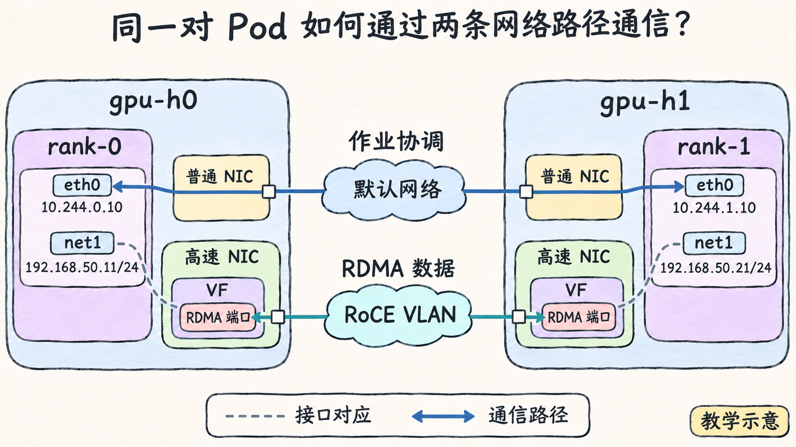

两台服务器各运行一个训练进程。进程已经通过集群 DNS 找到协调服务，完成了 Rendezvous，也就是加入同一次作业并确认参与者。接下来两端需要交换计算结果。假定服务器还有一组专用于高速通信的网口，怎样让 Pod 使用这些网口，同时保留原有的 Service 访问路径？ [Kubernetes v1.36 网络模型](https://v1-36.docs.kubernetes.io/docs/concepts/services-networking/) · [Multus 多接口示例](https://github.com/k8snetworkplumbingwg/multus-cni/blob/master/docs/how-to-use.md)

## 默认网络与附加网络的分工

Pod 的网络命名空间是一套独立的 Linux 接口、地址与路由视图。同一 Pod 的容器共享这套视图。普通 Pod 启动时，节点运行时通过 **CNI（Container Network Interface，容器网络接口）** 的约定调用网络插件。默认网络插件建立主接口，本例名为 `eth0`，并负责将 Pod 接入集群的普通通信网络。 [Kubernetes v1.36 Pod 的网络共享](https://v1-36.docs.kubernetes.io/docs/concepts/workloads/pods/) · [CNI 规范](https://www.cni.dev/docs/spec/)

**Multus** 是组织多个网络接入的 CNI 插件。部署后，运行时把一次 Pod 的网络请求交给 Multus，Multus 继续调用原有插件建立默认网络，并按 Pod 声明调用其他插件接入附加网络。最小变化是给同一个 Pod 再接一张接口，例如 `net1`。在本例中，专用物理网口连接独立的交换网络，附加接口给进程提供一个可选的数据入口。哪些连接使用它，由目的地址、路由和应用选择共同决定。 [Multus 的定位与多接口示例](https://github.com/k8snetworkplumbingwg/multus-cni/blob/master/docs/how-to-use.md)

这里的高速网络承载 **RoCE（RDMA over Converged Ethernet）**。第 06 章将 **RDMA（Remote Direct Memory Access，远程直接内存访问）** 解释为由网卡执行的缓冲区传输。应用先把缓冲区注册给 RDMA 设备并建立通信所需的状态，网卡才能按请求搬运数据。第 07 章介绍的 RoCEv2 将 RDMA 报文承载在 UDP/IP 上。对 Pod 来说，接入这条路径既需要网络地址与可达性，也需要进程能使用与该地址关联的 RDMA 设备和端口。 [NVIDIA DOCA 3.5.0 的 RoCE 与 GID 说明](https://networking-docs.nvidia.com/doca/archive/3-5-0/rdma-over-converged-ethernet)

## 两个 Pod 的接口、地址与物理路径

沿用第 12 章的 `gpu-h0` 和 `gpu-h1`。两台节点上各放一个 Pod，每个 Pod 运行一个训练成员（Rank）。本章教学拓扑包含普通和高速两类网卡（Network Interface Card，NIC）。普通网口承载默认 Pod 网络，高速端口接入同一虚拟局域网（VLAN）。本例给各 Pod 分配网卡提供的一个虚拟功能（Virtual Function，VF），用它的 Linux 网络接口作 `net1`。在这套配置中，同一个 VF 提供彼此关联的网络接口和 RDMA 设备。 [NVIDIA Network Operator v26.7.1 的 SR-IOV RDMA 示例](https://docs.nvidia.com/networking/display/kubernetes2671/quick-start/sriov-network-rdma.html)

| 位置 | 默认网络 `eth0` | RoCE 附加网络 `net1` |
| --- | --- | --- |
| `gpu-h0` 上的 `default/rank-0` | `10.244.0.10` | `192.168.50.11/24` |
| `gpu-h1` 上的 `default/rank-1` | `10.244.1.10` | `192.168.50.21/24` |

*图 13-01-01　双节点教学拓扑。协调服务使用默认网络，本例的 RDMA 数据使用与 `net1` 对应的 VF 端口。图只画出每台节点本次使用的一张高速网卡，双向箭头表示可建立双向通信。*

## 从对端地址和应用传输方式推导流量

设 `rank-0` 保留默认插件的路由，且到 `10.244.1.10` 的有效出口是 `eth0`。如果通信程序只获得对端的默认 Pod IP，并把它交给 TCP Socket，连接就沿 `eth0` 进入默认网络。若程序把同一个 Socket 的目的地址换成 `192.168.50.21`，则命中 `192.168.50.0/24` 的直连路由，连接从 `net1` 发出，传输仍使用 TCP。假如改用 RoCE，应用还要打开与 `net1` 关联的 RDMA 设备和端口，以适合该网络的参数连接对端，并提交 RDMA 请求。可以用关联接口与全局标识符（Global Identifier，GID）检查 RoCE 端点选择。 [Linux 路由查询](https://man7.org/linux/man-pages/man8/ip-route.8.html) · [NVIDIA DOCA 3.5.0 的 RoCE 端口与 GID 映射](https://networking-docs.nvidia.com/doca/archive/3-5-0/rdma-over-converged-ethernet)

| 给定条件 | 能推出的路径 |
| --- | --- |
| 目标 `10.244.1.10`，路由出口 `eth0`，应用使用 TCP | 默认网络上的 TCP 连接。 |
| 目标 `192.168.50.21`，路由出口 `net1`，应用使用 TCP | RoCE fabric 所在以太网上的 TCP 连接。 |
| 两端应用使用与 `net1` 对应的 RDMA 端口，以该网络的地址完成 RDMA 建连和传输 | 指定 VF 端口之间的 RDMA 数据路径。 |

实际核对时，先从 `.status.podIP` 和 Multus 的 `k8s.v1.cni.cncf.io/network-status` 分别取得主网络与附加网络地址，再和进程日志里的目标、传输方式及设备选择对照。若集群 DNS 和 Rendezvous 仍使用主网络，只配置一个 `net1` 就能保留原来的协调路径。为了让应用有可用的第二套地址，接下来要看 Multus 如何把 Pod 的网络声明交给实际配置接口的插件。 [Multus 网络状态与附加接口示例](https://github.com/k8snetworkplumbingwg/multus-cni/blob/master/docs/how-to-use.md) · [NVIDIA v26.7.1 双节点验证](https://docs.nvidia.com/networking/display/kubernetes2671/quick-start/sriov-network-rdma.html)
