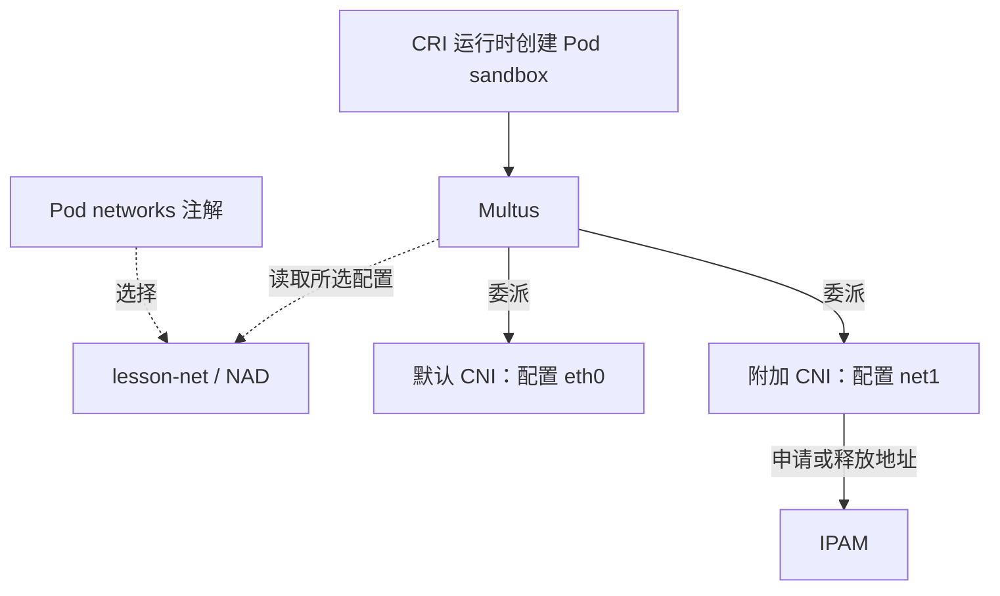
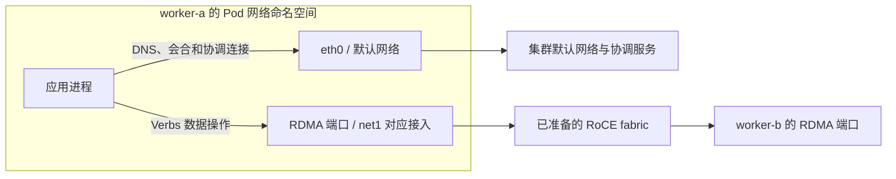
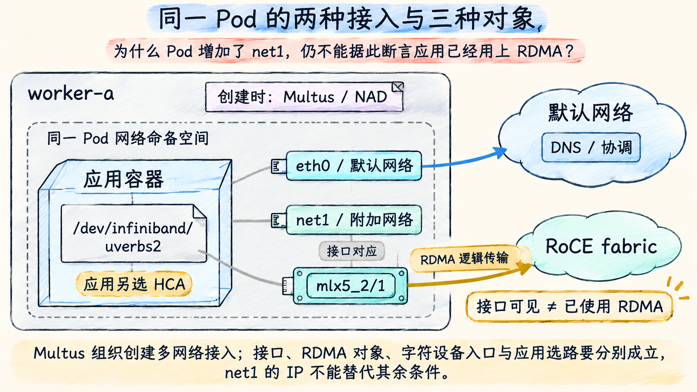

# 从一个 Pod 的两张网开始

## 默认网络已经解决了什么

一个训练进程需要先找到其他成员，再交换张量。前者涉及 DNS、会合服务和控制连接，后者可能持续占用高速 NIC。两类流量可以共用一套网络，也可以分开。本章选择默认 Pod 网络承载 DNS、Service 和作业协调，附加 RoCE 网络承载高吞吐数据；这是教学部署选择，不是 Kubernetes 强制规定的流量分类。

默认网络由集群 CNI 实现，给 Pod 提供 `eth0` 和符合 Kubernetes 网络模型的连通性。**附加网络**是在同一个 Pod 网络命名空间内增加另一条接口接入，如 `net1`。同一 Pod 的普通容器共用这些接口和路由；不能因为在某个 container 的 resources 中请求了 NIC，就认为 `net1` 仅属于该 container。

本章仍让 `status.podIP` 指向默认网络地址。附加地址记录在 Multus 的 `k8s.v1.cni.cncf.io/network-status` 注解中，不能以 `kubectl get pods -o wide` 只列一个 IP 为由判定 `net1` 不存在。默认网络与 Pod IP 的选择规则见 [Multus v4.1.0 usage guide](https://github.com/k8snetworkplumbingwg/multus-cni/blob/v4.1.0/docs/how-to-use.md) 的 “Which network will be used for Pod IP?”。

## Multus 组织接入，具体插件改变接口

**CNI** 是运行时创建网络时调用插件的接口规范。Multus 是元插件：接到创建请求后，委派默认 CNI 及被选中的附加 CNI。它不实现 RoCE 协议，也不因为名称里有“多网络”就代替交换机转发数据。

**NetworkAttachmentDefinition（NAD）** 是有命名空间的 Kubernetes 自定义资源，用 `spec.config` 保存供插件消费的 CNI JSON。Pod 用 `k8s.v1.cni.cncf.io/networks` 注解选择 NAD。这里先看下面的**自拟选择片段**；`roce-shared` 的完整定义在下一篇给出：

```yaml
metadata:
  name: worker-a
  namespace: lesson-net
  annotations:
    k8s.v1.cni.cncf.io/networks: '[{"name":"roce-shared","namespace":"lesson-net","interface":"net1"}]'
```

`name` 与 `namespace` 找到 NAD；`interface` 是本次在 Pod 中希望使用的接口名，不是宿主机 PF 名，也不是 RDMA 设备名。若省略 NAD 的 namespace，通常引用 Pod 所在命名空间；本章显式给出，避免跨空间同名对象混淆。实际是否允许跨空间引用还受 Multus 的 `namespaceIsolation` 等配置和平台准入约束，不能把 namespace 字段当成访问许可。

下面箭头表达创建时调用与读取，不表示通信数据经过这些组件：



实线是调用，虚线是对象选择/读取；默认 CNI 和附加 CNI 的插件配置各自定义行为。薄插件与 thick daemon 的部署形态不改变这里的责任分工。Multus 的集群网络委派、日志与命名空间选项可查 [Configuration Reference](https://github.com/k8snetworkplumbingwg/multus-cni/blob/v4.1.0/docs/configuration.md)。

NAD 创建成功只是 API 接受了这个对象。插件二进制可能未安装，`master` 也可能写错；调度器不会仅因 NAD 存在就校验节点具有该接口。下一篇会增加资源请求，但资源数量仍不能替代网络配置检查。

## netdev、RDMA 设备与设备文件是三种对象

Linux 的 Ethernet **netdev** 是 `ip link` 看到的接口。RDMA **设备对象**是 `rdma link`、Verbs 等看到的 HCA 及端口。`/dev/infiniband/uverbsN` 等**字符设备文件**是用户态进入内核 RDMA 接口的访问入口。它们相关，却不是三个可互换的名字。

| 本章对象 | 例子 | 用于回答的问题 |
| --- | --- | --- |
| 节点上的 PCI function | `net-a / 0000:41:00.2` | 分配的是哪一个硬件 function |
| Pod 内的 netdev | `net1` | 本网络命名空间有哪些 IP 接口与路由 |
| RDMA 设备与端口 | `mlx5_2/1` | 哪个 Verbs 设备端口能被发现和使用 |
| 字符设备入口 | `/dev/infiniband/uverbs2` | 容器是否具备所需的文件和设备访问权限 |
| 应用选择 | HCA、端口、地址/GID、传输插件 | 本次通信实际使用了什么路径 |

表中 VF 对象来自场景 V；后面的示例会明确写出映射。`uverbs2` 与 `mlx5_2` 只是本轮给定的枚举关系，不能凭数字相同推广规则。一个多端口或不同驱动配置还可能产生不同对象关系，必须读取实际映射。

因此，“`net1` 有 IP”只能进入 IP 连通性检查；“有 `/dev/infiniband`”也只说明出现了入口，之后仍要检查命名空间、权限、用户态 provider、注册内存和通信结果。RDMA 命名空间模式在第 03 篇解释。

## 应用使用网络时 Multus 已不在数据路径中

下面是本章选定的逻辑数据关系；默认网络内部的 overlay、交换机等均聚合，不表达真实布线：



这里把 netdev 与相关 RDMA 端口放在同一接入节点中作概念聚合，**不表示 Verbs 数据逐包穿过 net1 的 Linux Socket 栈**。RDMA 用户态提交与 NIC 数据搬运沿第 06 章的路径工作。CNI 创建时配置的地址、设备和命名空间，为这个路径提供运行条件。

默认网络通而附加网络不通，成员可能完成会合后卡在 RDMA 建链；附加网络通而默认 DNS 不通，作业也可能在成员发现阶段失败。给 Pod 增加 `net1` 不会自动改写应用的 HCA 选择，必须在第 06 篇用应用日志和测试结果闭合证据。



**图 fig-13-01-01** 同一 Pod 可以同时接入默认网络与附加网络。图中的 net1、RDMA 端口和字符设备入口分别承担不同职责；Multus 在创建时组织接入，运行时是否使用 RDMA 仍由可用条件与应用选择共同决定。箭头为逻辑通信示意，非物理接线。琥珀箭头从 RDMA 端口引出，灰线仅表示接口对应；图中未给出实际测试通过结果。

[返回导读](00_导读.md) · [下一篇：共享 HCA 时到底分配了什么](02_共享HCA时到底分配了什么.md)
