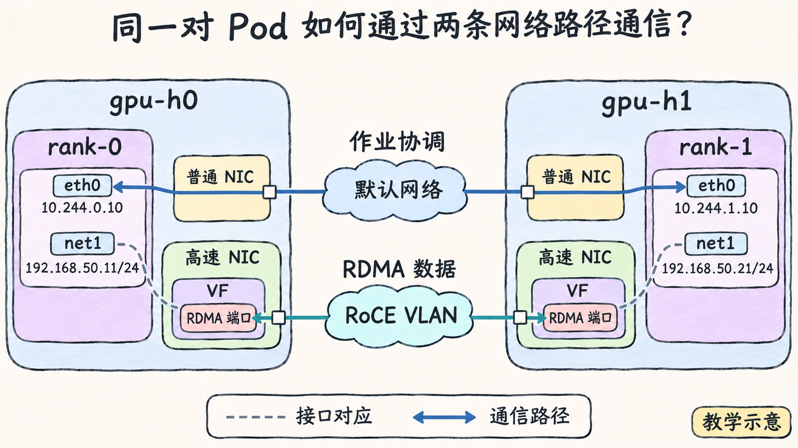

# 同一个 Pod 为什么需要两张网卡

两个训练进程能通过 Kubernetes Service 找到彼此，通信库却可能把数据也发到默认网络。要判断数据走哪条路，先问清三件事：进程拿到了哪个对端地址，选的是 Socket 还是 RDMA，以及一次实际连接使用了哪个接口或 RDMA 端口。

## SR-IOV 基础

一张高速网卡接入集群后，同一台节点上的多个 Pod 可能都需要使用它。**SR-IOV（Single Root I/O Virtualization，单根 I/O 虚拟化）** 是一项 PCIe 设备能力。支持它的网卡启用 SR-IOV 后，可以提供多个由操作系统独立枚举、由平台分别分配的设备功能。理解它需要分清主机看到的 PCI 功能、Pod 看到的网卡接口，以及机箱外接网线的物理端口。 [Linux 内核的 PCIe SR-IOV 说明](https://docs.kernel.org/PCI/pci-iov-howto.html#what-is-sr-iov)

### PF、VF 和 Pod 内接口

| 对象                         | 本章如何使用                                                                                                          |
| -------------------------- | --------------------------------------------------------------------------------------------------------------- |
| 物理功能（Physical Function，PF） | 主机用 PF 管理网卡，包括启用 VF 和配置网卡支持的 VF 属性。本章每个高速端口各对应一个 PF，`ens2f0` 和 `ens3f0` 是这两个 PF 对应的主机网络接口名。                     |
| 虚拟功能（Virtual Function，VF）  | 每个 VF 只属于一个 PF。启用后，Linux 会把它枚举成一个 PCI 功能，它有自己的 PCI 地址和配置空间。驱动可以操作这个 VF，平台也可以把它独立分配给使用方。                         |
| Pod 内接口 `net1`             | VF 绑定 Linux 网卡驱动后，驱动为它提供网络接口。CNI 把已分配 VF 的接口接入 Pod 的网络命名空间，命名为 `net1`，并为它配置地址。PCI 地址用于识别设备，接口名用于在对应网络命名空间内操作网卡。 |
| 物理端口                       | 网卡实际连向交换机的端口。同一 PF 下的 VF 可有各自的接口和 MAC 地址，外发流量仍经过同一物理端口并共享链路带宽。                                                  |

是否能启用 VF、能启用多少，以及可以对 VF 设置哪些属性，取决于网卡能力、平台配置和驱动。给 Pod 分配一个 VF 后，是否能用它做 RDMA，还取决于该 VF 的 RDMA 能力、Pod 中的设备访问条件和应用选择的传输方式。 [Linux 内核的 VF 启用与驱动说明](https://docs.kernel.org/PCI/pci-iov-howto.html#user-guide) · [SR-IOV CNI 的 PF、VF 与接口配置](https://github.com/k8snetworkplumbingwg/sriov-cni) · [SR-IOV Device Plugin 的 RDMA 资源说明](https://github.com/k8snetworkplumbingwg/sriov-network-device-plugin)

### 用两个 PF 核对 VF 数量和归属

沿用本章教学场景，在同一台主机的两个 PF 上各启用 4 个 VF，主机就能枚举出 `4 + 4 = 8` 个 VF。每个 PF 的索引都从 0 开始，所以两个 PF 各自的 VF 0 是不同的 PCI 设备。已启用的数量描述主机上的设备，Kubernetes 的可分配数量还取决于设备插件筛选出的资源池和设备健康状态。 [Linux PCI sysfs 接口](https://www.kernel.org/doc/Documentation/ABI/testing/sysfs-bus-pci) · [Kubernetes Device Plugin 的设备上报](https://v1-36.docs.kubernetes.io/docs/concepts/extend-kubernetes/compute-storage-net/device-plugins/)

在已启用 VF 的 Linux 主机上，可以通过下面的只读命令核对这个例子。`sriov_totalvfs` 是内核当前报告的启用上限，`sriov_numvfs` 是已启用数量。按本例配置，后者在两个 PF 上都应为 4。PF 的 `virtfn0` 指向该 PF 下索引为 0 的 VF，VF 的 `physfn` 则反向指回所属 PF。 [Linux PCI sysfs 字段和符号链接定义](https://www.kernel.org/doc/Documentation/ABI/testing/sysfs-bus-pci)

```sh
cat /sys/class/net/ens2f0/device/sriov_totalvfs
cat /sys/class/net/ens2f0/device/sriov_numvfs
cat /sys/class/net/ens3f0/device/sriov_numvfs

vf_path=$(readlink -f /sys/class/net/ens2f0/device/virtfn0)
printf '%s\n' "$vf_path"
readlink -f "$vf_path/physfn"
```

两条路径的最后一级分别是这个 VF 和它所属 PF 的 PCI 地址，形如 `0000:41:00.2`，由域、总线、设备和功能编号组成。`virtfn0` 中的 `0` 是 VF 在所属 PF 内的索引。用 PCI 地址关联主机上的设备记录，接入 Pod 后再用接口名查看地址和路由。 [Linux PCI sysfs 中的 VF 与 PF 映射](https://www.kernel.org/doc/Documentation/ABI/testing/sysfs-bus-pci)

## 两个网络各有一组地址

假设 `gpu-h0` 和 `gpu-h1` 各运行一个 Pod。每台节点有两张 H100 PCIe 和两张 ConnectX-7 NIC，每个 NUMA 节点各有一张 GPU 和一张高速 NIC。默认 Pod 网络走单独的普通网口，Pod 中的 `eth0` 由默认 CNI 配置。每台节点的两个高速端口都接入以太网 RoCE fabric。下图只画出每个 Pod 本次分配所用的高速 NIC。 [Kubernetes 网络模型](https://v1-36.docs.kubernetes.io/docs/concepts/services-networking/) · [Multus 多接口示例](https://github.com/k8snetworkplumbingwg/multus-cni/blob/master/docs/how-to-use.md)

本例在两台节点上各将一个 VF 的网络接口交给 Pod，命名为 `net1`。每个 Pod 的 `eth0` 和 `net1` 都在同一个 Pod 网络命名空间内，两台节点的 `net1` 接入同一个 VLAN。硬件拓扑和下表地址均为教学设定。 [NVIDIA SR-IOV RDMA 示例](https://docs.nvidia.com/networking/display/kubernetes2671/quick-start/sriov-network-rdma.html)

| 节点与 Pod | 默认网络 `eth0` | RoCE 附加网络 `net1` |
| --- | --- | --- |
| `gpu-h0` 上的 `rank-0` | `10.244.0.10` | `192.168.50.11/24` |
| `gpu-h1` 上的 `rank-1` | `10.244.1.10` | `192.168.50.21/24` |

本例让 `eth0` 保留默认路由和集群 DNS。集群 DNS 查询以及进程加入作业时的 Rendezvous 连接经默认网络。这个安排来自应用连接的地址和 Pod 的路由。若应用将协调服务明确绑定在附加网络上，协调流量也可以走附加网络。建立成员关系后，通信库还要各自建立数据连接，选择数据传输方式。



*图 13-01-01　本例的作业协调经 `eth0` 和默认网络，RDMA 测试使用与 `net1` 对应的 VF RDMA 端口。灰虚线表示接口与 VF 的对应关系。*

## 用目的地址和传输方式推导路径

在 `rank-0` 内，对 `10.244.1.10` 发起普通 IP 连接时，假定有效路由经 `eth0`。改为向 `192.168.50.21` 发起连接时，`192.168.50.0/24` 的直连路由会指向 `net1`。此时如果应用使用 TCP Socket，流量可以走附加网络，传输语义仍是 TCP。若通信库使用 RoCE，还要确认它选定了 `net1` 所关联的 RDMA 设备与端口，并在该路径上和对端建立 RDMA 连接。RoCE 的 netdev、设备端口和 GID 的映射可用于核对这一步。 [Multus 附加网络与路由](https://github.com/k8snetworkplumbingwg/multus-cni/blob/master/docs/how-to-use.md#specifying-a-default-route-for-a-specific-attachment) · [NVIDIA RoCE 设备与 GID 映射](https://networking-docs.nvidia.com/doca/archive/3-5-0/rdma-over-converged-ethernet)

| 进程的实际选择 | 还要核对的证据 | 本例可作出的判断 |
| --- | --- | --- |
| 只拿到对端的默认 Pod IP，并用它建 Socket 连接 | `ip route get` 显示出口 `eth0` | 该连接经过默认网络。不能用它判断附加网的状态。 |
| 拿到 `192.168.50.21`，用 TCP Socket | `ip route get` 显示 `net1`，应用记录为 TCP | 该连接经过附加网络，以 Socket 方式传输。 |
| 拿到附加 IP，应用用 RoCE | 两端 RDMA 设备、端口和其对应接口匹配，指定端口的 RDMA 传输完成 | 该次试验走的是已核对的 RDMA 路径。 |

现场可从 Pod 的 `.status.podIP` 读取默认 Pod IP，从 `k8s.v1.cni.cncf.io/network-status` 中按 `name` 或 `interface` 取附加网络的 `ips`，再与进程实际连接的对端地址比较。多接口同时存在只能说明 Pod 有多个网络入口。要验收数据路径，还要对照应用选择和两端实际使用的设备。 [Multus 状态定义](https://github.com/k8snetworkplumbingwg/network-attachment-definition-client/blob/master/pkg/apis/k8s.cni.cncf.io/v1/types.go) · [NVIDIA 的双节点 VF 验证流程](https://docs.nvidia.com/networking/display/kubernetes2671/quick-start/sriov-network-rdma.html)
