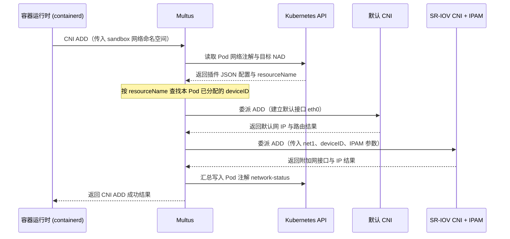

# Multus 网络选择、NAD 与 CNI 委派

当目标 Pod 已经被调度器绑定到一台 GPU 节点，容器运行时准备拉起 Pod 沙箱（sandbox）时，网络配置正式登场。Multus 站在节点建网的第一入口，要一口气回答三个问题：**这个 Pod 想接哪几张附加网？每张网由哪个 CNI 插件执行？如果要绑硬件设备，该把哪个设备交给插件？**

这三个答案，正是通过 Pod 注解、**NAD** 与 **CNI 委派链**环环相扣传递下去的。

## Pod 选择网络，NAD 定义插件配方

**NAD（NetworkAttachmentDefinition，网络附加定义）** 是带有命名空间作用域的 Kubernetes 自定义资源。你可以把它看作一张“附加网络的接线配方单”，通常在其 `.spec.config` 中用 JSON 字符串写明要调用的 CNI 插件类型、网络参数与 IPAM 配置。

业务 Pod 不直接写繁杂的 CNI JSON，只需在 `metadata.annotations` 中通过 `k8s.v1.cni.cncf.io/networks` 按名引用 NAD，并指定期望的接口名。省略命名空间时，Multus 默认在 **Pod 所在命名空间**内查找同名 NAD：

```yaml
# 1) Pod 侧声明：仅需引用 NAD 名称并指定接口名（省略容器与资源字段）
metadata:
  name: rank-0
  namespace: default
  annotations:
    # 省略 namespace 时默认查 default/roce-vf，接入后在 Pod 内命名为 net1
    k8s.v1.cni.cncf.io/networks: '[{"name":"roce-vf","interface":"net1"}]'
```

在 SR-IOV 场景中，这张 `default/roce-vf` NAD 通常不需要手工编写，而是由 SR-IOV Network Operator 根据更上层的网络策略自动渲染出来。精简后的核心字段包含三个关键输入：

```yaml
# 2) NAD 核心字段摘录（由 SR-IOV Network Operator 自动生成）
apiVersion: k8s.cni.cncf.io/v1
kind: NetworkAttachmentDefinition
metadata:
  name: roce-vf
  namespace: default
  annotations:
    # 关键锚点：告诉 Multus 去哪个设备资源池里查本 Pod 分到的 deviceID
    k8s.v1.cni.cncf.io/resourceName: nvidia.com/sriov_resource
spec:
  config: >-
    {"cniVersion":"1.0.0","name":"roce-vf","type":"sriov","vlan":0,
    "ipam":{"type":"nv-ipam","poolName":"roce-pool"}}
```

如果目标 NAD 放在另一个命名空间（例如 `fabric/roce-vf`），Pod 注解须显式指明命名空间。既可简写为 `fabric/roce-vf@net1`，也可在 JSON 项里写明 `"namespace":"fabric"` 与 `"interface":"net1"`。

跨命名空间引用还必须满足 Multus 的 `namespaceIsolation` 与 `globalNamespaces` 权限配置。

至于默认网络 `eth0` 的插件配方，则无需写在 Pod 注解里；它直接来自节点上的 Multus 配置文件（例如 `clusterNetwork` 指向集群原本的主 CNI）。

## 从 Pod Sandbox 到两张接口：Multus 的 CNI 委派链

节点上的 kubelet 通过 CRI 请求容器运行时创建 Pod sandbox，先搭起供工作容器共享的网络命名空间。随后，运行时调用 Multus 的 CNI `ADD` 接口，整条委派链按序展开：

1. **读取声明与配方**：Multus 查询 Kubernetes API，读取该 Pod 的网络注解及对应的 NAD 配置与 `resourceName`。
2. **补齐硬件设备标识**：若 NAD 标注了设备资源名，Multus 会从本机 kubelet 的设备分配记录中，找出该资源名下分给本 Pod 的具体 `deviceID`。
3. **先建主网，再接附网**：Multus 先委派默认 CNI 创建 `eth0`，成功后再把目标接口名 `net1`、`deviceID` 与 IPAM 参数一起委派给 SR-IOV CNI。
4. **回写结果**：附加插件完成接口移入与地址配置后返回结果，Multus 将所有网络状态汇总写回 Pod 注解，并向容器运行时返回完成。



*图 13-02-01：Multus 的 CNI `ADD` 委派时序。Multus 负责统筹默认与附加插件的调用顺序，并把设备资源名映射为具体 `deviceID` 递交给底层设备型 CNI。*

## 读懂 `network-status` 与 CNI `DEL` 清理生命周期

正常接入完成后，Multus 会把所有委派插件返回的结果写入 Pod 的 `k8s.v1.cni.cncf.io/network-status` 注解。下面是一次双接口接入后的典型快照：

```json
[
  {
    "name": "cluster-default",
    "interface": "eth0",
    "ips": ["10.244.0.10"],
    "default": true
  },
  {
    "name": "default/roce-vf",
    "interface": "net1",
    "ips": ["192.168.50.11"]
  }
]
```

排查时，用 `"default": true` 辨认主网络条目，用 `"interface": "net1"` 或 `"name": "default/roce-vf"` 定位附加网络分配到的 IP。

> [!note] 接入快照 vs 实时状态
> `network-status` 记录的是 **CNI `ADD` 完成那一刻的返回结果**。想核对容器里当下真实的网卡与路由表，仍应进入 Pod 用 `ip -br addr` 和 `ip route` 现场读取。

当 Pod 终止、容器运行时拆除 sandbox 时，运行时会发起 CNI `DEL` 调用。Multus 依据保存的委派记录反向通知各插件清理接口与归还 IP。如果中途某步 `ADD` 报错或节点异常重启导致清理中断，就需要对照插件日志和 IPAM 地址池状态，确认残留地址是否已回收。

## 两类常见 `FailedCreatePodSandBox` 报错怎么区分

只要 Multus 委派链任意一环出错，Pod 事件外层通常都统一显示为 `FailedCreatePodSandBox`。拆开看内层报错，就能立刻分清是“配方没找到”还是“插件没装好”：

- **找不到 NAD 对象**：假设集群里只有 `fabric/roce-vf`，Pod 注解却省略命名空间只写了 `roce-vf`，Multus 就会在查找 `default/roce-vf` 时报错退出。
- **找不到插件二进制**：NAD 已经解析成功，但报错提示找不到 `sriov` 可执行文件。此时应登录目标节点，核对容器运行时与 Multus 实际配置的 CNI 插件搜索路径及插件 DaemonSet 是否覆盖该节点。

> [!summary] 核心结论
> Multus 靠 **Pod 注解（选哪张网）→ NAD（用哪个插件与资源池）→ CNI 委派（按序建 `eth0` 与 `net1`）** 完成多网装配。它本身不创造硬件设备——对于 SR-IOV 附加网，真正决定把哪张卡交给 Pod 的，是递进来的那个 `deviceID`。

这个关键的 `deviceID` 究竟是怎么从物理网卡切出来、上报给调度器、再由 kubelet 精准交到 Multus 手里的？下一篇我们把目光下沉到 SR-IOV 的 PF 与 VF 生命周期。

> [!info]- 参考资料
> - **Multus 用法、配置与 v4.2.4 源码**：[Multus 多网络使用说明](https://github.com/k8snetworkplumbingwg/multus-cni/blob/master/docs/how-to-use.md)、[Multus 配置说明](https://github.com/k8snetworkplumbingwg/multus-cni/blob/master/docs/configuration.md)、[Multus v4.2.4 ADD 实现](https://github.com/k8snetworkplumbingwg/multus-cni/blob/v4.2.4/pkg/multus/multus.go)、[Multus v4.2.4 NAD 查询](https://github.com/k8snetworkplumbingwg/multus-cni/blob/v4.2.4/pkg/k8sclient/k8sclient.go)、[网络状态字段](https://github.com/k8snetworkplumbingwg/network-attachment-definition-client/blob/master/pkg/apis/k8s.cni.cncf.io/v1/types.go)
> - **CRI、CNI 与 SR-IOV NAD 模板**：[Kubernetes v1.36 CRI](https://v1-36.docs.kubernetes.io/docs/concepts/architecture/cri/)、[Kubernetes v1.36 sandbox 事件实现](https://github.com/kubernetes/kubernetes/blob/v1.36.0/pkg/kubelet/kuberuntime/kuberuntime_manager.go)、[CNI ADD 与结果规范](https://www.cni.dev/docs/spec/)、[SR-IOV NAD 的上游生成模板](https://github.com/k8snetworkplumbingwg/sriov-network-operator/blob/master/bindata/manifests/cni-config/sriov/sriov-cni-config.yaml)、[NVIDIA v26.7.1 网络配置](https://docs.nvidia.com/networking/display/kubernetes2671/quick-start/sriov-network-rdma.html)
