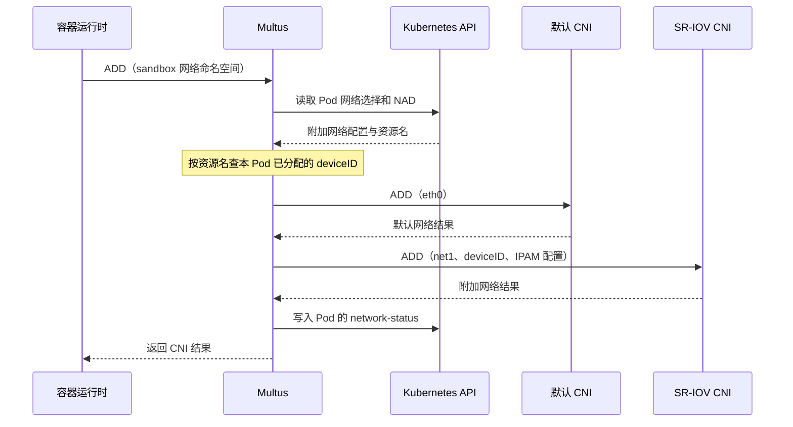

假设 `default/rank-0` 已绑定到 `gpu-h0`。它需要保留默认接口 `eth0`，再以 `net1` 接入 RoCE 附加网络。Multus 是节点网络调用的入口。它需要知道 Pod 选哪一张网络、用哪个插件接入，以及需要将哪一个已分配的设备交给插件。 [Multus 多网络使用说明](https://github.com/k8snetworkplumbingwg/multus-cni/blob/master/docs/how-to-use.md)

## Pod 选择网络，NAD 提供插件配置

**NetworkAttachmentDefinition（NAD，网络附加定义）** 是有命名空间的 Kubernetes 对象。通常在 `.spec.config` 中以 JSON 字符串保存插件配置。Pod 的 `k8s.v1.cni.cncf.io/networks` 注解引用这个对象，并可为本次接入指定接口名。省略命名空间时，Multus 从 Pod 所在的命名空间查找。所以 `default/rank-0` 的以下声明会查 `default/roce-vf`。 [Multus 的网络选择语法](https://github.com/k8snetworkplumbingwg/multus-cni/blob/master/docs/how-to-use.md)

```yaml
# Pod 的 metadata 摘录，省略容器和资源请求
metadata:
  name: rank-0
  namespace: default
  annotations:
    k8s.v1.cni.cncf.io/networks: '[{"name":"roce-vf","interface":"net1"}]'
```

本例的 NAD 由 SR-IOV Network Operator 依据网络对象生成。把生成结果读成三个输入。对象的命名空间和名字供 Pod 引用，`type: sriov` 选定执行接入的插件，`resourceName` 给 Multus 一个设备池的完整名称。插件配置还包含 IP 地址分配方式（IPAM，IP Address Management），交给具体插件处理。以下是教学字段摘录，省略生成对象的其他设置。线上应读实际的 NAD 及完整 `.spec.config`。 [SR-IOV NAD 的上游生成模板](https://github.com/k8snetworkplumbingwg/sriov-network-operator/blob/master/bindata/manifests/cni-config/sriov/sriov-cni-config.yaml) · [NVIDIA v26.7.1 网络配置](https://docs.nvidia.com/networking/display/kubernetes2671/quick-start/sriov-network-rdma.html)

```yaml
apiVersion: k8s.cni.cncf.io/v1
kind: NetworkAttachmentDefinition
metadata:
  name: roce-vf
  namespace: default
  annotations:
    k8s.v1.cni.cncf.io/resourceName: nvidia.com/sriov_resource
spec:
  config: >-
    {"cniVersion":"1.0.0","name":"roce-vf","type":"sriov","vlan":0,
    "ipam":{"type":"nv-ipam","poolName":"roce-pool"}}
```

若一张同名 NAD 位于 `fabric`，需显式选择 `fabric/roce-vf@net1`，或在 JSON 项中写 `"namespace":"fabric"` 和 `"interface":"net1"`。跨命名空间的引用还须符合 Multus 的 `namespaceIsolation` 和 `globalNamespaces` 配置。默认网络的配置则来自节点上的 Multus 配置，例如 `clusterNetwork` 指向原来的主网络。 [Multus 配置说明](https://github.com/k8snetworkplumbingwg/multus-cni/blob/master/docs/configuration.md) · [网络选择与命名空间示例](https://github.com/k8snetworkplumbingwg/multus-cni/blob/master/docs/how-to-use.md)

## CNI ADD 从 sandbox 接到两张接口

kubelet 在已绑定节点上通过 **CRI（Container Runtime Interface，容器运行时接口）** 请求建立 Pod sandbox。这个环境为工作容器提供共享的网络命名空间。运行时调用 Multus 的 CNI `ADD`，带入目标网络命名空间等参数。Multus 解析本次需要的插件配置，正常接入时先执行默认插件，再执行附加插件。对设备型附加网络，它还按照 NAD 的完整资源名取得已分配的设备标识 `deviceID`，交给附加插件。实际移动接口或配置地址的是收到这次调用的插件。时序按上游实现简化，略去 API 缓存和设备分配接口的细节。 [Kubernetes v1.36 CRI](https://v1-36.docs.kubernetes.io/docs/concepts/architecture/cri/) · [CNI ADD 与结果规范](https://www.cni.dev/docs/spec/) · [Multus v4.2.4 ADD 实现](https://github.com/k8snetworkplumbingwg/multus-cni/blob/v4.2.4/pkg/multus/multus.go)



## network-status 的含义与 CNI DEL

常规 Kubernetes 接入中，Multus 用插件返回的结果更新 Pod 的 `k8s.v1.cni.cncf.io/network-status`。以下是 `rank-0` 接入后的教学摘录。按 `interface: net1` 或 `name: default/roce-vf` 找到附加条目，再读 `ips`。主网络条目可用 `default` 标记识别。 [Multus 网络状态示例](https://github.com/k8snetworkplumbingwg/multus-cni/blob/master/docs/how-to-use.md) · [网络状态字段](https://github.com/k8snetworkplumbingwg/network-attachment-definition-client/blob/master/pkg/apis/k8s.cni.cncf.io/v1/types.go)

```json
[
  {"name":"cluster-default","interface":"eth0","ips":["10.244.0.10"],"default":true},
  {"name":"default/roce-vf","interface":"net1","ips":["192.168.50.11"]}
]
```

这个注解记录接入时的结果。当前接口和路由应在 Pod 内用 `ip -br addr` 与 `ip route` 观察。删除 sandbox 时，运行时发起 `DEL`，Multus 用保存的委派信息拆除网络。部分 `ADD` 失败或清理中断时，用插件日志和地址池实际状态核对哪些资源已释放。 [Multus v4.2.4 状态回写、清理和删除](https://github.com/k8snetworkplumbingwg/multus-cni/blob/v4.2.4/pkg/multus/multus.go)

设 API 里只有 `fabric/roce-vf`，Pod 注解却仍写 `roce-vf`，那么 Multus 在解析配置时找不到 `default/roce-vf`。如果找到了正确 NAD，消息却说找不到 `sriov` 可执行文件，就到 `gpu-h0` 查运行时和 Multus 实际使用的插件搜索路径及安装范围。两种情形都可能表现为 `FailedCreatePodSandBox`，内层错误才说明停在查找还是执行。NAD 解析成功后，设备型接入还缺一个输入，即本次该交付哪个 VF。 [Multus v4.2.4 NAD 查询](https://github.com/k8snetworkplumbingwg/multus-cni/blob/v4.2.4/pkg/k8sclient/k8sclient.go) · [Kubernetes v1.36 sandbox 事件实现](https://github.com/kubernetes/kubernetes/blob/v1.36.0/pkg/kubelet/kuberuntime/kuberuntime_manager.go)
