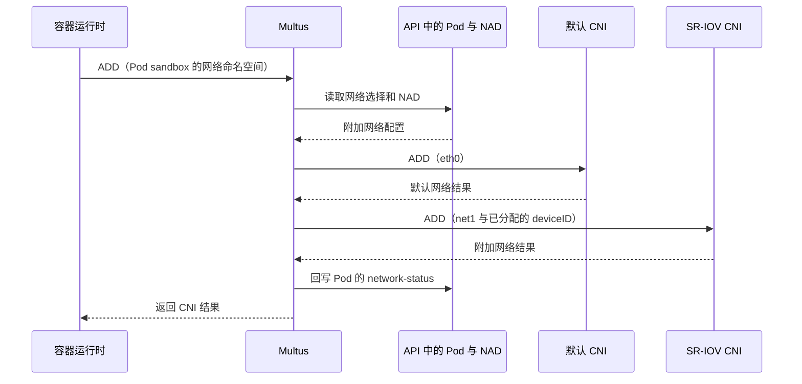

# Pod 的网络注解怎样变成附加网卡

Pod 声明要接入 `roce-vf`，集群里也能查到同名对象，但 Pod 中还没有 `net1`。这时应顺着运行时的网络调用查，先确认 Multus 实际读到了哪个对象，再确认委派插件是否成功执行。

## Pod 选网络，NAD 提供配置

`NetworkAttachmentDefinition`（NAD）是有命名空间的 Kubernetes 对象。它的 `.spec.config` 通常包含一段作为字符串保存的 CNI JSON，描述要用的插件和参数。本例的 Pod 与 NAD 都在 `default`。Pod 通过 `k8s.v1.cni.cncf.io/networks` 引用 `roce-vf`，并显式要求接口名 `net1`。下面对照 Pod 注解和按上游模板整理的 NAD 字段。现场可用 `kubectl -n default get network-attachment-definition roce-vf -o yaml` 检查 `SriovNetwork` 实际生成的对象，包括 `cniVersion` 和是否有 `plugins` 链。 [Multus 用法](https://github.com/k8snetworkplumbingwg/multus-cni/blob/master/docs/how-to-use.md) · [NVIDIA SR-IOV 网络示例](https://docs.nvidia.com/networking/display/kubernetes2671/quick-start/sriov-network-rdma.html) · [上游 SR-IOV NAD 模板](https://github.com/k8snetworkplumbingwg/sriov-network-operator/blob/master/bindata/manifests/cni-config/sriov/sriov-cni-config.yaml)

```yaml
# Pod 字段摘录
metadata:
  name: rank-0
  namespace: default
  annotations:
    k8s.v1.cni.cncf.io/networks: '[{"name":"roce-vf","interface":"net1"}]'
```

```yaml
# 生成的 NAD 中要核对的字段，省略其余 CNI 参数
apiVersion: k8s.cni.cncf.io/v1
kind: NetworkAttachmentDefinition
metadata:
  name: roce-vf
  namespace: default
  annotations:
    k8s.v1.cni.cncf.io/resourceName: nvidia.com/sriov_resource
spec:
  config: '{"cniVersion":"1.0.0","name":"roce-vf","type":"sriov","ipam":{"type":"nv-ipam","poolName":"roce-pool"}}'
```

简写 `roce-vf` 时查 Pod 所在命名空间。文本列表可写 `fabric/roce-vf@net1`，JSON 中也可用独立的 `namespace` 与 `interface`。跨命名空间引用还要满足 Multus 的 `namespaceIsolation` 和全局命名空间设置。默认 delegate 从节点上的 Multus 配置确定，例如 `clusterNetwork` 指向原先的默认 CNI 配置。 [Multus 网络选择与命名空间配置](https://github.com/k8snetworkplumbingwg/multus-cni/blob/master/docs/configuration.md) · [Multus 网络选择语法](https://github.com/k8snetworkplumbingwg/multus-cni/blob/master/docs/how-to-use.md)

## Multus 解析委派，再调用相应插件

Pod 绑定到节点后，kubelet 通过 CRI 请求运行时创建 Pod sandbox。运行时准备其网络命名空间，按节点上的 CNI 配置调用 Multus。Multus 从 API 解析附加网络定义，备好默认和附加 delegate。正常接入时，先执行默认 delegate，再执行附加 delegate。SR-IOV 这种接入还需要把 kubelet 已分配的设备 ID 交给 delegate。实际改变网络命名空间的是被调用的插件。 [Multus ADD 和 DEL 实现](https://github.com/k8snetworkplumbingwg/multus-cni/blob/master/pkg/multus/multus.go) · [CNI 规范](https://www.cni.dev/docs/spec/)



成功路径中，Multus 根据插件结果回写 `k8s.v1.cni.cncf.io/network-status`。本例可按 `name: default/roce-vf` 或 `interface: net1` 找到它的 `ips`，再用 `default` 区分主网络条目。该注解记录接入结果。接口后续发生的变化应进入 Pod 用 `ip -br addr` 和 `ip route` 核对。删除 sandbox 时，运行时调用 CNI `DEL`，Multus 可使用缓存配置拆除各附加网络和默认网络。遇到部分 `ADD` 成功后出错，也要根据插件日志和地址池的实际状态核对清理结果。 [Multus 状态字段](https://github.com/k8snetworkplumbingwg/network-attachment-definition-client/blob/master/pkg/apis/k8s.cni.cncf.io/v1/types.go) · [Multus 回滚与删除实现](https://github.com/k8snetworkplumbingwg/multus-cni/blob/master/pkg/multus/multus.go)

若 Pod 误引用另一命名空间，可以先查该命名空间下的 NAD 和引用权限。上游 Multus 在找不到 NAD 时有 `NoNetworkFound` 事件。若 NAD 已正确解析，运行时仍报找不到 `sriov` 或其他可执行插件，应核对 Pod 所在节点的 CNI `binDir`、对应部署的节点覆盖及安装结果。两类故障都可能表现为 kubelet 的 `FailedCreatePodSandBox`，区分它们要读内层错误。日志位置取决于 thin/thick 部署以及 `logFile`、`logToStderr` 的配置。 [Multus NAD 查找实现](https://github.com/k8snetworkplumbingwg/multus-cni/blob/master/pkg/k8sclient/k8sclient.go) · [Multus 日志配置](https://github.com/k8snetworkplumbingwg/multus-cni/blob/master/docs/configuration.md) · [Kubernetes v1.36 sandbox 事件](https://github.com/kubernetes/kubernetes/blob/v1.36.0/pkg/kubelet/kuberuntime/kuberuntime_manager.go)
