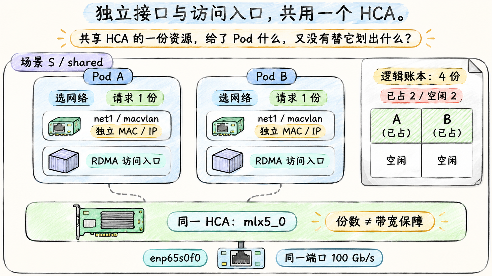

# 共享 HCA 时到底分配了什么

## 一块设备可以上报多个可分配单位

HCA（Host Channel Adapter）是 RDMA 网络适配器的常用称呼。场景 S 中每台只有一个用于本题的 PF RDMA 设备 `mlx5_0`，却希望多个 Pod 使用它。**RDMA Shared Device Plugin** 通过传统设备插件协议公布资源，并为请求资源的容器返回 RDMA 访问所需的设备信息。多个逻辑分配单位可以关联同一组实际设备。

下面是场景 S 的**自拟插件 ConfigMap 内 JSON 内容**，不是 Pod YAML；插件 DaemonSet 的安装、挂载等已具备：

```json
{
  "configList": [{
    "resourceName": "shared_hca",
    "resourcePrefix": "rdma.example.com",
    "rdmaHcaMax": 4,
    "selectors": {
      "ifNames": ["enp65s0f0"],
      "linkTypes": ["ether"]
    }
  }]
}
```

`ifNames` 根据宿主机 netdev 选择关联设备；它不是 Pod 接口名。`rdmaHcaMax: 4` 使本资源最多提供四个逻辑分配单位，不把一个 PF 切成四个 PCI function，也不产生四个独立速率为 100 Gb/s 的端口。字段依据 [Shared Device Plugin v1.5.3 的配置说明](https://github.com/Mellanox/k8s-rdma-shared-dev-plugin/blob/v1.5.3/README.md)。本例只选一个 PF，避免把“请求一份”误解成“在多个 PF 中必定获得唯一一个”。

Node 的下面两行是**自拟 `kubectl get node net-a -o yaml` 删节**：

```yaml
status:
  capacity:
    rdma.example.com/shared_hca: "4"
  allocatable:
    rdma.example.com/shared_hca: "4"
```

Allocatable 不是实时空闲余额。若已有两个容器各请求 1，调度器记账后还可以容纳两份请求；GPU、CPU 等约束需另外满足。四份同时使用时，端口链路、PCIe 带宽、NIC 队列等物理能力仍被共享。应用各建自己的 QP、MR 等对象，并不意味着这些对象没有容量与竞争限制。

**四份逻辑资源对应同一个 HCA 接入，份数不能换算成四条物理链路。**

## macvlan 解决 Pod 的 IP 接口

插件分配 RDMA 访问后，还需要安排 Pod 的网络接入。场景 S 用 **macvlan** 在 `enp65s0f0` 上创建子接口，并移入 Pod 网络命名空间，命名为 `net1`。不同 Pod 有各自的 MAC/IP 和 netdev，仍共享父接口的物理端口。它不是 VF，宿主机也不会出现新的 PCI function。macvlan 的父接口、模式与 MTU 含义见 [CNI macvlan 文档](https://www.cni.dev/plugins/current/main/macvlan/)。

下面是**完整的教学 NAD 对象**；其中 JSON 是 CNI 配置，`cniVersion` 是 CNI 规范版本，不是 Multus 版本。假设父接口 MTU 已为 9000，交换网络也允许本章选择的报文大小：

```yaml
apiVersion: k8s.cni.cncf.io/v1
kind: NetworkAttachmentDefinition
metadata:
  name: roce-shared
  namespace: lesson-net
spec:
  config: |
    {
      "cniVersion": "0.3.1",
      "name": "roce-shared",
      "type": "macvlan",
      "master": "enp65s0f0",
      "mode": "bridge",
      "mtu": 9000,
      "ipam": {
        "type": "whereabouts",
        "range": "192.0.2.0/24"
      }
    }
```

`IPAM` 是地址管理插件，负责选择和保留地址，返回给主 CNI；macvlan CNI 将结果应用到接口。这里不请求默认路由：同子网对端走 `net1`，其他目的地继续按已有路由查找。Whereabouts 的后端记录跨节点的地址占用；本轮另给定其已有分配状态使 `worker-a` 得到 `.101`、`worker-b` 得到 `.102`，不从 Pod 名推断分配顺序。[Whereabouts v0.8.0 README](https://github.com/k8snetworkplumbingwg/whereabouts/blob/v0.8.0/README.md)说明其 Kubernetes/etcd 后端与 CNI `ipam` 的关系。

## 把网络选择和资源请求写在同一份需求中

下面是**自拟 Pod 阅读样例**，教学镜像假定含 CUDA 应用、rdma-core 和匹配的 mlx5 provider；镜像占位不能拉取。GPU handler 已按前章准备，设备访问权限与进程 memlock（可锁定内存量）条件也假定满足，第 05 篇会解释这些注册前置；不在这里引入额外的自动资源注入 webhook：

```yaml
apiVersion: v1
kind: Pod
metadata:
  name: worker-a
  namespace: lesson-net
  annotations:
    k8s.v1.cni.cncf.io/networks: '[{"name":"roce-shared","namespace":"lesson-net","interface":"net1"}]'
spec:
  runtimeClassName: nvidia
  restartPolicy: Never
  containers:
    - name: worker
      image: registry.example.invalid/lesson/cuda-rdma:fixed
      command: ["sleep", "infinity"]
      resources:
        requests:
          nvidia.com/gpu: 1
          rdma.example.com/shared_hca: 1
        limits:
          nvidia.com/gpu: 1
          rdma.example.com/shared_hca: 1
```

注解表示要接 `roce-shared` 网络；resources 表示要占一张 GPU 和一份共享 HCA 资源。调度器按资源数量筛选节点，kubelet 决定具体设备分配，运行时/插件完成交付。只写注解不会自动补出 HCA 请求，只写 HCA 请求不会自动创建 `net1`。

本 NAD **没有** `resourceName` 注解，因为 macvlan 的父接口由 `master` 固定，未消费某个已分配 VF 的 PCI ID。共享插件的选择器和 NAD 的 `master` 都指向 `enp65s0f0`，这一对应由方案维护者保证。若把 NAD 改为另一个 PF，而共享插件仍选择原 PF，两个配置对象不会自动修复彼此。

网络命名空间由 Pod 共用，字符设备权限按容器的运行配置落实。上例只有一个容器；多容器 Pod 应单独核对哪些容器获得 RDMA 设备访问，不能因它们都能看到 `net1` 就认定都能打开 `uverbs`。

## shared 的可见性不是租户隔离承诺

场景 S 将 RDMA subsystem 明确设为 `shared`，RDMA 设备可跨网络命名空间可见；能否使用还受设备文件、cgroup、权限和用户态库等约束。共享插件提供访问入口，macvlan 提供网络接口，这两个动作没有将 PF 的 RDMA 对象独占搬给某个 Pod。

因此这套组合适用于接受共享边界、愿意管理干扰与访问范围的负载。它不保证带宽均分，不提供独立 PF 故障域，也不能仅靠不同 MAC/IP 声称 RDMA 设备已按租户隔离。命名空间模式的准确含义将在下一篇与 VF 接入一起解释。

下面独立评估网络容量：四个 Pod 都不请求 GPU，只各请求一份共享 HCA，因此不受每节点两张 GPU 的独占数量限制。在本章给定的单向有效预算 10 GB/s 下，若它们同时各需要持续 3 GB/s，合计需求为 `4 × 3 = 12 GB/s`，超过预算 2 GB/s。调度器仍可能在四份逻辑请求全部满足时接纳它们，因为本资源没有编码“每份预留 3 GB/s”。实际谁受到多少影响还取决于硬件调度、拥塞和应用行为，不能从四份账本反推出每份一定得到 2.5 GB/s。



**图 fig-13-02-02** 场景 S 的两个网络 Pod 各有独立 macvlan 接口与所需 RDMA 访问，并各占一份逻辑资源；四份账本仍对应同一个 PF HCA 和物理端口。此处只评估网络接入，不画 GPU；逻辑份数既不是 VF 切片，也不保证带宽均分。图内 Pod 的接口/入口图标表示软件接入视图，不代表新增实体网卡或 HCA。

[上一篇](01_从一个Pod的两张网开始.md) · [下一篇：把 VF 与 RDMA 设备放进同一个命名空间](03_把VF与RDMA设备放进同一个命名空间.md)
