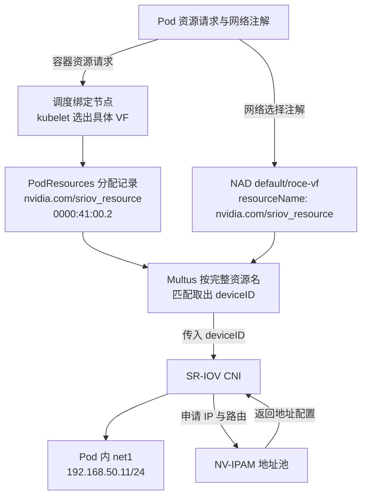

# SR-IOV VF 的创建、分配与接入

一台 GPU 服务器上通常同时跑着多个训练或推理 Pod，大家都想直通高速网卡的物理端口。如果每张物理网卡整卡只给一个 Pod，端口利用率太低；如果退回软件网桥共享，又丢掉了硬件旁路与隔离性。

**SR-IOV（Single Root I/O Virtualization，单根 I/O 虚拟化）** 正是 PCIe 硬件层给出的折中方案。开启后，一张支持 SR-IOV 的物理网卡可以在 PCIe 总线上裂变出多个独立可分配的设备功能，让 Kubernetes 像统计 GPU 一样，按整数精确计数并交付给各个 Pod。

## 什么是 PF、VF 与它们的 sysfs 对应关系

SR-IOV 把一张物理网卡划分为两类 PCIe 功能角色：
- **PF（Physical Function，物理功能）**：拥有完整管理权限的主功能，供宿主机配置网卡参数并控制要开启多少个虚拟功能。
- **VF（Virtual Function，虚拟功能）**：从所属 PF 派生出来的轻量硬件功能。每个 VF 都有独立的 PCI BDF、独立的收发队列与 MAC 地址，可以单独绑定驱动并移入某个 Pod。

需要注意一条物理事实：**同一个 PF 下的所有 VF 虽然在系统里是独立接口，但它们仍共用这个 PF 对应的同一条物理网口与上联链路**。

在双节点参考拓扑里，每台节点有两张 ConnectX-7 高速网卡，分别对应宿主机 PF 接口 `ens2f0` 和 `ens3f0`。每个 PF 启用 4 个 VF，单节点合计提供 `4 + 4 = 8` 个 VF。

因为 VF 索引是在各自 PF 内从 0 编号的，两个 PF 的 VF 0 拥有不同的 PCI BDF（例如 `ens2f0` 的 VF 0 记为 `0000:41:00.2`）。

在宿主机上，可以通过只读 sysfs 路径直接核验 PF 上限、当前开启数以及 PF 与 VF 的父子双向链接：

```sh
# 1) 查看物理口支持的最大 VF 数与当前已启用 VF 数（本例预期均为 4）
cat /sys/class/net/ens2f0/device/sriov_totalvfs
cat /sys/class/net/ens2f0/device/sriov_numvfs
cat /sys/class/net/ens3f0/device/sriov_numvfs

# 2) 从 PF 找到 VF 0 的完整 PCI BDF，再沿 physfn 反向找回所属 PF
vf_path=$(readlink -f /sys/class/net/ens2f0/device/virtfn0)
printf '%s\n' "$vf_path"            # 末尾段即为 VF 的 BDF，如 0000:41:00.2
readlink -f "$vf_path/physfn"       # 反向验证其父设备确实指向 ens2f0 对应的 PF
```

## 节点策略如何把物理口变成 Kubernetes 资源池

在 Network Operator `v26.7.1` 的 SR-IOV 方案里，运维人员不需要手工写 sysfs。只需提交两份声明式对象，就能自动完成“切 VF → 上报库存 → 渲染 NAD”全套动作：

```yaml
# 1) SriovNetworkNodePolicy：声明在哪些节点的哪些 PF 上切出 VF 并注册为资源池
spec:
  nodeSelector:
    ai-infra.example/roce-lab: "true"   # 命中两台目标 GPU 节点
  nicSelector:
    vendor: "15b3"                      # Mellanox/NVIDIA 网卡厂商 ID
    pfNames: ["ens2f0", "ens3f0"]       # 同时覆盖两个高速 PF
  numVfs: 4                             # 每个匹配 PF 启用 4 个 VF（单节点共 8 个）
  mtu: 1500
  deviceType: netdevice                 # 绑定内核网卡驱动，呈现为 Linux 网络接口
  isRdma: true                          # 分配时同时向容器交付关联的 RDMA 设备节点
  resourceName: sriov_resource          # 短资源名；配合默认前缀上报为 nvidia.com/sriov_resource
---
# 2) SriovNetwork/roce-vf：自动在 default 命名空间生成配套的 NAD
spec:
  networkNamespace: default
  resourceName: sriov_resource          # 与上文节点策略的资源名对齐
  vlan: 0                               # 物理口在交换侧做无标签接入，不由 VF 额外打 tag
  ipam: |
    {"type":"nv-ipam","poolName":"roce-pool"}
```

这里有两个容易忽略的细节。第一，`isRdma: true` 让 SR-IOV Device Plugin 在分配 VF 时把关联的 RDMA 字符设备一并交给容器，但 RDMA 设备在哪些网络命名空间可见，还另受节点 RDMA 子系统模式约束（第 05 篇展开）。第二，若改为由 VF 侧主动打 VLAN 标签，必须与接入交换机端口的 Trunk/Access 配置同步核对。

## 跟踪单个 VF 的四步交接：从资源请求到 `net1`

Pod 既要在注解里引用 `roce-vf` NAD，也要在容器的 `resources` 中声明所需的 GPU 与 VF 扩展资源（开启 Network Resources Injector 的集群也可在准入时自动补齐 VF 请求，排查时一律以 API Server 实际保存的 Pod 清单为准）：

```yaml
resources:
  requests:
    nvidia.com/gpu: 1
    nvidia.com/sriov_resource: 1
  limits:
    nvidia.com/gpu: 1
    nvidia.com/sriov_resource: 1
```

提交 Pod 后，这枚 VF 沿四个严丝合缝的环节落入容器：

1. **调度器按数选节点**：kube-scheduler 核对各节点 `nvidia.com/sriov_resource` 与 GPU 的调度余量，将 Pod 绑定到满足数量的目标节点。
2. **kubelet 选定具体 VF**：节点上的 Device Manager 从空闲 VF 中选定一个 BDF（如 `0000:41:00.2`），调用 SR-IOV Device Plugin 的 `Allocate` 取得容器设备配置。此后，经 kubelet PodResources API 即可查到该容器拿到的 `device_ids`。
3. **Multus 按完整资源名交接**：创建 sandbox 时，Multus 读出 NAD 注解里的 `nvidia.com/sriov_resource`，在 Pod 的本地设备分配映射中按同名键取出 `0000:41:00.2`，作为 `deviceID` 交给 SR-IOV CNI。
4. **SR-IOV CNI 移入接口并配 IP**：SR-IOV CNI 将该 VF 的网络接口移进 Pod 网络命名空间、改名为 `net1`，再调用 NV-IPAM 获取 IP 与路由并应用到接口。Pod 删除时由 CNI 归还地址与接口，设备占用由 kubelet 回收。



*图 13-03-01：单个 SR-IOV VF 从资源申请到进入 Pod 的四步交接链。NAD 上的 `resourceName` 注解是把“kubelet 设备分配”与“CNI 网络装配”精准焊在一起的唯一钥匙。*

> [!warning] 常见误区：资源名拼错会导致“有设备却接不进网”
> 如果 NAD 里的 `k8s.v1.cni.cncf.io/resourceName` 与 Pod 申请的资源键差了一个字符，kubelet 照样能把 VF 分给 Pod，但 Multus 拿着错键去查分配表时什么也找不到，最终直接卡死在 sandbox 创建阶段。

## 复算单节点 VF 余量与双 PF 资源池划分

扩展资源的调度始终遵循**单节点满足原则**。假设两台节点各自上报 8 个健康 VF，每台已有一个 Pod 占去 1 个。虽然 Node 的 `Allocatable` 仍显示 8，但单节点调度余量已经扣减为：

$$\text{单节点 VF 调度余量} = \text{Allocatable} - \text{已占 VF 数} = 8 - 1 = 7\text{ 个}$$

此时如果提交一个需要 **8 个 VF** 的新 Pod，即便两台节点合起来有 $7 + 7 = 14$ 个空闲 VF，该 Pod 依然会 `Pending`——因为单个 Pod 的所有资源必须落在同一台节点上。

另一方面，哪怕单节点能分出 2 个 VF，也不一定保证它们来自不同的物理网卡端口。如果业务要求**双网卡双链路冗余或双 Rail 并行**，关键在于如何划分 `SriovNetworkNodePolicy` 资源池：

| 资源池划分方式 | Pod 申请 2 个 VF 时的物理端口保证 |
| --- | --- |
| 单一池包含两个 PF 的全部 VF | 两个 VF 的 BDF 不同，但**可能落在同一个 PF**（共用同一物理端口） |
| 池 A 选两 PF 的 VF 索引 `0–1`，池 B 选两 PF 的索引 `2–3` | 两个策略互斥、每池各 4 个 VF；从两池各申 1 个**仍可能命中同一个 PF** |
| **池 A 只选 `ens2f0`，池 B 只选 `ens3f0`** | 从两池各申请 1 个并引用各自匹配的 NAD，可严格保证**分别来自两个物理端口**（还须同时通过节点内拓扑准入） |

> [!summary] 核心结论
> SR-IOV 把物理口切分为可计数的独立 VF，靠 `resourceName` 把 kubelet 设备分配无缝桥接到 Multus 与 SR-IOV CNI。想控制物理端口归属，必须按 PF 拆分独立资源池；同时记住，每多接入一次 VF 还会消耗一份附加网 IP。

硬件 VF 已经顺利挪进 Pod 变成了 `net1`，接下来谁来给它发不冲突的 IP 地址？如果路由配歪了或者沿途 MTU 缩水了，高速路径又会出现什么怪象？下一篇我们拆解附加网络的 IPAM、路由与 MTU。

> [!info]- 参考资料
> - **Linux SR-IOV 与 PCI sysfs**：[Linux PCIe SR-IOV 指南](https://docs.kernel.org/PCI/pci-iov-howto.html)、[Linux PCI sysfs 字段和符号链接](https://www.kernel.org/doc/Documentation/ABI/testing/sysfs-bus-pci)
> - **SR-IOV Operator、Device Plugin 与 CNI**：[SR-IOV Network Operator 的 Resource Injector](https://github.com/k8snetworkplumbingwg/sriov-network-operator)、[SR-IOV Network Operator 的 VF 索引分组](https://github.com/k8snetworkplumbingwg/sriov-network-operator/blob/master/doc/api/node-policies-api.md#multiple-policies-and-priority)、[SR-IOV Device Plugin 的选择条件和 isRdma 行为](https://github.com/k8snetworkplumbingwg/sriov-network-device-plugin)、[SR-IOV CNI 的 PF 和 VF 说明](https://github.com/k8snetworkplumbingwg/sriov-cni)
> - **NVIDIA Network Operator、Multus 与 NV-IPAM**：[NVIDIA v26.7.1 的以太网 SR-IOV 示例](https://docs.nvidia.com/networking/display/kubernetes2671/quick-start/sriov-network-rdma.html)、[NVIDIA v26.7.1 chart 配置](https://docs.nvidia.com/networking/display/kubernetes2671/customizations/helm.html)、[Multus v4.2.4 的资源名和设备 ID 交接](https://github.com/k8snetworkplumbingwg/multus-cni/blob/v4.2.4/pkg/k8sclient/k8sclient.go)、[NV-IPAM 的分配流程](https://github.com/Mellanox/nvidia-k8s-ipam#ip-allocation-flow)
> - **Kubernetes 扩展资源与 Device Plugin**：[Kubernetes 扩展资源规则](https://v1-36.docs.kubernetes.io/docs/concepts/configuration/manage-resources-containers/#extended-resources)、[Kubernetes v1.36 Device Plugin](https://v1-36.docs.kubernetes.io/docs/concepts/extend-kubernetes/compute-storage-net/device-plugins/)
