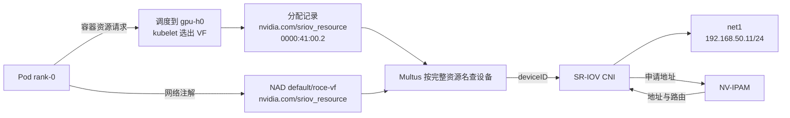

在两台节点的教学场景中，每台的多个 Pod 都可能要访问同一个高速物理端口。平台需要可计数、可分别分配的设备。**SR-IOV（Single Root I/O Virtualization，单根 I/O 虚拟化）** 是 PCIe 设备提供的一种能力。启用后，支持 SR-IOV 的网卡可以让操作系统枚举多个可独立分配的设备功能。Kubernetes 用这些功能表达资源库存，CNI 再将分到的功能接入网络。 [Linux PCIe SR-IOV 指南](https://docs.kernel.org/PCI/pci-iov-howto.html)

## PF、VF、PCI 地址与 Linux 接口

**物理功能（Physical Function，PF）** 是主机配置网卡及启用 VF 的入口。**虚拟功能（Virtual Function，VF）** 由所属 PF 提供，每个 VF 有自己的 PCI 地址，可以独立绑定驱动和分配给使用方。在本例的 Linux 网卡驱动模式下，VF 有一个网络接口。交付到 Pod 后，这个接口可叫 `net1`。同一 PF 下的多个 VF 可以有各自的接口和 MAC 地址，它们仍共用此 PF 对应的物理端口。 [Linux PCIe SR-IOV 指南](https://docs.kernel.org/PCI/pci-iov-howto.html) · [SR-IOV CNI 的 PF 和 VF 说明](https://github.com/k8snetworkplumbingwg/sriov-cni)

本例每个节点有两张 ConnectX-7 NIC。每张卡使用一个物理端口，分别对应主机接口 `ens2f0` 和 `ens3f0`。两个 PF 各启用四个 VF，共 `4 + 4 = 8` 个。VF 索引在单个 PF 内编号，所以两个 PF 的 VF 0 是不同的 PCI 设备。它们各以 PCI 地址识别，常简称为 **BDF（Bus、Device、Function）**。如 `0000:41:00.2` 还包含 PCI 域 `0000`，此处用它表示 `gpu-h0` 的 `ens2f0` 下的 VF 0。这个 BDF 是教学值。 [Linux PCI sysfs 字段和符号链接](https://www.kernel.org/doc/Documentation/ABI/testing/sysfs-bus-pci)

在已配置的主机上可通过只读命令检查该关系。`sriov_totalvfs` 是内核报告的上限，`sriov_numvfs` 是实际启用数，`virtfn0` 和 `physfn` 分别从 PF 找 VF、从 VF 找 PF。本例两次读取启用数都应得到 4。读取链接时，取完整路径的最后一段作为 PCI 地址。 [Linux PCI sysfs ABI](https://www.kernel.org/doc/Documentation/ABI/testing/sysfs-bus-pci)

```sh
cat /sys/class/net/ens2f0/device/sriov_totalvfs
cat /sys/class/net/ens2f0/device/sriov_numvfs
cat /sys/class/net/ens3f0/device/sriov_numvfs

vf_path=$(readlink -f /sys/class/net/ens2f0/device/virtfn0)
printf '%s\n' "$vf_path"
readlink -f "$vf_path/physfn"
```

## 节点策略怎样形成 VF 资源池

在 Network Operator v26.7.1 的 SR-IOV 方案中，SR-IOV Network Operator 的节点配置组件按 `SriovNetworkNodePolicy` 配置选中的 PF。SR-IOV Device Plugin 按资源池的选择条件发现已经存在的 VF，把设备和健康状态上报给 kubelet。两台节点都匹配标签 `ai-infra.example/roce-lab=true`，且两个 PF 均匹配时，`numVfs: 4` 对每个 PF 生效。以下摘录用 `deviceType: netdevice` 选择内核网卡接口模式，并用 `isRdma: true` 让设备插件在分配时提供 RDMA 设备访问所需的设备节点。RDMA 设备的命名空间可见性另受节点模式约束。 [NVIDIA v26.7.1 的以太网 SR-IOV 示例](https://docs.nvidia.com/networking/display/kubernetes2671/quick-start/sriov-network-rdma.html) · [SR-IOV Device Plugin 的选择条件和 isRdma 行为](https://github.com/k8snetworkplumbingwg/sriov-network-device-plugin)

```yaml
# nvidia-network-operator 命名空间中的两个对象，仅摘录 spec
# SriovNetworkNodePolicy
spec:
  nodeSelector:
    ai-infra.example/roce-lab: "true"
  nicSelector:
    vendor: "15b3"
    pfNames: ["ens2f0", "ens3f0"]
  numVfs: 4
  mtu: 1500
  deviceType: netdevice
  isRdma: true
  resourceName: sriov_resource
---
# SriovNetwork/roce-vf
spec:
  networkNamespace: default
  resourceName: sriov_resource
  vlan: 0
  ipam: |
    {"type":"nv-ipam","poolName":"roce-pool"}
```

两段中的 `sriov_resource` 是短资源名。按本例采用的 NVIDIA chart 前缀，kubelet 发布完整资源名 `nvidia.com/sriov_resource`，`SriovNetwork/roce-vf` 生成的 `default/roce-vf` NAD 也会标注这个完整名称。本例物理端口都通过无标签接入同一个交换机 VLAN，因此使用 `vlan: 0`，由交换侧把无标签流量归入规划的 VLAN。需要由 VF 一侧配置 VLAN 时，须与交换侧配置同时核对。 [NVIDIA v26.7.1 SR-IOV 网络示例](https://docs.nvidia.com/networking/display/kubernetes2671/quick-start/sriov-network-rdma.html) · [NVIDIA v26.7.1 chart 配置](https://docs.nvidia.com/networking/display/kubernetes2671/customizations/helm.html) · [SR-IOV CNI 的 VLAN 参数](https://github.com/k8snetworkplumbingwg/sriov-cni)

## Multus 怎样拿到 kubelet 分配的 VF

`default/rank-0` 的网络注解选择 `roce-vf` 并指定 `net1`。工作容器还显式申请两项扩展资源。启用了 Network Resources Injector 的集群也可在准入时补入 NAD 对应的请求和限制，此时应读 API 中实际存储的 Pod。下面是主例的容器资源字段，省略 Pod 的其余内容。 [SR-IOV Network Operator 的 Resource Injector](https://github.com/k8snetworkplumbingwg/sriov-network-operator) · [Kubernetes 扩展资源规则](https://v1-36.docs.kubernetes.io/docs/concepts/configuration/manage-resources-containers/#extended-resources)

```yaml
resources:
  requests:
    nvidia.com/gpu: 1
    nvidia.com/sriov_resource: 1
  limits:
    nvidia.com/gpu: 1
    nvidia.com/sriov_resource: 1
```

1. **按数量筛选节点。** 调度器比较 Pod 请求与候选节点的调度余量。设备插件上报健康库存后，假定两个节点各发布 8 个 VF，`rank-0` 在 `gpu-h0` 满足所需数量后被绑定到该节点。 [Kubernetes v1.36 Device Plugin](https://v1-36.docs.kubernetes.io/docs/concepts/extend-kubernetes/compute-storage-net/device-plugins/)
2. **在节点内选出设备。** kubelet 的 Device Manager 为工作容器选定具体 VF，并调用设备插件的 `Allocate` 获取容器侧设备配置。从 kubelet 的 PodResources API 可按 Pod、容器和 `resource_name` 读取 `device_ids`，本例中一项是 `0000:41:00.2`。从这一刻起，可以追踪同一个 PCI 功能。 [Kubernetes v1.36 Device Plugin 与 PodResources](https://v1-36.docs.kubernetes.io/docs/concepts/extend-kubernetes/compute-storage-net/device-plugins/)
3. **按资源名交接设备。** 创建 sandbox 时，Multus 读出 NAD 的 `k8s.v1.cni.cncf.io/resourceName`，在本 Pod 的节点设备分配映射中找到同名条目，并把 VF 的 BDF 作为 `deviceID` 交给 SR-IOV CNI。若 NAD 的资源名拼错，具体 VF 虽已分配，却无法通过这把键交给对应网络。 [Multus v4.2.4 的资源名和设备 ID 交接](https://github.com/k8snetworkplumbingwg/multus-cni/blob/v4.2.4/pkg/k8sclient/k8sclient.go)
4. **接入设备并配地址。** SR-IOV CNI 配置这个 VF，将其网卡接口移入目标网络命名空间，命名为 `net1`，调用 NV-IPAM 取得地址和路由，再把结果应用到接口。本次接入后得到 `192.168.50.11/24`。正常删除由 CNI 释放地址和还原 VF 接口，设备分配生命周期由 kubelet 管理。 [SR-IOV CNI 接入与清理](https://github.com/k8snetworkplumbingwg/sriov-cni) · [NV-IPAM 的分配流程](https://github.com/Mellanox/nvidia-k8s-ipam#ip-allocation-flow)



## 按单节点余量和 PF 归属推导分配

假设每台节点各有 8 个健康 VF，主例的两个 Pod 各消耗所在节点的 1 个。Node 的 `Allocatable` 仍可显示 8，调度余量按请求扣减，每台是 `8 − 1 = 7`。另一个 Pod 申请 8 个 VF 时，两台合计有 14 个也无处放置，因为单个 Pod 的请求须由一个节点满足。 [Kubernetes 扩展资源的单节点调度条件](https://v1-36.docs.kubernetes.io/docs/concepts/configuration/manage-resources-containers/#extended-resources)

即使一台节点能提供两个 VF，还要问申请是否约束了物理端口。例如另一个场景中每个 PF 都有空闲 VF，Pod 想同时使用两个物理端口。三个配置的差别在资源名表达了哪些候选设备。 [SR-IOV Network Operator 的 VF 索引分组](https://github.com/k8snetworkplumbingwg/sriov-network-operator/blob/master/doc/api/node-policies-api.md#multiple-policies-and-priority)

| 池划分 | 请求两个 VF 时能得到的保证 |
| --- | --- |
| 一个池选两个 PF 的全部 VF | 两个 VF 的 BDF 不同，可能来自同一个 PF。 |
| A 池选两个 PF 各自的索引 `0–1`，B 池选两个 PF 各自的 `2–3` | 两个策略用相同的 `numVfs: 4` 和优先级，范围互斥，每个池有四个 VF。各申请 1 个依然可能选中同一个 PF。 |
| A 池只选 `ens2f0`，B 池只选 `ens3f0` | 两个资源名各申请 1 个后，分别来自两个 PF。Pod 还需引用各自匹配的 NAD，且两项资源须能同时通过节点内准入。 |

分配单位和接入次数需要一起规划。想把同一个池的两个 VF 都接入 Pod，就申请两个单位并声明两次附加接入。随后分别对照设备 BDF、PF 归属和接口名。每次接入还会消耗地址池里的地址，所以空闲设备数只是容量的一部分。 [Multus v4.2.4 对同资源多次接入的设备索引](https://github.com/k8snetworkplumbingwg/multus-cni/blob/v4.2.4/pkg/k8sclient/k8sclient.go)
