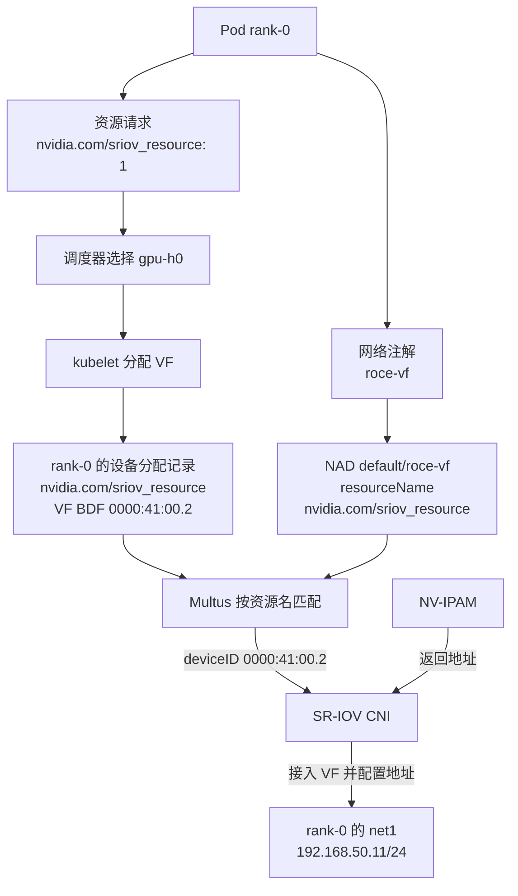

# 一张 SR-IOV VF 如何从 PF 进入 Pod

一台节点有两个高速端口，多个 Pod 又各要一张或多张附加网卡。Kubernetes 怎样知道有多少设备可供分配，以及实际分配的设备属于哪个端口？先看主机上有哪些 VF，再看它们怎样进入资源池和 Pod。

## 从物理功能到资源池

本例每个节点有两个高速端口对应的物理功能（PF）。每个 PF 各启用 4 个虚拟功能（VF），所以主机上共有 `4 + 4 = 8` 个可分配的 PCI 功能。每个 VF 的流量经过所属 PF 对应的物理端口。 [Linux 内核的 PCIe SR-IOV 说明](https://docs.kernel.org/PCI/pci-iov-howto.html#what-is-sr-iov) · [SR-IOV CNI 的 PF 与 VF 说明](https://github.com/k8snetworkplumbingwg/sriov-cni)

| PF 接口 | 所在 NUMA 节点 | 启用的 VF 索引 |
| --- | --- | --- |
| `ens2f0` | NUMA 0 | `0–3` |
| `ens3f0` | NUMA 1 | `0–3` |

VF 索引在各自的 PF 内编号，因此 `ens2f0` 的 VF 0 和 `ens3f0` 的 VF 0 是两个设备。

主机用 PCI 地址识别具体的 VF，例如 `0000:41:00.2`。这个地址由域、总线、设备和功能编号组成，后文简称 PCI BDF。VF 绑定 Linux 网卡驱动并接入 Pod 后，容器内看到的是它的网络接口名，例如 `net1`。排查时用 Kubernetes 的扩展资源名定位设备池，再用 BDF 跟踪这个 VF。 [Linux 内核的 VF 枚举与驱动说明](https://docs.kernel.org/PCI/pci-iov-howto.html) · [SR-IOV CNI 接收 PCI 地址的说明](https://github.com/k8snetworkplumbingwg/sriov-cni)

创建 VF 由节点配置完成，例如由 SR-IOV Network Operator 的节点侧组件依据 `SriovNetworkNodePolicy` 执行。SR-IOV Device Plugin 从已创建的设备中按选择条件发现 VF，通过 kubelet 发布扩展资源。 [SR-IOV Network Operator](https://github.com/k8snetworkplumbingwg/sriov-network-operator) · [SR-IOV Device Plugin](https://github.com/k8snetworkplumbingwg/sriov-network-device-plugin)

以 Network Operator v26.7.1 的以太网 RDMA 示例为依据，本例假设两台目标节点都已打上 `ai-infra.example/roce-lab: "true"`，且 `ens2f0` 和 `ens3f0` 对应的端口都连到同一 RoCE VLAN。`pfNames` 同时选择两个 PF，`numVfs: 4` 对每个选中的 PF 生效。主例用 `sriov_resource` 将这 8 个 VF 发布为每个节点上的一个资源池，再由 `SriovNetwork/roce-vf` 引用。`isRdma: true` 使插件路径提供所需的 RDMA 资源，`netdevice` 让 VF 以 Linux 网络接口方式接入。示例采用该版 NVIDIA chart 的资源前缀 `nvidia.com`，字段摘要省略部署所需的其余配置。 [SR-IOV Network Operator 的 `numVfs` 字段定义](https://github.com/k8snetworkplumbingwg/sriov-network-operator/blob/master/api/v1/sriovnetworknodepolicy_types.go) · [NVIDIA v26.7.1 SR-IOV 快速示例](https://docs.nvidia.com/networking/display/kubernetes2671/quick-start/sriov-network-rdma.html) · [NVIDIA chart 资源前缀与组件配置](https://docs.nvidia.com/networking/display/kubernetes2671/customizations/helm.html)

```yaml
# SriovNetworkNodePolicy，位于 nvidia-network-operator
spec:
  nodeSelector:
    ai-infra.example/roce-lab: "true"
  nicSelector:
    vendor: "15b3"
    pfNames: ["ens2f0", "ens3f0"]
  numVfs: 4
  deviceType: netdevice
  isRdma: true
  resourceName: sriov_resource
---
# SriovNetwork/roce-vf，位于 nvidia-network-operator
spec:
  networkNamespace: default
  resourceName: sriov_resource
  ipam: |
    {"type":"nv-ipam","poolName":"roce-pool"}
```

## 从请求到 Pod 内接口

`SriovNetwork/roce-vf` 生成 `default/roce-vf` 的 NAD。生成对象的 `k8s.v1.cni.cncf.io/resourceName` 应为带前缀的 `nvidia.com/sriov_resource`。Pod 同时声明网络选择和资源请求。某些集群启用了 Resource Injector，准入时会从 NAD 注解补入资源请求。读线上配置时，以实际存入 API 的 Pod 为准。 [NVIDIA 生成网络示例](https://docs.nvidia.com/networking/display/kubernetes2671/deployment-guide-kubernetes.html) · [SR-IOV Resource Injector 的角色](https://github.com/k8snetworkplumbingwg/sriov-network-operator)

```yaml
# Pod 的 metadata.annotations
k8s.v1.cni.cncf.io/networks: '[{"name":"roce-vf","interface":"net1"}]'
---
# 同一 Pod 中，工作容器的 resources 字段
requests:
  nvidia.com/gpu: 1
  nvidia.com/sriov_resource: 1
limits:
  nvidia.com/gpu: 1
  nvidia.com/sriov_resource: 1
```

1. kubelet 从插件收到设备及健康信息，在 Node 的 `.status.allocatable` 发布数量。调度器用目标节点的可分配量和已绑定 Pod 的资源请求计算余量，具备足够数量的节点才可能通过筛选。 [Kubernetes Device Plugin](https://v1-36.docs.kubernetes.io/docs/concepts/extend-kubernetes/compute-storage-net/device-plugins/)
2. Pod 绑定后，kubelet 的 Device Manager 从该节点的设备池选出具体 VF，调用 SR-IOV Device Plugin 的 `Allocate`。此时可以沿 kubelet PodResources API 按 Pod、容器及 `resource_name` 找到 `device_ids`。设备分配的粒度是容器，本例由同一个工作容器申请 GPU 和 VF。 [Kubernetes Device Plugin 与 PodResources](https://v1-36.docs.kubernetes.io/docs/concepts/extend-kubernetes/compute-storage-net/device-plugins/)
3. 创建 sandbox 时，Multus 读取 NAD 上的完整资源名，从节点设备映射取出这个 Pod 已分配的 PCI BDF，作为 `deviceID` 交给 SR-IOV CNI。用 PodResources 核对 BDF，再到主机 PCI sysfs 的 `physfn` 确认其所属 PF。 [Multus `resourceName` 和 `deviceID` 的实现](https://github.com/k8snetworkplumbingwg/multus-cni/blob/master/pkg/k8sclient/k8sclient.go)
4. 对 `netdevice` 路径，SR-IOV CNI 依据 `deviceID` 配置 VF、把接口移入 sandbox 并取名 `net1`。它调用 IPAM 获得地址和路由，再把结果应用到接口。正常删除时，CNI 释放 IP 并还原 VF。kubelet 管理设备分配生命周期，后续调度依赖节点资源和 Pod 请求状态。 [SR-IOV CNI 接入与清理](https://github.com/k8snetworkplumbingwg/sriov-cni)



图中的 PCI BDF 和 IP 地址是教学值。两条支路在 Multus 汇合时，匹配的是完整资源名 `nvidia.com/sriov_resource`。

## 多个 PF 的 VF 怎样组成资源池

主例的同名资源池覆盖两个 PF。假设进入另一次分配，同一节点上 Pod A 和 Pod B 各请求 `nvidia.com/sriov_resource: 2`。一种可能的结果是 A 拿到两个 PF 各自的 VF 0，B 拿到两个 PF 各自的 VF 1。这样每个 PF 都为两个 Pod 提供设备，每个 Pod 也都拿到了两个 PF 的设备。这个请求只指定数量，实际分到的两个 VF 也可能来自同一个 PF。两个 VF 若都要接入 Pod，还需声明两次网络接入。读实际结果时，通过 PodResources 查 PCI BDF，再沿各自的 `physfn` 找 PF。 [Kubernetes PodResources](https://v1-36.docs.kubernetes.io/docs/concepts/extend-kubernetes/compute-storage-net/device-plugins/) · [Multus 按网络接入选用已分配设备](https://github.com/k8snetworkplumbingwg/multus-cni/blob/master/pkg/k8sclient/k8sclient.go)

如果要让多个资源池都能使用两个物理端口，可以在另一套配置中，按各 PF 内的 VF 索引划分池。以下两个 `SriovNetworkNodePolicy` 使用相同的 `numVfs: 4` 和优先级。它们选中的 VF 范围互不重叠。每个池覆盖两个 PF，每个 PF 的 VF 也分布在两个池中。两个池各发布 4 个 VF，合计仍是原来的 8 个。 [SR-IOV Network Operator 的 VF 分组和策略优先级](https://github.com/k8snetworkplumbingwg/sriov-network-operator/blob/master/doc/api/node-policies-api.md#multiple-policies-and-priority)

| 扩展资源 | `nicSelector.pfNames` | 每节点设备数 |
| --- | --- | ---: |
| `nvidia.com/sriov_group_a` | `ens2f0#0-1`、`ens3f0#0-1` | 4 |
| `nvidia.com/sriov_group_b` | `ens2f0#2-3`、`ens3f0#2-3` | 4 |

如果工作负载要求**从两个 PF 各拿一个 VF**，就按 PF 分成两个资源池，每个池只选一个 PF。Pod 同时申请两个资源名各 1 个，并引用两个分别匹配相应资源名的 NAD。主例的两个 PF 位于不同 NUMA 节点，这种申请还要满足 kubelet 的 NUMA 准入策略。 [SR-IOV Device Plugin 的资源选择规则](https://github.com/k8snetworkplumbingwg/sriov-network-device-plugin) · [Kubernetes Topology Manager](https://v1-36.docs.kubernetes.io/docs/tasks/administer-cluster/topology-manager/)

## 用三类失败拆开“有卡但用不了”

假设两台节点各有 8 个健康 VF，每台已有一个 Pod 请求 1 个，且这些 VF 都属于节点上的同名扩展资源。每台的 `Allocatable` 仍可显示 8，调度余量各为 `8 − 1 = 7`。此时申请 8 个 VF 的单个 Pod 无法放到任一节点，两台合计 14 个也无法满足这个请求。若 Pod 只请求 1 个，已经绑定，事件却提到无法获得 VF 的 PCI 地址，先比对 PodResources 中的资源名、设备 ID 与 NAD 的完整资源名。若三者匹配但事件显示 IPAM 分配失败，则检查地址池和这个节点的地址块。已分配 VF 与有可用地址是两项独立条件。 [Kubernetes 扩展资源的调度规则](https://v1-36.docs.kubernetes.io/docs/concepts/configuration/manage-resources-containers/#extended-resources) · [NV-IPAM 的按节点分配流程](https://github.com/Mellanox/nvidia-k8s-ipam)
