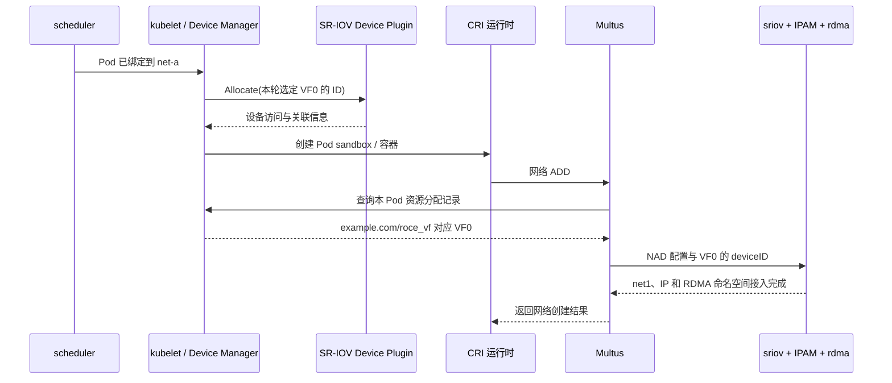
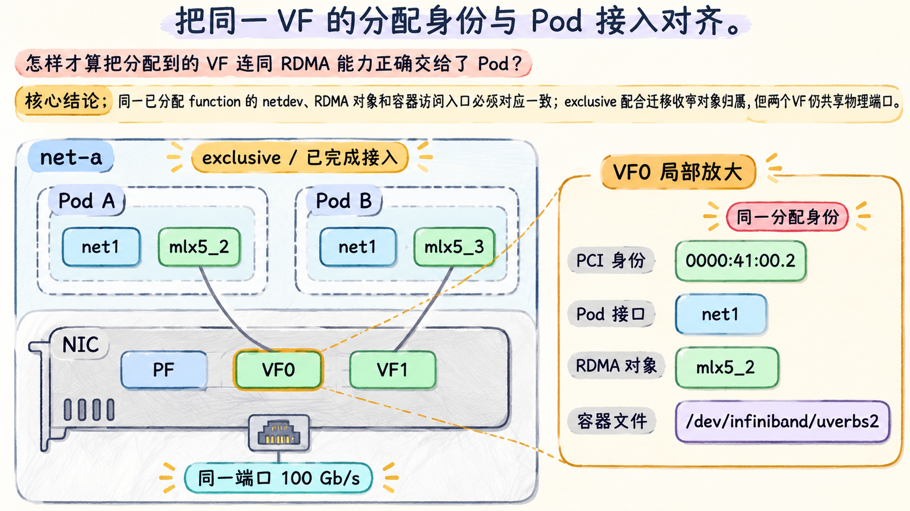

# 把 VF 与 RDMA 设备放进同一个命名空间

## 从共享访问改为分配独立 function

本篇切换到场景 V。**SR-IOV** 允许支持的 PCIe 设备提供多个 Virtual Function（VF）。Physical Function（PF）保留设备配置管理能力，VF 是可分别枚举和分配的 PCI function。VF 数量、RDMA 支持、队列与地址能力取决于 NIC、固件和驱动，不是把任意 Ethernet 卡打开一个开关就能获得。

本章每个 PF 只创建两个 VF。VF0 与 VF1 有不同 PCI 地址、各自的 netdev 和 RDMA 设备对象，可以分别交给 Pod；它们仍来自同一个物理端口，受共同链路和 PF/端口级故障影响。VF 提供设备分配边界，不自动等于物理网络独占、带宽预留或完整租户安全边界。

**两个 VF 有各自的 function 身份，但共用一个 100 Gb/s 物理端口。**

创建 VF 是宿主机准备阶段，由节点配置或 SR-IOV Network Operator 等管理者完成。SR-IOV Device Plugin 发现并公布**已经存在**的 function；SR-IOV CNI 消费已经分配的 VF，完成网络接入。二者都不代替 VF 创建。相关职责可查 [SR-IOV CNI v2.8.1 README](https://github.com/k8snetworkplumbingwg/sriov-cni/blob/v2.8.1/README.md) 的 “Kubernetes Quick Start”。

## 先准备，再发现和分配

以下是 `net-a` **自拟宿主机取证摘要**，把 sysfs、`lspci` 与 RDMA 映射整理为表，不是某一条命令的原样输出；本轮 PF/VF MTU 均已设为 9000：

| 证据 | 本轮结果 | 含义 |
| --- | --- | --- |
| PF 的 `sriov_numvfs` | `2` | 已创建两个 VF，不表示已交给 Pod |
| PF `virtfn0` 链接目标 | `0000:41:00.2` | VF0 的 function 身份 |
| PF `virtfn1` 链接目标 | `0000:41:00.3` | VF1 的 function 身份 |
| 两个 VF 的 PCI 驱动 | `mlx5_core` | 使用内核 netdevice/RDMA 路径，未绑定 `vfio-pci` |
| VF0 的关联 RDMA 对象 | `mlx5_2`，port 1 | 与后文 Pod 观察对应 |
| VF1 的关联 RDMA 对象 | `mlx5_3`，port 1 | 是另一个 RDMA 对象 |

`mlx5_core` 是本例的 PCI 驱动，RDMA 功能还依赖 `mlx5_ib` 等内核组件。不要因插件配置里常见 `drivers` 字段就把 `mlx5_ib` 一律当成 PCI function 的绑定驱动。

下面是**SR-IOV Device Plugin 配置片段**，限定 PF 下的两个 VF，不将 PF 本身混入资源池；`#0-1` 是该插件的 VF 索引范围语法：

```json
{
  "resourceList": [{
    "resourcePrefix": "example.com",
    "resourceName": "roce_vf",
    "selectors": [{
      "vendors": ["15b3"],
      "drivers": ["mlx5_core"],
      "pfNames": ["enp65s0f0#0-1"],
      "linkTypes": ["ether"],
      "isRdma": true
    }]
  }]
}
```

这里的 `isRdma` 要求插件交付关联 RDMA 资源；它不会给不支持 RDMA 的 VF 增加硬件能力，也不负责把 RDMA 对象搬进 Pod 网络命名空间。字段与范围语法见 [SR-IOV Device Plugin v3.9.0 README](https://github.com/k8snetworkplumbingwg/sriov-network-device-plugin/blob/v3.9.0/README.md) 的 “Config parameters” 和 “Selectors”。本轮两个 VF 健康且未分配，Node 的 `example.com/roce_vf` Capacity/Allocatable 均为 2。

## exclusive 是 RDMA 对象的命名空间归属

Linux 网络命名空间隔离 netdev，不会让所有 RDMA 对象自动遵循相同归属。RDMA subsystem 有节点级的两种模式：

| 模式 | RDMA 对象的命名空间行为 | 本章用途 |
| --- | --- | --- |
| `shared` | 设备可在多个网络命名空间可见，使用仍受其他访问条件约束 | 场景 S 共享 PF HCA |
| `exclusive` | 每个 RDMA 设备对象只属于一个网络命名空间，可被迁移 | 场景 V，将已分配 VF 的 RDMA 对象迁入 Pod |

**exclusive 限定 RDMA 对象的可见范围，不增加物理端口。**

模式语义与切换限制依据 [iproute2 v6.8.0 的 rdma-system 手册](https://github.com/iproute2/iproute2/blob/v6.8.0/man/man8/rdma-system.8)。`rdma system show` 用于读取模式。`rdma system set netns exclusive` 是宿主机配置动作，应在节点初始化阶段规划；活跃命名空间与已有设备可使 shared→exclusive 返回 EBUSY。不能把它当成业务 Pod 中随时执行的修复，也不能在同一节点的两个 NAD 中声明不同 subsystem 模式。

**RDMA CNI** 是链式插件。本章先由 `sriov` 配置 VF netdev，再由 `rdma` 根据已分配的 PCI function 找到关联 RDMA 对象，将它迁入目标网络命名空间。v1.3.0 会检查 subsystem 为 exclusive；不能把它追加到场景 S 的 macvlan 链中，期待同一个 PF HCA 被独占迁给多个 Pod。[RDMA CNI v1.3.0 README](https://github.com/k8snetworkplumbingwg/rdma-cni/blob/v1.3.0/README.md)和 [CmdAdd 实现](https://github.com/k8snetworkplumbingwg/rdma-cni/blob/v1.3.0/cmd/rdma/main.go)分别提供部署条件与检查逻辑。

为了只观察模式的影响，还可以固定同样两个 VF 已分别给 Pod A/B：shared 状态下两个 RDMA 对象可跨 namespace 可见；exclusive 并完成迁移后，A 只见对应 VF0 的 `mlx5_2`，B 只见对应 VF1 的 `mlx5_3`。这个独立对照保持硬件数量与 function 分配相同，只比较 RDMA 对象的命名空间条件，不能与场景 S/V 的整体切换混为一谈。

字符设备交付与对象迁移仍是两件事：Device Plugin 帮助容器获得需要的 RDMA 设备入口；CNI 改变网络命名空间中的对象归属。只完成其中一半，进程仍可能无法打开和使用预期设备。命名空间隔离也不代替硬件访问控制、网络分段和资源配额。

## 用 resourceName 把已分配 VF 交给附加 CNI

下面是场景 V 的**教学 NAD 完整对象**。它在独立节点池中替代场景 S 的 NAD，不叠加两个场景：

```yaml
apiVersion: k8s.cni.cncf.io/v1
kind: NetworkAttachmentDefinition
metadata:
  name: roce-vf
  namespace: lesson-net
  annotations:
    k8s.v1.cni.cncf.io/resourceName: example.com/roce_vf
spec:
  config: |
    {
      "cniVersion": "0.3.1",
      "name": "roce-vf",
      "plugins": [
        {
          "type": "sriov",
          "ipam": {
            "type": "whereabouts",
            "range": "192.0.2.0/24"
          }
        },
        {"type": "rdma"}
      ]
    }
```

Pod 使用第 02 篇完整清单的结构，只将网络选择改为 `roce-vf`，并将 requests/limits 中的 `rdma.example.com/shared_hca: 1` **替换**为 `example.com/roce_vf: 1`，其余保持不变。每个 worker 请求一张 GPU 和一个 VF。没有自动注入 webhook，因此请求必须显式给出。

NAD 的 `resourceName`、Pod 的扩展资源键、插件上报的完整资源名三者必须一致。Multus 用此关联找到本 Pod 已分配的设备信息，把具体 PCI `deviceID` 传给 SR-IOV CNI；NAD 本身不预先写死 VF0 的地址。`roce-vf` 是网络对象名，`example.com/roce_vf` 是资源池名，`0000:41:00.2` 是一次节点内分配的具体身份。

以下是**责任阶段时序**，不主张 kubelet 所有内部方法严格按图逐行执行；图中只画已经解释的跨组件关系：



本轮另给定 kubelet 确实选中了 VF0；不能从地址较小推断默认分配算法。Multus 的设备信息查询是节点本地机制，不表示向 Kubernetes API 新增一个 `VF0` 对象，也不表示 scheduler 直接选择 PCI 地址。完成后，应用进程才结合设备文件和用户态库使用这条接入。

## 回收时要收回接口、地址与分配记录

正常删除时，网络链的 DEL 按插件链逆序处理，RDMA 对象归还、VF 网络复原及 IPAM 释放分别有对应动作；kubelet 也清理已分配集合。插件链的生命周期与逆序删除见 [CNI spec-v0.3.1 的执行规则](https://github.com/containernetworking/cni/blob/spec-v0.3.1/SPEC.md)。Device Plugin 协议没有通用 `Deallocate` RPC，不应在图里添加这一调用。

RDMA CNI v1.3.0 的 DEL 会依据缓存尝试把对象迁回默认命名空间；缓存和命名空间缺失有专门处理。断电或强删可能打断正常清理，因此排查“VF 数量有但不能再用”时，应核对 function 归属、CNI 缓存、IPAM 租约和 kubelet 分配记录，不能只增加资源池数字。Whereabouts 的残留地址核对机制见 [v0.8.0 Extended configuration](https://github.com/k8snetworkplumbingwg/whereabouts/blob/v0.8.0/doc/extended-configuration.md) 的 “IP Reconciliation”。



**图 fig-13-03-03** 场景 V 中，两个已创建的 VF 分别交给两个 Pod；exclusive 配合 RDMA 对象迁移，使每个 Pod 获得对应的 netdev、RDMA 对象和容器访问入口。右侧仅放大 VF0 的同一组身份，并未增加设备。function 与 namespace 分开管理，物理端口仍然共用。灰色连线表示身份关联，非实际数据走线；NIC 内分区为逻辑 function 示意。

[上一篇](02_共享HCA时到底分配了什么.md) · [下一篇：让设备位置与网络参数相互匹配](04_让设备位置与网络参数相互匹配.md)
