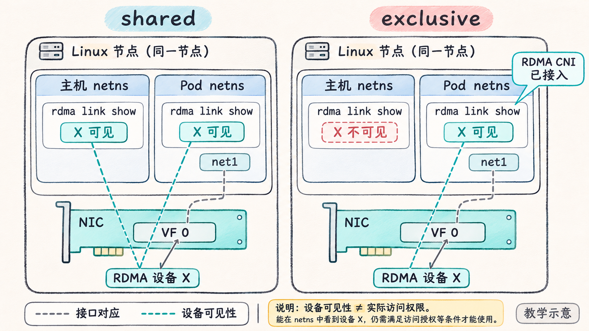

# 共享 HCA、独占 VF 与 RDMA 命名空间

Pod 申请一个 `rdma/...` 资源和申请一张 VF，都会消耗 Kubernetes 上的一个整数单位，但这个单位指向的设备不同。要选择接入方式，需要分别看 Pod 拿到的设备、RDMA 设备在哪些网络命名空间可见，以及端口和链路由谁共用。

## Macvlan 和 Shared Device Plugin 各做一半

NVIDIA Network Operator v26.7.1 的共享示例使用一张支持 RDMA 的主机网卡。`MacvlanNetwork.spec.master` 指向该网卡的 Linux 接口，例如 `ens1f0`。Macvlan CNI 在这个接口上创建有独立 MAC 的附加接口，IPAM 为每个 Pod 分配地址。RDMA Shared Device Plugin 通过 `selectors.ifNames` 选择同一个 `ens1f0` 所关联的 HCA，也就是运行 RDMA 操作的适配器，并给申请共享资源的容器提供对应的 RDMA 设备访问。接口配置与 RDMA 设备选择要对上同一个物理端口。 [NVIDIA Macvlan 共享示例](https://docs.nvidia.com/networking/display/kubernetes2671/quick-start/macvlan-rdma-shared.html) · [RDMA Shared Device Plugin 配置及工作流](https://github.com/Mellanox/k8s-rdma-shared-dev-plugin)

```json
{
  "resourceName": "rdma_shared_device_a",
  "resourcePrefix": "rdma",
  "rdmaHcaMax": 63,
  "selectors": {"ifNames": ["ens1f0"]}
}
```

这是 Shared Device Plugin 中单个资源池的摘录。两个 Pod 各申请 `rdma/rdma_shared_device_a: 1` 时，假定该池只选择一张 HCA，两个 Pod 可各有一张 Macvlan 接口和一个地址，并访问同一张 HCA。`rdmaHcaMax: 63` 表示插件可向 Kubernetes 发布 63 个逻辑单位。物理端口的链路带宽仍由实际使用它的进程共享，调度计数不包含每个 Pod 的带宽配额。 [RDMA Shared Device Plugin 的容量定义](https://github.com/Mellanox/k8s-rdma-shared-dev-plugin#rdma-shared-device-plugin-configurations)

## VF 的网卡移动和 RDMA 设备的可见性

在 SR-IOV VF 路径中，Pod 获得一个单独分配的 PCI 功能，SR-IOV CNI 把其 netdev 放进 Pod 网络命名空间。设备插件配置 `isRdma: true` 时，分配还会向容器提供对应的 RDMA 资源。RDMA 设备自身在哪些网络命名空间可见，由 Linux RDMA 子系统和接入方式决定。Linux 有以下两种模式。 [SR-IOV Device Plugin 的 `isRdma`](https://github.com/k8snetworkplumbingwg/sriov-network-device-plugin) · [iproute2 的 RDMA 子系统手册](https://github.com/iproute2/iproute2/blob/main/man/man8/rdma-system.8)

- `shared` 允许 RDMA 设备跨网络命名空间可见。进程实际使用设备还取决于容器里的 `/dev/infiniband`、设备访问权限和用户态驱动。Macvlan 共享例依赖这种模式。
- `exclusive` 让一个 RDMA 设备只在它所属的一个网络命名空间可见。要将某个 VF 的 RDMA 设备交给 Pod，可以先由 SR-IOV CNI 接入 VF 的 netdev，再由链式 RDMA CNI 移动关联的 RDMA 设备。

基础 VF 教学路径假定节点保持 `shared`，NAD 使用普通 `sriov` delegate。在独立的 `exclusive` 教学场景中，Network Operator v26.7.1 文档通过 `SriovNetworkPoolConfig.spec.rdmaMode` 设为 `exclusive`，以它的 `nodeSelector` 确定受影响的节点。然后在 `SriovNetwork.spec.metaPlugins` 中追加 RDMA CNI。应检查生成的 NAD，其 `plugins` 顺序是 `sriov` 后接 `rdma`。`rdma system show` 用于确认节点模式，`rdma link show` 分别在主机和 Pod 内执行，用于确认同一个 VF 对应设备的可见性。再查 Pod 的设备节点和 Verbs 打开设备的结果。模式属于节点 RDMA 子系统，已有活动命名空间和 RDMA 设备时，内核可能拒绝切换到 `exclusive`。 [NVIDIA 基础 VF 示例](https://docs.nvidia.com/networking/display/kubernetes2671/quick-start/sriov-network-rdma.html) · [NVIDIA 独占模式示例](https://docs.nvidia.com/networking/display/kubernetes2671/deployment-guide-kubernetes.html#network-operator-deployment-and-rdma-exclusive-subsystem-mode) · [RDMA CNI 的链式配置与前提](https://github.com/k8snetworkplumbingwg/rdma-cni) · [iproute2 的模式切换条件](https://github.com/iproute2/iproute2/blob/main/man/man8/rdma-system.8)

```yaml
# SriovNetworkPoolConfig 的模式字段
spec:
  rdmaMode: exclusive
---
# SriovNetwork 的附加插件字段
spec:
  metaPlugins: |
    {"type":"rdma"}
```



*图 13-04-01　同一节点的两种独立配置。`rdma link show` 记录设备 X 在相应网络命名空间内的可见性。容器实际使用设备还取决于设备节点与访问权限。*

## 按资源与隔离条件选组件

| 接入方式 | 申请单位 | Pod 接口 | RDMA 可见性 | 共用资源与适用条件 |
| --- | --- | --- | --- | --- |
| Macvlan + RDMA Shared Device Plugin | 一个逻辑单位 | 由主机接口派生的 Macvlan | 用 `shared` 模式，核对容器实际获得的 RDMA 资源 | 多个 Pod 共用 HCA 和链路，适用于允许共享适配器的资源池。 |
| SR-IOV VF | 一个 VF | 独立 VF netdev | `exclusive` 配合 RDMA CNI，可把对应 RDMA 设备置入 Pod 的网络命名空间 | 同一 PF 下的 VF 仍共用物理端口。若要求限速、VLAN 策略或租户隔离，逐项查 NIC、驱动与配置能力。 |
| Host Device | 一个匹配的主机设备 | 由 Host Device CNI 移入的主机接口 | 取决于 RDMA 模式、设备资源和插件组合 | 若交付的是整条专用物理接口，该接口占用粒度更大，节点要另外维持自己的管理和默认网络。 |

以太网侧的 SR-IOV CNI 配置针对以太网 VF。采用 InfiniBand 时，应按接入方案选对应组件，例如给 IB VF 使用 InfiniBand SR-IOV CNI，通过 IPoIB 给共享方案提供 IP 接口，并核对 IB 端口、子网管理和适用的 P_Key 分区配置。设备分配和网络附加的分工仍可用上述表格分析，fabric 的地址和隔离条件随网络协议改变。 [NVIDIA v26.7.1 的 Host Device、IPoIB 与 IB SR-IOV 示例](https://docs.nvidia.com/networking/display/kubernetes2671/deployment-guide-kubernetes.html) · [CNI host-device 插件](https://www.cni.dev/plugins/current/main/host-device/)
