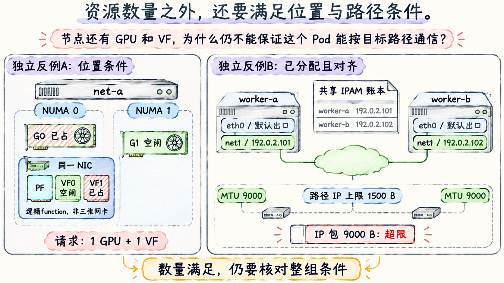

# 让设备位置与网络参数相互匹配

## 一张 GPU 加一个 VF 没有表达它们的距离

场景 V 的两个 VF 均来自 NUMA 0 的 PF。G0 在 NUMA 0，G1 在 NUMA 1。如果一个容器同时请求 `nvidia.com/gpu: 1` 与 `example.com/roce_vf: 1`，数量账本只表达两个独立资源维度的需求。它没有写出“必须选 G0 和 VF0”，更没有表达完整 PCIe 路径或 GPUDirect 支持性。

下面是**自拟拓扑与占用快照**，CPU/内存容量在本题充足，VF0 空闲，VF1 已被另一个 Pod 占用：

| 对象 | NUMA 0 | NUMA 1 |
| --- | --- | --- |
| GPU | G0 已占用 | G1 空闲 |
| NIC / VF | PF；VF0 空闲，VF1 已占用 | 无 |
| 普通资源数量余额 | VF 1 份 | GPU 1 张 |

节点总数上满足一张 GPU、一个 VF，但没有一组空闲设备同在一个 NUMA 节点。`Topology Manager` 在 kubelet 内组合 CPU/设备等 Hint Provider 提供的拓扑提示，按策略决定节点内准入。假定 GPU 与 NIC 插件均正确提供对应 NUMA 提示、作用域为本容器、使用 `single-numa-node` 策略，且没有其他可选设备，则这个请求无法在单个 NUMA 节点对齐，会在节点内被拒绝。scheduler 已绑定也不能消除该限制。

若 G0 释放，则有 G0+VF0 的单 NUMA 组合，当前设备条件可以满足；这不是宣称其他准入、镜像和网络检查也已通过。`best-effort` 可以在无法最优对齐时接纳，`restricted` 对首选提示有更强条件，不能与 `single-numa-node` 混称为“开启 NUMA”。机制与策略见 [Kubernetes release-1.32 Topology Manager 文档](https://github.com/kubernetes/website/blob/release-1.32/content/en/docs/tasks/administer-cluster/topology-manager.md)。CPU 对齐还需 CPU Manager 的相应配置；只写 GPU/NIC limits 不会自动固定 CPU 或主机内存。

**节点数量满足时，设备仍可能分别落在两个 NUMA 区域，找不到同区组合。**

NUMA 相同只是邻近线索。同 NUMA 设备仍可能经过不同 PCIe 交换层级；实际 P2P、ACS/IOMMU、NIC/GPU 支持性必须另查。跨 NUMA 在某些平台上会增加绕行或使特定 GPUDirect 路径不可用，但不能仅凭 NUMA 编号替所有机器判死刑。第 04、06 章建立的数据路径判断仍然适用。

## 资源与网络地址要维护同一套身份

下面是 `net-a / worker-a` 在场景 V 中的**教学映射摘要**。相同 PCI 字符串若出现在 net-b，表示另一台机器上的另一设备：

```text
Pod: lesson-net/worker-a, container: worker, node: net-a
resource: example.com/roce_vf, allocated PCI: 0000:41:00.2
PF: 0000:41:00.0, VF index: 0, NUMA: 0
NAD: lesson-net/roce-vf, interface: net1
Pod RDMA: mlx5_2/1, netdev: net1, uverbs: /dev/infiniband/uverbs2
Pod IP on net1: 192.0.2.101/24
```

资源分配记录来自 kubelet 的 PodResources 等节点侧证据；PF/VF 关系来自 sysfs；RDMA/netdev 对应来自 `rdma link`、`ibdev2netdev` 等；IP 和路由来自 Pod 网络命名空间。必须在这些视角间建立映射，不能假定“Pod 的第一个 GPU 和第一个 HCA”自然最接近。

## IPAM 的协调范围必须覆盖共享地址域

`host-local` 将分配状态保存在节点本地，只保证本机账本的唯一性。两台机器若都从同一范围独立领取地址，可各自认为 `.101` 未占用而产生冲突。[host-local 官方说明](https://www.cni.dev/plugins/current/ipam/host-local/)明确限定了这个范围。

解决方法包括为节点预分互不重叠的地址段，或使用跨节点协调的 IPAM。Whereabouts 用共同后端记录租约；Network Operator 也可管理 NV-IPAM，下一篇说明其选择边界。任何方案还应避开宿主机、网关、静态服务等外部分配。两个互不协调的 IPAM 实例不会因为使用同一 CIDR 就自动共享租约。

地址耗尽与设备耗尽是不同故障。即使 Node 上有空闲 VF，IPAM 无可分配地址也会使 CNI ADD 失败；调度器通常不会提前把 NAD 地址池余额算进传统扩展资源。反过来，地址足够也不能替代 VF 分配。容量规划因此至少要分别保留 GPU、设备份数和地址余额。

## 保留默认路由，让目的地址决定出口

下面是场景 V 中 `worker-a` 的**自拟 Pod 内命令输出**，仅保留本章需要的行；网关 `10.244.1.1` 是默认 CNI 在本例提供的下一跳：

```text
$ ip -br addr
eth0   UP  10.244.1.20/24
net1   UP  192.0.2.101/24
$ ip route
default via 10.244.1.1 dev eth0
10.244.1.0/24 dev eth0 scope link src 10.244.1.20
192.0.2.0/24 dev net1 scope link src 192.0.2.101
$ ip route get 192.0.2.102
192.0.2.102 dev net1 src 192.0.2.101
```

访问 `.102` 命中 `/24` 直连路由，出口为 net1；DNS Service 等不匹配该网段的目的地仍走默认网络。本例没有第二条默认路由，也没有宣称所有集群 CNI 都生成相同网关地址。

若在附加网络选择里加入 `default-route`，或在 IPAM routes 中加入默认路由，就改变了这个前提。应重新检查 DNS、Service、控制连接与返回方向；跨子网附加网络还需要实际网关、远端路由以及必要的策略路由，不能只给 Pod 配一个地址。MTU、路由与地址都不会由 GPU 请求自动生成。

Linux `ip route get` 验证 IP 路由选择，不能单独证明 Verbs 使用哪个 HCA/GID。RoCEv2 的实际通信还涉及 RDMA 设备、端口、源地址/GID、地址解析和传输库选择。应用显式选错 HCA 时，正确的 net1 路由也救不了这次配置。

## 把三种 MTU 分开读

Ethernet netdev MTU 表示接口接受的三层包大小；交换设备的帧上限还包含链路层开销，厂商口径需核对；RDMA `active_mtu` 表示 RDMA 端口当前的包粒度能力，应用的路径 MTU 还要满足双方和路径约束。它们不是同一数字的三种写法。

下面是**独立的教学反例**，不覆盖导读中的健康网络条件：

| 位置 | 给定条件 |
| --- | --- |
| 两端 Pod net1、父 PF/VF | netdev MTU 9000 |
| 路径中间一段 | 明确只能转发 IP 包长不超过 1500 B 的报文；已排除其他故障 |
| 两端 RDMA 端口 | `active_mtu=4096`，不代表中间网络已接受该长度 |
| 待测 IPv4 ICMP | 无 IP options、IP 头 20 B、ICMP 头 8 B，DF=1 |

`ping -4 -M do -s 1472` 对应 IP 总长 `1472+8+20=1500 B`，在本题路径内；`-s 8972` 对应 9000 B，将超过中间限制。小 ping 通、大 ping 失败在这些充分条件下可解释为 MTU 不一致；在未知环境里仍要取证 ICMP、过滤和路径条件。

这个 ICMP 计算不能推出 RDMA QP 的路径 MTU 就应设为 9000，也不能用小 ping 通过替代 RDMA 测试。RDMA 端口的 MTU 字段可查 [rdma-core v56.0 的 ibv_query_port 手册](https://github.com/linux-rdma/rdma-core/blob/v56.0/libibverbs/man/ibv_query_port.3)。RoCE 的 PFC、ECN、优先级和链路错误仍按第 07 章逐层检查，不由 CNI 配了 MTU 就自动成立。



**图 fig-13-04-02** 两个视区为独立教学反例。左侧总数量足够，但在给定 single-numa-node 与正确提示条件下没有同 NUMA 的空闲组合；右侧已假定设备分配和对齐成立、地址协调且出口正确，仍因端点与路径包长条件不同而出现超限。位置、地址、选路与 MTU 必须沿同一交付路径分别核对。左侧“同一 NIC”范围包含 PF/VF 的逻辑占位，不代表三张实体网卡。

[上一篇](03_把VF与RDMA设备放进同一个命名空间.md) · [下一篇：在两个 Operator 之间接通 GPUDirect RDMA](05_在两个Operator之间接通GPUDirectRDMA.md)
