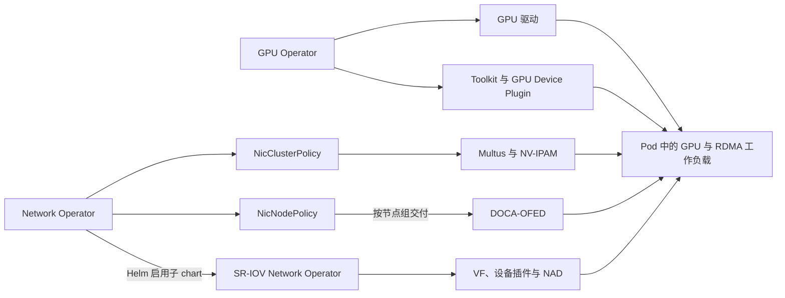

# 两个 Operator 怎样交付 GPUDirect RDMA 的依赖

两个 Pod 已经可以用 RDMA 传输主机内存中的数据。若把缓冲区改成 GPU 显存后注册失败，先核对当前走的是哪种 GPU 内存注册路径，再确认两端的驱动、设备与用户态库是否满足它的要求。

## 先确认由谁提供组件

下面以 Ubuntu 24.04 LTS x86_64、Kubernetes v1.36、containerd 2.3、GPU Operator v26.7.2 和 Network Operator v26.7.1 为教学版本。Network Operator v26.7.1 的 Kubernetes 范围为 1.32–1.36，总纲引用的 v26.4.0 范围为 1.31–1.35。这里按 v26.7.1 解释对象与配置层次，整套 GPUDirect RDMA 组合需另看厂商支持口径。 [Network Operator v26.7.1 平台矩阵](https://docs.nvidia.com/networking/display/kubernetes2671/platform-support.html) · [Network Operator v26.4.0 平台矩阵](https://docs.nvidia.com/networking/display/kubernetes2640/platform-support.html) · [GPU Operator v26.7 平台矩阵](https://docs.nvidia.com/datacenter/cloud-native/gpu-operator/26.7/platform-support.html)

| 依赖 | 配置入口和运行职责 | 核对哪一项结果 |
| --- | --- | --- |
| GPU 驱动、Toolkit、GPU Device Plugin | GPU Operator 的 `ClusterPolicy` 管理启用的 GPU 组件，驱动也可预装。 | 主机加载的 GPU 驱动、目标节点上的 Toolkit 和插件、Pod 实际获得的 GPU。 |
| NIC 驱动 | 预装发行版 NIC 驱动，或以 Network Operator 管理 DOCA-OFED。按池管理时由 `NicNodePolicy.spec.ofedDriver` 和 `nodeSelector` 决定覆盖范围。 | 目标节点上的实际 NIC/RDMA 模块、版本和端口，按同一 PCI 地址关联到网卡。 |
| Multus、通用 CNI 插件、NV-IPAM | `NicClusterPolicy.spec.secondaryNetwork.multus`、`secondaryNetwork.cniPlugins` 和 `spec.nvIpam` 管理启用项。已有组件时核对实际配置由谁维护。 | 节点运行时选中的 CNI 配置、可执行插件、Multus 与 NV-IPAM 状态、目标地址池。 |
| VF 创建、VF 资源发布、NAD 生成 | 教学主例通过 `sriovNetworkOperator.enabled: true` 启用 Network Operator chart 的 SR-IOV 子 Operator，由它管理配置守护进程、设备插件和 SR-IOV 网络对象。 | `SriovNetworkNodePolicy`、节点状态、已生成的 NAD 和 Node 上的 VF 资源。核对该 PF 只被预定的设备池管理。 |

Network Operator 还可以用 `NicNodePolicy` 按节点组管理 DOCA-OFED、RDMA Shared Device Plugin 或 SR-IOV Device Plugin。Multus、NV-IPAM 等集群范围组件由 `NicClusterPolicy` 管理。对已启用的组件读 `status.conditions[]`，例如 `MultusCNIReady`、`NVIPAMReady` 或 `OFEDDriverReady`，核对 `type`、`status`、`reason` 和 `observedGeneration`。`Ready=True` 表示受管理组件达到其就绪条件。要判断一个特定节点能否交付网络，继续核对 DaemonSet 在该节点的实际落点、驱动和接口，再验证 Pod。 [NVIDIA Helm 配置](https://docs.nvidia.com/networking/display/kubernetes2671/customizations/helm.html) · [NicClusterPolicy 与 NicNodePolicy](https://docs.nvidia.com/networking/display/kubernetes2671/customizations/nic-node-policy.html) · [Network Operator 状态条件](https://docs.nvidia.com/networking/display/kubernetes2671/life-cycle-management.html)

两边共用一套 NFD，并核对 `NodeFeatureRule` API 和 Node 上的 `feature.node.kubernetes.io/pci-10de.present`、`feature.node.kubernetes.io/pci-15b3.present`。已有 NFD 时，Network Operator 的安装指南给出 `nfd.enabled=false`，`nfd.deployNodeFeatureRules` 则控制是否交付规则。v26.7.1 的 chart 将 NFD 镜像标记为 `network-operator-v26.7.1`。其平台矩阵将 NFD 范围写为 v0.15.6–v0.17.0，并建议复用 GPU Operator 的实例。GPU Operator v26.7.2 源码标签中的 NFD 子 chart 依赖版本为 v0.19.0。实际部署前应检查发行 chart 的渲染结果以及现网 NFD 镜像，核对双方需要的标签和版本。仅凭这几份公开记录，无法确认 v0.19.0 在这一组合中的厂商支持。 [Network Operator NFD 前置条件](https://docs.nvidia.com/networking/display/kubernetes2671/platform-support.html#prerequisites) · [Network Operator v26.7.1 chart 默认值](https://github.com/Mellanox/network-operator/blob/v26.7.1/deployment/network-operator/values.yaml) · [GPU Operator v26.7.2 chart 依赖](https://github.com/NVIDIA/gpu-operator/blob/v26.7.2/deployments/gpu-operator/Chart.yaml)

## 设备可用之后，应用还要注册 GPU 内存

普通 RDMA 测试将主机内存缓冲区注册给 RDMA 设备。GPUDirect RDMA 则要让 NIC 能通过 PCIe 访问 GPU 显存，应用必须用支持的接口完成显存注册。主机侧需要兼容的 GPU、NIC、驱动和 PCIe 路径，例如核对 GPU 与 NIC 是否使用同一 PCIe I/O Root Complex。Pod 侧要同时有 GPU 和 RDMA 设备访问权限、匹配的 CUDA 用户态与 Verbs 库和设备 provider，测试程序或通信库还要支持所选的注册方式。 [GPU Operator 的 GPUDirect RDMA 前置条件](https://docs.nvidia.com/datacenter/cloud-native/gpu-operator/26.7/gpu-operator-rdma.html) · [CUDA GPUDirect RDMA 的 PCIe 拓扑限制](https://docs.nvidia.com/cuda/gpudirect-rdma/index.html#supported-systems)

| 显存注册方式 | GPU Operator v26.7 文档列出的条件 | 可核对的线索 |
| --- | --- | --- |
| DMA-BUF | Linux 内核 ≥ 5.12、开放 GPU 内核模块、工作负载内 CUDA ≥ 11.7，以及支持 DMA-BUF 的 GPU、NIC 驱动和应用。符合条件时可以使用发行版的 NIC 驱动及 RDMA 用户态包。 | GPU 内核模块类型、内核和 CUDA 版本、NIC 驱动能力，以及应用记录中的 DMA-BUF 注册结果。 |
| `nvidia-peermem` | 支持的 NVIDIA GPU 驱动，加上 MLNX_OFED 或 DOCA-OFED，以及这条路径所需的 `nvidia_peermem` 模块。 | 主机加载的两个驱动栈、`nvidia_peermem` 模块及应用对 GPU 缓冲区的注册结果。 |

由 GPU Operator 管理 GPU 驱动时，v26.7 文档用 `driver.rdma.enabled=true` 启用 legacy 模块。MLNX_OFED 直接安装在主机时，文档还指定 `driver.rdma.useHostMofed=true`。DMA-BUF 的注册过程通过内核的缓冲区共享接口完成，不依赖 legacy 模块。 [GPU Operator 的安装配置](https://docs.nvidia.com/datacenter/cloud-native/gpu-operator/26.7/gpu-operator-rdma.html#installing-the-gpu-operator-and-enabling-gpudirect-rdma)

厂商矩阵另有组合限制。GPU Operator v26.7 的 GDR 小节在 Ubuntu 24.04 项列出 Network Operator v26.1.0。Network Operator v26.7.1 的 GDR 小节列出 GPU Operator v25.3.x 或更新，以及 DOCA-OFED 和 `nvidia_peermem` 条件。上表的 DMA-BUF 前置条件取自 GPU Operator 的 GPUDirect 专章。评审具体环境要把注册方式、GPU 和 NIC 型号与固件、内核、两侧驱动和 Operator 版本一起核对。这些文档提供了组件条件，教学版本的端到端组合仍待实机验收和厂商支持确认。 [GPU Operator GDR 平台列表](https://docs.nvidia.com/datacenter/cloud-native/gpu-operator/26.7/platform-support.html#support-for-gpudirect-rdma) · [Network Operator GDR 平台列表](https://docs.nvidia.com/networking/display/kubernetes2671/platform-support.html#support-for-gpudirect-rdma)

## 把普通 RDMA 和显存测试做成可比较的两组证据

先在两台节点的 Pod 中选择同一个附加网络、对应的 RDMA 设备和端口，用主机内存跑 `ib_write_bw`。要验证 GPU 缓冲区，使用带 CUDA 支持的 perftest 构建，再跑两端 GPU 内存测试。GPU Operator v26.7 文档演示的是跨两节点的 Macvlan + Shared Device Plugin 环境。它在两端使用 `--use_cuda=0 --use_cuda_dmabuf`，其中 `0` 是容器内所选 CUDA 设备编号。对 legacy 路径两端都保留 `--use_cuda=0`，省略 `--use_cuda_dmabuf`。复测时固定节点、NIC、端口、消息大小、传输方向和工具版本，记录两端申请的缓冲区、显存注册方式和测试结果。 [NVIDIA 的 GPU 缓冲区验证示例与输出](https://docs.nvidia.com/datacenter/cloud-native/gpu-operator/26.7/gpu-operator-rdma.html#verifying-the-installation-by-performing-a-data-transfer) · [perftest 的 CUDA 与 DMA-BUF 参数](https://github.com/linux-rdma/perftest)

普通 RDMA 成功、显存测试失败时，先读两端哪一侧的缓冲区分配或内存注册失败，并核对工具是否编入所需支持。指定 GPU 缓冲区传输成功时，证据覆盖的是这次测试的设备对、注册方式和方向。训练程序是否选用相同路径，还需要该程序自己的设备选择和运行记录。本节引用的是官方共享网络验证方法，教学 VF 组合暂无实机结果。
