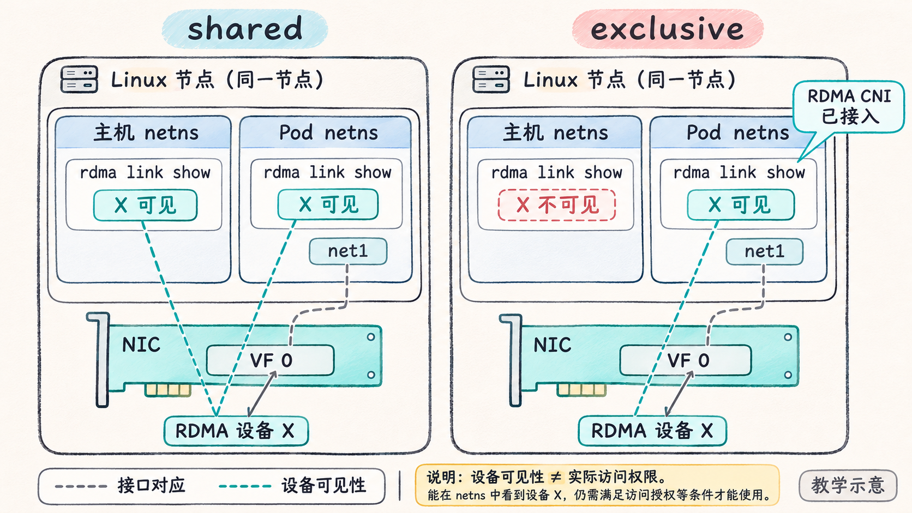

# 共享 HCA、独占 VF 与 RDMA 命名空间

SR-IOV 给每个 Pod 分一个独立 VF，隔离清晰、好追踪。但在实际集群里，业务需求千差万别：开发调试池或中小规模推理服务可能希望几十个 Pod 共用同一张高速网卡；而高隔离生产训练或 PD 分离推理池，则要求不同 Pod 连彼此的 RDMA 设备都完全看不见。

面对这些不同诉求，选型时抓住四个核心问题就不会迷路：**Kubernetes 按什么单位计数？Pod 收到哪种网络接口？RDMA 设备在哪个命名空间可见？底层的物理带宽还在被谁争抢？**

## Macvlan + 共享 HCA：无需切 VF 的轻量共享路径

**HCA（Host Channel Adapter，主机通道适配器）** 指为进程提供 RDMA 端口与硬件传输能力的适配器。当集群不想启用 SR-IOV 切分、又想让多个 Pod 共用一张高速网卡时，最常见的组合是 **Macvlan CNI + RDMA Shared Device Plugin**：

- **网络接口由 Macvlan 派生**：在宿主机高速物理口（例如 `ens1f0`）上，Macvlan CNI 为每个 Pod 派生一个带独立 MAC 地址的子接口，再由 IPAM 分配独立 IP。
- **RDMA 能力由共享插件申报**：RDMA Shared Device Plugin 选中同一个物理口对应的 HCA，把关联的 RDMA 设备访问权包装成可复用的逻辑扩展资源池。配置时必须让 `MacvlanNetwork.spec.master` 与设备插件的 `selectors.ifNames` 指向同一底层接口。

下面是单池共享插件的典型配置摘录：

```json
{
  "resourceName": "rdma_shared_device_a",
  "resourcePrefix": "rdma",
  "rdmaHcaMax": 63,
  "selectors": {"ifNames": ["ens1f0"]}
}
```

假设该配置只选中一张 HCA 且物理口正常，`rdmaHcaMax: 63` 表示 Kubernetes 最多可对外分配 63 个逻辑单位。当两个 Pod 各申请 `rdma/rdma_shared_device_a: 1` 后，该池的逻辑调度余量为：

$$\text{共享 HCA 逻辑余量} = \text{rdmaHcaMax} - \text{已分配单位} = 63 - 2 = 61$$

> [!warning] 常见误区：63 个逻辑单位 ≠ 63 份独享带宽
> 逻辑上限只控制 Kubernetes 最多把这张 HCA 借给多少个 Pod。物理层依然只有一块网卡和一条链路，所有并发流量共用同一口线速，且单节点可接入的 Pod 总数同样受 IPAM 地址池限制。

## 独占 VF 与 Linux RDMA 命名空间：`shared` vs `exclusive`

回到 SR-IOV 方案。每只 Pod 分到的是独立的 PCIe VF，SR-IOV CNI 将 VF 的网络接口（netdev）移入 Pod 网络命名空间。设置 `isRdma: true` 后，设备插件同时向容器交付关联的 RDMA 设备节点。

但是，**接口移进 Pod 了，对应的 RDMA 设备谁能看见？** 这由 Linux 节点级 RDMA 子系统模式决定：

- **`shared` 模式（常见默认）**：节点上的所有 RDMA 设备跨网络命名空间可见。宿主机与各个 Pod 执行 `rdma link show` 都能枚举到同一批设备（Macvlan 共享方案必须工作在此模式）。
- **`exclusive` 模式（严格命名空间隔离）**：每个 RDMA 设备只属于唯一一个网络命名空间。此时必须在 SR-IOV CNI 之后串联 **RDMA CNI** 插件，由它找到该 VF 关联的 RDMA 设备并一并移入 Pod 网络命名空间。

在 Network Operator `v26.7.1` 中，启用 `exclusive` 模式只需两处配合——用 `SriovNetworkPoolConfig` 切换节点子系统模式，并在 `SriovNetwork` 中通过 `metaPlugins` 挂入链式 `rdma` 插件：

```yaml
# 1) SriovNetworkPoolConfig：将目标节点的 Linux RDMA 子系统设为 exclusive
spec:
  rdmaMode: exclusive
---
# 2) SriovNetwork：生成 sriov → rdma 的链式 CNI 配置
spec:
  metaPlugins: |
    {"type":"rdma"}          # SR-IOV CNI 移入 netdev 后，由 RDMA CNI 移入关联的 RDMA 设备
```

当 Pod 删除触发 CNI `DEL` 时，插件链按**反序**执行——RDMA CNI 先把 RDMA 设备归还给宿主机，再由 SR-IOV CNI 回收网络接口。



*图 13-05-01：同一 VF 在 `shared` 与 `exclusive` 模式下的 RDMA 设备可见性对照。两侧 `net1` 均已移入 Pod；右侧经 RDMA CNI 接入后，宿主机命名空间不再可见设备 X。注意：设备可见不等于拥有打开权限，实际使用仍需核对容器 `/dev/infiniband` 授权与用户态 Verbs 驱动。*

> [!note] 切换模式的运行约束
> RDMA 子系统模式作用于整台节点。如果节点上已有活动网络命名空间且存在 RDMA 设备，在线从 `shared` 切到 `exclusive` 可能返回 `EBUSY`。变更前建议先排空节点，再用 `rdma system show` 确认生效模式，随后分别在宿主机和 Pod 内用 `rdma link show` 交叉验证。

## 三类高速接入方案全景对比与选型取舍

把 Macvlan 共享、SR-IOV 独占 VF 与整口直通（Host Device）放到同一张表里，按隔离强度、容量上限与运维复杂度一比，选型立刻清晰：

| 对比维度 | Macvlan + 共享 HCA | SR-IOV VF（`shared` / `exclusive`） | Host Device（整物理接口直通） |
| --- | --- | --- | --- |
| **分配与接入对象** | 1 个共享逻辑单位 + 派生 Macvlan 子接口 | 1 个独立 PCI VF + 独立 netdev（`exclusive` 加移 RDMA 设备） | 宿主机整块物理网口直接移入 Pod |
| **隔离性与可见性** | 仅支持 `shared`，多 Pod 共享 HCA 与链路，存在邻居干扰 | 独立硬件队列与 BDF；配 `exclusive` + RDMA CNI 可隔离 RDMA 设备视图；同 PF 下仍共享物理口带宽 | 独享整口物理链路与硬件队列，隔离度最高（需另保节点默认管理网） |
| **单卡容量上限** | 高（由 `rdmaHcaMax` 与 IP 池决定，如单口几十个 Pod） | 中（受网卡硬件 `sriov_totalvfs` 上限约束） | 极低（1 个物理口仅能交 1 个 Pod） |
| **运维复杂度** | 低（无需 BIOS/NIC 开启 SR-IOV 与切分策略） | 中（需配置节点策略、VF 资源池、可选 `exclusive` 链式 CNI） | 中低（需按口预留物理管理口，避免移走默认网口） |
| **典型适配场景** | 开发测试池、小规模可容忍干扰的共享推理服务 | **主流生产首选**：多租户分布式训练、PD 分离在线推理实例 | 极高吞吐整机独占型 8 卡大模型训练 Pod |

如果业务还要求两个 Pod 避开同一物理链路的带宽争用，单靠 VF + `exclusive` 还不够——必须按第 03 篇的方法为每个 PF 建独立资源池，将两个 Pod 明确分到不同物理口，并核对交换机上联的收敛情况。

> [!tip] 原生 InfiniBand（IB）网络的接入差异
> 若底层计算网是原生 InfiniBand 而非 RoCEv2，接入链遵循完全相同的分层逻辑，但 CNI 插件替换为 **IB SR-IOV CNI** 或 **IPoIB CNI**。物理端口须工作在 IB 模式，由子网管理器（Subnet Manager）完成 fabric 建表，并核对两端所属的 **P_Key（Partition Key，分区键）** 允许互通。

> [!summary] 核心结论
> **要高密度、低门槛选 Macvlan + 共享 HCA；要独立硬件队列与 RDMA 命名空间隔离选 SR-IOV VF + `exclusive` + RDMA CNI；要彻底独享物理端口选按 PF 分池或整口直通。**

当一个 Pod 既拿到了独占 GPU，又拿到了独占 VF，是不是就万事大吉了？不一定——如果 GPU 插在 CPU 1 下、VF 却分在 CPU 0 下，每一次 GPUDirect RDMA 都要横穿跨 CPU 互联总线。下一篇我们把视角切回服务器主板，讲透 GPU 与 VF 的 NUMA 对齐和 PCIe 路径。

> [!info]- 参考资料
> - **Macvlan 与 RDMA Shared Device Plugin**：[NVIDIA v26.7.1 的 Macvlan 共享案例](https://docs.nvidia.com/networking/display/kubernetes2671/quick-start/macvlan-rdma-shared.html)、[RDMA Shared Device Plugin 工作流](https://github.com/Mellanox/k8s-rdma-shared-dev-plugin)、[RDMA Shared Device Plugin 的 rdmaHcaMax 定义](https://github.com/Mellanox/k8s-rdma-shared-dev-plugin#rdma-shared-device-plugin-configurations)
> - **SR-IOV、RDMA 命名空间与 RDMA CNI**：[SR-IOV Device Plugin 的 isRdma](https://github.com/k8snetworkplumbingwg/sriov-network-device-plugin)、[iproute2 的 RDMA 命名空间模式](https://github.com/iproute2/iproute2/blob/main/man/man8/rdma-system.8)、[RDMA CNI 上游说明](https://github.com/k8snetworkplumbingwg/rdma-cni)、[CNI 插件链的 DEL 顺序](https://www.cni.dev/docs/spec/)、[NVIDIA v26.7.1 的 RDMA 独占模式示例](https://docs.nvidia.com/networking/display/kubernetes2671/deployment-guide-kubernetes.html#network-operator-deployment-and-rdma-exclusive-subsystem-mode)
> - **Host Device 与 InfiniBand 接入**：[CNI host-device 插件](https://www.cni.dev/plugins/current/main/host-device/)、[NVIDIA v26.7.1 的各类接入示例](https://docs.nvidia.com/networking/display/kubernetes2671/deployment-guide-kubernetes.html)
