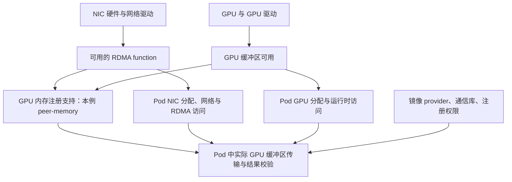
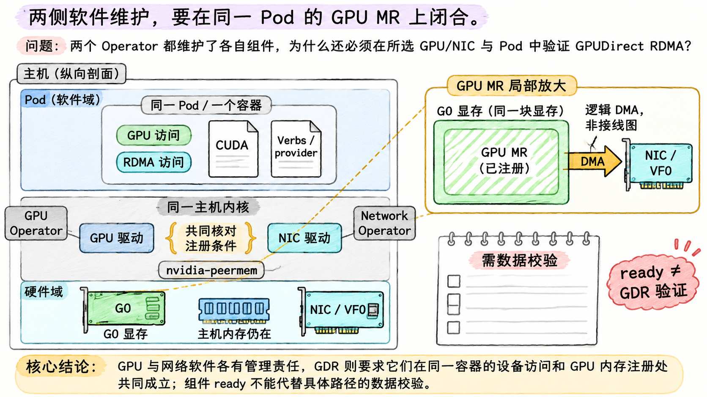

# 在两个 Operator 之间接通 GPUDirect RDMA

## 先按接入方案选择组件

Device Plugin 解决资源发现与分配，CNI 解决网络接入，IPAM 解决地址分配；Operator 维护这些组件及其配置。选择方案应先确定需要什么分配和隔离边界，再决定部署哪些软件。

| 接入方式 | 资源与接口的组合 | RDMA 与隔离边界 |
| --- | --- | --- |
| 本章 S：共享 PF HCA + macvlan | Shared Device Plugin 提供逻辑份数；macvlan 创建子接口；IPAM 分地址 | `shared`；PF HCA 跨命名空间可见；不加本章的 RDMA CNI |
| 本章 V：RDMA VF | SR-IOV Device Plugin 公布 VF；Multus 传递已分配 ID；SR-IOV CNI 配 netdev；IPAM 分地址 | 本章选 `exclusive` 并链入 RDMA CNI，迁移关联对象；VF 仍共享物理端口 |
| 整个 netdev 接入 | 设备插件可公布 PF 或已透传 function；host-device CNI 消费并迁移对应 netdev | 占用粒度更大；是否需要 RDMA 对象迁移仍取决于模式和组件能力；不能拿走宿主机管理接口后才发现节点失联 |
| IPoIB / IB VF | 使用 IPoIB 或 ib-sriov 等适用插件，另处理地址、PKey、GUID 与 fabric 条件 | IPoIB 是 IP 接口接入，不把 RDMA 变成 IPoIB Socket 传输；IB 子网管理仍在 Pod 外 |
| SF 等其他 function | 需要设备、固件、驱动、设备插件选择器和接入插件共同支持 | 不把 VF 的参数原样移植；分配粒度与隔离能力按实现核对 |

host-device、PF/SF 支持范围可分别查 [CNI host-device](https://www.cni.dev/plugins/current/main/host-device/) 与 [SR-IOV Device Plugin v3.9.0](https://github.com/k8snetworkplumbingwg/sriov-network-device-plugin/blob/v3.9.0/README.md)。IB 的独立组合见 [Network Operator v25.4.0 Getting Started](https://github.com/Mellanox/network-operator-docs/blob/v25.4.0/docs/getting-started-kubernetes.rst) 中 “SR-IOV InfiniBand Network”。表格用于比较职责，不代表所有组合都获得同等支持。

`hostNetwork: true` 是另一种直接使用宿主机网络命名空间的选择，不是新增一个独立附加网络；它减少 Pod 网络命名空间隔离，也不自动提供 GPU、RDMA 字符设备或库。本章 S/V 都不使用它。

## Network Operator 管理网络软件，GPU Operator 管理 GPU 软件

**Network Operator** 用 `NicClusterPolicy` 表达集群期望，按所选方案维护网络驱动、设备插件、Multus/CNI、IPAM 等。某些功能由其部署的其他 Operator 承担：例如 SR-IOV Network Operator 用 `SriovNetworkNodePolicy` 配置 PF/VF，用 `SriovNetwork` 生成网络附件配置。`NicClusterPolicy`、`SriovNetworkNodePolicy` 和 NAD 不是同一个对象的不同名字。

GPU Operator 则用 `ClusterPolicy` 维护 GPU 驱动、Toolkit、GPU 插件和相关组件。两个策略对象都能 ready，并不意味着某对 GPU/NIC 已完成 GPUDirect 数据传输。组件范围与子状态语义见 [Network Operator v25.4.0 README](https://github.com/Mellanox/network-operator/blob/v25.4.0/README.md)。

下面是本章采用的一份**教学责任清单**。预装方式若改变，相应行必须整体换管理者，不能让节点镜像脚本与 Operator 同时维护同一内核驱动：

| 对象/状态 | 本轮管理者 | 两侧共同确认的交界 |
| --- | --- | --- |
| NIC 固件、物理端口、交换机 RoCE 策略 | 节点/网络平台 | 硬件支持、固件版本、链路、VLAN/MTU/拥塞配置 |
| NIC 内核驱动、RDMA 内核栈 | Network Operator 所管理的 DOCA-OFED 驱动路径 | GPU peer-memory 构建/加载所需符号与版本 |
| VF 数量、绑定与持久化 | 场景 V 的 SR-IOV Network Operator | 创建后由设备插件发现；无重复配置者 |
| Multus、接入 CNI、网络设备插件 | Network Operator 体系 | 插件版本、资源名、设备信息传递、namespace 模式 |
| Whereabouts v0.8.0 及地址域 | 本章独立网络平台部署 | 共享后端、权限、静态地址排除及回收 |
| GPU 驱动、Toolkit、GPU 插件 | GPU Operator | 与网络驱动的注册接口、运行时交付 |
| GPU/NIC 用户态库、通信库与应用配置 | 工作负载镜像及作业配置 | provider、内存注册 API、设备选择、资源请求 |

NFD 也要有唯一部署者。若 GPU Operator 体系已经提供符合两个 Operator 需求的 NFD，应关闭 Network Operator chart 的重复 NFD 部署，同时核对所需发现规则；“已有几个标签”不等同于配置完备。25.4.0 的说明见 [Getting Started 的 Prerequisites](https://github.com/Mellanox/network-operator-docs/blob/v25.4.0/docs/getting-started-kubernetes.rst)。

本章为了展示 IPAM 接口独立使用 Whereabouts，不把它写成当前 Operator 默认推荐。Network Operator **25.4 弃用 Whereabouts 集成，25.10 移除 `NicClusterPolicy` 中的集成入口**；这不表示独立的 Whereabouts 项目消失。Operator 内的替代路线是按对应版本配置 NV-IPAM：例如 25.4 的 `IPPool` 指定子网和每节点分块，CNI `ipam` 使用 `type: nv-ipam`、`poolName` 引用它。不能只改插件名字而不部署控制器、CRD、权限和地址池。[v25.10.0 release notes](https://github.com/Mellanox/network-operator-docs/blob/v25.10.0/docs/release-notes.rst)记录了这一变更；历史教学配置与当前选型需要分开阅读。

## RDMA 可用以后，GPU 缓冲区还多一条注册依赖

普通 RDMA 可以以主机内存作为 MR；GPU 应用也可以先在 GPU 与主机缓冲区间复制，再由 NIC 传输。**GPUDirect RDMA** 的目标是让支持的 NIC 在注册与映射成立后 DMA 访问 GPU 显存，省去这部分主机暂存。两种路径都可能使用 RDMA，所以“日志写 NET/IB”不能单独证明数据来自 GPU 显存。

**GPUDirect RDMA 改变的是 NIC 访问的缓冲区位置，主机暂存路径仍然可以使用 RDMA。**

NVIDIA 的两条主要内核侧支持路线是 DMA-BUF 与 legacy `nvidia-peermem`，应用/通信库必须支持相应注册方式：

| 路线 | 本章需要保留的条件 | 不能据此直接推出的结论 |
| --- | --- | --- |
| DMA-BUF | 支持的 GPU、open GPU kernel modules、满足要求的内核/CUDA/NIC 驱动与用户态注册接口；25.3 文档列出内核至少 5.12、CUDA 至少 11.7 等前置 | 仅有新内核或 open 模块就已完成 GPU MR 注册 |
| `nvidia-peermem` | GPU 模块与 MLNX_OFED/DOCA-OFED 等兼容，peer-memory 模块正确构建、加载；应用使用对应 GPU 注册路径 | 模块存在就说明当前每个 VF、容器和通信库均走直访路径 |

条件与 GPU Operator 开关依据 [25.3.0 GPUDirect RDMA 文档](https://docs.nvidia.com/datacenter/cloud-native/gpu-operator/25.3.0/gpu-operator-rdma.html)。其中 `driver.rdma.enabled=true` 用于 legacy peer-memory 路线；它不是给所有 DMA-BUF 部署都必须打开的“RDMA 总开关”。主机预装网络驱动时还涉及 `driver.rdma.useHostMofed` 的责任选择，应按该版本文档和实际驱动管理方式使用。

本章后续成功材料选 **legacy nvidia-peermem 路线，Network Operator 管理网络驱动**，并另给定两端所选 GPU/function 的注册、拓扑和驱动组合均支持。场景 S/V 的网络机制本身不靠这个假设成立；普通主机内存 RDMA 也不依赖 GPU peer-memory 模块。场景 V 的 GPU Direct 支持需针对 VF 路径验证，不能拿 PF 成功直接替代。

主机侧应检查 GPU/NIC/固件、PCIe 路径、网络驱动、GPU 驱动、注册桥接和互联条件；Pod 侧则检查**同一容器**请求到 GPU 与 RDMA 资源、设备文件可访问、CUDA 与 rdma-core/provider 可用、memlock 限制满足注册量、通信库支持且实际选择 GPU 注册路径。不同组件可能需要不同权限；应从明确的设备/注册失败证据配置，不能把所有工作负载统一改成 privileged 作为解释。

镜像中安装 `libibverbs` 并不能代替宿主机 NIC 内核驱动；宿主机有驱动也不能保证镜像中存在匹配的 mlx5 provider。memlock 是进程可锁定内存量的限制，大量注册失败时需检查实际限制和使用量，而不是凭错误发生在 GPU 作业中就判定显存不足。

## 管理 ready 与数据传输之间还差什么

下面箭头表示功能前置，没有规定所有 DaemonSet 的实际启动顺序：

Operator ready 主要反映受管状态，业务验证还要覆盖具体节点、function、网络、消息大小、并发、缓冲区类型与结果正确性。接下来用这些层次建立一条从 Pod 请求到实际传输的证据链。

**图 fig-13-05-02** GPU Operator 与 Network Operator 分别维护相关主机软件，但它们服务于同一主机上的负载。图中选用正文的 legacy peer-memory 路线：同一容器具备两类设备访问和用户态条件，所选 GPU MR 成功注册后，NIC 才能按本路径访问显存。管理 ready 与本次路径验证仍须分别记录；DMA 为逻辑示意。右侧 NIC 与 GPU MR 属于同一局部观察，不增加硬件数量；空白校验纸表示仍须验证。

[上一篇](04_让设备位置与网络参数相互匹配.md) · [下一篇：用分层证据判断网络交付到了哪里](06_用分层证据判断网络交付到了哪里.md)
