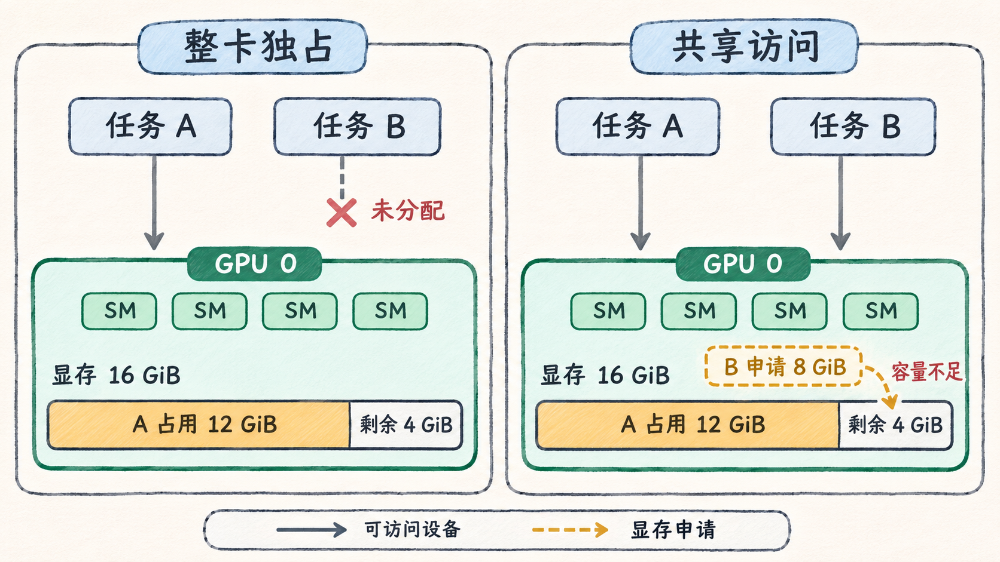

# 一张 GPU 怎样给多个任务用

任务 A 每次做完一段 GPU 计算，都要等 CPU 准备下一批数据。这时候 GPU 利用率降下来了。任务 B 能不能趁空档用这张卡？先看 A 是否独占设备，再看两份工作是否能同时放进显存，以及它们互相干扰时，业务能否接受结果。

## 能访问、放得下和跑得动

GPU 是物理设备。驱动让得到权限的进程访问设备。卡内的 SM 执行计算，显存保存输入、权重、中间结果和工作区。程序提交给 GPU 执行的一段计算叫作 Kernel。一次 Kernel 结束后，只要程序还需要之前分配的数据，显存就可能继续占用。等 CPU 准备数据、没有 Kernel 在执行和显存已释放，是三个可以分别观察的状态。 [NVIDIA CUDA 执行模型](https://docs.nvidia.com/deploy/mps/595/architecture.html#background) · [NVIDIA MIG 对 SM 和显存 slice 的定义](https://docs.nvidia.com/datacenter/tesla/mig-user-guide/620/concepts.html#terminology)

假设一张教学 GPU 有 16 GiB 可用显存，A 的峰值为 12 GiB，B 为 8 GiB。二者单独运行都放得下。如果 A 保留了 12 GiB，B 又开始申请 8 GiB，两份需求会同时达到 `12 + 8 = 20 GiB`，相差 4 GiB。即使 Kernel 从来没有重叠，这个显存冲突也会发生。如果 A 先释放缓冲区，再由 B 使用，峰值就可以错开。这里的数字仅用于推导，暂不计运行时开销和其他进程。

*左图为整卡独占，右图为共享访问。共享访问让 B 可以提出显存申请。A 的 12 GiB 仍在驻留时，剩余的 4 GiB 容不下 B 申请的 8 GiB。数值为教学假设。*

评估共享时，可以让同一对任务分别回答以下问题。

| 要判断的事情 | 用什么证据回答 |
| --- | --- |
| **显存容量** | 观察单设备的峰值需求、同时驻留的总量、分配上限与实际可用空间。 |
| **计算资源** | 看设备分配了哪些计算单元，或运行时给进程设了怎样的执行上限。 |
| **性能干扰** | 比较单跑与同卡并跑时的吞吐和尾延迟。即使显存容量够用，缓存、显存带宽和执行机会也可能发生竞争。 |
| **故障影响** | 区分应用退出、显存分配失败、驱动报告的 GPU 级错误和整机故障，核对同时受影响的进程与设备。 |
| **租户安全** | 明确谁能打开设备、谁可以配置或重置设备，以及工作负载与宿主机分别处在哪个信任边界。 |

同一项观测通常只能回答其中一部分。看到 GPU 利用率低，可以继续查工作何时提交。看到显存还有余量，可以继续算峰值是否会重叠。要判断 B 当前能否使用设备，还得读分配和访问状态。

## 按资源怎样交给任务分类

下表继续使用 A、B 和同一张物理卡。分类依据是**方案控制什么资源，以及共享发生在哪里**。整卡独占提供基线，软件共享与硬件切分是本章讨论的两个方向。

| 使用方式 | A 和 B 各自获得什么 | 代表机制 |
| --- | --- | --- |
| 整卡独占 | 一次只为一个使用者交付整张卡 | 完整 GPU 的 Device Plugin 分配 |
| 软件共享，时间复用 | 两者可在同一设备上提交工作，执行可以交错 | Time-Slicing |
| 软件共享，协同并发 | 两个 CUDA 客户端共享执行资源，有条件时 Kernel 可以重叠 | CUDA MPS |
| 软件共享，软件限额 | 同卡运行，显存分配和计算提交可由软件限制 | HAMi-core |
| 硬件切分 | 各自获得一个硬件实例，每个实例拥有分配给它的计算和显存资源 | MIG |

软件一栏里的三个例子侧重点不同。Time-Slicing 让多个使用者获得访问机会，MPS 为多个 CUDA 进程提供协同并发，HAMi-core 打开按任务检查显存和节流的路径。硬件切分也可以和软件共享组合。例如在一个 MIG 实例上再做 Time-Slicing，同一实例内的任务仍要争用该实例的设备资源。HAMi 作为中间件也有两条相关路径，HAMi-core 执行软件限额，Flexible MIG 管理硬件实例的按需分配。 [NVIDIA Time-Slicing](https://docs.nvidia.com/datacenter/cloud-native/gpu-operator/26.7/gpu-sharing.html) · [CUDA MPS 架构](https://docs.nvidia.com/deploy/mps/595/architecture.html) · [HAMi-core 限额](https://project-hami.io/docs/key-features/device-resource-isolation) · [NVIDIA MIG](https://docs.nvidia.com/datacenter/tesla/mig-user-guide/620/introduction.html) · [HAMi Flexible MIG](https://project-hami.io/docs/userguide/nvidia-device/dynamic-mig-support)

设备还可以交给虚拟机。GPU 直通把整张物理卡直接交给一个虚拟机的驱动。NVIDIA vGPU 软件可以向虚拟机提供由时分或 MIG 支撑的设备，具体取决于 GPU 和产品模式。读到 **GPU 虚拟化** 时，先辨认材料在描述资源怎样分，还是描述资源经由哪一层交付给使用者。这里的主场景是 Linux 裸机上的容器。 [NVIDIA GPU 直通](https://docs.nvidia.com/vgpu/latest/grid-vgpu-user-guide/using-gpu-pass-through.html) · [NVIDIA vGPU for Compute 模式](https://docs.nvidia.com/ai-enterprise/release-7/latest/infra-software/vgpu/overview.html)

## 整卡已分配，空闲时仍有归属

在关闭共享和 MIG 的 Kubernetes 节点上，NVIDIA Device Plugin 向 kubelet 报告可用的物理设备。某个容器一旦获分配一张卡，该设备通常随容器所属 Pod 的使用生命周期占用，直到相应分配被回收。程序可以按需申请或释放显存，设备归属遵循另一套生命周期。 [Kubernetes v1.36 Device Plugin 的设备上报和分配](https://v1-36.docs.kubernetes.io/docs/concepts/extend-kubernetes/compute-storage-net/device-plugins/)

| 同一张卡的三个时点 | 当前使用权 | B 能否获得这张整卡 |
| --- | --- | --- |
| A 正在运行 Kernel | 已分给 A | 不能 |
| A 等待 CPU，卡上暂时没有 Kernel | 仍分给 A | 不能 |
| A 结束，kubelet 已回收设备分配 | 可以再分配 | 可以进入分配候选 |

这里的独占是由设备分配路径给出的。容器实际能打开哪些设备取决于注入和访问权限，宿主机特权进程的可见范围另有配置。整卡也和同机其他设备一起依赖主机供电、驱动和系统状态。评估吞吐需要看 GPU 型号、数据路径和负载，评估安全需把宿主机权限带入判断。
