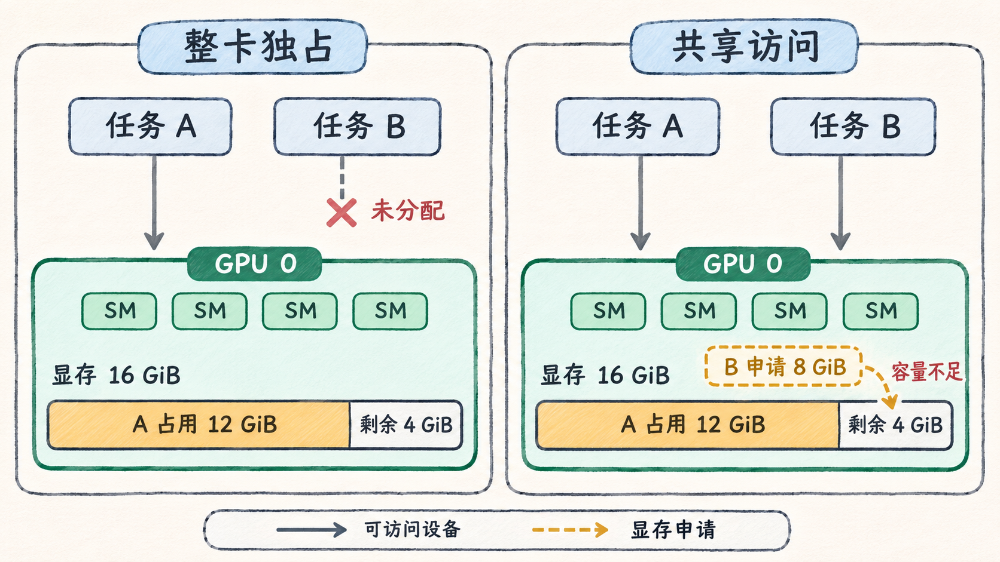

# 整卡分配、显存驻留与共享边界

线上部署一个量化后的 7B 或 14B 对话推理模型，加上正常并发下的 KV Cache，往往只需要 12—18 GiB 显存；一个算法工程师的交互式开发调试容器，绝大多数时间甚至处于空等状态。如果给这类负载强行分配一张 40 GB 或 80 GB 整卡，大半显存和算力都会长期闲置。

但要是图省事，直接把两个在线推理服务塞进同一张 GPU，生产环境很快就会遭遇三重灾难：

1. **显存驻留冲突**：模型权重一旦加载便长期钉在显存里，即使当前一秒没有任何用户请求，也不会主动腾出空间。
2. **KV Cache 突发撞爆 OOM 连坐**：一个服务的长上下文请求骤增，KV Cache 瞬间吃光整卡余量，直接把同卡邻居的新请求乃至整个进程拖入 OOM。
3. **邻居 Prefill 洪峰打爆 Decode 尾延迟**：邻居突然涌入一批长提示词，计算密集的 Prefill 瞬间占满 SM 与 HBM 带宽，正在逐字生成的另一个在线服务立刻出现肉眼可见的卡顿。

本章就是为了系统解决这一矛盾：**如何围绕在线推理的服务质量承诺，设计既不浪费整卡、又守住隔离底线的 GPU 资源池**。先从整卡独占的归属生命周期与显存驻留规律看起。

## 整卡分配的生命周期：空转不等于可回收

GPU 是一块由操作系统驱动管理的物理硬件。进程获得设备访问权后，驱动把应用提交的 Kernel 调度到卡上执行，而模型权重、输入张量、KV Cache 与框架工作区全部驻留在显存里。

在默认整卡分配模式下，Kubernetes 通过 kubelet 与 Device Plugin 把整张物理卡交给某一个容器独占。即使这个容器当前正在等 CPU 做文本分词、等网络接收下一批请求，甚至把临时缓冲区全清空了，只要它的 Pod 还没有退出，设备归属依然牢牢锁在它手里。

| 同一张物理卡的三个时点 | GPU 是否在执行计算 | 显存权重是否驻留 | 设备调度归属 |
| --- | --- | --- | --- |
| 在线服务正在执行 Kernel | 是 | 是 | 已被当前容器独占 |
| 服务等待下一批请求或 CPU 预处理 | 暂停 | 仍常驻显存 | 仍归当前容器持有 |
| Pod 退出且分配已回收 | 暂停 | 已释放 | 释放回池，可供新 Pod 分配 |

> [!warning] 常见误区：利用率归零 ≠ 资源空闲
> 监控大盘里一张 GPU 的计算利用率跌到 0%，只说明当下没有 Kernel 在跑，既不意味着模型权重已经撤出显存，也不意味着调度器可以把这张卡分给别人。整卡独占模式以 Pod 生命周期为回收边界，而不是以单次计算耗时为边界。

要讨论宿主机特权进程绕过编排直接访问设备时，还需结合驱动设备节点权限与容器安全策略一并核查，而非仅看调度账本。

## 同时驻留的显存账本与 KV Cache 突发风险

一旦放开整卡独占、允许两个容器同时打开同一张物理卡，决定它们能不能共存的第一道门槛并不是算力，而是**同时驻留的显存容量**。

看下面这张对照图：假设一张 `GPU 0` 提供 `16 GiB` 应用可用显存。左侧是整卡独占，已有工作负载（图中记为 `任务 A`）拿走整卡，新接入的工作负载（`任务 B`）连设备访问权都拿不到。右侧放开了共享访问，`任务 A` 与 `任务 B` 都能打开这张卡。

*图 14-01-01：整卡独占与共享访问对照。两侧显存状态相同，右图开放共享访问权后，仍受总显存同时驻留上限约束。*

即便 `任务 A` 此刻一丁点计算都没做，只要它为了响应下一批请求而把 `12 GiB` 权重和缓存留在显存里，剩余可用容量就只剩：

$$V_{\text{free}} = 16\ \text{GiB} - 12\ \text{GiB} = 4\ \text{GiB} < 8\ \text{GiB}$$

`任务 B` 申请 `8 GiB` 时立刻遭遇 `4 GiB` 缺口而分配失败。两个服务的 Kernel 哪怕从未在同一微秒执行，显存冲突照样在申请阶段爆发。

如果已有服务在邻居加载前能主动释放 `4 GiB` 临时工作区，两者合计恰好达到 $8 + 8 = 16\ \text{GiB}$，在不计框架开销的理想账本里才勉强放得下。但在在线 LLM 推理中，显存由三块组成：

$$V_{\text{total}} = V_{\text{weights}} + V_{\text{runtime}} + V_{\text{KV\_cache}}(B, L)$$

模型权重 $V_{\text{weights}}$ 与 CUDA 上下文、推理引擎预留池 $V_{\text{runtime}}$ 属于**不可错峰的常驻底座**；而 $V_{\text{KV\_cache}}(B, L)$ 会随并发请求数 $B$ 与上下文长度 $L$ 动态膨胀。如果两个在线服务共用同一池无上限显存，平时风平浪静，只要其中一方突然涌入长文本请求，另一方立刻面临 OOM 连坐。

## 在线推理的隔离评判标尺：TTFT、TPOT 与 SLO

在分布式训练里，大家盯着整集群吞吐和步耗时看；但在在线大模型推理里，平均吞吐高远远不够，用户体验直接由三个延迟标尺决定：

- **TTFT（Time To First Token，首字延迟）**：从用户发出请求到看见第一个生成 token 的等待时长。它主要由请求排队时间与 **Prefill 阶段**的计算耗时决定，最怕被同卡邻居抢占 SM 算力或长时间霸占执行队列。
- **TPOT（Time Per Output Token，单 token 生成间隔，又称 ITL，Inter-Token Latency）**：模型开始输出后，每吐出下一个 token 的平均间隔。它由 **Decode 阶段**驱动，本质受限于 HBM 显存带宽，一旦邻居争抢 HBM 通道或 L2 缓存，打字机输出就会一卡一顿。
- **SLO（Service Level Objective，服务等级目标）**：业务对推理服务的硬性契约，通常落在尾部延迟分位（如 `TTFT P99 < 500 ms`、`TPOT P99 < 35 ms`）。哪怕 95% 的请求很快，只要最慢的 1% 频繁超标，在线服务就违反了 SLO。

> [!tip] 工程直觉：用双阶段视角看懂“邻居干扰”
> 在线推理同卡混跑的干扰有两条截然不同的暗道：**SM 算力排队主要打爆 TTFT**（邻居一批长提示词 Prefill 进来，你的请求干等上卡），**HBM 带宽争抢主要拖垮 TPOT**（两个 Decode 服务同时满速刷权重和 KV Cache，单卡有效带宽被生生劈成两半）。

## 评估共享与切分方案的五个工程维度

无论底层采用软件轮转、多进程并发、软件限额还是硬件物理切分，平台交付给容器的本质无非三类东西：**整张物理卡**、**同一物理卡的共享访问名额**，或者**由硬件切出的独立实例**。

后文剖析每一种主流方案时，都统一用下面五个核心工程维度外加故障与安全边界逐一打分，方便直接落到资源池选型：

| 评估维度 | 面向在线推理的核对重点 |
| --- | --- |
| **显存硬隔离** | 能否为每个副本划定硬上限？邻居 KV Cache 突发增长时，是只让越界者自己 OOM，还是拉着同卡邻居一起崩溃？ |
| **算力与 HBM 带宽干扰** | 邻居执行重型 Prefill 或满速 Decode 时，是否会争抢当前服务的 SM、L2 缓存与 HBM 显存通道？ |
| **P99 尾延迟表现** | 固定输入分布与并发度下，同卡并跑相比单跑，TTFT P99 与 TPOT P99 的抖动幅度是否可预测、可承诺 SLO？ |
| **卡内碎片率** | 资源切分粒度是否灵活？会留下多少无法被其他服务复用的零散显存或计算切片？ |
| **运维灵活性** | 能否按 Pod 请求动态增减配额，还是必须先排空整张卡上的在线副本再做静态重配置？ |

此外还必须单独看清两条红线：**故障隔离域**（单次 OOM、进程崩溃、硬件致命错误和宿主机宕机分别波及谁）与**访问控制边界**（谁能接触设备节点、谁有权更改切分配置）。

> [!summary] 核心结论
> **独立的 CUDA 虚拟地址空间 ≠ 独立的显存容量隔离**。两个同卡进程虽然互相看不见对方的显存指针，但如果从同一块无上限显存池里分配空间，一方爆掉 KV Cache 照样让另一方无处分配。下一篇先从最轻量的两类软件共享方案——Time-Slicing 与 CUDA MPS——拆解同卡进程的调度与干扰真相。

> [!note] 虚拟化交付对照（GPU 直通与 vGPU）
> 虚拟机同样可以作为 GPU 的交付载体。**GPU 直通**把整张物理卡直接映射给单台虚拟机，语义等价于整卡独占；**NVIDIA vGPU** 则可在底层通过时分或 MIG 切分把单卡交付给多台虚拟机。本章主线聚焦 Linux 裸机与容器路径，但评估虚拟机 GPU 池时，以上五个维度与故障域标尺完全通用。

> [!info]- 参考资料
> - **CUDA 执行与背景模型**：[NVIDIA CUDA 执行模型](https://docs.nvidia.com/deploy/mps/595/architecture.html#background)、[NVIDIA MPS 架构](https://docs.nvidia.com/deploy/mps/595/architecture.html)
> - **MIG 术语与隔离机制**：[NVIDIA MIG 术语](https://docs.nvidia.com/datacenter/tesla/mig-user-guide/620/concepts.html#terminology)、[NVIDIA MIG 的内存与计算隔离](https://docs.nvidia.com/datacenter/tesla/mig-user-guide/620/introduction.html)
> - **Kubernetes 整卡分配与安全边界**：[Kubernetes v1.36 设备插件分配模型](https://v1-36.docs.kubernetes.io/docs/concepts/extend-kubernetes/compute-storage-net/device-plugins/)、[NVIDIA GPU Operator v26.7.2 安全说明](https://docs.nvidia.com/datacenter/cloud-native/gpu-operator/26.7/security.html)
> - **虚拟化交付对照**：[NVIDIA GPU 直通指南](https://docs.nvidia.com/vgpu/latest/grid-vgpu-user-guide/using-gpu-pass-through.html)、[NVIDIA vGPU 架构概览](https://docs.nvidia.com/ai-enterprise/release-7/latest/infra-software/vgpu/overview.html)
