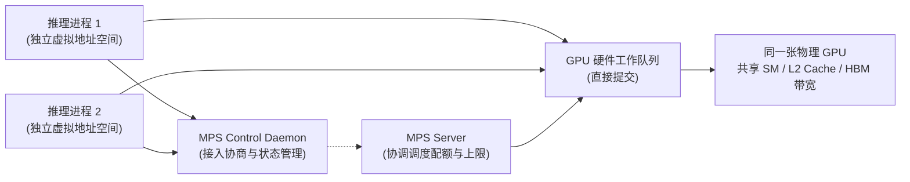

# Time-Slicing 时分共享与 CUDA MPS 并发

当两套轻量推理服务、向量嵌入服务或开发测试容器共享同一张物理 GPU，且无需改动底层硬件分区时，最直接的两条软件路径是 **Time-Slicing（时分共享）** 与 **CUDA MPS（Multi-Process Service，多进程服务）**。

理解两者的分界线，要先抓住一个核心对象：**CUDA Context（上下文）**。每个使用 GPU 的进程都会在目标设备上建立自己的 CUDA 上下文，里面保存了该进程独立的虚拟地址空间、已分配的显存映射与执行状态。普通时分共享让多个上下文轮流上卡，而 MPS 则把多个进程的工作送入协同调度通道，让它们的小型 Kernel 有机会在同一瞬间并行推进。

## Time-Slicing：轮流算，但显存始终并肩挤在一起

**Time-Slicing（时分共享）** 是 GPU 驱动层原生支持的上下文轮转机制。多个容器通过 Kubernetes Device Plugin 拿到同一张物理卡的共享访问名额后，各自向驱动提交 Kernel，驱动按时间片在不同 CUDA 上下文之间切换执行。

下表展示两个在线推理副本共享同一张卡时的典型交替视图（切片时长随实际 Kernel 负载波动）：

| 观察对象 | 时间片段一 | 时间片段二 | 时间片段三 |
| --- | --- | --- | --- |
| 当前占用 SM 的副本 | 推理副本 1 | 推理副本 2 | 推理副本 1 |
| 显存中驻留的数据 | 副本 1 + 副本 2 权重与 KV Cache | 副本 1 + 副本 2 权重与 KV Cache | 副本 1 + 副本 2 权重与 KV Cache |

这张表一针见血地暴露了时分共享的本质：**计算是轮流的，显存却是同时占着的**。

放到真实型号上算一笔账就更直观。以单张 A100-SXM4-40GB 为例，驱动向上层报告的可用显存约 `40,537 MiB`。假设两套 14B 推理副本落到同一张卡上，在各自高并发 KV Cache 展开后各需常驻 `22 GiB`：

$$V_{\text{req}} = 2 \times 22 \times 1024\ \text{MiB} = 45,056\ \text{MiB}$$

$$\Delta V = 45,056\ \text{MiB} - 40,537\ \text{MiB} = 4,519\ \text{MiB}$$

两个容器在 Kubernetes 侧都能顺利拿到共享名额并启动，但当并发流量涌入、双方显存需求逼近峰值时，就会缺口 `4,519 MiB`——先申请的一方占住空间，后申请的一方直接触发 OOM 崩溃。哪怕此时前一个副本一个 Kernel 都没在跑，也救不了后者。

> [!warning] 常见误区：名额数是准入账本，不是活跃进程数
> Time-Slicing 共享名额只在容器准入时计数。如果同卡上的邻居容器从 1 个推理 Worker 改起 3 个多进程 Worker，插件账本依然只显示占了 1 个名额，但驱动面前争抢时间片的活跃 CUDA 上下文立刻从 2 个暴增到 4 个。结果是每个请求的排队等待时间成倍拉长，在线推理的 TTFT 与 TPOT 尾延迟瞬间失控。

在故障隔离方面，单次显存分配失败可以只让触发 OOM 的进程报错，但硬件级或驱动上下文级致命错误仍可能波及同卡所有共享进程。

## CUDA MPS：让多个小 Kernel 在同一瞬间并行上卡

如果两个同卡服务都在高频提交轻量 Kernel（例如小 batch 向量化、轻量视觉模型或小模型低并发推理），每个 Kernel 只用得上整张卡 15%—25% 的 SM 资源，普通 Time-Slicing 每次却只能让一个上下文上卡，剩下的 SM 全在干等。

**CUDA MPS（多进程服务）** 正是为解决“单进程喂不饱整卡”而设计的协同运行时。管理员在节点上运行 `MPS Control Daemon`，同属一个 Linux 用户空间的多个客户端进程在初始化 CUDA 上下文时接入该守护进程，由它拉起并关联到 `MPS Server`。



*图 14-02-01：CUDA MPS 在 Volta 及更新架构上的工作路径。客户端保留独立地址空间，通过协同调度让轻量 Kernel 得以并行驻留 SM。*

在 A100、H100 等 Volta 及更新架构上，MPS 客户端各自保留独立的 GPU 虚拟地址空间，直接向 GPU 硬件队列提交工作。只要第一个服务的 Kernel 启动后，卡上还剩足够的 SM 线程槽与寄存器，第二个服务的线程块就能立刻填补空档，两个 Kernel 实现真正意义上的时间重叠，从而拉高整卡吞吐。

但对于在线 LLM 推理，必须看清一个反直觉的边界：

- **轻量计算型负载有收益**：多个小型嵌入或分类模型各自远未打满 SM 与 HBM 带宽，开启 MPS 能明显提升总 QPS 并缩短等待排队。
- **重型 LLM Decode 并跑反而加剧抖动**：Decode 阶段天生卡在 HBM 显存带宽上。两个都在持续高速刷权重和 KV Cache 的 Decode 服务就算在 SM 上实现了重叠，底层抢的依然是同一套 HBM 通道和 L2 缓存，结果总吞吐未必提升，双方的 TPOT 尾延迟反而互相拖慢。

## MPS 的算力与显存软上限及故障传染

相比毫无约束的 Time-Slicing，MPS 允许管理员通过控制接口给客户端设定两道配额护栏：

```sh
# 1. 启动 MPS 控制守护进程（单卡或多卡按 CUDA_VISIBLE_DEVICES 限定）
nvidia-cuda-mps-control -d

# 2. 为新接入客户端设置默认活跃线程占比上限（例如 25%）与显存上限（例如 16384 MiB）
echo "set_default_active_thread_percentage 25" | nvidia-cuda-mps-control
echo "set_default_device_pinned_mem_limit 0 16384M" | nvidia-cuda-mps-control

# 3. 查询当前生效的 MPS Server 列表与默认配额
echo "get_server_list" | nvidia-cuda-mps-control
echo "get_default_active_thread_percentage" | nvidia-cuda-mps-control
```

这两道配额的真实语义与核对方式如下：

| 配置项 | 实际控制的量 | 关键边界与核对方法 |
| --- | --- | --- |
| **Active thread percentage** | 客户端可动用的执行线程比例上限（受硬件 SM 粒度舍入约束） | 即使整卡只有这一个客户端在单跑，也同样受此上限封顶；不同客户端的 Kernel 仍可能落在同一组 SM 上共享缓存。可通过 `cudaDevAttrMultiProcessorCount` 辅助核对。 |
| **Pinned device memory limit** | 客户端经由 CUDA API 申请的设备显存上限（计入 CUDA 内部显存分配） | 可防止单个客户端无限膨胀 KV Cache 吃空整卡；需核对对应设备的生效值并结合实际分配返回值验证。 |

> [!warning] 常见误区：设置 25% 线程上限，不等于拿到了 25% 独立硬件
> 把两个推理客户端都设为 25% 活跃线程上限，只保证各自最多动用约四分之一的执行线程，**并没有把 SM 编号、L2 缓存和 HBM 带宽切成两块独立物理通道**。因此单看一个百分比配置无法承诺在线推理的 P99 延迟，必须在固定输入和并发下实测并跑表现。

故障隔离域也是 MPS 在多租户在线推理池里的硬伤。在 `OpenRM R595` 对应的 Volta 及更新架构模型中，尽管客户端地址空间隔离，一旦发生致命 GPU 异常，受影响设备上的客户端都会收到故障通知，MPS Server 会切入 `FAULT` 状态。必须等所有相关客户端全部退出后，Server 才会重建设备上下文并重新接受新连接——一个异常客户端就可能触发同卡邻居的级联重启。

## 五维工程评估：Time-Slicing vs CUDA MPS

把这两种无需硬件分区的软件共享方案放进在线推理的五维标尺下对照，定位一目了然：

| 工程维度 | Time-Slicing（时分共享） | CUDA MPS（多进程并发） |
| --- | --- | --- |
| **显存硬隔离** | **无**。所有同卡进程混用整卡显存，KV Cache 突发极易引发 OOM 连坐。 | **弱—中（运行时上限）**。支持按客户端设显存上限，可拦截越界分配，但内存控制器与 L2 缓存仍共享。 |
| **算力与 HBM 带宽干扰** | **高干扰**。按时间片粗粒度轮转，邻居突发 Prefill 直接堵塞当前进程队列。 | **中高干扰**。轻量 Kernel 可共享 SM 重叠执行，但重算力 Prefill 与高带宽 Decode 仍激烈争抢缓存与 HBM 通道。 |
| **P99 尾延迟表现** | **不可控**。TTFT 与 TPOT 随邻居并发和进程数剧烈抖动，不适合高 SLO 在线服务。 | **中度抖动**。小模型/嵌入服务表现优于时分，但 LLM 长短请求混跑仍难守住严格 P99 红线。 |
| **卡内碎片率** | **极低**。无固定切分档位，只要总显存放得下即可动态塞入。 | **极低**。线程与显存配额按需配置，无硬件窗口对齐约束。 |
| **运维灵活性** | **高**。无需重配物理卡，通过插件配置即可快速开启或调整副本数。 | **中**。需维护 MPS 守护进程、同用户权限边界及 `FAULT` 后的重建流程。 |

> [!summary] 核心结论
> **Time-Slicing 适合开发测试、交互式 Notebook 和无严格延迟承诺的间歇任务**；**CUDA MPS 适合同一可信团队的轻量高并发推理与小 Kernel 压榨吞吐**。如果业务要求多套在线大模型互不干扰、守住毫秒级 TTFT/TPOT P99，并彻底切开显存通道与 HBM 带宽，就必须进入下一篇的硬件物理切分——MIG。

> [!info]- 参考资料
> - **CUDA MPS 架构与执行模型**：[NVIDIA MPS R595 架构](https://docs.nvidia.com/deploy/mps/595/architecture.html)、[NVIDIA MPS 背景与执行模型](https://docs.nvidia.com/deploy/mps/595/architecture.html#background)
> - **MPS 适用场景、配额与故障恢复**：[NVIDIA MPS R595 适用负载](https://docs.nvidia.com/deploy/mps/595/when-to-use-mps.html#identifying-candidate-applications)、[NVIDIA MPS R595 线程与显存限制](https://docs.nvidia.com/deploy/mps/595/when-to-use-mps.html)、[NVIDIA MPS R595 错误隔离与恢复](https://docs.nvidia.com/deploy/mps/595/when-to-use-mps.html#memory-protection-and-error-containment)、[NVIDIA MPS R595 管理接口参考](https://docs.nvidia.com/deploy/mps/595/appendix-tools-and-interface-reference.html)
> - **Time-Slicing 语义与 A100 显存规格**：[GPU Operator v26.7.2 Time-Slicing 语义](https://docs.nvidia.com/datacenter/cloud-native/gpu-operator/26.7/gpu-sharing.html#understanding-time-slicing-gpus)、[GPU Operator v26.7.2 共享边界说明](https://docs.nvidia.com/datacenter/cloud-native/gpu-operator/26.7/gpu-sharing.html)、[NVIDIA A100 显存枚举示例](https://docs.nvidia.com/datacenter/tesla/mig-user-guide/620/getting-started-with-mig.html#enable-mig-mode)
