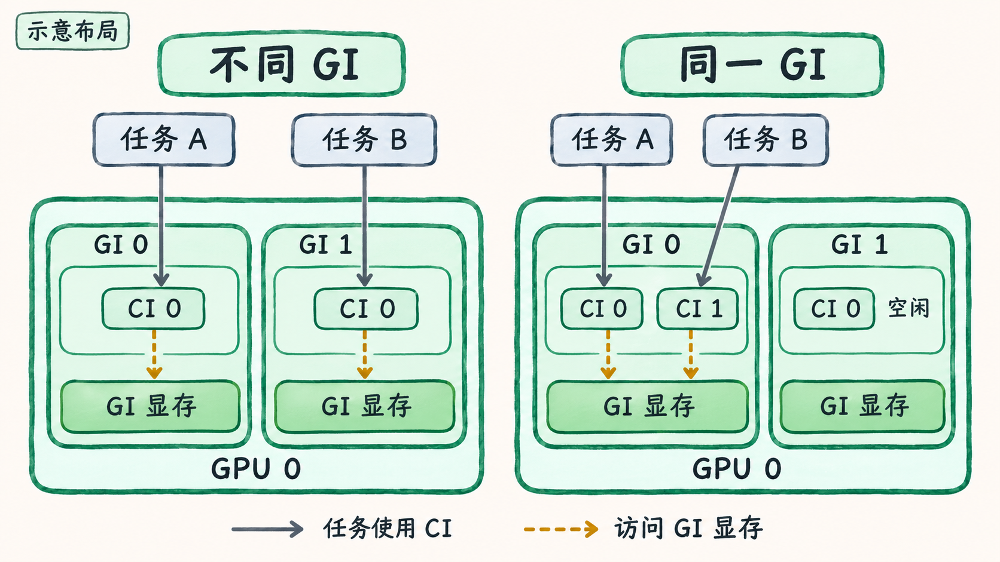

如果 A 的显存压力不能挤占 B 的容量和内存带宽，可以把支持的 NVIDIA GPU 配置为 MIG（Multi-Instance GPU，多实例 GPU）。MIG 是由驱动管理的硬件划分能力。管理员在物理卡上启用 MIG 模式、创建实例，应用通过 CUDA 使用交付到进程的 MIG 设备。平台随后可以像分配设备一样把预建实例分给不同任务。支持情况取决于具体 GPU 型号、系统和驱动。 [NVIDIA MIG 620 简介](https://docs.nvidia.com/datacenter/tesla/mig-user-guide/620/introduction.html) · [支持的 GPU 与系统](https://docs.nvidia.com/datacenter/tesla/mig-user-guide/620/supported-gpus.html)

## GI 的内存边界与 CI 的计算边界

MIG 用切片（slice）描述可划分的一组硬件资源。最小正常场景可以从一张 A100-SXM4-40GB 上的两个 `3g.20gb` 开始。每个任务拿到一个 MIG 设备，每个设备由一个 GPU Instance 和其内部的一个 Compute Instance 组成。

1. **GPU Instance（GI，GPU 实例）** 获得一组计算切片、显存切片和规格所带的引擎。内存路径也随 GI 划分，包括相应的 L2 缓存分区、内存控制器和带宽。A 与 B 分属不同 GI 时，各从自己的那份显存分配。
2. **Compute Instance（CI，计算实例）** 从父 GI 获得一部分计算切片。每个 GI 只建一个 CI 时，可以把 GI 的全部计算切片交给这个 CI。若在一个 GI 中建多个 CI，它们各自有计算切片，也都从父 GI 的同一份显存及内存路径取用资源。 [NVIDIA MIG 620 实例划分与术语](https://docs.nvidia.com/datacenter/tesla/mig-user-guide/620/concepts.html#partitioning) · [NVIDIA MIG 620 内存系统](https://docs.nvidia.com/datacenter/tesla/mig-user-guide/620/introduction.html)

*图 14-03-01　同一张 GPU 上的两种示意布局。实线连接任务与 CI，虚线标出 CI 到所属 GI 显存的访问关系。块的大小和编号仅供解释层级。*

若目标是让 B 的显存预算独立于 A，右图的两个 CI 只能提供各自的计算切片，两个任务的容量仍要在 GI 0 内合计。把 B 放回 GI 1，才能用两个 GI 各自的容量检查预算。物理卡和节点仍是这些实例共用的故障域。NVIDIA 的 A100 故障指南把 Xid 94 列为影响范围受限的错误，对 Xid 95 则要求排空其他 GI 的工作后复位 GPU。实际判读须结合代际、驱动和故障时的实例分配。 [NVIDIA GPU 故障处置指南](https://docs.nvidia.com/deploy/gpu-debug-guidelines/620/gpu-node-triage.html)

## A100 Profile 的内存、SM 与引擎

Profile 是设备支持的一种固定资源组合。下表给出 A100-SXM4-40GB 的部分 GI Profile，分母分别是该卡的 8 个内存切片和 7 个计算切片。Copy Engine 是承担数据搬运的硬件引擎。 [NVIDIA MIG 620 A100 Profile 表](https://docs.nvidia.com/datacenter/tesla/mig-user-guide/620/supported-mig-profiles.html#a100-mig-profiles)

| GI Profile | 内存切片 | SM 切片 | Copy Engine 数 |
| --- | ---: | ---: | ---: |
| `1g.5gb` | 1/8 | 1/7 | 1 |
| `2g.10gb` | 2/8 | 2/7 | 2 |
| `3g.20gb` | 4/8 | 3/7 | 3 |
| `4g.20gb` | 4/8 | 4/7 | 4 |

两个 `3g.20gb` 合计占 8 份内存切片与 6 份 SM 切片，因此还剩 1 份 SM 切片，却无法再用 `1g.5gb`，后者还需 1 份内存切片。换成一个 `4g.20gb` 和一个 `3g.20gb`，两者使用相同总数的内存切片，合计占满 7 份 SM 切片。创建时还必须满足下面的合法位置要求。

若 `3g.20gb` 的 GI 有一个占用全部计算切片的 CI，设备名可简写为 `3g.20gb`。若把其中一个计算切片单独划给一个 CI，可出现形如 `1c.3g.20gb` 的名字。显存档仍属于父 GI。名称中的 `gb` 是厂商规格拼写。估算应用是否放得下，使用实例的实际报告及分配结果。其他卡型的档位和位置需要重新查表，例如 A100 80GB 对应的较大规格为 `3g.40gb`。 [NVIDIA MIG 610 设备命名](https://docs.nvidia.com/datacenter/tesla/mig-user-guide/610/mig-device-names.html) · [NVIDIA MIG 620 Profile 表](https://docs.nvidia.com/datacenter/tesla/mig-user-guide/620/supported-mig-profiles.html)

## GI 的合法位置与放置碎片

规格表能用来排除切片数量不足的组合。数量满足后，还要看正在使用的实例占了哪些位置。NVIDIA 的 A100 40GB 示例中，`nvidia-smi mig -lgipp` 给出 `3g.20gb` 的位置为 `{0,4}:4`。它表示两个可能的起点 0、4，跨度各为 4。普通 `1g.5gb` 的合法起点是 0—6，跨度为 1。位置 7 可以在大规格的窗口内。 [NVIDIA MIG 620 实例几何与位置列表](https://docs.nvidia.com/datacenter/tesla/mig-user-guide/620/getting-started-with-mig.html#instance-geometry)

| 已有两个 `1g.5gb` 的起点 | 窗口 0–3 | 窗口 4–7 | `3g.20gb` 能否落下 |
| --- | --- | --- | --- |
| 0、4 | 位置 0 已占 | 位置 4 已占 | 两个合法窗口都与现有实例重叠 |
| 0、1 | 位置 0、1 已占 | 空闲 | 可在 4–7 创建 |

两种状态都剩 6 个位置和 5 个计算切片，差别在于这些空位是否形成一个合法窗口。这就是卡内的放置碎片。读现场记录时，先用 `nvidia-smi mig -lgip` 对照 Profile 名称与 ID，再用 `-lgipp` 找候选位置，最后用 `-lgi` 的 `Placement Start:Size` 排除与现有 GI 重叠的位置。涉及多 Profile 组合时，再对照真实驱动的规格和创建顺序约束。 [NVIDIA MIG 620 Profile 放置](https://docs.nvidia.com/datacenter/tesla/mig-user-guide/620/concepts.html#profile-placement) · [NVIDIA MIG 620 创建实例样例](https://docs.nvidia.com/datacenter/tesla/mig-user-guide/620/getting-started-with-mig.html)

如果管理员已建好两个大实例，调度器可以按它们已发布的库存判断请求。若实例要等新 Pod 才创建，平台还须先证明物理卡上有合法位置。两条路径使用同样的硬件约束，接下来要看它们各自由哪个组件表达和执行。
