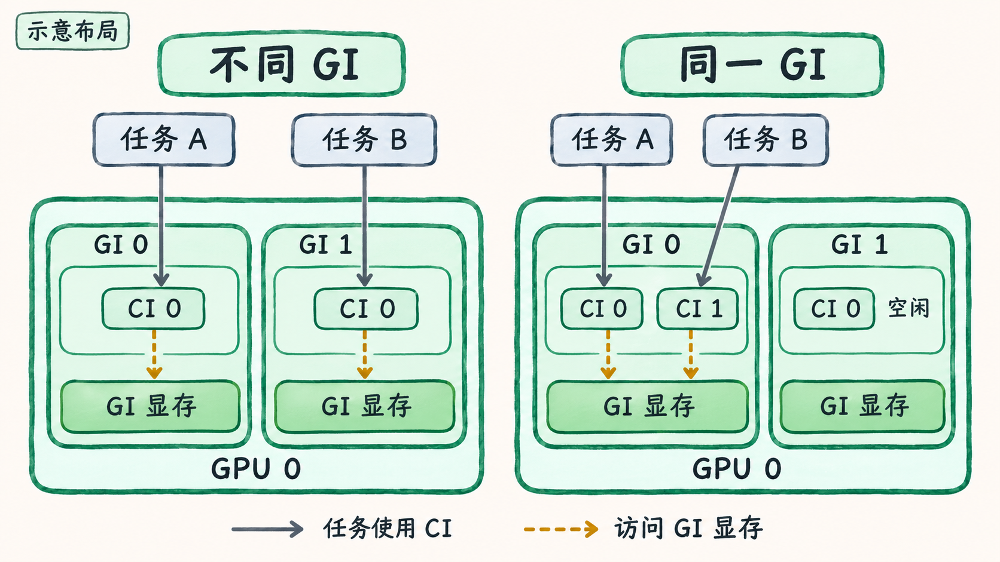

# MIG 怎样切出硬件实例

假设任务 A 和 B 共享一张物理 GPU。若希望两者各有一部分显存、计算资源和显存访问带宽，MIG（Multi-Instance GPU）可以在支持的 GPU 上划出硬件实例。读一个 MIG 设备时，先找显存和带宽的边界，再找其中的计算边界。 [NVIDIA MIG 620 简介](https://docs.nvidia.com/datacenter/tesla/mig-user-guide/620/introduction.html)

## GI 定资源边界，CI 定计算范围

一个 **GPU Instance（GI）** 获得一组计算 slice、显存 slice 和 Profile 指定的引擎。显存 slice 连同属于它的 L2 缓存、内存控制器和访问路径分配给 GI。因此在同一张卡上，两个 GI 各自有显存容量和相应的内存路径。一个 GI 的显存使用量或带宽变化，不会把另一个 GI 的显存容量加大或缩小。 [NVIDIA MIG 620 概念](https://docs.nvidia.com/datacenter/tesla/mig-user-guide/620/concepts.html#terminology) · [NVIDIA MIG 内存路径](https://docs.nvidia.com/datacenter/tesla/mig-user-guide/620/introduction.html)

**Compute Instance（CI）** 取走父 GI 的一部分计算 slice。一个 GI 可以只建一个 CI、让它使用该 GI 的全部计算资源，也可以拆给多个 CI。这些 CI 都在同一 GI 内访问那份显存，并共享 GI 的其他引擎。若任务需要互相独立的显存容量，应沿设备关系核对它们位于哪个 GI。 [NVIDIA GI 与 CI 的关系](https://docs.nvidia.com/datacenter/tesla/mig-user-guide/620/concepts.html#partitioning)

| A、B 的设备布局 | 计算 | 显存及其访问路径 |
| --- | --- | --- |
| A 与 B 各用一个 GI 内的一个 CI | 各自使用所分配的计算 slice | 各有所在 GI 的显存和内存路径 |
| A、B 各用同一个 GI 的一个 CI | 各用该 GI 中划给自己的计算 slice | 共同使用父 GI 内的显存和引擎 |

*A100 40GB 示意布局。同一 GI 内的两个 CI 各有划分的计算资源，共用父 GI 的显存与访问路径。图中块的大小为示意。*

这类隔离要连同其物理边界判断。同卡的 GI 仍依赖同一张物理卡和节点。NVIDIA 的 A100 故障指南用 Xid 94、95 对照。Xid 94 指向被限制范围的 ECC 错误，故障应用需要恢复，其他应用可以继续运行到合适的维护时点。Xid 95 指向未被限制范围的 ECC 错误，指南要求排空同卡其他 GI 的工作后复位。评估具体故障仍要核对设备代际、驱动、日志时点及该时间段的任务分配。 [NVIDIA GPU Debug Guidelines 的 A100 Xid 94/95](https://docs.nvidia.com/deploy/gpu-debug-guidelines/620/gpu-node-triage.html) · [NVIDIA Xid Catalog](https://docs.nvidia.com/deploy/xid-errors/620/analyzing-xid-catalog.html)

## 用 Profile 读显存、SM 和引擎

Profile 给出一份实例可以获得的资源组合。以 A100-SXM4-40GB 为例，每个显存 slice 约占该卡显存资源的八分之一，每个 SM slice 对应 MIG 模式下约七分之一的计算 slice。下表选了几个常用规格，`gb` 保留 NVIDIA 的 Profile 拼写。 [NVIDIA MIG 620 A100 Profile 表](https://docs.nvidia.com/datacenter/tesla/mig-user-guide/620/supported-mig-profiles.html#a100-mig-profiles)

| GI Profile | 显存 slice | SM slice | Copy Engine 数 |
| --- | ---: | ---: | ---: |
| `1g.5gb` | 1/8 | 1/7 | 1 |
| `2g.10gb` | 2/8 | 2/7 | 2 |
| `3g.20gb` | 4/8 | 3/7 | 3 |
| `4g.20gb` | 4/8 | 4/7 | 4 |

`3g.20gb` 和 `4g.20gb` 都分到 4 个显存 slice，计算资源和 Copy Engine 数不同。如果 `3g.20gb` GI 只有一个使用全部计算 slice 的 CI，CUDA 设备名可以省略 CI 大小。若只给某个 CI 1 个计算 slice，设备名可写作 `1c.3g.20gb`。20 GB 指父 GI 这一规格，多个 CI 仍共同使用其内存。读取应用可用容量时，要看本设备枚举和 CUDA 分配结果。型号变化也会改变 Profile 名和容量，例如 A100 80GB 的 `3g.40gb`。 [NVIDIA MIG 设备命名](https://docs.nvidia.com/datacenter/tesla/mig-user-guide/610/mig-device-names.html) · [NVIDIA A100 的 Profile 和容量](https://docs.nvidia.com/datacenter/tesla/mig-user-guide/620/supported-mig-profiles.html#a100-mig-profiles)

MIG 能否启用要按具体 GPU SKU、系统和驱动查表。NVIDIA 620 版指南列出的最低驱动为 A100 的 R450 450.80.02 和 H100 的 R525 525.85.12。Profile 自身还可有更高的版本门槛。若用 Kubernetes 管理，再核对 GPU Operator、容器运行时和应用版本带来的条件。 [NVIDIA MIG 620 支持的 GPU](https://docs.nvidia.com/datacenter/tesla/mig-user-guide/620/supported-gpus.html) · [NVIDIA MIG 620 前置版本](https://docs.nvidia.com/datacenter/tesla/mig-user-guide/620/getting-started-with-mig.html#prerequisites)

## 为什么空着六格仍放不下四格的实例

同一张 A100 40GB 的位置布局还要满足硬件给出的起点。NVIDIA 的示例中，`nvidia-smi mig -lgipp` 显示 `3g.20gb` 的合法位置为 `{0,4}:4`，即起点 0 或 4，每个窗口长 4。`1g.5gb` 有 0–6 这些合法起点，每个窗口长 1。下面从官方位置表推导两个教学快照。 [NVIDIA MIG 620 位置列表和几何示例](https://docs.nvidia.com/datacenter/tesla/mig-user-guide/620/getting-started-with-mig.html)

| `1g.5gb` 已占起点 | 窗口 0–3 | 窗口 4–7 | 能否再建一个 `3g.20gb` |
| --- | --- | --- | --- |
| 0、4 | 位置 0 已占 | 位置 4 已占 | 不能 |
| 0、1 | 位置 0 和 1 已占 | 整窗空闲 | 能，放在 4–7 |

两种布局都还空 6 格，并剩下 5 个 SM slice。决定结果的是合法窗口是否有重叠。位置 7 可落在一个大 Profile 的窗口内，它没有单独作为 `1g.5gb` 起点出现。用 `nvidia-smi mig -lgip` 查 Profile，用 `-lgipp` 查合法位置，再用 `-lgi` 的 `Profile ID`、`Instance ID` 与 `Placement Start:Size` 查实际布局。若同样的组合因创建顺序而返回 `Insufficient Resources`，还要对照驱动版本及官方创建样例。 [NVIDIA MIG Profile Placement](https://docs.nvidia.com/datacenter/tesla/mig-user-guide/620/concepts.html#profile-placement) · [NVIDIA MIG 实例几何样例](https://docs.nvidia.com/datacenter/tesla/mig-user-guide/620/getting-started-with-mig.html#instance-geometry)

预建 MIG 由管理员先定布局，平台随后分配现有实例。按需切分由分配路径预留合法位置并创建实例，例如 HAMi Flexible MIG。两者都要满足同一物理卡提供的 Profile 和位置约束。 [NVIDIA GPU Operator MIG 配置](https://docs.nvidia.com/datacenter/cloud-native/gpu-operator/26.7/gpu-operator-mig.html) · [HAMi Flexible MIG](https://project-hami.io/docs/userguide/nvidia-device/dynamic-mig-support)
