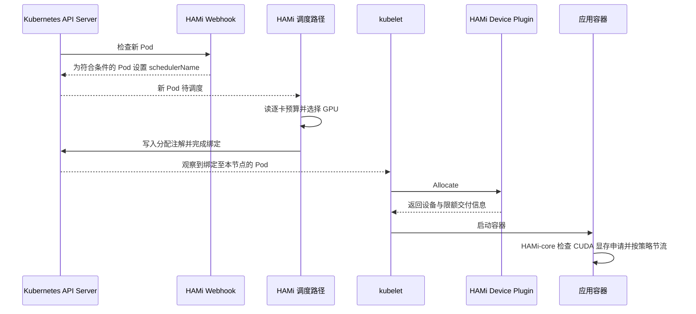

# Kubernetes 怎样交付共享与切分 GPU

Pod 里的一份 GPU 资源可以对应一张整卡、一个共享访问名额，或者一份已经创建的 MIG 设备。判断它是什么，需要把候选节点、上报库存和容器拿到的设备连起来。

本篇的 NVIDIA Device Plugin 示例采用 Kubernetes v1.36、GPU Operator v26.7.2 和 Device Plugin/GFD v0.20.1。教学节点有两张 A100-SXM4-40GB，每种配置各取一个设备健康的稳定快照。HAMi 示例单独采用 v2.11.0 的资源配置与协议。 [Kubernetes v1.36 Device Plugins](https://v1-36.docs.kubernetes.io/docs/concepts/extend-kubernetes/compute-storage-net/device-plugins/) · [GPU Operator v26.7 组件矩阵](https://docs.nvidia.com/datacenter/cloud-native/gpu-operator/26.7/platform-support.html#gpu-operator-component-matrix) · [HAMi v2.11.0 发行说明](https://github.com/Project-HAMi/HAMi/releases/tag/v2.11.0)

## 先走一遍整卡交付

关闭共享和 MIG 时，NVIDIA Device Plugin 将两张健康卡发布为两个 `nvidia.com/gpu` 资源。下面是单容器 Pod 中的资源片段。只写 GPU `limits` 时，Kubernetes 以同样的值作为请求。 [Kubernetes v1.36 的 GPU 请求规则](https://v1-36.docs.kubernetes.io/docs/tasks/manage-gpus/scheduling-gpus/#using-device-plugins)

```yaml
resources:
  limits:
    nvidia.com/gpu: 1
```

scheduler 先找满足节点约束、同名资源有余量的节点。绑定后，kubelet 的 Device Manager 结合本地健康设备和占用记录选出设备，让插件的 `Allocate` 提供注入所需信息。容器启动后，再看实际可用的 UUID。假设两张卡都健康，节点的 `Capacity` 与 `Allocatable` 都是 2。如果已经有一个 Pod 请求 1，供新 Pod 调度的账面余量为 `2 − 1 = 1`，Node 的 `Allocatable` 仍是 2。若一张卡被插件标为不健康，才会影响健康设备的可分配计数。 [Kubernetes v1.36 Device Plugin 分配与健康状态](https://v1-36.docs.kubernetes.io/docs/concepts/extend-kubernetes/compute-storage-net/device-plugins/) · [Kubernetes v1.36 scheduler 的资源过滤](https://github.com/kubernetes/kubernetes/blob/v1.36.0/pkg/scheduler/framework/plugins/noderesources/fit.go)

一次顺利的交付可以用四段记录核对。先看 Pod 的资源请求、`PodScheduled` 条件和 `spec.nodeName`，再看对应 Node 的 `.status.capacity` 与 `.status.allocatable`。然后读该节点本地 kubelet PodResources API `List` 的命名空间、Pod 名、容器名、`resource_name` 与 `device_ids`。最后在宿主机和容器各读一次 `nvidia-smi -L`，用实际的设备 ID 策略对应 UUID。应用侧可用 `cudaGetDeviceCount`、`cudaGetDeviceProperties` 验证 CUDA 枚举和显存信息，再运行一次小规模计算并检查 CUDA 返回值。 [Kubernetes v1.36 PodResources API](https://v1-36.docs.kubernetes.io/docs/concepts/extend-kubernetes/compute-storage-net/device-plugins/#monitoring-device-plugin-resources) · [NVIDIA Device Plugin 的设备 ID 策略](https://github.com/NVIDIA/k8s-device-plugin/blob/v0.20.1/README.md#configuration-option-details) · [NVIDIA CUDA Runtime 设备管理](https://docs.nvidia.com/cuda/cuda-runtime-api/group__CUDART__DEVICE.html)

## Time-Slicing 怎样改变请求的含义

保持节点的两张卡与容器运行时不变，只增加插件共享配置。以下是 GPU Operator 命名空间中的教学 ConfigMap。资源条目选 `nvidia.com/gpu`，每个底层设备发布 4 份访问名额，开启后缀以便让工作负载明确请求共享设备。 [GPU Operator v26.7 Time-Slicing 配置](https://docs.nvidia.com/datacenter/cloud-native/gpu-operator/26.7/gpu-sharing.html) · [Device Plugin v0.20.1 Time-Slicing 选项](https://github.com/NVIDIA/k8s-device-plugin/blob/v0.20.1/README.md#with-cuda-time-slicing)

```yaml
apiVersion: v1
kind: ConfigMap
metadata:
  name: gpu-sharing-examples
  namespace: gpu-operator
data:
  whole-card-share: |
    version: v1
    flags:
      migStrategy: none
    sharing:
      timeSlicing:
        renameByDefault: true
        failRequestsGreaterThanOne: true
        resources:
          - name: nvidia.com/gpu
            replicas: 4
```

`ClusterPolicy.spec.devicePlugin.config.name` 指向 ConfigMap，`config.default` 可选默认键。按节点配置时，用该 Node 的 `nvidia.com/device-plugin.config` 标签选键。GPU Operator v26.7 文档指出，单独修改这份 ConfigMap 不会自动触发插件重启。依照所选部署方式完成更新后，复查插件和 GFD 状态、新资源及配置标签。稳定后，该节点可发布 `2 × 4 = 8` 个 `nvidia.com/gpu.shared`。`nvidia.com/gpu.replicas` 描述每个底层资源的复制倍数。在此整卡例中，`nvidia.com/gpu.count` 与物理枚举仍对应两张卡。 [GPU Operator v26.7 节点配置、重启和标签验证](https://docs.nvidia.com/datacenter/cloud-native/gpu-operator/26.7/gpu-sharing.html#updating-a-time-slicing-config-map)

申请时，把资源片段改为 `nvidia.com/gpu.shared: 1`。如果改成 2，节点可能有充足数量，scheduler 可以完成放置。但由于 `failRequestsGreaterThanOne: true`，节点端插件会拒绝单容器申请多份共享资源。v0.20.1 README 的官方示例里，提交源是 kubelet，事件原因是 `UnexpectedAdmissionError`，信息包含 `Allocate failed` 和请求数超过 1。该示例使用共享的 `nvidia.com/gpu` 名称，本文改名只影响资源名。若节点缺少匹配的资源或余量，问题则出现在调度前，查看 `FailedScheduling` 的过滤原因。这两个记录对应不同的失败阶段。 [Device Plugin v0.20.1 官方事件示例](https://github.com/NVIDIA/k8s-device-plugin/blob/v0.20.1/README.md#with-cuda-time-slicing) · [Kubernetes v1.36 的资源过滤](https://github.com/kubernetes/kubernetes/blob/v1.36.0/pkg/scheduler/framework/plugins/noderesources/fit.go)

## MIG 布局与资源名分别由谁决定

先看 GPU 是否处于 MIG mode，再看具体建了什么 GI 和 CI。MIG Manager 或管理员设置这些设备状态。Kubernetes 端的 `migStrategy` 决定 Device Plugin 与 GFD 怎样表达已经存在的设备。 [GPU Operator v26.7 MIG 策略和管理职责](https://docs.nvidia.com/datacenter/cloud-native/gpu-operator/26.7/gpu-operator-mig.html#enabling-mig-during-installation)

- `none` 用于本篇两张卡关闭 MIG 的整卡例。
- `single` 在节点采用 MIG 时要求所有 GPU 开启 MIG、都有 MIG 设备，而且设备规格一致。插件以 `nvidia.com/gpu` 发布这些 MIG 设备。
- `mixed` 为 MIG 设备按 Profile 取资源名，同时可用 `nvidia.com/gpu` 发布关闭 MIG 的整卡。

| 两张卡的教学快照 | 发布的资源名与数量 | 请求 1 时获得的单位 |
| --- | --- | --- |
| 两张整卡，无共享 | `nvidia.com/gpu: 2` | 一张物理卡 |
| 两张整卡，每张四个共享名额，改名 | `nvidia.com/gpu.shared: 8` | 一次共享访问 |
| `single`，每张卡七份 `1g.5gb` | `nvidia.com/gpu: 14` | 一个 `1g.5gb` MIG 设备 |
| `mixed`，一张整卡、一张有两份 `3g.20gb` | `nvidia.com/gpu: 1`，`nvidia.com/mig-3g.20gb: 2` | 按资源名获得整卡或一份实例 |
| 上一行只给 `3g.20gb` 各加两个共享名额，改名 | `nvidia.com/gpu: 1`，`nvidia.com/mig-3g.20gb.shared: 4` | 该 MIG 资源名授予一次实例内的共享访问 |

表中的配置彼此独立。最后一行的每个 GI 仍和其他 GI 划分硬件资源，同一 GI 内两个访问名额则会争用该实例内的资源。使用 `single` 时，Pod 需要通过节点选择约束区分整卡节点和发布统一 MIG 实例的节点。GFD 的 `product`、`replicas` 等标签描述资源特征，实际数量和剩余请求要分别去 Node 和 Pod 对象查。 [GPU Operator v26.7 共享资源与标签](https://docs.nvidia.com/datacenter/cloud-native/gpu-operator/26.7/gpu-sharing.html) · [NVIDIA Device Plugin v0.20.1 的 MIG 和共享资源名](https://github.com/NVIDIA/k8s-device-plugin/blob/v0.20.1/README.md#shared-access-to-gpus)

例如 `mixed` 节点发布两份 `nvidia.com/mig-3g.20gb`，已有 Pod 占一份，新来一个容器请求两份。假定别处也没有能容纳该 Pod 的节点，这个 Pod 会保持 Pending。检查 `PodScheduled` 条件和 `FailedScheduling`，再看是否由 `Insufficient nvidia.com/mig-3g.20gb` 解释。节点上有整卡或还有小规格实例时，名称对应的库存仍要分别计数。 [Kubernetes v1.36 NodeResourcesFit 实现](https://github.com/kubernetes/kubernetes/blob/v1.36.0/pkg/scheduler/framework/plugins/noderesources/fit.go)

### CUDA 枚举与 DRA 的版本边界

设备分配成功后，应用进程实际枚举的数量还取决于驱动和 CUDA。NVIDIA 的对照例中，CUDA 12 配 R525 的进程只能枚举一个 MIG 实例。R570 路径开始支持跨 GI 枚举，同时每个 GI 只枚举一个 CI。例如两个 CI 都来自同一个 GI，看到两个分配记录后也要检查 CUDA 实际发现了多少个设备。v0.20.1 插件的 MPS 与 Time-Slicing 是互斥的共享配置。 [NVIDIA MIG 的 CUDA 枚举规则](https://docs.nvidia.com/datacenter/tesla/mig-user-guide/610/mig-device-names.html#cuda-device-enumeration) · [Device Plugin v0.20.1 共享边界](https://github.com/NVIDIA/k8s-device-plugin/blob/v0.20.1/README.md#shared-access-to-gpus)

使用 NVIDIA DRA Driver v0.5.1 时，应用可通过 `ResourceClaim` 分配预先创建的 MIG 设备，这项能力在 GPU Operator v26.7 文档中列为 GA。为 Claim 创建实例的 `DynamicMIG` 是 Alpha，默认关闭。阅读这条分配路径需要查 Claim 及其设备状态，启用前要核对具体的 feature gate。 [GPU Operator v26.7 DRA 能力与成熟度](https://docs.nvidia.com/datacenter/cloud-native/gpu-operator/26.7/dra-intro-install.html#dra-driver-feature-maturity)

## HAMi 怎样按单卡预算选设备

HAMi v2.11.0 的 NVIDIA 后端在调度时检查每张卡的名额、可用显存和算力预算。沿用 A 与 B 的单容器例，分别给它们下面两份资源配置。两者各需要一张卡上的份额。默认 `memoryFactor: 1` 时，`gpumem` 按整数 MiB 写，`gpucores` 是整数百分比。 [HAMi 显存单位](https://project-hami.io/docs/userguide/nvidia-device/specify-device-memory-usage) · [HAMi 算力请求](https://project-hami.io/docs/userguide/nvidia-device/specify-device-core-usage)

```yaml
# 任务 A 容器内的配置
resources:
  limits:
    nvidia.com/gpu: 1
    nvidia.com/gpumem: 12288
    nvidia.com/gpucores: 30
```

```yaml
# 任务 B 容器内的配置
resources:
  limits:
    nvidia.com/gpu: 1
    nvidia.com/gpumem: 8192
    nvidia.com/gpucores: 40
```

假定只有一张满足放置条件的卡，三个名额可用，`deviceMemoryScaling` 和 `deviceCoreScaling` 都是 1。A 与 B 消耗 `12,288 + 8,192 = 20,480 MiB` 和 70% 的算力预算。再来一个与 B 相同的请求时，名额仍够，显存需求变成 28,672 MiB。若该卡报告的可调度显存不少于这个数字，显存条件也能通过，但算力请求会到 110%，该卡无法承接第三个任务。 [HAMi 逐卡预算与筛选](https://project-hami.io/docs/core-concepts/scheduling) · [HAMi v2.11.0 的缩放和名额设置](https://raw.githubusercontent.com/Project-HAMi/HAMi/v2.11.0/charts/hami/values.yaml)



Webhook 在检测到 HAMi 资源且 Pod 未显式选择其他调度器等条件下设置 `spec.schedulerName: hami-scheduler`。在触发选卡后，检查 Node 的 `.status.allocatable` 和 `hami.io/node-nvidia-register`。后者的 `id`、`count`、`devmem`、`devcore` 分别可用来核对 GPU UUID、该卡名额、可调度显存和计算预算。Device Plugin 通过 kubelet 发布的扩展资源数与调度器读到的每卡预算属于不同记录。 [HAMi v2.11.0 架构](https://project-hami.io/docs/core-concepts/architecture) · [HAMi 设备注册与任务分发协议](https://project-hami.io/docs/developers/protocol)

Pod 注解 `hami.io/vgpu-devices-allocated` 记录调度选择和份额，`hami.io/vgpu-devices-to-allocate` 记录待设备插件落实的分配。`hami.io/bind-phase` 从 `allocating` 到 `success` 或 `failed`，能帮助判断进展。软件限额是否真正生效，还要核对容器内库是否加载，以及 `devices.nvidia.gpuCorePolicy` 选了 `default`、`force` 还是 `disable`。显存的三个证据也应分开读，`hami_vgpu_memory_allocated_bytes` 是调度分配，`hami_vgpu_memory_limit_bytes` 是运行时限额，`hami_vgpu_memory_used_bytes` 是使用量。对照同一时点的节点、GPU UUID 和 Pod/容器标签再比较数值。 [HAMi 分配协议](https://project-hami.io/docs/developers/protocol) · [HAMi 分配和用量指标](https://project-hami.io/docs/core-concepts/observability) · [HAMi 实时指标字段与样本](https://project-hami.io/docs/userguide/monitoring/real-time-device-usage)

### Flexible MIG 如何使用同一份显存请求

现在把 A 的 12,288 MiB 显存需求交给采用 Flexible MIG 的 HAMi 资源池，算力按硬件 Profile 验收。节点的配置选择 `operatingmode: mig`，Pod 可用 `nvidia.com/vgpu-mode: "mig"` 指定模式。`migProfileAllowlist` 限定可用规格。假定目标 A100 40GB 的可选 Profile 为 `2g.10gb` 与 `3g.20gb`，前者的设备容量放不下 12 GiB。若 NVML 报告后者有足够显存且存在合法空窗，scheduler 就能预留物理 GPU、Profile 和位置。 [HAMi v2.11.0 Flexible MIG 配置和筛选](https://project-hami.io/docs/userguide/nvidia-device/dynamic-mig-support) · [A100 40GB Profile](https://docs.nvidia.com/datacenter/tesla/mig-user-guide/620/supported-mig-profiles.html#a100-mig-profiles)

这条路径仍通过 Device Plugin。`Allocate` 将预留落实成指定位置的 GI 和 CI，并注入 MIG 设备。查 `hami.io/vgpu-mig-allocations` 的 `gpuUUID`、`profile`、`placement` 与实际 `migUUID`，可以对照预留和交付。Pod 结束后，HAMi 回收该 Pod 的 CI 和 GI。若两个合法窗口已被占用，新的请求会等待满足位置条件。管理员第一次切换目标到 MIG 模式时，仍要处理已有作业、可能的 GPU 复位以及必要的重启。 [HAMi Flexible MIG 的预留记录和生命周期](https://project-hami.io/docs/userguide/nvidia-device/dynamic-mig-support#reservation-and-instance-lifecycle)

默认资源名下，HAMi Device Plugin 和 NVIDIA Device Plugin 都会注册 `nvidia.com/gpu`，同节点会发生冲突。本例让两类设备分配归属各自的节点池。GPU Operator 可以继续管理驱动、Toolkit 和物理层监控，目标节点需核对插件注册归属、运行时设备注入方式和实际版本。Flexible MIG 的目标卡上的实例管理由 HAMi 承担，同时检查 NVIDIA MIG Manager 的作用范围，避免让两边同时操作同一张卡。 [HAMi 安装前提与 GPU Operator](https://project-hami.io/docs/installation/prerequisites) · [HAMi 插件共存条件](https://project-hami.io/docs/faq) · [Flexible MIG 的硬件管理前置条件](https://project-hami.io/docs/userguide/nvidia-device/dynamic-mig-support#prerequisites)
