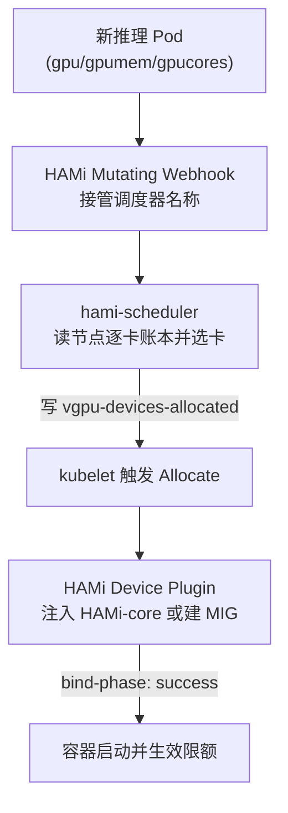

# HAMi 逐卡调度、软件限额与按需 MIG

设想一套量化后的 14B 在线推理服务，单副本在峰值 KV Cache 下恰好需要 `12 GiB` 显存与 `30%` 算力预算。把它放进原生 Time-Slicing 池，调度器只数名额不管每张卡还剩多少显存，极易把两套服务撞成 OOM；放进静态 MIG 池，`2g.10gb` 装不下，升到 `3g.20gb` 又白白浪费近 `8 GiB` 显存，而且每次调整比例还要排空整张卡。

**HAMi（Heterogeneous AI Computing Virtualization Middleware，异构 AI 计算虚拟化中间件）** 正是为了填平这条鸿沟而生。它通过自定义调度器与设备插件协同工作，在单卡粒度上同时追踪名额、显存和算力预算。

在 NVIDIA 后端，HAMi `v2.11.0` 提供两条核心落地路径：**软件层显存与算力硬限额（HAMi-core）**，以及**按需动态切分硬件实例（Flexible MIG）**。下文逐一拆解其调度账本与执行边界。

## 逐卡三维联合筛选：节点合计够用，为什么依然落不下？

在一套独立的双卡 A100-SXM4-40GB HAMi 资源池中（采用默认 NVIDIA 资源名，`memoryFactor: 1`，显存与算力缩放系数均为 `1`），上述 14B 推理副本用如下 Pod 清单声明单卡三维份额：

```yaml
apiVersion: v1
kind: Pod
metadata:
  name: infer-14b-vgpu
spec:
  containers:
    - name: llm-engine
      image: vllm/vllm-openai:latest
      resources:
        limits:
          nvidia.com/gpu: 1          # 申请 1 张 GPU 上的 1 个共享名额
          nvidia.com/gpumem: 12288   # 申请 12,288 MiB（12 GiB）软件显存硬上限
          nvidia.com/gpucores: 30    # 申请 30% 算力调度预算（整数百分比）
```

观察节点两张物理卡当前的实时剩余账本：

| 物理卡 | 剩余共享名额 | 剩余显存余额 | 剩余算力预算 | 能否满足 `(1, 12288 MiB, 30%)` |
| --- | ---: | ---: | ---: | --- |
| `GPU 0` | `1` | `16,384 MiB` | `20%` | **不能**（算力缺 `10` 个百分点） |
| `GPU 1` | `1` | `10,240 MiB` | `60%` | **不能**（显存缺 `2,048 MiB`） |

算一下节点总量，你会发现总剩余显存高达 `26,624 MiB`、剩余名额有 `2` 个，看似绰绰有余。但因为单卡任务的三项约束**必须在同一张物理卡上同时满足**，逐卡核算后结果截然不同：

$$\text{GPU 0 算力缺口} = 30\% - 20\% = 10\%, \qquad \text{GPU 1 显存缺口} = 12,288 - 10,240 = 2,048\ \text{MiB}$$

两张卡各有短板，新推理副本只能等待。只有当 `GPU 0` 上某个已有任务退出并释放出至少 `10%` 算力预算时，`GPU 0` 的三项余量才同时过关，调度器才会放行。

同一张空卡上连续装箱也遵循完全一致的联合校验。假设一张空卡配置了 `3` 个共享名额、至少 `28,672 MiB` 可用显存和 `100%` 算力预算：

- 放入第 1 个副本（`12,288 MiB, 30%`）和第 2 个副本（`8,192 MiB, 40%`）后，已用 `2` 个名额、`20,480 MiB` 显存、`70%` 算力。
- 当第 3 个副本（同样申请 `8,192 MiB, 40%`）到达时，名额（$3 \le 3$）与显存（$28,672\ \text{MiB}$）账面都过关，但算力合计达到：

$$C_{\text{sum}} = 30\% + 40\% + 40\% = 110\% > 100\%$$

调度器立刻拦下第 3 个副本——**三项约束在每次放置时必须同时重算，任何一维越界都不得放行**。

## 调度器与设备插件的注解交接协议

原生 Kubernetes 只靠 `Node.status.allocatable` 传整数总量，HAMi 如何把“具体选中哪张物理卡、给多少 MiB 和算力”从调度器安全交给节点上的设备插件？全靠一组结构化的 Node 与 Pod 注解完成状态接力：



*图 14-05-01：HAMi 逐卡调度与设备插件注解交接流程。调度器决定落卡与配额，插件在节点端落实注入并回写状态。*

线上核对一次 HAMi 分配是否真正落地，重点核查下面两处对象记录：

| 对象位置 | 关键注解 / 字段 | 排障与核对含义 |
| --- | --- | --- |
| **Node** | `.status.allocatable` 与 `hami.io/node-nvidia-register` | `allocatable` 给出名额总数；注册注解中的 `id`、`count`、`devmem`、`devcore` 精确登记每张物理卡的 UUID 与原始容量，调度时实时扣除已绑 Pod 份额。 |
| **Pod** | `hami.io/vgpu-devices-allocated`、`hami.io/vgpu-devices-to-allocate`、`hami.io/bind-phase` | 前两者记录调度选定的目标卡 UUID 与待交付清单；插件完成交付后 `bind-phase` 由 `allocating` 变为 `success`，失败则标记为 `failed`。 |

## HAMi-core 软件显存硬墙与 Kernel 节流

在默认软件共享模式下，HAMi Device Plugin 在容器启动时把用户态拦截库 **HAMi-core** 注入容器并接管 CUDA 调用路径，提供两道软件隔离机制：

1. **显存分配硬拦截（挡住 KV Cache 连坐 OOM）**：每当推理进程调用 CUDA 申请显存，HAMi-core 都会实时累加该容器的已用显存并对照其 `gpumem` 限额。例如某推理副本的上限是 `12,288 MiB`，当前已驻留 `10,240 MiB`（权重 + 存量 KV Cache），此时突发长上下文再申请 `3,072 MiB`：

$$10,240 + 3,072 = 13,312\ \text{MiB} > 12,288\ \text{MiB}$$

   **即使底层物理卡还空着十几 GiB 显存，这笔被拦截的申请也会立刻返回 OOM**。超限服务自己触发请求拒绝或限流，绝不会把同卡邻居拖下水。
2. **基于令牌的 Kernel 算力节流（`gpuCorePolicy`）**：HAMi-core 通过发放和消耗时间令牌约束 Kernel 提交速率，对应容器环境变量 `GPU_CORE_UTILIZATION_POLICY` 支持三种策略：
   - **`default`**：仅当同卡存在相同或更高优先级的其他容器同时运行 Kernel 时触发节流；卡上只剩自己跑时，虽然 `30%` 依然记在调度账本上，但运行时可以弹性吃满整卡空闲算力。
   - **`force`**：无论邻居是否活跃，始终严格按 `gpucores` 上限压制提交速率，适合需要稳定基准压测或防止冷启动突刺的场景。
   - **`disable`**：彻底关闭算力节流，仅保留显存硬拦截。

> [!warning] 常见误区：软件限额挡得住 OOM，挡不住 HBM 带宽争抢
> HAMi-core 是用户态拦截方案。它通过拦截 CUDA 内存分配完美隔离了显存上限，并通过令牌放缓了 Kernel 提交节奏，但**物理 SM、L2 缓存与 HBM 内存通道依然归同卡所有容器共享**。邻居一旦发起高带宽 Decode 洪峰，本服务的 TPOT 仍可能产生抖动。此外，安全边界高度依赖容器内拦截库不被特权绕过。

核对 HAMi-core 显存账目是否一致，可将三项核心监控指标按同一时刻、同一物理卡和同一容器并排比对：`hami_vgpu_memory_allocated_bytes`（调度器账本分配量）、`hami_vgpu_memory_limit_bytes`（插件注入的运行时上限）与 `hami_vgpu_memory_used_bytes`（实时已用量）。

## Flexible MIG：按需预留、动态建切片与自动回收

如果业务既想要 **MIG 的物理级 HBM 带宽与 P99 隔离**，又不想忍受静态预建池的高碎片和手动排空，HAMi `v2.11.0` 提供了 **Flexible MIG** 模式——在已开启 MIG 模式的物理卡上，按 Pod 显存需求实时匹配最小合法 Profile 并现场建出硬件实例。

管理员先在节点配置中将目标卡声明为 `operatingmode: mig`，推理 Pod 只需沿用同样的 `gpumem` 字段并加上一条注解即可触发按需硬件切分：

```yaml
apiVersion: v1
kind: Pod
metadata:
  name: infer-14b-dyn-mig
  annotations:
    nvidia.com/vgpu-mode: "mig"    # 指示 HAMi 使用 Flexible MIG 而非软件拦截
spec:
  containers:
    - name: llm-engine
      image: vllm/vllm-openai:latest
      resources:
        limits:
          nvidia.com/gpu: 1
          nvidia.com/gpumem: 12288 # 需求 12 GiB，由调度器自动匹配最小可用 MIG Profile
```

这套按需硬件交付走过严谨的三步生命周期：

1. **筛 Profile 与预留窗口**：设 `migProfileAllowlist` 仅允许 `2g.10gb` 与 `3g.20gb`。调度器按 NVML 实报容量淘汰 `2g.10gb`，自动选中 `3g.20gb` 并核查几何空窗：若 `4–7` 空闲则预留 `start: 4, size: 4`，若 `0` 与 `4` 均被占则排队等待。
2. **节点落实建实例**：预留信息经由 `hami.io/vgpu-mig-allocations` 注解下发到节点。kubelet 调用 `Allocate` 时，插件重新核验物理卡状态，现场在预留窗位创建 GI 与 CI，把生成的 MIG 设备注入容器并回填 `migUUID`。
3. **退出即回收**：Pod 结束运行后，HAMi 自动拆除对应的 CI 与 GI，第一时间把该物理放置窗口还回池中，供下一批不同规格的在线推理服务复用。

> [!warning] 节点池归属红线：严禁双重管理同一张物理卡
> 采用默认 `nvidia.com/gpu` 资源名时，**HAMi 节点池与 NVIDIA Device Plugin 节点池必须物理隔离**，禁止两个插件在同一节点争抢上报同一资源名。
>
> 同时，开启 Flexible MIG 的物理卡必须把硬件切分权独占交给 HAMi，不可与 GPU Operator 的 MIG Manager 同时托管同一张卡（驱动与 Toolkit 仍可继续由 GPU Operator 托管）。

## 五维工程评估：HAMi-core vs HAMi Flexible MIG

| 工程维度 | HAMi-core（软件显存/算力限额） | HAMi Flexible MIG（按需动态硬件切片） |
| --- | --- | --- |
| **显存硬隔离** | **强（软件拦截硬墙）**。越界申请立刻被拦截 OOM，彻底阻断 KV Cache 溢出连坐邻居。 | **极强（物理级）**。容器拿到的就是真实 MIG 硬件 GI，显存与控制器彻底物理隔离。 |
| **算力与 HBM 带宽干扰** | **中度干扰**。令牌节流限制了 SM 占空比，但 L2 缓存与 HBM 显存通道仍共享。 | **极低（物理级）**。HBM 带宽、L2 缓存与 SM 切片全链路硬件隔离，同卡并跑近乎零干扰。 |
| **P99 尾延迟表现** | **中—良**。明显优于 Time-Slicing，但高并发 LLM Decode 混跑仍存在带宽争抢尾延迟波动。 | **极佳**。运行期隔离效果等价于静态 MIG，可稳定承接严格 TTFT/TPOT P99 SLO。 |
| **卡内碎片率** | **极低**。支持 MiB 级任意显存切分与 1% 级算力切分，装箱密度极高。 | **中等**。仍受离散 MIG Profile 与合法放置窗口约束，但退出即回收大幅减少了长期闲置碎片。 |
| **运维灵活性** | **极高**。无需重启卡、无需排空邻居，按 Pod YAML 随时动态申请任意比例。 | **高**。相比静态预建池免去了人工改标签和整卡排空重配，但需在目标平台严验建删与回收稳定性。 |

> [!summary] 核心结论
> 在在线推理池里，**HAMi-core** 是“低成本防 OOM 连坐 + 高密度混跑”的利器，适合非核心在线推理、测试环境与中小模型高密部署；**HAMi Flexible MIG** 则把硬件物理隔离和动态调度揉在了一起。当然，在大量集群里静态 MIG 预建池依然是运维最成熟的主流方案——下一篇我们完整走一遍静态 MIG 重配置到监控归因的闭环。

> [!info]- 参考资料
> - **HAMi 架构、版本与配置参数**：[HAMi 核心架构文档](https://project-hami.io/docs/core-concepts/architecture)、[HAMi v2.11.0 发行说明](https://github.com/Project-HAMi/HAMi/releases/tag/v2.11.0)、[HAMi v2.11.0 Helm Chart values.yaml](https://raw.githubusercontent.com/Project-HAMi/HAMi/v2.11.0/charts/hami/values.yaml)、[HAMi 安装前提与 GPU Operator 协作](https://project-hami.io/docs/installation/prerequisites)
> - **逐卡调度与交接协议**：[HAMi 逐卡调度机制](https://project-hami.io/docs/core-concepts/scheduling)、[HAMi 调度器与插件交接协议](https://project-hami.io/docs/developers/protocol)
> - **软件资源隔离与观测指标**：[HAMi 软件显存与设备隔离](https://project-hami.io/docs/key-features/device-resource-isolation)、[HAMi 算力节流与 gpuCorePolicy](https://project-hami.io/docs/key-features/device-resource-isolation#compute)、[HAMi 可观测性架构](https://project-hami.io/docs/core-concepts/observability)、[HAMi 实时设备用量指标](https://project-hami.io/docs/userguide/monitoring/real-time-device-usage)
> - **Flexible MIG 按需切分**：[HAMi v2.11.0 Flexible MIG 配置指南](https://project-hami.io/docs/userguide/nvidia-device/dynamic-mig-support)、[HAMi Flexible MIG 预留与实例生命周期](https://project-hami.io/docs/userguide/nvidia-device/dynamic-mig-support#reservation-and-instance-lifecycle)、[NVIDIA A100 MIG Profile 规格表](https://docs.nvidia.com/datacenter/tesla/mig-user-guide/620/supported-mig-profiles.html#a100-mig-profiles)
