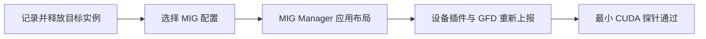

# MIG 重配置后怎样核对实例与监控

一个节点原来有七份小实例。将同一张卡改为两份大实例以后，旧 Pod 无法继续使用原来的设备，资源名与监控归因也要重查。理解一次重配置，需要跟着模式、实例、节点库存和应用验证依次核对。

## 同一张卡怎样从七个小实例改为两个大实例

取两张健康 A100-SXM4-40GB 的教学节点 `gpu-mixed`，使用 GPU Operator v26.7.2、MIG Manager v0.15.1 与 `mixed`。GPU 0 的 MIG 模式已经开启，从 `7 × 1g.5gb` 改为 `2 × 3g.20gb`。GPU 1 在两份配置中都处于关闭 MIG 的状态。这里改变的是 GPU 0 的实例布局。先记录当前作业、GPU 模式和实例，把目标资源从新作业的候选里移开，并有序结束依赖待拆实例的作业。MIG Manager 也会暂停可能正在访问 GPU 的管理组件。 [GPU Operator v26.7 组件矩阵](https://docs.nvidia.com/datacenter/cloud-native/gpu-operator/26.7/platform-support.html#gpu-operator-component-matrix) · [GPU Operator v26.7 MIG 重配置前提](https://docs.nvidia.com/datacenter/cloud-native/gpu-operator/26.7/gpu-operator-mig.html#enabling-mig-during-installation)

下面是供阅读的自定义 ConfigMap `data.config.yaml` 内容。`devices` 是该节点上的 GPU 索引，读配置前先确认索引、PCI 地址和物理 UUID 的对应关系。`ClusterPolicy.spec.migManager.config.name` 选择含这份数据的 ConfigMap。变更时，Node 的 `nvidia.com/mig.config` 目标值从 `seven-small` 改到 `two-large`。 [GPU Operator v26.7 自定义 MIG 配置](https://docs.nvidia.com/datacenter/cloud-native/gpu-operator/26.7/gpu-operator-mig.html#example-custom-mig-configuration-during-installation)

```yaml
version: v1
mig-configs:
  seven-small:
    - devices: [0]
      mig-enabled: true
      mig-devices:
        "1g.5gb": 7
    - devices: [1]
      mig-enabled: false
  two-large:
    - devices: [0]
      mig-enabled: true
      mig-devices:
        "3g.20gb": 2
    - devices: [1]
      mig-enabled: false
```

GPU 模式已经生效后，实例的生命周期可以单独理解。创建时先有 GI，再有可供 CUDA 使用的 CI。拆除前先退出占用设备的应用，然后撤 CI、撤 GI。节点有进程持有设备句柄时，复位或拆实例可能受阻，除了计算进程还要查节点监控与管理组件。Ampere 的 A100 启用 MIG 时需要 GPU 复位，模式可跨重启保存。Hopper 的 H100 启用 MIG 时无需 GPU 复位，模式随驱动模块的驻留状态保留。若 GPU 被重置或系统重启，已建的 GI、CI 布局还需恢复。把「模式是否开启」和「实例是否存在」分别验证。 [NVIDIA MIG 620 启用模式、驱动客户端及实际实例管理](https://docs.nvidia.com/datacenter/tesla/mig-user-guide/620/getting-started-with-mig.html)

## 从配置已接收到应用通过验证



| 时点 | 需要的证据 | 先检查什么 |
| --- | --- | --- |
| 已选择配置 | Node 的 `nvidia.com/mig.config` 指向新键，`nvidia.com/mig.config.state` 为 `pending` | 配置是否存在，目标设备是否还有 GPU 客户端。若该平台和配置需要重启，再跟踪 `rebooting`。 |
| 实例布局已应用 | MIG Manager 的变更和完成记录，状态 `success`，宿主机的 GI/CI 枚举 | 物理 UUID、每个 Profile 的实例数量、GI/CI 是否实际存在。 |
| 节点库存已经更新 | GFD 标签、Node `Capacity` 与 `Allocatable`、Device Plugin 与 kubelet 记录 | 新资源名和数量是否与目标布局一致，旧规格资源是否仍有可用量。 |
| 应用验证完成 | 新 Pod 已绑定，PodResources 记录了实际设备，容器能枚举并完成最小 CUDA 调用 | 设备可见性、实际 UUID、驱动与运行时注入、CUDA 结果和退出状态。 |

NVIDIA 的 GPU Operator v26.7 文档给出了一个 H100 80GB 的官方重配置样例。示例日志日期为 2024-05-14，样例切到 `3g.40gb` 布局。可识别的两行日志是 `Applying MIG device configuration` 与 `Updating MIG config: map[3g.40gb:2]`。后续日志记录 GPU 客户端恢复与状态设为 `success`。文档样例片段未注明当日所有软件组件的确切版本。这里用它说明日志里如何辨认应用目标布局的阶段，A100 前后状态由下面的教学快照推导。 [GPU Operator v26.7 官方 H100 重配置样例](https://docs.nvidia.com/datacenter/cloud-native/gpu-operator/26.7/gpu-operator-mig.html#example-reconfiguring-mig-profiles)

| `mixed` 节点状态 | `nvidia.com/gpu` | `nvidia.com/mig-1g.5gb` | `nvidia.com/mig-3g.20gb` |
| --- | ---: | ---: | ---: |
| 目标卡重新配置前 | 1 | 7 | 0 |
| 布局应用、两张卡均健康且插件上报收敛后 | 1 | 0 | 2 |

表内 0 表示没有可分配的该类设备。实际 Node 对象中，该资源键也可能缺失。保留原请求 `nvidia.com/mig-1g.5gb: 1` 的 Pod 即便重新创建，也仍然需要同名资源。目标节点出现 `success` 后，要继续对照 Node 状态和新探针结果。可在目标 GPU 节点用下面的只读命令检查模式、GI 与 CI，然后在控制终端单独读取 Node 对象。 [NVIDIA nvidia-smi 命令手册](https://docs.nvidia.com/deploy/nvidia-smi/) · [GPU Operator v26.7 的布局验证](https://docs.nvidia.com/datacenter/cloud-native/gpu-operator/26.7/gpu-operator-mig.html)

```sh
# 目标 GPU 节点
nvidia-smi --query-gpu=uuid,pci.bus_id,mig.mode.current --format=csv
nvidia-smi -L
nvidia-smi mig -lgi
nvidia-smi mig -lci

# Kubernetes 控制终端，gpu-mixed 是教学节点名
kubectl get node gpu-mixed -o yaml
```

## 用变更时点保护监控归因

记录变更前后的时间段、节点、Pod 命名空间和名称、容器名、物理 GPU UUID、MIG UUID、GI/CI ID。PodResources `List` 提供容器被分配的 `resource_name` 和 `device_ids`，用同一时段的宿主机与容器枚举将 ID 对上。MIG UUID 的不变性只覆盖该设备的生命周期。实例销毁重建后，应重新建立归因。同一个 GI 数字 ID 或相同 Profile 都不足以证明它还是前一个实例。 [Kubernetes v1.36 PodResources](https://v1-36.docs.kubernetes.io/docs/concepts/extend-kubernetes/compute-storage-net/device-plugins/#monitoring-device-plugin-resources) · [NVIDIA NVML 620 的 UUID 生命周期](https://docs.nvidia.com/deploy/nvml-api/620/api/group__nvmlDeviceQueries.html)

DCGM Exporter 的 `DCGM_FI_DEV_FB_USED` 表示已用显存，单位为 MiB。读到一条样本时先确认采集实体。物理 GPU 样本可用 `UUID` 等字段关联整卡。MIG GPU Instance 样本通常还会带 `GPU_I_ID` 与 `GPU_I_PROFILE`。结合当前 exporter 的设备选择器、字段和实际标签核对粒度。GPU Operator v26.7.2 的矩阵列出 DCGM Exporter v4.6.1-4.8.4，具体部署仍应以镜像和配置为准。 [DCGM Exporter 的采集字段与单位](https://docs.nvidia.com/datacenter/dcgm/latest/installation/install-dcgm-exporter.html#select-metrics) · [DCGM Exporter 标签](https://docs.nvidia.com/datacenter/dcgm/latest/reference/dcgm-exporter-metrics.html#exporter-labels) · [GPU Operator v26.7 组件矩阵](https://docs.nvidia.com/datacenter/cloud-native/gpu-operator/26.7/platform-support.html#gpu-operator-component-matrix)

下表为教学快照。时间、样本数值和 ID 别名均为假设。每行把同一时段的 PodResources 分配、主机设备枚举和 exporter 样本对在一起。

| 时点 | Pod 与容器 | 分配资源和设备 ID | 宿主机的设备映射 | `DCGM_FI_DEV_FB_USED` |
| --- | --- | --- | --- | --- |
| 10:00，变更前 | `demo/task-a` / `app` | `nvidia.com/mig-1g.5gb` / `MIG-old` | `GPU-A` 下的 GI 2、CI 0 | `GPU_I_ID=2`，`GPU_I_PROFILE=1g.5gb`，1,024 MiB |
| 10:15，变更后 | `demo/task-b` / `app` | `nvidia.com/mig-3g.20gb` / `MIG-new` | `GPU-A` 下的 GI 2、CI 0 | `GPU_I_ID=2`，`GPU_I_PROFILE=3g.20gb`，4,096 MiB |

两条记录有相同物理 UUID，示例里还复用了 GI ID。把它们连成一个实例的显存时间序列会错误归因。对于 NVIDIA Device Plugin 的 Time-Slicing，GPU Operator 文档明确标注 DCGM Exporter 无法把 GPU 指标归到各容器。分配记录可以回答哪个 Pod 得到了访问权，分摊物理样本则需要相应层级的用量证据。HAMi 自己提供容器级用量和限额记录，需要和物理卡计数器分别解释。 [GPU Operator v26.7 Time-Slicing 的 DCGM 归因限制](https://docs.nvidia.com/datacenter/cloud-native/gpu-operator/26.7/gpu-sharing.html#limitations) · [HAMi 观测视图](https://project-hami.io/docs/core-concepts/observability)
