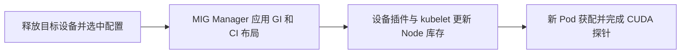

教学节点 `gpu-mixed` 有两张 A100-SXM4-40GB，插件使用 `mixed`。管理员计划把 `GPU-A` 上的七个 `1g.5gb` 换成两个 `3g.20gb`，`GPU-B` 仍以整卡交付。实例布局先在物理卡上改变，随后节点上报新库存，新 Pod 才能按规格取得设备。变更前后还要把监控样本对应到当时的实例。

## MIG 模式与 GI、CI 布局的生命周期

**MIG 模式**决定物理卡能否划分实例，**实例布局**决定该卡现在有什么设备。模式启用后还要先创建 GI，再为 GI 创建 CI，CUDA 才有可用设备。拆除实例时，先释放使用者，再撤 CI 和 GI。监控和管理进程若仍持有相关设备，也可能影响变更。 [NVIDIA MIG 620 启用模式与实例管理](https://docs.nvidia.com/datacenter/tesla/mig-user-guide/620/getting-started-with-mig.html)

在 A100 上启用 MIG 时，驱动会尝试复位 GPU，模式状态可以跨系统重启保存。从 Hopper 开始，启用模式无需复位，模式随驱动内核模块驻留，卸载重载会清除。两种情况下都要独立确认布局，因为已建 GI、CI 在 GPU 复位或系统重启之后需要重建。本例的 `GPU-A` 已处于 MIG 模式，变更操作针对实例布局。 [NVIDIA MIG 620 的代际差异](https://docs.nvidia.com/datacenter/tesla/mig-user-guide/620/getting-started-with-mig.html#enable-mig-mode)

## MIG Manager 应用新布局

GPU Operator v26.7.2 的 MIG Manager 监听 Node 的 `nvidia.com/mig.config` 标签。标签选中目标配置后，管理器停止受管的 GPU 客户端，应用模式和布局，再恢复相关组件。管理员要先移出调度候选并有序结束占用目标 GPU 的用户负载，确认管理流程或平台复位会影响哪些组件。有些环境为应用模式变更还需要节点重启。 [GPU Operator v26.7 重配置前提及管理流程](https://docs.nvidia.com/datacenter/cloud-native/gpu-operator/26.7/gpu-operator-mig.html)

以下为自定义 ConfigMap 的 `data.config.yaml` 内容摘录，省略外层对象。ClusterPolicy 的 `spec.migManager.config.name` 指向该 ConfigMap。这里假定节点当前索引 0 对应 `GPU-A`，索引 1 对应 `GPU-B`。应用前用物理 UUID 和 PCI 地址复核对应关系。目标标签值从 `seven-small` 改到 `two-large`。 [GPU Operator v26.7 自定义 MIG ConfigMap](https://docs.nvidia.com/datacenter/cloud-native/gpu-operator/26.7/gpu-operator-mig.html#example-custom-mig-configuration-during-installation)

```yaml
version: v1
mig-configs:
  seven-small:
    - devices: [0]
      mig-enabled: true
      mig-devices:
        "1g.5gb": 7
    - devices: [1]
      mig-enabled: false
  two-large:
    - devices: [0]
      mig-enabled: true
      mig-devices:
        "3g.20gb": 2
    - devices: [1]
      mig-enabled: false
```



上游文档用 H100 80GB 演示了类似过程。2024-05-14 的官方日志例先记录 `Applying MIG device configuration` 和 `Updating MIG config: map[3g.40gb:2]`，随后记录恢复 GPU 客户端和状态变为 `success`。它说明怎样从日志读出目标规格和当前阶段。下面的 A100 数字来自教学布局推导。 [GPU Operator v26.7 官方 H100 日志样例](https://docs.nvidia.com/datacenter/cloud-native/gpu-operator/26.7/gpu-operator-mig.html#example-reconfiguring-mig-profiles)

## 从布局状态验收到 Pod 可用

| 检查层 | 观察对象与完成条件 |
| --- | --- |
| 管理器 | 目标标签选中 `two-large`。`nvidia.com/mig.config.state` 可见 `pending`，需要时经过 `rebooting`，应用完成后为 `success`。 |
| 设备 | `GPU-A` 上确有两个 `3g.20gb` GI，各有可用 CI。`GPU-B` 的模式仍关闭。 |
| 库存 | Device Plugin、kubelet 和 GFD 重新上报后，按 Node 的资源键检查数量，用 GFD 标签辅助解释布局。 |
| 应用 | 新 Pod 申请新资源键并绑到候选节点，PodResources 给出分配 ID。容器枚举到新设备，在它上面分配缓冲区并执行一次可验证的 CUDA 计算。 |

以下均为只读观测示例。在目标节点分别查看设备身份、模式和实例，在 Kubernetes 控制终端读取目标 Node。将 `-lgi` 和 `-lci` 的结果对照 `-L` 中的设备；Node 对象再用于核对资源数量。 [NVIDIA nvidia-smi 命令参考](https://docs.nvidia.com/deploy/nvidia-smi/index.html) · [GPU Operator v26.7 变更后验证](https://docs.nvidia.com/datacenter/cloud-native/gpu-operator/26.7/gpu-operator-mig.html#example-reconfiguring-mig-profiles)

```sh
# 在目标节点查看物理卡与实例
nvidia-smi --query-gpu=index,uuid,pci.bus_id,mig.mode.current --format=csv
nvidia-smi -L
nvidia-smi mig -lgi
nvidia-smi mig -lci

# 在控制终端查看教学节点的资源
kubectl get node gpu-mixed -o yaml
```

| 稳定状态的教学库存 | `nvidia.com/gpu` | `nvidia.com/mig-1g.5gb` | `nvidia.com/mig-3g.20gb` |
| --- | ---: | ---: | ---: |
| 目标卡重配置前 | 1 | 7 | 0 |
| 新布局生效、健康设备已上报 | 1 | 0 | 2 |

表内 0 表示该资源无可分配量，实际对象中对应键也可能缺失。若旧 Pod 模板继续请求 `nvidia.com/mig-1g.5gb: 1`，排空后用这个模板新建的 Pod 仍要求同名库存，新布局无法满足它。如果管理器显示 `success`、宿主机布局已生效，而 Node 仍显示旧规格，应先看插件恢复、注册与重新上报。Node 库存收敛后，再用新请求验证容器。 [GPU Operator v26.7 MIG 资源和验证](https://docs.nvidia.com/datacenter/cloud-native/gpu-operator/26.7/gpu-operator-mig.html) · [Kubernetes v1.36 PodResources](https://v1-36.docs.kubernetes.io/docs/concepts/extend-kubernetes/compute-storage-net/device-plugins/#monitoring-device-plugin-resources)

## 按实例生命周期关联监控样本

DCGM（Data Center GPU Manager，数据中心 GPU 管理工具）的 Exporter 把设备观测转成指标。以 `DCGM_FI_DEV_FB_USED` 为例，值表示已用设备显存，单位为 MiB。先确认样本采集的是物理卡、GI 还是其他实体。实例样本可带 `GPU_I_ID` 与 `GPU_I_PROFILE`，具体标签和粒度取决于版本、设备选择器和指标支持。MIG UUID 的稳定范围是该 MIG 设备的生命周期。 [DCGM 显存指标](https://docs.nvidia.com/datacenter/dcgm/latest/installation/install-dcgm-exporter.html#select-metrics) · [DCGM Exporter 的实体标签](https://docs.nvidia.com/datacenter/dcgm/latest/reference/dcgm-exporter-metrics.html#exporter-labels) · [NVML 620 UUID 语义](https://docs.nvidia.com/deploy/nvml-api/620/api/group__nvmlDeviceQueries.html)

下表的时间、ID 和用量均为教学构造。两行都是 GI 层样本。每行通过同一节点、时间窗口和父 GPU 连接 PodResources、宿主机 GI/CI 映射与指标。

| 时点 | Pod 与容器 | 分配 ID | 宿主机映射 | GI 样本 `DCGM_FI_DEV_FB_USED` |
| --- | --- | --- | --- | --- |
| 10:00，变更前 | `demo/task-a` / `app` | `MIG-old` | `GPU-A` / GI 2 / CI 0 | `GPU_I_ID=2`，`GPU_I_PROFILE=1g.5gb`，1,024 MiB |
| 10:15，变更后 | `demo/task-b` / `app` | `MIG-new` | `GPU-A` / GI 2 / CI 0 | `GPU_I_ID=2`，`GPU_I_PROFILE=3g.20gb`，4,096 MiB |

按 `GPU-A` 和 GI 数字 ID 聚合，会把不同时段的两个实例当作同一对象，误读成同一实例用量增长。要归到 Pod，先用采集时刻的节点和父卡把 GI 标签映射到实例，再查当时的 Pod 与容器分配。若同一个 GI 有多个 CI 或共享进程，GI 样本只能说明合计用量，还需相应粒度的观测才能分摊。NVIDIA Device Plugin 的 Time-Slicing 在 GPU Operator v26.7 文档中也有限制，DCGM Exporter 无法把 GPU 指标关联到容器，PodResources 只能补充访问归属。 [GPU Operator v26.7 Time-Slicing 监控限制](https://docs.nvidia.com/datacenter/cloud-native/gpu-operator/26.7/gpu-sharing.html#limitations)

完成这条核对链后，可以准确说出新资源池现在能交付什么设备。接下来要用它承接具体负载，检验容量、干扰与故障域是否符合要求。
