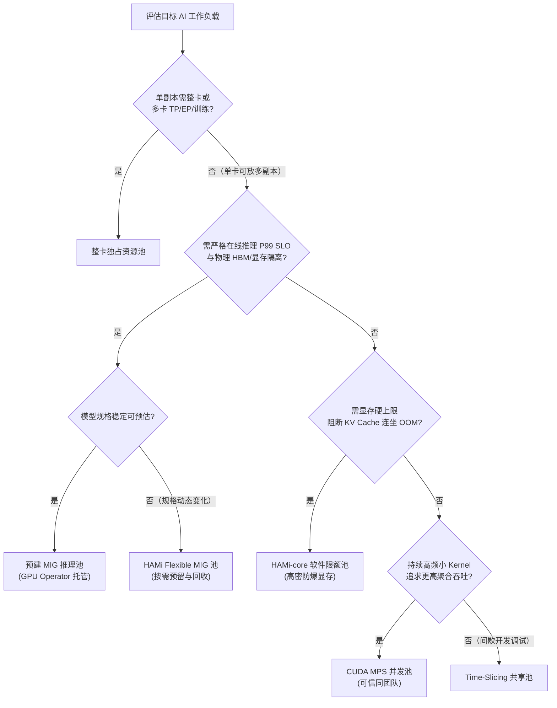

# GPU 资源池选择与并跑验收

走到这一步，手里已经握齐了六种 GPU 交付方式：**整卡独占**、**Time-Slicing**、**CUDA MPS**、**预建 MIG**、**HAMi-core 软件限额**与**HAMi Flexible MIG**。但真正搭建集群时，基础设施团队面对的问题极其务实：

- 线上 7B/14B 核心对话 API 要保 `TTFT P99` 和 `TPOT P99`，不能因为隔壁业务突发长文本就卡顿；
- 内部评测、向量嵌入和算法开发容器量很大，全给整卡成本会立刻失控；
- 70B 大模型张量并行推理和分布式训练又必须独占高速卡间互联。

解决之道不是找一种“通吃所有场景的银弹”，而是**按业务隔离与延迟需求划分清晰的功能资源池，再用可复现的并跑压测验收上线**。

## 六类资源池全景对比与选型决策树

先把前五篇的工程评估收拢到同一张五维全景表里，横向看清每种资源池的真实护城河与代价：

| 资源池形态 | 显存硬隔离 | 算力与 HBM 带宽干扰 | P99 尾延迟表现 | 卡内碎片率 | 运维灵活性 | 最适配业务场景 |
| --- | --- | --- | --- | --- | --- | --- |
| **整卡独占** | 物理整卡独占 | 无同卡干扰 | 最优（无邻居） | 低（大负载）/ 极高（小模型浪费） | 最高 | 多卡 TP/EP 推理、大模型训练、高吞吐核心服务 |
| **Time-Slicing** | **无**（易 OOM 连坐） | 高干扰（粗粒度轮转） | 不可控 | 极低 | 高 | 交互式开发、调试 Notebook、低频无 SLO 任务 |
| **CUDA MPS** | 弱—中（运行时上限） | 中高干扰（共享 L2/HBM） | 中度抖动 | 极低 | 中 | 同团队轻量嵌入/分类模型并发压榨整卡吞吐 |
| **预建 MIG** | **物理级硬隔离** | **极低（物理切开）** | **极佳且可预测** | 中高（离散档位） | 较低（改布局需排空） | **高 SLO 多租户在线推理池**（7B/14B 稳定规格） |
| **HAMi-core** | **强（软件拦截硬墙）** | 中度干扰（共享 HBM） | 中—良 | 极低（MiB 级切分） | 极高（动态申请） | 内部非核心推理、研发评测高密防 OOM 混部 |
| **HAMi Flexible MIG** | **物理级硬隔离** | **极低（物理切开）** | **极佳且可预测** | 中（退出即回收） | 高（按需动态建删） | 规格多变、又要求物理硬隔离的弹性在线推理池 |

落到实际架构决策时，可以顺着下面这棵决策树，把任何一条业务线快速归类到对应候选池：

*图 14-07-01：面向在线推理与研发混部集群的 GPU 资源池选型决策树。*

## 单设备容量门槛、混合池核算与物理故障域

选定池类型后，第一关永远是**单设备峰值显存门槛**。假设某量化推理服务单副本需在同一个 CUDA 设备上常驻 `12 GiB`（含权重、推理框架上下文与峰值 KV Cache）。即使当前预建 MIG 池里空着两块 `2g.10gb` 实例，单设备容量都低于 `12 GiB`，它也放不进去——除非模型引擎显式启用多设备拆分（例如 `TP=2`），否则必须转向 `3g.20gb` 或整卡。

规划节点池布局时，要分清两笔账：**已有发布库存**与**物理卡几何切分能力**。以一台空闲双卡 A100-SXM4-40GB 节点同时承接“14B 在线推理（`3g.20gb`）”和“小模型研发调试（`1g.5gb`）”为例：

- **两卡全切小规格**：可容纳 $2 \times 7 = 14$ 个开发 Pod，但 `3g.20gb` 容量为 `0`，在线推理彻底无法落脚。
- **单卡专切混合布局**（一张卡 `7 × 1g.5gb`，另一张卡 `2 × 3g.20gb`）：

$$\text{节点同时承载能力} = 7\ \text{个开发副本} + 2\ \text{个在线推理副本}$$

这样既为在线推理保住了硬件硬隔离槽位，又没把整台节点锁死在单一规格上。具体比例再结合集群内两类请求的到达分布动态调优即可。

> [!warning] 常见误区：两个独立 GI ≠ 两个高可用故障域
> 把主备两个在线推理副本分别放进同一张物理卡的 `GI 0` 与 `GI 1`，虽然实现了算力与显存硬隔离，但**它们依然共享同一张物理 GPU、同一块主板与同一台宿主机**，整卡异常（如 `Xid 95`）或节点断电仍会导致双双下线。
>
> 有高可用要求的服务，必须将副本调度到**不同的物理 GPU UUID**，并通过节点反亲和分散到不同宿主机（第 15 章展开）。跨租户部署时，还须同步核查容器设备权限、宿主机特权与管理面重配置权限。

## 多 Rank 负载（TP / 分布式训练）的设备与通信边界

如果负载从单卡单进程扩展成多进程多 Rank（例如多卡张量并行推理或分布式训练），资源池选型就不能只看单设备显存，必须额外核对三条通信前提：

1. **设备唯一性**：每个 Rank 必须映射到互不相同的物理 GPU 或独立 MIG 实例 UUID；多个 Rank 落在同一个 MIG 设备上会导致资源冲突或初始化失败。
2. **卡间 P2P 范围限制**：在 MIG 模式下，CUDA P2P 互联能力受硬件隔离边界严格约束（例如在多代驱动路径上，MIG 实例间的 P2P 仅限于同一物理卡内的实例之间，无法像整卡那样畅通走跨卡 NVLink 全互联）。
3. **跨机通信与选路核验**：一旦多 Rank 跨越多台节点，必须按第 06、08、13 章的方法完整核对两侧高速网卡、父 GPU 的 PCIe/NUMA 亲和路径、显存注册能力及通信库实际选路日志。

> [!note] 版本与基线说明（多 MIG 集合通信）
> 在本书统一参考栈（`CUDA 13.2.1` + `NCCL 2.27.3`）下，NCCL 尚未原生内置多 MIG 通信组支持；**生产级多卡 TP/EP 在线推理与分布式训练应统一部署在整卡独占资源池**，以完整保留 NVLink/NVSwitch 带宽。
>
> 在更新的 NCCL 实验路径（自 `2.31` 起、配合 `CUDA 13` 驱动）中，官方引入了实验性 MIG 通信组支持，要求每个 Rank 绑定独立 MIG UUID 且显式设置 `NCCL_MNNVL_ENABLE=0`（不支持 NVLS）；如确需尝试，应在隔离测试池按指定消息尺寸逐项压测。

## 面向在线推理 SLO 的单跑 vs 并跑验收方法

资源池方案最终不能只靠纸面表格拍板，上线前必须用**同口径的单跑与并跑对照实验**把性能与隔离边界钉死。

验收遵循“先单跑立基线 → 再同卡加压并跑 → 按最严 SLO 一票否决”三步闭环：

| 验收环节 | 必须固定与记录的关键证据 |
| --- | --- |
| **1. 固定压测边界** | 锁定相同的提示词长度分布、输出长度分布、并发请求数、预热轮次与统计时间窗，避免输入波动掩盖邻居干扰。 |
| **2. 锁定环境与映射** | 完整记录 GPU 型号、驱动版本、容器运行时、切分/共享配置、目标服务与同卡竞争邻居各自拿到的物理 GPU UUID 或 MIG UUID。 |
| **3. 采集推理核心指标** | 分别采集单跑与并跑时的**峰值显存（含 KV Cache 与框架工作区）**、**TTFT P50/P99**、**TPOT（ITL）P50/P99**、总输出吞吐（`tokens/s`）以及所有 CUDA/OOM 报错计数。 |
| **4. 故障与权限核验** | 若业务含隔离与安全红线，补充核对设备映射归属、邻居 OOM 触发时的波及证据及容器设备权限配置。 |

> [!summary] 核心结论：总吞吐上涨，绝不能掩盖 P99 违约
> 在在线推理资源池的验收桌上，有一条铁律：**即使同卡并跑让整张卡的聚合 `tokens/s` 提升了 40%，只要其中高优先级在线服务的 `TTFT P99` 或 `TPOT P99` 跌破了业务 SLO 红线，或者在峰值并发下出现哪怕一次邻居连坐 OOM，这次共享方案就必须判定不通过**——要么降低同卡密度、切入 HAMi-core 显存硬墙，要么直接升级到物理隔离的 MIG 池。

> [!info]- 参考资料
> - **MIG Profile 容量与放置规划**：[NVIDIA MIG 620 A100 Profile 表](https://docs.nvidia.com/datacenter/tesla/mig-user-guide/620/supported-mig-profiles.html#a100-mig-profiles)、[NVIDIA MIG 610 设备命名与 CUDA 映射](https://docs.nvidia.com/datacenter/tesla/mig-user-guide/610/mig-device-names.html)、[NVIDIA MIG 620 Profile 放置原则](https://docs.nvidia.com/datacenter/tesla/mig-user-guide/620/concepts.html#profile-placement)、[GPU Operator v26.7.2 MIG 配置与资源管理](https://docs.nvidia.com/datacenter/cloud-native/gpu-operator/26.7/gpu-operator-mig.html)
> - **硬件隔离与平台安全边界**：[NVIDIA MIG 620 硬件隔离说明](https://docs.nvidia.com/datacenter/tesla/mig-user-guide/620/introduction.html)、[NVIDIA GPU Operator v26.7.2 安全说明](https://docs.nvidia.com/datacenter/cloud-native/gpu-operator/26.7/security.html)
> - **多 Rank 与 MIG 通信条件**：[NVIDIA MIG 620 应用与通信条件](https://docs.nvidia.com/datacenter/tesla/mig-user-guide/620/deployment-considerations.html#application-considerations)、[NCCL MIG 实例通信组条件参考](https://docs.nvidia.com/deeplearning/nccl/archives/nccl_2312/user-guide/docs/usage/communicators.html#using-mig-instances)
