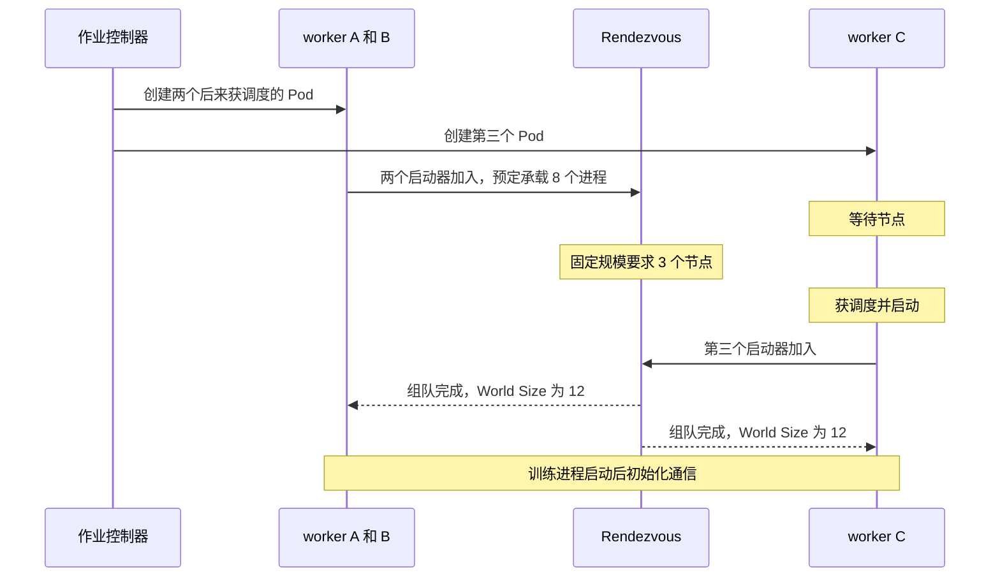
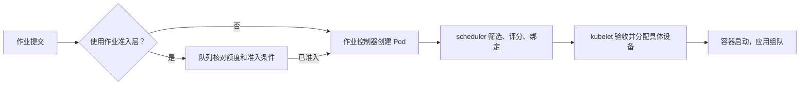

# 从等 Rank 到等一组 Pod

一个训练作业申请 3 个 worker Pod。每个 Pod 运行一个启动器，预定启动 4 个训练进程，每个进程使用 1 张 GPU。调度器已经放下两个 Pod，节点给它们分配了 8 张 GPU。第三个 Pod 仍在等待。这 8 张卡能让作业先跑起来吗？要回答这个问题，先看应用要求几个成员，再看系统在哪一步决定这一批成员能否获得资源。

本文用 Kubernetes v1.36 的常规 Pod 调度和 Device Plugin 路径说明机制。作业及其中的 GPU 数量采用教学假设。

## 固定规模的作业为什么会等

作业控制器负责创建 3 个 worker Pod。一个 Pod 放在一台节点上，本例要求 3 个 worker 各在一台物理节点。容器内的启动器负责组队并启动本地训练进程。每个训练进程在这次组队中有一个全局编号，叫 **Rank**。整个进程组的进程总数是 **World Size**。本例中，每台节点 4 个训练进程，固定 World Size 为 `3 × 4 = 12`。Rendezvous 负责让各节点对参与成员及其角色达成一致。以 torchrun 为例，训练进程在组队后读取 `LOCAL_WORLD_SIZE`、`RANK` 和 `WORLD_SIZE`。 [PyTorch 2.14 torchrun](https://docs.pytorch.org/docs/2.14/elastic/run.html) · [PyTorch 2.14 Rendezvous](https://docs.pytorch.org/docs/2.14/elastic/rendezvous.html)

如果只有两个 Pod 启动，两个启动器合计只代表 `2 × 4 = 8` 个预定的进程名额。固定规模的 Rendezvous 缺一台节点，本轮还没组成 12 个 Rank，训练进程组无法进入首次集合通信。若第三个 Pod 已在运行，仍要检查它是否加入了同一个 Rendezvous，以及后续进程组的通信是否成功。把三份没有依赖关系的数据预处理任务放在同样的三个 Pod 中，先启动的两个通常可以各自产出结果，因为它们的工作不需要等另外一个成员。

因此排查启动等待时，先将 `--nnodes` 的预期节点数和 `--nproc-per-node` 的本地进程数写下来。再对照 Pod 状态与启动器记录，找出是否还有成员未启动或未加入。已有进程环境变量时，可以据此核对本轮实际规模。 [PyTorch 2.14 torchrun](https://docs.pytorch.org/docs/2.14/elastic/run.html)

## 作业准入、Pod 放置、节点内设备分配

这三个阶段回答的问题各有一项可观察的结果。作业准入回答租户或队列现在能否启动这个作业，Pod 放置回答它的每个 Pod 要去哪台节点，节点内设备分配回答容器具体会拿到哪些设备。容器启动后，应用还要完成自己的成员协调。

| 阶段 | 组件怎样作决定 | 到哪里看结果 |
| --- | --- | --- |
| 作业准入 | 配置了队列时，准入组件核对整份作业的资源额度和其他准入条件，控制器据此释放作业。启用拓扑感知准入时，这一步也可能先计算物理放置。 | 以 Kueue v0.17 管理的 `batch/v1 Job` 为例，看 Job 的 `.spec.suspend`，再看 Workload 的 `QuotaReserved` 和 `Admitted` 条件。 |
| Pod 放置 | 在常规调度路径上，scheduler 先过滤不满足硬条件的节点，再为通过过滤的节点评分，最终绑定选中的节点。 | 看 Pod 的 `.spec.nodeName` 和 `PodScheduled` 条件。 |
| 节点内设备分配 | kubelet 在本地验收 Pod。Device Manager 选出具体设备 ID，调用插件的 `Allocate`，再把插件返回的运行时配置交给容器启动流程。 | 成功分配后可从 kubelet PodResources API 读取容器的 `resource_name` 和 `device_ids`。 |

常规 Job 可以在创建后直接由 Job 控制器创建 Pod。作为准入的例子，假设 Kueue 管理的固定规模作业需要 12 个 H100 整卡额度，当前同类额度只有 8 个可用且没有额外可借用额度。此时 Job 可以处于挂起状态，一个 worker Pod 都没创建。若额度后来足够，所有准入条件也通过，控制器才会放行 Job。若队列未启用物理拓扑检查，放行之后还可能发现 12 张卡分布在无法容纳这组 Pod 的节点上。 [Kubernetes v1.36 Job 挂起语义](https://v1-36.docs.kubernetes.io/docs/concepts/workloads/controllers/job/#suspending-a-job) · [Kueue v0.17 Job 集成](https://kueue.sigs.k8s.io/v0.17/docs/tasks/run/jobs/) · [Kueue v0.17 准入概念](https://kueue.sigs.k8s.io/v0.17/docs/concepts/)

使用 Device Plugin 时，scheduler 根据扩展资源计数筛节点。绑定完成后，Device Manager 根据本机可用设备与拓扑约束选择 ID。插件的 `Allocate` 响应可以包含供运行时使用的设备节点、环境变量、挂载或 CDI 设备名。对于 SR-IOV VF，插件负责设备资源交付，附加网络的 VF 接入和地址配置还依赖相应 CNI。 [Kubernetes v1.36 调度框架](https://v1-36.docs.kubernetes.io/docs/concepts/scheduling-eviction/scheduling-framework/) · [Kubernetes v1.36 Device Plugin API](https://v1-36.docs.kubernetes.io/docs/concepts/extend-kubernetes/compute-storage-net/device-plugins/) · [SR-IOV CNI 接入方式](https://github.com/k8snetworkplumbingwg/sriov-cni)

## Gang 的最小成组数应该是多少

设有 4 台可用节点，每台只能接纳一个 worker。作业甲、乙都需要 3 个 worker。如果逐 Pod 放置恰好给甲、乙各放了两个，4 台节点会被占满，两份作业都在等待第三个成员。成组调度（Gang Scheduling）在允许绑定前先检查当前能否放下达到最低门槛的一组 Pod。在这个场景里，若给甲放 3 个，甲可以开始组队，乙则继续等到能凑足 3 台。 [Kubernetes 原生 Gang Scheduling](https://kubernetes.io/docs/concepts/scheduling-eviction/gang-scheduling/)

门槛要从应用实际能接受的最小规模推导。一台节点对应一个 worker Pod、每个 worker 启动 4 个进程时，固定规模要求 3 个 Pod。若应用和控制器均支持从 2 台开始、之后扩到 3 台，门槛可以设为 2。下表用同一份只有两个合格节点的快照比较两种门槛，假定其他条件均满足。

| 启动规格 | 可同时放置的 worker | 最小成组数 | 本轮结果 |
| --- | ---: | ---: | --- |
| `--nnodes=3 --nproc-per-node=4` | 2 | 3 | 继续等第三个节点，尚未组队。 |
| `--nnodes=2:3 --nproc-per-node=4` | 2 | 2 | 两台组队成功后，World Size 为 `2 × 4 = 8`。 |

在 torchrun 的弹性模式下，成员变化可导致所有现有训练进程停止并重组 WorkerGroup，新一轮的 `RANK` 和 `WORLD_SIZE` 可能改变。要能从两台扩大到三台，应用须接受新的规模，并能按自己的进度恢复逻辑重新开始。把固定三节点的作业门槛改成 2，scheduler 可以通过这个门槛，启动器仍会等到三台。 [PyTorch 2.14 torchrun 的故障与成员变更](https://docs.pytorch.org/docs/2.14/elastic/run.html)

成组通过说明 scheduler 找到了满足门槛的候选放置。之后各节点分别验收和启动容器，设备分配、镜像拉取或应用 Rendezvous 仍可能失败。复查时，要看本轮有多少 Pod 获得节点、多少实际上启动，以及有多少成员进入同一个进程组。 [Kubernetes v1.37 原生成组调度流程](https://kubernetes.io/docs/concepts/scheduling-eviction/gang-scheduling/) · [Kubernetes v1.36 Pod 生命周期](https://v1-36.docs.kubernetes.io/docs/concepts/workloads/pods/pod-lifecycle/)

Kubernetes 原生实现中，PodGroup 的 `minCount` 表示最少需要同时可放置的成员数，已绑定的组成员也可计入后续调度轮次。v1.36 的原生 gang 是 Alpha，涉及 `GenericWorkload`、`GangScheduling` 和 `scheduling.k8s.io/v1alpha2`。到 v1.37，核心 Workload/PodGroup 和 gang 升为 Beta，使用 `scheduling.k8s.io/v1beta1`，由仍默认关闭的 `GenericWorkload` 特性开关控制。读集群配置时先核对版本和开关，再判断普通 Pod 调度还是成组检查生效。 [Kubernetes v1.36 发布说明](https://kubernetes.io/blog/2026/05/13/kubernetes-v1-36-advancing-workload-aware-scheduling/) · [Kubernetes v1.37 发布说明](https://kubernetes.io/blog/2026/09/08/kubernetes-v1-37-advancing-workload-aware-scheduling/) · [PodGroup 策略](https://kubernetes.io/docs/concepts/workloads/workload-api/policies/)
