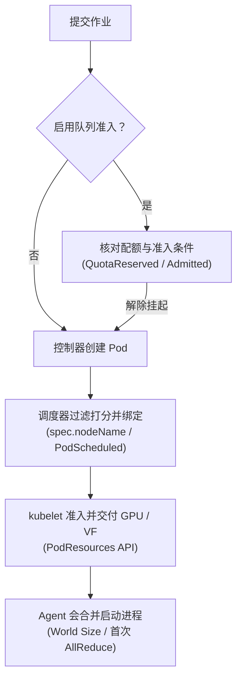

# 作业准入、Pod 放置与训练会合

同一套集群上只剩 2 台空闲的 GPU 节点，此时同时迎来两份请求：一份是扩容 3 个副本的在线推理服务，另一份是固定 3 节点的同步训练作业。如果直接交给 Kubernetes 默认的逐 Pod 调度器，结果截然不同。

在线推理先启动的 2 个副本立刻就能承接线上流量，首字延迟随之下滑；而同步训练先启动的 2 个 Pod 虽稳稳占住了 8 张 H100，却因为迟迟凑不齐第 3 个成员，所有卡都在空转死等，训练步数停在零。

这正是多卡作业调度的起点：**基础设施必须先看懂应用对成员齐备的依赖，再决定如何放行与放置 Pod**。

## 从单节点四卡看清完整交付链

在切入多节点死锁前，先用一台拥有 4 张空闲整卡的节点走通最干净的正常路径。这里启动一个承载训练进程的 **worker Pod**，容器内由 `torchrun` **Agent**（本地进程启动器）拉起 4 个训练进程，每进程独占 1 张 GPU。

沿用 [第 05 章](../05_为什么一个作业需要多张GPU/00_内容大纲.md) 的 PyTorch 2.9 启动模型，让 4 个进程各贡献一个序号值并执行求和，完整交付依次跨越四道关卡：

1. **控制器建单与调度器绑定**：作业控制器按模板创建 Pod，Kubernetes `v1.36` 调度器先过滤掉不满足资源或硬性约束的节点，再对候选节点打分并写入 `spec.nodeName`。
2. **kubelet 准入与设备交付**：目标节点上的 kubelet 接手绑定后的 Pod，通过第 11 章的 Device Plugin 路径选出 4 个具体 GPU 设备 ID，调用 `Allocate` 交由容器运行时注入容器并启动 Agent。
3. **Agent 会合与分配编号**：容器内的 `torchrun` Agent 发起会合（Rendezvous）确认参与节点。单机场景只有这一个 Agent，会合完毕后它拉起 4 个训练进程，分配 `RANK=0…3`、`WORLD_SIZE=4` 与 `LOCAL_WORLD_SIZE=4`，各进程按 `LOCAL_RANK` 绑定对应 GPU。
4. **进程组初始化与首次集合通信**：4 个进程初始化分布式进程组，并通过 `NCCL 2.27.3` 发起 AllReduce 求和。输入分别为 1、2、3、4 时，所有进程在操作完成后都读到总和 10。

```bash
# 容器内 worker Pod 的单节点 4 卡启动命令示例
torchrun \
  --nnodes=1 \
  --nproc-per-node=4 \
  --rdzv-backend=c10d \
  --rdzv-endpoint=127.0.0.1:29500 \
  train.py
```

走到这里，Pod 处于 `Running` 仅仅说明容器进程跑起来了，真正标志“算力投入产出”的是进程组建立并推进首次集合通信。

## 扩到固定三节点：为什么部分启动等于白占卡

现在将规模放大为本章的分布式训练主例 `train-12`：固定 3 个 worker Pod，分别落在 3 台不同物理节点，每个 Pod 运行 4 个训练进程。

每个 worker Pod 申请 **4 张 H100 80 GB 整卡、16 个 Kubernetes CPU 单位、96 GiB 主机内存与 1 个支持 RDMA 的 VF**（附加高速网络接入见 [第 13 章](../13_Multus与RDMA_把高速网络交给Pod/00_内容大纲.md)）。

启动器采用固定规模 `--nnodes=3 --nproc-per-node=4`，并指向同一个会合后端、端点与作业 ID。

整份作业的默认进程组总规模与首轮序号求和校验值如下：

$$
\text{World Size} = 3 \text{ 节点} \times 4 \text{ 进程/节点} = 12
$$

$$
\sum_{r=0}^{11} (r + 1) = 1 + 2 + \cdots + 12 = 78
$$

把这套 3 节点规格放进只剩 2 台可用节点的集群里，Kubernetes 侧与应用侧的状态会出现明显的“视野割裂”：

| 运行阶段 | Kubernetes 集群侧所见 | 训练应用侧所见 |
| --- | --- | --- |
| 仅 2 个 Pod 启动 | 2 台节点已划走 8 张 H100，第 3 个 Pod 处于 `Pending` 等待调度 | 2 个 Agent 抵达会合点（可承接 8 进程），但固定 3 节点门槛未齐，12 人进程组无法建立 |
| 第 3 个 Pod 启动并会合 | 3 个 Pod 全部获得节点、GPU 与 VF 并处于 `Running` | 3 个 Agent 完成会合，各自拉起 4 个进程初始化通信，首轮 AllReduce 全部拿到结果 `78` |

如果把同样 3 个 Pod 换成**彼此独立的数据预处理任务**或**无状态的在线推理副本**，先启动的 2 个 Pod 马上就能干活产出；但固定 12 人的同步训练每一步都要求全员参与集合通信，缺 1 个节点就寸步难行。

> [!warning] 常见误区：容器全 `Running` 仍可能零进展
> 即使 3 个 worker 容器都显示 `Running`，如果第 3 个 Agent 的会合 ID 写错、网络不通或进程组初始化卡死，整组训练照样不会向前走一步。调度成功只解决“拿到资源”，并不替应用完成会合。

## 作业准入层：把配额判断提前到建 Pod 之前

既然缺员启动只会白白占卡，一个自然的改进是在控制器创建 Pod 之前加一道**作业准入**关卡——先按整份作业的资源总量核对队列配额，放行之后再建 Pod。

以 `Kueue v0.17` 托管原生 `batch/v1 Job` 为例，Kueue 会为每个作业生成对应的 **Workload** 对象，集中记录资源需求、额度保留与准入状态。作业提交时先处于挂起状态（`spec.suspend: true`），Job 控制器按兵不动，不会贸然创建任何 worker Pod。

假设 `train-12` 需要 12 张同型 H100 额度，而当前队列仅剩 8 个额度且无可借空间。此时 Workload 保持等待，集群里连第 1 个 Pod 都不会出现；直到队列凑足 12 个额度并通过其他准入检查，Kueue 才把 `spec.suspend` 改回 `false`，放行 Job 控制器创建 3 个 Pod。

```yaml
# 交由 Kueue 托管准入的训练 Job 关键片段
apiVersion: batch/v1
kind: Job
metadata:
  name: train-12
  namespace: ai
  labels:
    kueue.x-k8s.io/queue-name: train-local-queue  # 绑定目标本地队列
spec:
  suspend: true          # 初始挂起，等待 Kueue Workload 准入后解除
  parallelism: 3         # 并发运行 3 个 worker Pod
  completions: 3
  completionMode: Indexed
```

需要注意**配额准入**与**节点放置**的分工：普通额度准入只核对账面总量是否够 12 张卡，不保证这些空闲卡能恰好凑成 3 台完整节点（除非额外启用了 Kueue 拓扑感知准入）。Pod 创建出来后，仍需调度器绑定节点，再由节点侧设备插件与 SR-IOV CNI 把 GPU 和 VF 真正装进容器。



*图 15-01-01：多卡训练作业从队列准入到应用首次集合通信的四段交接链路。*

沿着这条链路，每一段都有清晰的证据边界：`QuotaReserved` 与 `Admitted` 交代队列准入，`spec.nodeName` 与 `PodScheduled` 交代调度器选择，kubelet 的 **PodResources API** 交代容器拿到的真实设备 ID，应用日志则交代会合与首次通信。

## 训推双轨：为什么不能用同一把尺子调度

看到这里，不妨退后一步俯瞰整个 AI 基础设施集群。本章贯穿的 8 卡 HGX H100 集群同时承载**分布式训练**与**在线大模型推理**，二者对调度的底层诉求恰恰是镜像相反的：

| 调度维度 | 分布式同步训练（批处理） | 在线大模型推理（长驻服务） |
| --- | --- | --- |
| **成员耦合度** | 强耦合，缺一不可（要求全员会合同步） | 弱耦合，单副本可独立处理请求与恢复 |
| **放置偏好** | **拉近聚合**：尽量挤进同一高速网络域与同一 NUMA | **打散容灾**：跨节点、跨机架反亲和避免单点故障 |
| **扩缩与启动节奏** | 追求整组同时起跑，允许在队列里等待凑齐资源 | 追求秒级弹性扩容，极度敏感于百 GB 权重冷启动耗时 |
| **核心观测目标** | 高吞吐、高算力利用率、减少部分占卡空转 | 守住首字延迟（TTFT）与单 token 延迟（TPOT）SLO |
| **资源竞争定位** | 通常作中低优先级批处理，支持检查点断点续训 | 高优先级线上业务，高峰期需优先拿卡甚至抢占离线训练 |

> [!summary] 核心结论
> 即使 Kueue 为 `train-12` 一次性留出了 12 张卡的额度，如果底层调度器依然“来一个绑一个”，三节点训练还是可能出现“先绑 2 个、第 3 个卡死”的僵局。要彻底堵住这道缺口，必须把成组约束带进调度器内部——这就是下一篇要主讲的 **Gang Scheduling**；而在线推理截然相反的调度逻辑，也会贯穿后续各篇并在第 06 篇系统展开。

> [!info]- 参考资料
> - **PyTorch 分布式启动与会合**：[PyTorch 2.9 · torchrun](https://docs.pytorch.org/docs/2.9/elastic/run.html)、[PyTorch 2.9 · Rendezvous](https://docs.pytorch.org/docs/2.9/elastic/rendezvous.html)、[PyTorch 2.9 · 分布式通信与 AllReduce](https://docs.pytorch.org/docs/2.9/distributed.html)、[PyTorch 2.9 · all_reduce API](https://docs.pytorch.org/docs/2.9/distributed.html#torch.distributed.all_reduce)、[PyTorch v2.9.1 · LocalElasticAgent 环境变量源码](https://github.com/pytorch/pytorch/blob/v2.9.1/torch/distributed/elastic/agent/server/local_elastic_agent.py)
> - **NCCL 集合通信参考**：[NCCL 2.27.3 · Overview](https://docs.nvidia.com/deeplearning/nccl/archives/nccl_2273/user-guide/docs/overview.html)
> - **Kubernetes 调度、Job 与设备插件**：[Kubernetes v1.36 · 调度框架](https://v1-36.docs.kubernetes.io/docs/concepts/scheduling-eviction/scheduling-framework/)、[Kubernetes v1.36 · Pod API](https://v1-36.docs.kubernetes.io/docs/reference/kubernetes-api/workload-resources/pod-v1/)、[Kubernetes v1.36 · Pod 生命周期](https://v1-36.docs.kubernetes.io/docs/concepts/workloads/pods/pod-lifecycle/)、[Kubernetes v1.36 · Job 挂起语义](https://v1-36.docs.kubernetes.io/docs/concepts/workloads/controllers/job/#suspending-a-job)、[Kubernetes v1.36 · Device Plugin 与 PodResources](https://v1-36.docs.kubernetes.io/docs/concepts/extend-kubernetes/compute-storage-net/device-plugins/)
> - **Kueue 准入与高速网络**：[Kueue v0.17 · Job 集成](https://kueue.sigs.k8s.io/v0.17/docs/tasks/run/jobs/)、[Kueue v0.17 · 准入与条件](https://kueue.sigs.k8s.io/v0.17/docs/concepts/admission/)、[Kueue v0.17 · 拓扑感知准入](https://kueue.sigs.k8s.io/v0.17/docs/concepts/topology_aware_scheduling/)、[SR-IOV CNI · VF 接入](https://github.com/k8snetworkplumbingwg/sriov-cni)
