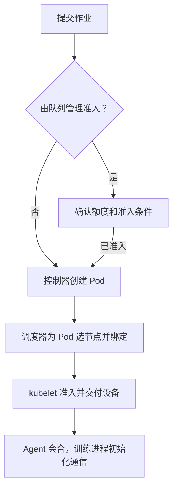

多卡训练的**作业调度**要为一批彼此依赖的 Pod 交付资源。它连接了应用的成员需求与 Kubernetes 的放置过程。应用指定要有多少参与者，作业控制器把规格展开为 Pod，调度器为 Pod 选择节点，节点上的 kubelet 把设备交给容器。容器中的启动器随后组织进程参与训练。一份作业需要哪些调度约束，取决于少了某个成员时应用还能否运行。

## 单节点四卡作业的启动过程

先在一台有四张可用整卡的节点上运行一个 Pod。这个 Pod 是一个 **worker Pod**，即作业中承载训练进程的 Pod。它在一个容器中启动一个 `torchrun` **Agent**（本地进程启动器），由 Agent 启动四个训练进程，每个进程使用一张 GPU。四个进程约定各提供一个数字、求和后都得到同一个结果。以下沿用第 05 章的 PyTorch 2.9 会合和集合通信模型，单节点数字用于说明启动顺序。 [PyTorch 2.9 · torchrun](https://docs.pytorch.org/docs/2.9/elastic/run.html) · [PyTorch 2.9 · AllReduce](https://docs.pytorch.org/docs/2.9/distributed.html#torch.distributed.all_reduce)

1. 控制器根据作业模板创建 Pod。Kubernetes v1.36 的常规调度器先过滤不满足资源或硬性放置条件的节点，再为通过过滤的节点评分，选定节点并绑定。这时 Pod 有了 `spec.nodeName`。 [Kubernetes v1.36 · 调度框架](https://v1-36.docs.kubernetes.io/docs/concepts/scheduling-eviction/scheduling-framework/) · [Kubernetes v1.36 · Pod API](https://v1-36.docs.kubernetes.io/docs/reference/kubernetes-api/workload-resources/pod-v1/)
2. kubelet 在绑定节点上准入 Pod。在第 11 章的 Device Plugin 路径中，调度器按 `nvidia.com/gpu: 4` 检查数量，kubelet 的 Device Manager 则选择四个设备 ID，并调用插件的 `Allocate` 获取运行时交付所需的信息。运行时据此准备容器，启动其中的 Agent。 [Kubernetes v1.36 · Device Plugin](https://v1-36.docs.kubernetes.io/docs/concepts/extend-kubernetes/compute-storage-net/device-plugins/)
3. Agent 用 **Rendezvous**（会合）确定本轮有哪些参与节点。本例只有一个 Agent。会合后，它启动四个进程并给它们分配本轮编号。进程组内的编号叫 **Rank**，本例默认进程组的进程总数叫 **World Size**。四个进程分别取得 `RANK=0…3`，且各自的 `WORLD_SIZE=4`、`LOCAL_WORLD_SIZE=4`。它们用各自的 `LOCAL_RANK` 选择容器内的一张 GPU。 [PyTorch 2.9 · Rendezvous](https://docs.pytorch.org/docs/2.9/elastic/rendezvous.html) · [PyTorch v2.9.1 · Worker 环境变量](https://github.com/pytorch/pytorch/blob/v2.9.1/torch/distributed/elastic/agent/server/local_elastic_agent.py)
4. 四个进程初始化框架进程组，再发起 **AllReduce**。这是要求该组成员都参与的集合操作，求和时每个成员都提交自己的值并取得总和。若贡献值为 1、2、3、4，每个进程在本卡操作完成后都能读到 10。框架可以使用 NCCL（NVIDIA Collective Communications Library）执行这次 GPU 通信。 [PyTorch 2.9 · 进程组初始化与 AllReduce](https://docs.pytorch.org/docs/2.9/distributed.html) · [NCCL 2.31.2 · 概览](https://docs.nvidia.com/deeplearning/nccl/archives/nccl_2312/user-guide/docs/overview.html)

## 固定三节点作业的参与者

将同样的每 Pod 四进程扩为三个 worker Pod，每 Pod 落在不同物理节点。这是本章的主例 `train-12`。每个 Pod 请求四张 H100 80 GB 整卡、16 个 Kubernetes CPU 单位、96 GiB 主机内存及一个支持 **RDMA**（Remote Direct Memory Access，远程直接内存访问）的 **SR-IOV VF**（Single Root I/O Virtualization 的虚拟功能），即交给 Pod 使用的一份网卡设备。第 13 章已讲过 VF 如何通过附加网络接入。主例假设每个 Agent 使用同一个会合后端、端点和作业 ID，并采用固定节点数 `--nnodes=3 --nproc-per-node=4`。完整默认进程组需要 `3 × 4 = 12` 个进程。 [PyTorch 2.9 · torchrun 启动规格](https://docs.pytorch.org/docs/2.9/elastic/run.html) · [SR-IOV CNI · VF 接入](https://github.com/k8snetworkplumbingwg/sriov-cni)

| 教学时点 | Kubernetes 侧 | 应用侧 |
| --- | --- | --- |
| 两个 Pod 已启动 | 两个节点已为它们分配共 8 张卡，第三个 Pod 等待调度。 | 两个 Agent 进入会合，合计可承载 8 个训练进程。固定三节点的会合仍缺第三个 Agent，本轮十二人进程组尚未建立。 |
| 第三个 Pod 也已启动并成功加入会合 | 三个 Pod 均已获得节点和设备。 | 三个 Agent 完成会合并各自启动四个进程，随后由进程初始化通信。若继续用“Rank 加一”求和，首轮所有 Rank 完成操作后都得到 `1 + 2 + … + 12 = 78`。 |

同样只启动两个 Pod，若任务是三份彼此独立的数据预处理，先启动的两份可以各自产出。固定十二人训练需要成员共同完成进程组内的同步操作。两个 Pod 已占用八张卡，却还没有达到启动训练所要求的规模。在三个容器都已启动的情形下，若训练仍无进度，就要查第三个 Agent 是否进入同一次会合，以及各进程是否完成初始化和首次通信。 [PyTorch 2.9 · Rendezvous](https://docs.pytorch.org/docs/2.9/elastic/rendezvous.html) · [PyTorch 2.9 · 分布式通信](https://docs.pytorch.org/docs/2.9/distributed.html)

## 作业额度、Pod 绑定与设备分配

集群可以在控制器创建 Pod 前增加**作业准入**。它按整份作业的需求决定队列当前可否放行。以 Kueue v0.17 管理的 `batch/v1 Job` 为例，Kueue 用 **Workload** 记录资源需求、额度保留和准入状态。Job 挂起时，Job 控制器等待其解除挂起再创建用于执行的 Pod。假设 `train-12` 需要 12 个同类整卡额度，队列当前只有 8 个额度且没有可借额度，作业会等待额度，连第一个 Pod 也可能尚未创建。额度够且其余准入检查通过后，Kueue 才放行这个 Job。 [Kueue v0.17 · Job 集成](https://kueue.sigs.k8s.io/v0.17/docs/tasks/run/jobs/) · [Kueue v0.17 · 准入](https://kueue.sigs.k8s.io/v0.17/docs/concepts/admission/) · [Kubernetes v1.36 · Job 挂起语义](https://v1-36.docs.kubernetes.io/docs/concepts/workloads/controllers/job/#suspending-a-job)

如果只做额度准入，工作负载通过后仍要由调度器为 Pod 找到节点。配置了拓扑感知准入时，Kueue 还会核算相应域的物理容量。来到节点侧，设备插件交付具体的 VF，容器网络插件还要把 VF 接入 Pod 并设置接口和地址。下面的流程图概括普通额度准入和节点交付的交接顺序。 [Kueue v0.17 · 拓扑感知准入](https://kueue.sigs.k8s.io/v0.17/docs/concepts/topology_aware_scheduling/) · [Kubernetes v1.36 · Device Plugin 与 PodResources](https://v1-36.docs.kubernetes.io/docs/concepts/extend-kubernetes/compute-storage-net/device-plugins/) · [SR-IOV CNI · VF 接入](https://github.com/k8snetworkplumbingwg/sriov-cni)

按这条路径，`QuotaReserved` 和 `Admitted` 回答队列阶段的两个判断，`spec.nodeName` 与 `PodScheduled` 记录常规调度结果，kubelet 的 **PodResources API** 可以报告容器获分配的设备 ID，应用日志则记录会合和首次操作。即使队列一次为三份请求保留了额度，普通调度仍可能逐个绑定 Pod，于是重现两个先启动、第三个还在等待的场景。成组调度要处理的正是这里的放置门槛。 [Kueue v0.17 · 准入条件](https://kueue.sigs.k8s.io/v0.17/docs/concepts/admission/) · [Kubernetes v1.36 · Pod 生命周期](https://v1-36.docs.kubernetes.io/docs/concepts/workloads/pods/pod-lifecycle/)
