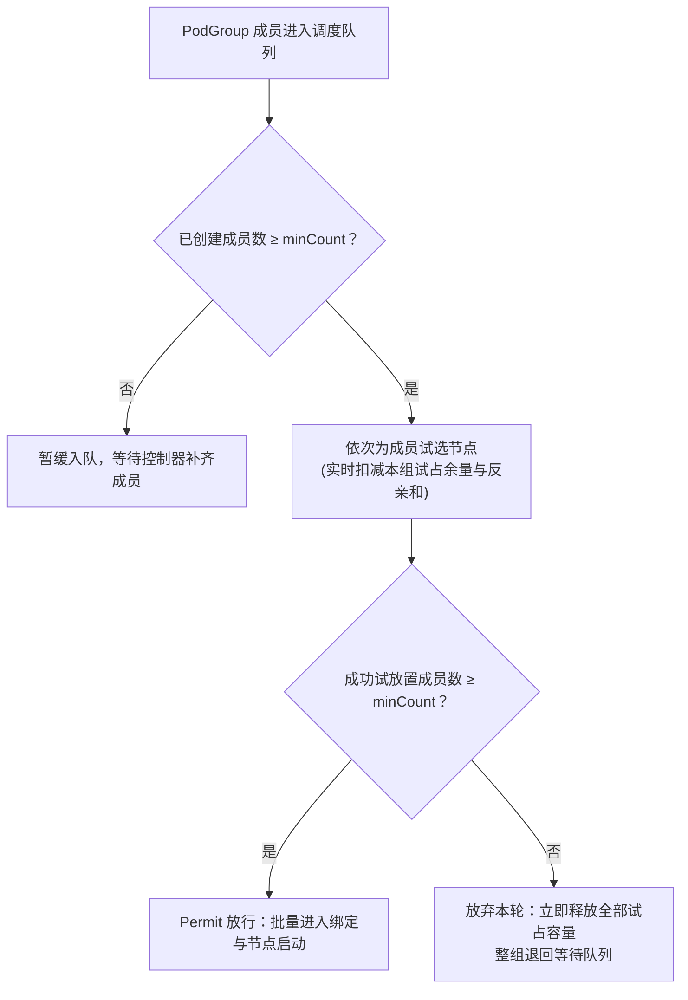

# Gang 成组调度与弹性作业规模

深夜集群里刚好空出 4 台合格的 GPU 节点，两份各需 3 个节点的同步训练作业几乎同时涌入调度器。明明集群足够完整跑起其中一份作业，最后的结果却往往是两份作业全部卡死、4 台机器全被占满却零算力产出。

问题出在“单个 Pod 视角”与“整组作业视角”的错位。解决这一僵局的核心机制就是 **Gang Scheduling（成组调度）**。

## 从“2 + 2 互相等死”理解 Gang Scheduling

把两份 3 节点训练作业分别记作作业甲与作业乙，4 台合格节点每台至多接纳 1 个 worker。

在默认逐 Pod 调度下，如果调度队列恰好按“甲、乙、甲、乙”的顺序轮流绑定，4 台节点很快会被拆成 **`2 + 2`**。此时作业甲占着 2 台节点死等第 3 台，作业乙也占着 2 台节点死等第 3 台；只要没有新节点加入或外部干预释放，两份固定规模的训练会合都永远无法达成。

**Gang Scheduling（成组调度）** 把调度器的放行单位从“单个 Pod”提升为“一组相互依赖的 Pod”：**要么一次性为整组凑齐最低要求的可用落点并集体放行，要么一个也不绑定，让整组继续等待**。

你可以把它想象成旅游团过检票口——导游要求“齐了 3 个人才放行上车”。同一批 4 台节点换成成组调度后，调度器先替作业甲凑齐 3 个落点并放行，结果变成 **`3 + 0`**：作业甲顺利起跑推进训练，作业乙不占空位，安静等待下一波 3 台节点释放。

## 试放置、门槛确认与原子放行

成组调度不是“先绑上去，不够再踢掉”，而是在**真正绑定之前**于调度器内存快照中完成整组试算。

以最小成组门槛 `minCount = 3` 为例，在 `Kubernetes v1.36` 原生组调度周期中，整个流程分成四个严密步骤：

1. **成员数量预检（PreEnqueue）**：调度器先核对组内已经创建出来的 Pod 数量。即便集群空着 3 台整机，只要控制器当前只建出了 2 个 Pod，调度器就不会启动本轮试放。
2. **逐成员试放置**：3 个成员到齐后，调度器依次替每个 worker 挑选候选节点，并将已被本组前序成员试占的资源与反亲和约束实时记入账本，防止把两个必须分机的 worker 试放到同一台机器上。
3. **成组门槛校验（Permit）**：试放结束时，核对成功拿到可行落点的成员数是否达到 `minCount`。凑满 3 个则允许这批成员进入绑定阶段；只找到 2 个则整组打回等待队列，并立刻清空本轮试占的调度容量，留给其他作业使用。
4. **独立绑定与节点启动**：放行之后，3 个 Pod 各自走完节点绑定、kubelet 准入与容器启动。



*图 15-02-01：Gang 成组调度在绑定前的试放置与 `Permit` 门槛校验流程。*

> [!warning] 常见误区：Gang 放行不等于训练一定能跑起来
> 成组调度只消除了“集群明明不够 3 个落点却先绑 2 个”的死锁路径。放行绑定之后，单个 Pod 依然可能因为节点内 NUMA 拓扑拒绝、镜像拉取失败、设备分配报错或会合超时而掉队，导致实际可用成员再次跌破门槛。

此外，默认组调度算法按成员次序逐个试放。遇到异构规格（如混合不同卡数角色）或复杂亲和条件时，顺序试放可能错过原本存在的可行组合；因此绑定后仍须逐层核对设备分配数、启动成功的 Agent 数以及最终形成的进程组规模。

## 固定规模 vs 弹性规模：把门槛对齐到应用

是不是所有多卡训练都必须死守固定节点数？如果当前集群只有 2 台合格节点，而训练任务本身支持弹性启动，就可以把成组门槛下调到最小可运行规模。

在 PyTorch 2.9 的 `torchrun` 中，`--nnodes` 指定参与会合的节点数量区间，乘以每节点进程数才是该轮训练真正的 World Size。下表对照三种配置在“2 台合格节点”快照下的结果：

| `torchrun` 启动规格 | 调度成组门槛 (`minCount`) | 2 节点快照下的运行结果 |
| --- | ---: | --- |
| 固定 `--nnodes=3 --nproc-per-node=4` | 3 | 试放仅得 2 处落点，成组检查拦下并继续等待，避免占卡空转 |
| 弹性 `--nnodes=2:3 --nproc-per-node=4` | 2 | 门槛通过并绑定 2 个 Pod；2 个 Agent 完成会合后以 `WORLD_SIZE=8` 推进训练 |
| 固定 `--nnodes=3`，误把门槛改为 `2` | 2 | 2 个 Pod 获准绑定并占走 8 张卡，但启动器仍在苦等第 3 个 Agent，退回死锁 |

> [!tip] 工程直觉：门槛必须与启动器、控制器三方对齐
> 下调弹性作业的成组门槛时，必须同时确认三件事：应用开启了弹性区段（如 `--nnodes=2:3`）、队列准入放行最小规模、作业控制器允许在缺席部分副本时继续存活。三者只要有一处仍按固定 3 节点校验，就会出现“调度放了，应用死等”的错配。

在弹性会合模式下，达到最小节点数后 Agent 会短暂等待其余成员。如果第 3 台节点在首轮会合结束后才上线加入，`torchrun` 会主动停止当前 8 进程组并按新规模重组为 `WORLD_SIZE=12`。由于原有成员的 Rank 可能重新洗牌，训练代码必须能够按新规模重划数据分片，并从可恢复检查点无缝续跑。

## Kubernetes 原生 `PodGroup` 与 Volcano 的分工

在 `Kubernetes v1.36` 中，原生工作负载感知调度引入了 `scheduling.k8s.io/v1alpha2` API，并将静态策略模板与运行时组状态拆成两个对象：**Workload** 声明长期策略模板，**PodGroup** 则承载调度器跟踪的运行时成员组与成组门槛（`schedulingPolicy.gang.minCount`）。

```yaml
# Kubernetes v1.36 原生 PodGroup 运行时对象关键片段（v1alpha2）
apiVersion: scheduling.k8s.io/v1alpha2
kind: PodGroup
metadata:
  name: train-12-workers
  namespace: ai
spec:
  podGroupTemplateRef:
    workload:
      workloadName: train-12
      podGroupTemplateName: workers
  schedulingPolicy:
    gang:
      minCount: 3  # 至少凑齐 3 个 worker 才允许本组集体绑定
```

> [!note] 版本与特性门控说明
> 在本书基准 `Kubernetes v1.36` 中，原生 `Workload` 与 `PodGroup` 处于 Alpha 阶段，需显式开启 `GenericWorkload` 与 `GangScheduling` 门控并确认上层控制器已对接（更高版本正逐步演进至 `v1beta1`）。
>
> 当前生产集群普遍采用 `Volcano` 落地成组调度，第 16 章将完整走通 Volcano 的 `PodGroup` 与 `Queue` 配置。

## 反观在线推理：为什么推理服务排斥 Gang Scheduling

把视角切回在线大模型推理集群，同样是要拉起 3 个推理副本承接高峰流量，却**绝对不要给常规多副本推理服务套上 Gang Scheduling**。

原因很简单：常规数据并行多副本（例如 3 个各自独占 1–4 张卡的 7B/70B 推理实例）彼此之间没有跨副本同步会合依赖。高峰到来时，如果集群暂时只能腾出 2 个副本的卡：

- **采用普通独立调度**：先落地的 2 个副本在权重加载后立刻加入负载均衡池分担流量，队列积压与 P99 TTFT 马上下降，第 3 个副本稍后补位即可。
- **误用 Gang 调度**：因为凑不齐第 3 个落点，前 2 个副本也被迫死等，明明手里握着能救火的空闲卡却一滴水也不泼，直接酿成线上 SLO 违约。

> [!summary] 核心结论
> **Gang 只为强同步依赖而生**。除了跨节点张量并行（如单实例必须横跨 2 台 8 卡机运行超大规模 MoE）或强绑定拓扑的 PD 分离实例组需要局部小范围成组调度（常借助 LeaderWorkerSet 等编排）外，绝大多数在线推理副本应当坚持“能起一个是一个”的独立弹性调度，把成组约束留给多机同步训练。

成组门槛决定了“一次要凑齐几个落点”。至于集群账面上究竟能凑出几个合格落点、它们是否落在同一个高速网络域，下一篇立刻拆解。

> [!info]- 参考资料
> - **Kubernetes 原生 Gang 与组调度**：[Kubernetes v1.36 · Gang Scheduling](https://v1-36.docs.kubernetes.io/docs/concepts/scheduling-eviction/gang-scheduling/)、[Kubernetes v1.36 · PodGroup 调度周期与限制](https://v1-36.docs.kubernetes.io/docs/concepts/scheduling-eviction/podgroup-scheduling/)、[Kubernetes v1.36 · 调度框架](https://v1-36.docs.kubernetes.io/docs/concepts/scheduling-eviction/scheduling-framework/)、[Kubernetes v1.36 · Pod 生命周期](https://v1-36.docs.kubernetes.io/docs/concepts/workloads/pods/pod-lifecycle/)
> - **Workload-Aware Scheduling 版本演进博客**：[Kubernetes v1.36 · Advancing Workload-Aware Scheduling](https://kubernetes.io/blog/2026/05/13/kubernetes-v1-36-advancing-workload-aware-scheduling/)、[Kubernetes Workload-Aware Scheduling 后续演进](https://kubernetes.io/blog/2026/09/08/kubernetes-v1-37-advancing-workload-aware-scheduling/)
> - **PyTorch 固定与弹性会合**：[PyTorch 2.9 · 固定与弹性启动](https://docs.pytorch.org/docs/2.9/elastic/run.html)、[PyTorch 2.9 · 成员变化与重组](https://docs.pytorch.org/docs/2.9/elastic/run.html#membership-changes)、[PyTorch 2.9 · Rendezvous 等待机制](https://docs.pytorch.org/docs/2.9/elastic/rendezvous.html)
