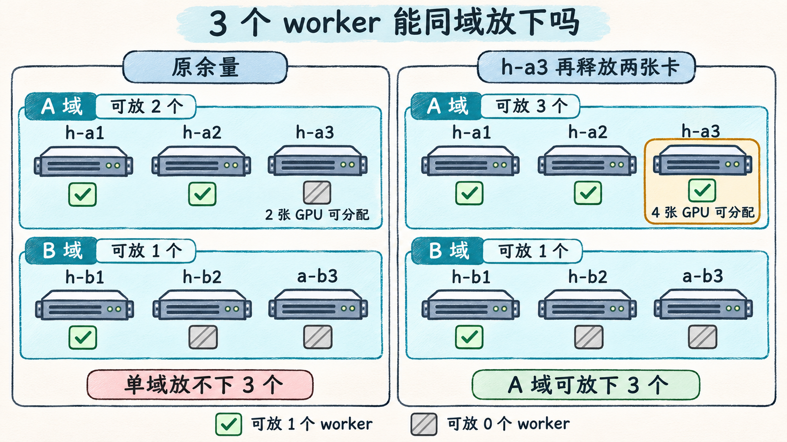

# 把作业放到合适的一组节点

一个固定规模的作业需要 3 个 worker，各在一台不同的物理节点。每个 worker 请求 4 张 H100 80 GB 整卡、16 CPU、96 GiB 主机内存和一个 RDMA VF。平台显示有 30 张卡的调度余量。要判断这份作业能否放下，先算有几台节点能独立满足一个 worker，再看这些节点能否出现在作业要求的同一个网络域。

## 先把单个 worker 的条件写进 Pod 模板

下面是 Kubernetes v1.36 的教学配置摘录，省略镜像、作业控制器和附加网络配置。管理员把同型整卡节点纳入 `h100-80gb` 池，GPU 插件以 `nvidia.com/gpu` 发布整卡资源，RDMA 用的 SR-IOV VF 由设备插件以教学资源名 `example.com/rdma-vf` 发布。每个 Pod 有一个训练容器，CPU 与内存各自的请求和上限相等。 [Kubernetes v1.36 GPU 调度](https://v1-36.docs.kubernetes.io/docs/tasks/manage-gpus/scheduling-gpus/) · [SR-IOV Network Device Plugin](https://github.com/k8snetworkplumbingwg/sriov-network-device-plugin)

```yaml
metadata:
  labels:
    infra.example.com/training-run: train-12
spec:
  nodeSelector:
    infra.example.com/gpu-pool: h100-80gb
  affinity:
    podAntiAffinity:
      requiredDuringSchedulingIgnoredDuringExecution:
        - labelSelector:
            matchLabels:
              infra.example.com/training-run: train-12
          topologyKey: kubernetes.io/hostname
  containers:
    - name: worker
      resources:
        requests:
          cpu: "16"
          memory: 96Gi
          nvidia.com/gpu: 4
          example.com/rdma-vf: 1
        limits:
          cpu: "16"
          memory: 96Gi
          nvidia.com/gpu: 4
          example.com/rdma-vf: 1
```

`nodeSelector` 先限定可用的节点池。`nvidia.com/gpu: 4` 要求该节点还能提供 4 个同资源名的单位，CPU、主机内存和 VF 也都要在该节点够用。这里同一命名空间内的三个 Pod 带相同的作业标签。硬性反亲和规则按 hostname 禁止它们共处一个节点域。本例假定节点的 hostname 标签值唯一。 [Kubernetes v1.36 节点选择和 Pod 反亲和](https://v1-36.docs.kubernetes.io/docs/concepts/scheduling-eviction/assign-pod-node/) · [Kubernetes v1.36 容器资源管理](https://v1-36.docs.kubernetes.io/docs/concepts/configuration/manage-resources-containers/)

`80 GB` 是本例 GPU 规格的一部分，由同质节点池保证。若混装节点采用同一个 `nvidia.com/gpu` 资源名，节点标签只能筛选整台机器，该资源池内的其他型号仍可能被选中。需要按单个设备的型号或显存来筛选时，可用支持相应数据的 DRA 驱动。驱动在 `ResourceSlice` 上发布每个设备的属性或容量，调度器可以按 `ResourceClaim` 的条件匹配并参与分配，随后节点侧还需准备设备。使用 MIG 或共享资源时，先读清资源名实际代表的单位，再用该单位算余量。 [Kubernetes v1.36 DRA](https://v1-36.docs.kubernetes.io/docs/concepts/scheduling-eviction/dynamic-resource-allocation/) · [NVIDIA GPU Operator 26.7 GPU 共享](https://docs.nvidia.com/datacenter/cloud-native/gpu-operator/26.7/gpu-sharing.html) · [NVIDIA GPU Operator 26.7 MIG](https://docs.nvidia.com/datacenter/cloud-native/gpu-operator/26.7/gpu-operator-mig.html)

## 用节点账本复算三个 worker

下表是某一时点的教学快照。每列余量用节点的 `Allocatable` 减调度器已经计入的请求。假定节点标签、设备上报和 scheduler 缓存在这一时点一致，其他未列出的过滤条件都满足。CPU 列用 Kubernetes CPU 单位，主机内存用 GiB，GPU 和 VF 都按设备个数计。实际排查时结合 `Node.status.allocatable`、节点上的 Pod 请求和同一轮调度事件。GPU 使用率衡量设备当时的活动，资源账本衡量还能分配给多少请求。 [Kubernetes v1.36 节点 Allocatable](https://v1-36.docs.kubernetes.io/docs/tasks/administer-cluster/reserve-compute-resources/#node-allocatable) · [NodeResourcesFit v1.36.0 源码](https://github.com/kubernetes/kubernetes/blob/v1.36.0/pkg/scheduler/framework/plugins/noderesources/fit.go)

| 节点   | 网络域 | GPU 规格     | GPU 余量 | CPU 余量 |  主机内存余量 | VF 余量 | 可放的 worker |
| ---- | --- | ---------- | -----: | -----: | ------: | ----: | ---------: |
| h-a1 | A   | H100 80 GB |      8 |     32 | 192 GiB |     2 |          1 |
| h-a2 | A   | H100 80 GB |      4 |     16 |  96 GiB |     1 |          1 |
| h-a3 | A   | H100 80 GB |      2 |     32 | 192 GiB |     2 |          0 |
| h-b1 | B   | H100 80 GB |      4 |     32 | 192 GiB |     1 |          1 |
| h-b2 | B   | H100 80 GB |      4 |     12 |  80 GiB |     0 |          0 |
| a-b3 | B   | A100 40 GB |      8 |     32 | 192 GiB |     2 |          0 |

每个 worker 的规格相同。通过型号筛选的节点，每项余量除以单个 worker 的需求并向下取整，取四项中的最小值。再把每节点的结果限制在 1 以内。

- `h-a1` 四项各能容纳 2 个 worker，反亲和把它限制为 1 个。
- `h-a2` 和 `h-b1` 各能容纳 1 个。
- `h-a3` 只有 2 张可分配的 H100，GPU 一项已经过不了。
- `h-b2` 有 4 张 H100，但 CPU、主机内存和 VF 分别低于需求。
- `a-b3` 的整卡有余量，但节点型号不在指定池内。

全池共有 `8 + 4 + 2 + 4 + 4 + 8 = 30` 张整卡余量，其中 H100 有 22 张。整组申请 12 GPU、48 CPU、288 GiB 主机内存和 3 个 VF。依据逐节点结果，忽略同域要求时可以把三个 Pod 放到 `h-a1`、`h-a2` 和 `h-b1`。设备实际选取及节点内准入发生在绑定之后，表中“可放”只覆盖本例设定的集群侧条件。

## 给整组增加同域约束后再算一次

网络域是部署定义的范围。平台可根据机架、交换机端口与 NIC 的映射给节点打上 `infra.example.com/fabric-domain: a` 或 `b`，让调度系统有可用的边界。一个域可以对应一个机架，也可以跨多个机架。决定域标签的是要表达的物理或逻辑网络范围，本例假设该映射已由运维核实。

| 条件 | A 域可放 | B 域可放 | 三个 worker 的结果 |
| --- | ---: | ---: | --- |
| 当前余量，要求同域 | 2 | 1 | 最大单域名额为 2，等待。 |
| 当前余量，允许跨域 | 2 | 1 | 可以选 A 域两个节点、B 域一个节点。 |
| `h-a3` 再释放两张 H100，要求同域 | 3 | 1 | A 域三个不同节点各放一个。 |

最后一行只改 `h-a3` 的 GPU 余量，从 2 张变为 4 张。该节点的 CPU、内存与 VF 原本就够，于是 A 域增加一个完整的 worker 名额。若把同样的两张卡加到 `h-a1`，那个节点仍受每台一个 worker 的限制。评估扩容或等待资源释放时，需要问它发生在哪台节点和哪个域。



图 15-02-01　教学作业需要 3 个同域 worker，每台节点至多放 1 个。右图仅在 `h-a3` 释放两张 H100，A 域由两个合格落点增至三个，B 域始终只有一个。

同域若是硬条件，整组只能在具备足够空间的单域内放置。若是偏好，可以允许调度逻辑先尝试较小域，再在策略允许时扩大候选范围。回退跨域前，要确认 worker 实际使用的 RDMA 网络可跨域通信，并核对链路带宽、收敛和作业的同步需求。节点标签能表达放置范围，实际性能要靠用相同拓扑和规模的通信证据来判断。

Pod 的 `topologySpreadConstraints` 用于控制匹配副本在域间的分布偏斜。表达整组同域，可以选择具备组级拓扑能力的实现。Kubernetes 原生的 Topology-Aware Workload Scheduling 从 v1.36 起为 Alpha，v1.37 仍默认关闭，另需 `TopologyAwareWorkloadScheduling`。结合 PodGroup 的 gang 策略时，可以在选定标签域内检验是否满足整组放置门槛。 [Kubernetes v1.36 Pod 拓扑分布](https://v1-36.docs.kubernetes.io/docs/concepts/scheduling-eviction/topology-spread-constraints/) · [Kubernetes 拓扑感知 Workload 调度](https://kubernetes.io/docs/concepts/workloads/workload-api/topology-aware-scheduling/) · [Kubernetes v1.37 开关说明](https://kubernetes.io/blog/2026/09/08/kubernetes-v1-37-advancing-workload-aware-scheduling/)

Kueue v0.17 的拓扑感知准入可用 Pod 模板注解表示两种选择。在已配置 TAS 的资源规格中，`kueue.x-k8s.io/podset-required-topology` 指定必须容纳整个 PodSet 的域层级。`kueue.x-k8s.io/podset-preferred-topology` 从指定层级尝试，放不下时按已定义的拓扑层级向上寻找。准入结果要结合之后的 scheduler 放置和 kubelet 验收来读。 [Kueue v0.17 Topology Aware Scheduling](https://kueue.sigs.k8s.io/v0.17/docs/concepts/topology_aware_scheduling/)
