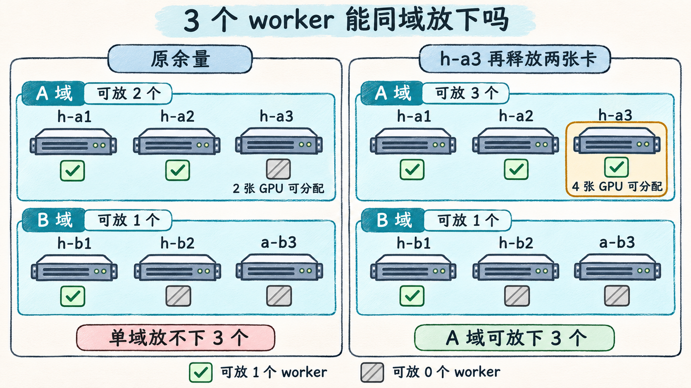

`train-12` 要同时放下 3 个 worker Pod，每个请求 4 张 H100 80 GB 整卡、16 CPU、96 GiB 主机内存和 1 个支持 RDMA 的 VF，三个 Pod 必须在不同节点。全池盘点得到 30 张整卡余量，超过作业所需的 12 张。能否放下作业，先取决于每台节点能否接纳完整的一个 worker，再取决于这些落点能否组成应用要求的拓扑。

## 整卡资源名、型号与每节点副本数

下面的 Kubernetes v1.36 教学摘录节选自 Job 的 Pod 模板，省略镜像、启动参数和第 13 章介绍的附加网络配置。管理员将同型的 H100 80 GB 整卡节点纳入教学节点池 `h100-80gb`，并确认池内 `nvidia.com/gpu` 的一个单位是一张独占整卡。`example.com/rdma-vf` 是假定已由设备插件发布的教学资源名。 [Kubernetes v1.36 · GPU 调度](https://v1-36.docs.kubernetes.io/docs/tasks/manage-gpus/scheduling-gpus/) · [SR-IOV Network Device Plugin · 资源池配置](https://github.com/k8snetworkplumbingwg/sriov-network-device-plugin)

```yaml
metadata:
  labels:
    infra.example.com/training-run: train-12
spec:
  nodeSelector:
    infra.example.com/gpu-pool: h100-80gb
  affinity:
    podAntiAffinity:
      requiredDuringSchedulingIgnoredDuringExecution:
        - labelSelector:
            matchLabels:
              infra.example.com/training-run: train-12
          topologyKey: kubernetes.io/hostname
  containers:
    - name: worker
      resources:
        requests:
          cpu: "16"
          memory: 96Gi
          nvidia.com/gpu: 4
          example.com/rdma-vf: 1
        limits:
          cpu: "16"
          memory: 96Gi
          nvidia.com/gpu: 4
          example.com/rdma-vf: 1
```

`nodeSelector` 按节点标签限定型号池。`requests` 要求四种资源在同一节点上同时有足够余量。整卡和 VF 属于扩展资源，这里各自的请求与限制相等。硬性 **Pod 反亲和**禁止同一命名空间中具有该作业标签的 Pod 共享同一个 hostname 标签值。假定这些主机名标签值唯一，并且该作业标签只匹配本次的三个 worker，于是每台至多放一个。 [Kubernetes v1.36 · 资源管理](https://v1-36.docs.kubernetes.io/docs/concepts/configuration/manage-resources-containers/#extended-resources) · [Kubernetes v1.36 · 节点选择与 Pod 反亲和](https://v1-36.docs.kubernetes.io/docs/concepts/scheduling-eviction/assign-pod-node/)

H100 80 GB 中的 80 GB 是单卡显存规格，模板里的 96 GiB 是整只 Pod 的主机内存请求。如果一台机器混装不同型号且共用 `nvidia.com/gpu`，节点标签匹配后，设备管理仍可从该资源池选到其他型号。需要按单个设备选择时，可用第 11 章的 **DRA**（Dynamic Resource Allocation，动态资源分配）。支持相应属性或容量的驱动通过 `ResourceSlice` 发布设备信息，调度器按 `ResourceClaim`（设备申领）的条件匹配，节点侧仍要准备所分配的设备。第 14 章的共享名额或 MIG（Multi-Instance GPU，多实例 GPU）切片也必须按照资源配置解释数量。 [Kubernetes v1.36 · DRA](https://v1-36.docs.kubernetes.io/docs/concepts/scheduling-eviction/dynamic-resource-allocation/) · [NVIDIA GPU Operator 26.7 · GPU 共享](https://docs.nvidia.com/datacenter/cloud-native/gpu-operator/26.7/gpu-sharing.html) · [NVIDIA GPU Operator 26.7 · MIG](https://docs.nvidia.com/datacenter/cloud-native/gpu-operator/26.7/gpu-operator-mig.html)

## 逐节点复算 worker 落点

这份教学快照里的余量等于该资源的 `Allocatable`（可分配总量）减去调度器已计入的有效请求。本轮假定节点标签、设备资源上报和调度器缓存一致，其他过滤条件通过，并且本轮开始前没有同作业的已放置副本。CPU 用 Kubernetes CPU 单位，主机内存用 GiB，GPU 与 VF 取设备个数。查看现场时，用节点上报与同一时点的请求记录近似重建账本，留意调度器可能已经计入正在绑定的 Pod。GPU 利用率可以很低，已承诺的资源仍留在账上。 [Kubernetes v1.36 · Node Allocatable](https://v1-36.docs.kubernetes.io/docs/tasks/administer-cluster/reserve-compute-resources/#node-allocatable) · [Kubernetes v1.36.0 · NodeResourcesFit](https://github.com/kubernetes/kubernetes/blob/v1.36.0/pkg/scheduler/framework/plugins/noderesources/fit.go) · [Kubernetes v1.36.0 · 调度器缓存](https://github.com/kubernetes/kubernetes/blob/v1.36.0/pkg/scheduler/backend/cache/cache.go)

| 节点 | 网络域 | GPU 规格 | GPU 余量 | CPU 余量 | 主机内存余量 | VF 余量 | worker 落点数 |
| --- | --- | --- | ---: | ---: | ---: | ---: | ---: |
| h-a1 | A | H100 80 GB | 8 | 32 | 192 GiB | 2 | 1 |
| h-a2 | A | H100 80 GB | 4 | 16 | 96 GiB | 1 | 1 |
| h-a3 | A | H100 80 GB | 2 | 32 | 192 GiB | 2 | 0 |
| h-b1 | B | H100 80 GB | 4 | 32 | 192 GiB | 1 | 1 |
| h-b2 | B | H100 80 GB | 4 | 12 | 80 GiB | 0 | 0 |
| a-b3 | B | A100 40 GB | 8 | 32 | 192 GiB | 2 | 0 |

在这个同规格副本模型中，通过标签筛选的每个节点，分别用 GPU、CPU、内存、VF 余量除以相应的单 Pod 请求，向下取整后取最小值。每一项的商都表示这一项最多能支持几个完整副本。反亲和再将结果限制到最多 1。

- `h-a1` 的四项商都是 2，反亲和限制为 1。`h-a2` 四项刚好够 1 个。`h-b1` 的 CPU 与内存各够 2 个，GPU 与 VF 各只够 1 个。
- `h-a3` 的 GPU 商为 `⌊2 ÷ 4⌋ = 0`。`h-b2` 虽有 4 张卡，但 CPU、内存和 VF 三项都低于单 Pod 请求。`a-b3` 在标签筛选时即被排除。

`30` 是全表的整卡余量，扣去 `a-b3` 的 8 张 A100 后，匹配型号的余量为 `22`。再逐节点比对全部需求，得到 `h-a1`、`h-a2` 和 `h-b1` 三个落点。整组需求为 12 GPU、48 CPU、288 GiB 主机内存和 3 VF。三处落点说明集群侧的数量和节点约束允许这组放置，节点侧的设备可用位置还要在绑定后检查。

## 网络域内的整组容量

**网络域**是部署根据布线和网络层级划出的节点范围，例如一个机架的接入交换机下，或相互连接的一组机架。平台可用现有布线和 Pod 实际访问的 RDMA 网络核对映射，为节点标上 `infra.example.com/fabric-domain: a` 或 `b`。同步训练可能在每步等待跨节点交换，同域放置可以让作业使用域内结构，实际延迟与可用带宽还取决于交换路径、链路负载和应用通信模式。第 07、08 章分别说明网络路径和通信库如何产生这些差异。

| 条件 | A 域可放 | B 域可放 | 三个 worker 的结果 |
| --- | ---: | ---: | --- |
| 原余量，要求同域 | 2 | 1 | 最大单域容量 `max(2, 1) = 2`，等待。 |
| 原余量，允许跨域 | 2 | 1 | 合计 `2 + 1 = 3`，两台在 A，一台在 B。 |
| `h-a3` 再释放两张 H100，要求同域 | 3 | 1 | A 域三个节点各放一个。 |

在 `h-a3`，GPU 余量从 2 增为 4，其他三项原本足够，因而新增一个落点。若同样的两张卡是在 `h-a1` 释放，反亲和仍使它只提供一个落点，A 域依然放不下三个副本。



图 15-03-01　固定规模作业需要三个同域 worker，每台节点至多一个。图中“可分配”的 GPU 数是扣除已计入请求后的余量。

## 同域硬约束、同域偏好与跨域回退

**同域硬约束**要求在一个域内找齐落点。**同域偏好**先试满足指定范围，放不下时按策略扩大范围，最宽可以跨原来的域。允许跨域前，需要确认容器实际使用的 RDMA 网络可达，且跨域路径能够满足同步作业的性能要求。普通 Pod 的 `topologySpreadConstraints` 管的是匹配副本在各域间的分布偏斜。跟踪整组同域要求时，要看实际负责成组放置的调度或准入机制怎样表达域约束。 [Kubernetes v1.36 · Pod 拓扑分布约束](https://v1-36.docs.kubernetes.io/docs/concepts/scheduling-eviction/topology-spread-constraints/)

Kubernetes 原生 **Topology-Aware Workload Scheduling** 在 v1.36 为默认关闭的 Alpha，需另启用 `TopologyAwareWorkloadScheduling`。与原生 gang 策略结合时，调度器按 PodGroup 指定的标签把节点划成候选域，在域内检查是否有足够落点达到 `minCount`。v1.37 的拓扑功能仍为默认关闭的 Alpha。 [Kubernetes v1.36 · 拓扑感知 Workload 调度](https://v1-36.docs.kubernetes.io/docs/concepts/workloads/workload-api/topology-aware-scheduling/) · [Kubernetes v1.37 · 功能开关](https://kubernetes.io/blog/2026/09/08/kubernetes-v1-37-advancing-workload-aware-scheduling/)

Kueue v0.17 的 **TAS**（Topology Aware Scheduling，拓扑感知调度）会在配置了拓扑的资源规格上为 PodSet（一组同模板 Pod）做拓扑准入。`kueue.x-k8s.io/podset-required-topology` 要求整个 PodSet 落在指定层级的一个域内。`kueue.x-k8s.io/podset-preferred-topology` 可以向已配置的更高层级逐级放宽，最高层仍放不下时可分布到多个域。 [Kueue v0.17 · TAS](https://kueue.sigs.k8s.io/v0.17/docs/concepts/topology_aware_scheduling/)

判断这类准入结果时，要核对准入层采用了哪些约束。以原快照为例，如果一份估算只算设备和主机余量，`h-a1` 可以计为两个落点，加上 `h-a2` 的一个，A 域看起来就够三个。调度器执行硬性反亲和时，`h-a1` 最多只放一个。因此要把拓扑分配记录与 Pod 实际的约束以及绑定结果一起看。
