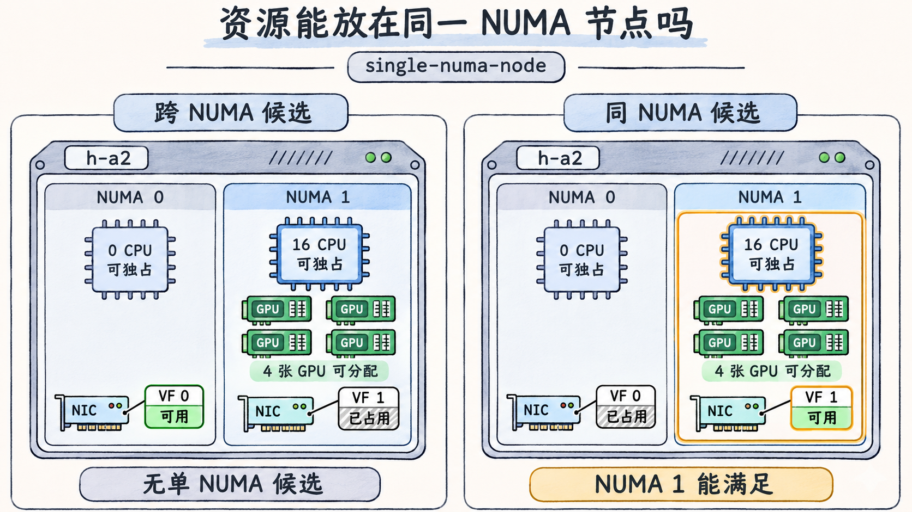

# Pod 已绑定，节点怎样交付资源

一个 worker Pod 请求 4 张整卡、16 CPU、96 GiB 主机内存和一个 RDMA VF。scheduler 已把它绑定到 `h-a2`，各项节点余量也都够。kubelet 仍可能报告 `TopologyAffinityError`。这两条记录可以同时成立，因为 scheduler 先以节点为单位核对资源，kubelet 还可以根据同一台机器内的设备和 CPU 位置检查准入。本文按 Kubernetes v1.36、Linux 和 Device Plugin 路径分析。 [Kubernetes v1.36 调度框架](https://v1-36.docs.kubernetes.io/docs/concepts/scheduling-eviction/scheduling-framework/) · [Kubernetes v1.36 Topology Manager](https://v1-36.docs.kubernetes.io/docs/tasks/administer-cluster/topology-manager/)

## 数量够时，仍需要看可用资源位于哪一侧

假设 `h-a2` 有两个 NUMA 节点。每个 NUMA 节点有本地 CPU 和内存，PCIe 设备也有相应的 NUMA 归属。这次能分配给该 Pod 的 4 张 GPU 与 16 个独占 CPU 都在 NUMA 1，唯一空闲的 VF 在 NUMA 0。GPU 与 VF 的设备插件都准确上报了拓扑，CPU Manager 能对该容器交付独占 CPU。主机内存余量为 96 GiB，本例采用默认内存策略，内存满足节点总量检查。表里的数字都是教学余量。

| 可用资源 | NUMA 0 | NUMA 1 | 节点合计 |
| --- | ---: | ---: | ---: |
| 整卡 GPU | 0 | 4 | 4 |
| 可独占 CPU | 0 | 16 | 16 |
| 指定资源名的 VF | 1 | 0 | 1 |

这三个资源都在同一台机器上。若要求它们同属一个 NUMA 节点，NUMA 0 缺 GPU 和 CPU，NUMA 1 缺 VF。另一份独立快照只改变哪一个 VF 空闲。设备池在两侧都有同资源名的 VF，此时 NUMA 0 的 VF 被占用，NUMA 1 的 VF 可用。GPU、CPU 和节点总余量与原快照相同，NUMA 1 已能提供全部三项。

## kubelet 怎么得到对齐结果

绑定后，kubelet 的 Topology Manager 会向有能力提供拓扑信息的资源管理器查询提示。提示包含一组可用 NUMA 节点的掩码，以及该候选是否为首选。GPU 和 VF 的设备插件通过 `TopologyInfo` 上报每个设备的 NUMA 信息，Device Manager 将这些信息与当前可用设备合起来，给出设备候选。CPU Manager 则根据可独占 CPU 给出 CPU 候选。Topology Manager 合并这些提示、按策略决定是否接纳，再把选定的亲和性留给各资源管理器用于实际分配。 [Kubernetes v1.36 Topology Manager](https://v1-36.docs.kubernetes.io/docs/tasks/administer-cluster/topology-manager/) · [Device Plugin 的 TopologyInfo](https://v1-36.docs.kubernetes.io/docs/concepts/extend-kubernetes/compute-storage-net/device-plugins/#device-plugin-integration-with-the-topology-manager)

| kubelet 策略 | 怎样检查提示 | 原快照的结果 |
| --- | --- | --- |
| `none` | 跳过这一步的 NUMA 对齐。 | 节点可接纳，设备分处两侧。 |
| `best-effort` | 尝试对齐，合并的结果即使非首选也允许接纳。 | 节点可接纳，GPU/CPU 与 VF 跨 NUMA。 |
| `restricted` | 要求合并结果为首选。策略定义按提示是否首选来判断。 | 本例各方的首选单域彼此冲突，节点拒绝。 |
| `single-numa-node` | 对提供了拓扑信息的资源，要求存在可接受的单 NUMA 对齐。 | 原快照拒绝。换成 NUMA 1 的 VF 后，三个请求可在 NUMA 1 一起满足。 |



图 15-03-01　两组快照的设备位置相同，只有可用的 VF 候选发生变化。在设备拓扑提示准确且其余准入条件满足时，右图符合 `single-numa-node` 策略。

上述结果假定其他准入条件都满足。拒绝发生时，原 Pod 已有绑定记录，kubelet 会报告该 Pod 的准入失败。scheduler 不会把同一个已绑定 Pod 改派到另一台机器。若需要重试，查看作业控制器是否根据它的策略创建了替代 Pod，并按新 Pod 的 UID 重新追踪。 [Kubernetes v1.36 Topology Manager 策略](https://v1-36.docs.kubernetes.io/docs/tasks/administer-cluster/topology-manager/#topology-manager-policies) · [Kubernetes v1.36 拓扑排查](https://v1-36.docs.kubernetes.io/docs/tasks/debug/debug-cluster/topology/)

## 配置中哪些条件会改变结果

用于严格对齐的 kubelet 配置可以包含以下字段。这是 `KubeletConfiguration` 的教学摘录，假设节点已有符合实际 CPU 编号和系统需求的 CPU 预留。启用 `static` 策略时，需落实系统 CPU 预留。可以用 `reservedSystemCPUs` 指定 CPU 列表，也可以在 `kubeReserved`、`systemReserved` 中的一项或两项设置 CPU，确保预留量大于零。算例中的 16 个 CPU 已扣除系统预留和其他独占分配。

```yaml
cpuManagerPolicy: static
topologyManagerScope: pod
topologyManagerPolicy: single-numa-node
```

在这个容器级请求场景里，CPU Manager 的 `static` 策略把独占 CPU 分给 Guaranteed Pod 中申请了整数 CPU 的容器。本例单容器 CPU 请求与上限都是 16，内存请求与上限都是 96 GiB。加入 sidecar 时，重新核对每个容器的 CPU 和内存要求是否仍满足 Guaranteed。默认的 `container` scope 对每个容器分别算对齐，`pod` scope 则为整只 Pod 合并请求和拓扑提示。如果两个容器分别请求 GPU 与 VF，前一种 scope 可能分别接纳这两个容器，后一种才会按整只 Pod 检查两类设备的共同落点。 [Kubernetes v1.36 CPU Manager](https://v1-36.docs.kubernetes.io/docs/tasks/administer-cluster/cpu-management-policies/) · [Kubernetes v1.36 Pod QoS](https://v1-36.docs.kubernetes.io/docs/concepts/workloads/pods/pod-qos/) · [Kubernetes v1.36 Topology Manager scope](https://v1-36.docs.kubernetes.io/docs/tasks/administer-cluster/topology-manager/#topology-manager-scopes)

内存的 NUMA 要求还取决于 Memory Manager。Linux 上的 `Static` 策略会为 Guaranteed Pod 提供内存拓扑提示，并需要配置相应的节点内存预留。本例只用内存节点总量判断容量，单 NUMA 对齐结论覆盖 GPU、VF 和独占 CPU。设备提示也可能缺失。例如 SR-IOV 插件可以用 `excludeTopology` 省略 VF 的拓扑，kubelet 此时缺少该 VF 的物理位置依据。要确认是否同域，还得核对实际分配和 PCI 设备。 [Kubernetes v1.36 Memory Manager](https://v1-36.docs.kubernetes.io/docs/tasks/administer-cluster/memory-manager/) · [SR-IOV Device Plugin 的 excludeTopology](https://github.com/k8snetworkplumbingwg/sriov-network-device-plugin)

## 把策略判断和实际分配对起来

拒绝时，先看 `kubectl describe pod` 和 Pod 状态中是否出现 `TopologyAffinityError`。再按同一个 Pod UID 和发生时间找 kubelet 日志，确认实际 policy、scope 与各资源的 NUMA 提示。Kubernetes v1.36 的官方排查示例给出了两类证据，包括拒绝状态和提示中的 `numaAffinity`、`preferred`。这些字段的上下文与日志可见性以版本和日志级别为准。 [Kubernetes v1.36 拓扑排查示例](https://v1-36.docs.kubernetes.io/docs/tasks/debug/debug-cluster/topology/)

节点接纳 Pod 后，用设备 ID 把实际分配记录与物理连接对上。

| 证据 | 怎么用 |
| --- | --- |
| kubelet PodResources 的 `List` 结果 | 按命名空间、Pod 名和容器名找到 `cpu_ids`，再用对应的 `resource_name` 查看 `device_ids` 及已上报的 `topology.nodes`。 |
| 主机 GPU 与 PCI 枚举 | 将 GPU UUID 对到 PCI 总线地址，将 SR-IOV VF 对到所属 PF，再用 `nvidia-smi topo -m` 和 PCIe 树核对 GPU 与 NIC 的路径。 |
| 容器网络和通信记录 | 确认应用属于同一批分配并实际使用预期的 RDMA 端口。 |

同属一个 NUMA 节点的 GPU 与 NIC 仍可能接在不同 PCIe 分支。若要判断 GPUDirect RDMA 路径能否成立，还要按平台检查上游 PCIe Root Complex 等连接条件，以及所用驱动和应用配置。机架或网络域标签回答的是 Pod 之间的跨机放置，NUMA 提示回答的是一台机器内的资源对齐，设备 ID 和端口记录则能把实际数据路径落到具体硬件。 [Kubernetes v1.36 PodResources API](https://v1-36.docs.kubernetes.io/docs/concepts/extend-kubernetes/compute-storage-net/device-plugins/#monitoring-device-plugin-resources) · [NVIDIA nvidia-smi 拓扑命令](https://docs.nvidia.com/deploy/nvidia-smi/index.html#topology) · [NVIDIA GPUDirect RDMA 平台条件](https://docs.nvidia.com/cuda/gpudirect-rdma/index.html#supported-systems)
