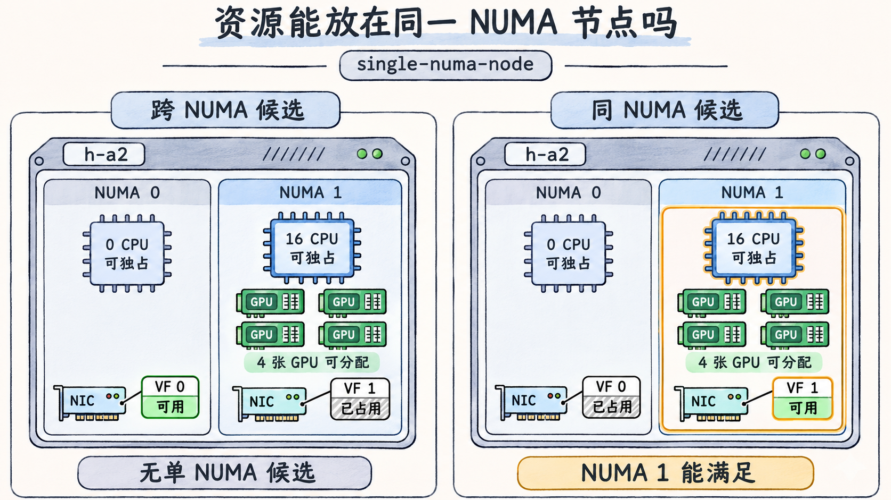

# NUMA 对齐与节点内资源交付

调度器刚刚把训练 worker 成功绑定到节点 `h-a2` 上——这台节点的账本上清清楚楚写着 4 张空闲 H100、16 个空闲 CPU、96 GiB 空闲内存和 1 个空闲 RDMA VF。可不到两秒，Pod 却被节点本地直接拒之门外，状态栏跳出刺眼的 **`TopologyAffinityError`**。

节点明明不缺资源，为什么翻脸不认账？因为调度器只管“节点总账够不够”，而真正决定 GPU、独占 CPU 与高速网卡是不是插在**同一颗 CPU 对应的 NUMA 节点**上的，是节点本地的 **Topology Manager** 与 **CPU Manager**。

## Topology Manager 与 CPU Manager 的职责分工

双路 GPU 服务器天然分为 NUMA 0 与 NUMA 1 两半（跨 Socket 的延迟放大与带宽衰减见 [第 01 章](../01_从一台GPU服务器认识基础设施/00_内容大纲.md) 与 [第 04 章](../04_单机多卡与GPU数据路径/00_内容大纲.md)）。

如果训练或推理进程跑在 NUMA 1 的 CPU 与 GPU 上，高速网卡 VF 却分到了 NUMA 0，每笔跨机数据都得穿越跨路互联。

为了守住节点内部的物理亲和性，kubelet 引入了两个核心本地管理器：

- **Topology Manager（拓扑管理器）**：kubelet 节点内准入的“亲和性裁判”。它在 Pod 启动前向各资源管理器收集候选 NUMA 提示（Hint），按节点策略计算交集；只有合并结果满足策略才准入并锁定亲和掩码，否则直接拒绝。
- **CPU Manager（CPU 管理器）**：负责为符合条件的容器分配独占的物理/逻辑 CPU 核心，避免关键训练数据预处理线程或推理调度线程被其他容器抢占漂移，并向 Topology Manager 提供 CPU 的 NUMA 候选提示。

## 同侧对齐 vs 跨侧冲突：掩码交集推演

回到节点 `h-a2`（双路双 NUMA，默认内存策略按节点总量放行 96 GiB 主机内存）。每个资源管理器上报的提示包含两项关键信息：**候选 NUMA 掩码**（一组 NUMA 编号）以及**是否为首选的 `preferred` 标记**。

先看最理想的**同侧快照**：4 张空闲 GPU、16 个可独占逻辑 CPU 和唯一空闲的 `VF 1` 全都位于 NUMA 1。

1. Device Manager 根据 GPU 与 SR-IOV 设备插件上报的 `TopologyInfo`，分别生成首选单节点候选 `{1}`（GPU）与 `{1}`（VF）。
2. CPU Manager 为满足独占条件的 16 核请求生成首选单节点候选 `{1}`（CPU）。
3. Topology Manager 对三类首选候选求交集：

$$
H_{\text{GPU}} \cap H_{\text{CPU}} \cap H_{\text{VF}} = \{1\} \cap \{1\} \cap \{1\} = \{1\}
$$

交集非空且为单 NUMA 首选，满足 `single-numa-node` 策略！kubelet 放行准入，并把 NUMA 1 的具体设备和 CPU 交给容器运行时。

现在**只做一处微调**：两张物理网卡对应的 `VF 0`（NUMA 0）和 `VF 1`（NUMA 1）同属一个扩展资源池，把空闲的 VF 从 NUMA 1 换成 NUMA 0。此时节点总余量一模一样，但局部布局已变为跨侧分裂：

| 快照状态 | NUMA 0 可用资源 | NUMA 1 可用资源 | 节点总余量 |
| --- | --- | --- | --- |
| **同侧对齐** | 0 GPU、0 独占 CPU、0 VF | 4 GPU、16 独占 CPU、1 VF（`VF 1`） | 4 GPU、16 CPU、1 VF |
| **跨侧分裂** | 0 GPU、0 独占 CPU、1 VF（`VF 0`） | 4 GPU、16 独占 CPU、0 VF | 4 GPU、16 CPU、1 VF |

在跨侧分裂下，VF 的首选候选变成 `{0}`，三类单节点候选的交集瞬间坍缩为空集：

$$
\{1\} \cap \{1\} \cap \{0\} = \varnothing
$$

只有跨双侧拼凑 `{0, 1}` 才能凑足数量，但这不再是单一 NUMA 节点，也不再满足各设备各自更窄的首选提示。



*图 15-04-01：节点总余量完全相同，仅空闲 VF 位置改变时，NUMA 跨侧冲突（左）与同侧对齐（右）的直观对比。*

## Topology Manager 四类策略对比

面对同样的“跨侧分裂”快照，节点是否放行完全取决于 kubelet 配置的 Topology Manager 策略：

| Topology Manager 策略 | 准入判定规则 | 跨侧分裂快照的结果 | 典型适用场景 |
| --- | --- | --- | --- |
| `none` | 不收集提示、不做拓扑对齐检查 | **放行**，资源按默认顺序跨两侧分配 | 普通通用计算节点，不关心 PCIe/NUMA 亲和 |
| `best-effort` | 尽量对齐；无首选交集时接受跨侧合并结果 | **放行**，GPU/CPU 在 NUMA 1，VF 跨到 NUMA 0 | 容忍轻微抖动、优先保证可调度性的推理或开发池 |
| `restricted` | 合并结果必须保持为各提供方的**首选（`preferred`）** | **拒绝**（三类资源各有更窄首选提示且互不相交） | 允许多 NUMA 大容器（如 8 卡全机作业），但禁止本可对齐却被拆散 |
| `single-numa-node` | 参与对齐的资源必须落在**同一个** NUMA 节点 | **拒绝**（改用 NUMA 1 上的 `VF 1` 即可通过） | 对 GPUDirect RDMA 与低尾延迟要求严苛的 4 卡训练/推理节点 |

> [!tip] 工程直觉：一眼分清 `restricted` 与 `single-numa-node`
> **`single-numa-node` 死守“必须单 NUMA”**——哪怕 8 卡 Pod 天然要跨双 NUMA 才能装下全部 GPU，它也会拒绝。
>
> **`restricted` 看的是“是否首选”**——如果 8 卡请求本身就需要双 NUMA，资源管理器给出的首选提示本就是 `{0, 1}`，`restricted` 会放行，只在“本可单侧满足却被拆跨两侧”时才拒单。

## 独占 CPU、作用域与隐蔽边界

要让上述 NUMA 对齐真正生效，必须在节点 `KubeletConfiguration` 中把 CPU Manager、作用域和 Topology Manager 策略配套打开：

```yaml
# 节点侧 KubeletConfiguration 关键拓扑配置片段（Kubernetes v1.36）
cpuManagerPolicy: static                # 为 Guaranteed 整数核容器分配独占 CPU
topologyManagerScope: pod               # 在整个 Pod 维度统一求设备与 CPU 交集
topologyManagerPolicy: single-numa-node # 强制参与对齐的资源落在同一 NUMA 节点
# 实际部署须同步配置 reservedSystemCPUs 或 kubeReserved/systemReserved 的 CPU 预留
```

落地配置时，有四个工程边界最容易踩坑：

1. **独占 CPU 的准入门槛**：CPU Manager `static` 策略仅对 **Guaranteed QoS**（所有容器 CPU/内存 `requests == limits`）且请求整数 CPU 的容器生效；任一 sidecar 漏写 `limits` 都会让独占 CPU 与提示静默失效。
2. **`container` 与 `pod` 作用域差异**：默认 `container` 作用域逐容器独立求交集。如果把 GPU 与 VF 拆在两个不同容器里，各自都能在一侧通过 `single-numa-node`，合起来却跨了 NUMA；改为 `pod` 作用域才能强制同一 Pod 内所有容器对齐到同一侧。
3. **Memory Manager `Static` 联动**：默认内存策略只看节点总余量；如果同时启用了 Memory Manager `Static` 策略（需配置节点内存预留），它会把本地内存也加入提示交集。一旦 96 GiB 空闲内存只够在 NUMA 0 凑齐，即便 `VF 1` 空闲在 NUMA 1，同侧准入依然会因内存提示冲突而失败。
4. **插件 `excludeTopology` 盲区**：若 SR-IOV Device Plugin 配置了 `excludeTopology: true`，插件不再向 kubelet 上报 VF 的 NUMA 位置。此时 `single-numa-node` 虽然会放行，却根本没把 VF 纳入对齐计算，必须去宿主机核对真实设备位置。

## 从准入结果追回真实物理路径

节点拒绝 Pod 时，`spec.nodeName` 仍留在原节点上，Pod 状态与 kubelet 日志会明确报出 `TopologyAffinityError`。

排查时须锁定同一个 **Pod UID** 与时间戳，核对生效的 policy、scope 以及实际参与合并的 `numaAffinity` 与 `preferred`；若控制器重建了替代 Pod，新 Pod 会拥有全新的 UID 与独立调度记录。

节点接纳 Pod 后，如果想确认训练或推理进程真正走的是同一条高速 PCIe/NUMA 路径，可以沿下面这条只读核验链一路追到底层硬件：

```bash
# 1. 通过 kubelet PodResources API 查看容器获分配的具体 cpu_ids 与 device_ids
#    （按 namespace / pod / container 与 resource_name 匹配 GPU UUID 及 VF PCI 地址）
# 2. 在宿主机核对 GPU 与网卡之间的拓扑亲和及互联级别
nvidia-smi topo -m

# 3. 沿 Linux PCI sysfs 追溯已分配 VF 对应的物理网卡 PF 与 NUMA 节点编号
readlink -f /sys/bus/pci/devices/0000:81:00.2/physfn
cat /sys/bus/pci/devices/0000:81:00.2/numa_node
```

> [!warning] 常见误区：NUMA 对齐只是 GPUDirect RDMA 的前半步
> `single-numa-node` 保证 GPU、独占 CPU 与 VF 落在同一颗 CPU 的 NUMA 侧，显著降低跨路开销。但要确认跨机数据是否真正走通 GPUDirect RDMA，仍须结合 `nvidia-smi topo -m`、PCIe 拓扑树、DMA-BUF/驱动状态以及 Pod 内实际通信端口共同验证。

> [!summary] 核心结论
> **调度器算的是节点总账，kubelet 算的是节点内 NUMA 交集**。跨节点调度和节点内拓扑对齐共同决定了“单个或多个 Pod 能不能真正落地”；而在长期运行的多租户集群里，真正决定大作业排多久队的，是下一篇要拆解的**碎片装箱、队列公平与抢占策略**。

> [!info]- 参考资料
> - **Kubernetes Topology / CPU / Memory Manager**：[Kubernetes v1.36 · Topology Manager](https://v1-36.docs.kubernetes.io/docs/tasks/administer-cluster/topology-manager/)、[Topology Manager 策略与掩码](https://v1-36.docs.kubernetes.io/docs/tasks/administer-cluster/topology-manager/#topology-manager-policies)、[Topology Manager 作用域](https://v1-36.docs.kubernetes.io/docs/tasks/administer-cluster/topology-manager/#topology-manager-scopes)、[Kubernetes v1.36 · CPU Manager](https://v1-36.docs.kubernetes.io/docs/tasks/administer-cluster/cpu-management-policies/)、[Kubernetes v1.36 · Memory Manager](https://v1-36.docs.kubernetes.io/docs/tasks/administer-cluster/memory-manager/)、[Kubernetes v1.36 · Pod QoS](https://v1-36.docs.kubernetes.io/docs/concepts/workloads/pods/pod-qos/)
> - **Device Plugin 拓扑上报与排查**：[Kubernetes v1.36 · Device Plugin 拓扑集成](https://v1-36.docs.kubernetes.io/docs/concepts/extend-kubernetes/compute-storage-net/device-plugins/#device-plugin-integration-with-the-topology-manager)、[PodResources 监控接口](https://v1-36.docs.kubernetes.io/docs/concepts/extend-kubernetes/compute-storage-net/device-plugins/#monitoring-device-plugin-resources)、[Kubernetes v1.36 · 拓扑故障排查](https://v1-36.docs.kubernetes.io/docs/tasks/debug/debug-cluster/topology/)、[SR-IOV Device Plugin · excludeTopology](https://github.com/k8snetworkplumbingwg/sriov-network-device-plugin)
> - **PCIe sysfs 与 GPUDirect RDMA 硬件条件**：[Linux Kernel · PCI sysfs ABI](https://www.kernel.org/doc/Documentation/ABI/testing/sysfs-bus-pci)、[NVIDIA CUDA · GPUDirect RDMA 平台支持条件](https://docs.nvidia.com/cuda/gpudirect-rdma/index.html#supported-systems)
