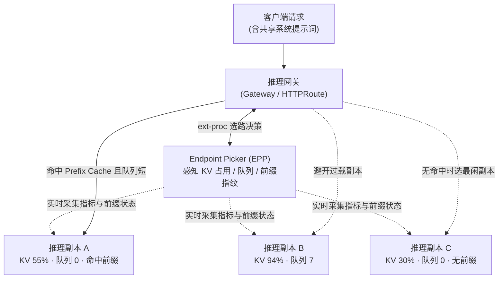
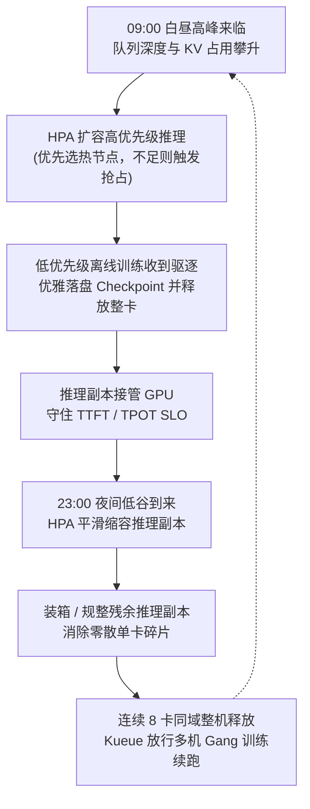

# 在线推理调度、智能路由与训推混部

上午十点线上流量骤增，70B 大模型推理服务的扩缩容控制器立刻触发扩容，一口气新拉起 3 个副本。按理说首字延迟应该很快回落，可现场监控却出现了两个反直觉的怪象。

第一，新副本虽然秒级绑定了空闲 GPU，但因为落在了没缓存权重的冷节点上，远程拉取 140 GiB 模型文件耗掉近 3 分钟，等它终于就绪时高峰早就打穿了 SLO。第二，哪怕副本都跑起来了，普通轮询负载均衡仍把大量携带相同系统提示词的请求随机发给空缓存副本，导致显存里的 Prefix Caching 命中率暴跌、算力白白重算。

要把在线大模型推理稳稳跑在 GPU 集群上，必须彻底跳出“批处理训练”的调度惯性，围绕**高可用打散、权重缓存亲和、队列与 KV 感知扩缩容/路由、以及昼夜训推潮汐混部**四根支柱重建调度体系。

## 一、高可用反亲和与多副本独立恢复

第 02 篇已经点破一个核心分水岭：**常规在线推理多副本排斥 Gang 成组调度**。同步训练少了任何一个 Rank 都寸步难行，而在线推理的多个数据并行副本各自独立服务，高峰期先跑起来 1 个副本就能立刻卸掉一截排队压力。

正因如此，推理调度在空间布局上和训练完全反向——它不要把副本捆在同一个故障域里，而是要用三道机制把可用性拉满：

- **节点/机架反亲和与拓扑打散**：通过 `topologySpreadConstraints` 或首选 `podAntiAffinity` 将同模型副本均匀分散到不同物理节点与机架，防止单机掉卡或单台叶交换机故障击穿全部线上容量。
- **独立快速恢复**：某台节点发生硬件故障时，控制器立即在其他健康节点重建单个替代副本，绝不牵连其余健康副本中断服务。
- **主动维护兜底（PDB）**：配置 `PodDisruptionBudget`，确保节点排空、镜像升级或运维驱逐时至少保留规定比例的可用副本，守住基线吞吐。

> [!note] 局部成组的唯一例外：跨机超大规模推理
> 当单个推理实例本身大到单机装不下（例如超大 MoE 需要跨 2 台 8 卡机组成单个 TP/EP 实例，或 PD 分离架构下强绑定的 Prefill-Decode 实例组）时，才会在**单个实例内部**使用类似 LeaderWorkerSet 的机制做小范围成组拉起与重启；不同实例副本之间依然保持完全独立与跨域打散。

## 二、冷启动耗时拆解与权重缓存亲和

对普通 Web 微服务来说，扩容 1 个副本只需几秒；但对大模型推理来说，容器启动后必须把几十到上百 GB 的模型权重搬进 GPU 显存（[第 09 章](../09_GPU的数据从哪里来_存储与IO/00_内容大纲.md) 拆解过完整 I/O 路径）。这段冷启动时间直接决定了弹性扩容能不能赶上流量洪峰。

以 70B 参数模型为例，BF16 权重约 $140\text{ GiB}$。假设远程共享存储分配给单 Pod 的有效读取带宽为 $1\text{ GiB/s}$，而预热在宿主机本地 NVMe RAID 盘上的读取带宽为 $7\text{ GiB/s}$（忽略框架初始化与图编译的固定开销），仅权重加载耗时就拉开七倍差距：

$$
T_{\text{remote}} = \frac{140\text{ GiB}}{1\text{ GiB/s}} = 140\text{ s}, \qquad T_{\text{local-nvme}} = \frac{140\text{ GiB}}{7\text{ GiB/s}} = 20\text{ s}
$$

如果把权重冷加载与集群调度割裂开，调度器随手把新副本塞进一台没有本地缓存的空节点，在线扩容就会慢半拍。

工程上的标准解法是**权重预热 + 偏好型缓存亲和**：由节点侧的缓存守护进程提前把高频线上模型权重拉取到本地 NVMe，并给节点打上缓存标签（如 `model-cache.example.com/llama-70b: "ready"`）；推理 Deployment 在模板中通过**软亲和（Preferred）** 优先选择热节点，同时保留跨机架打散与 PDB：

```yaml
# 在线推理服务的高可用打散、权重缓存亲和与 PDB 关键片段
apiVersion: apps/v1
kind: Deployment
metadata:
  name: infer-70b
  namespace: ai
spec:
  replicas: 4
  template:
    spec:
      priorityClassName: infer-online-high        # 高优先级：高峰期可抢占离线训练
      topologySpreadConstraints:                  # 跨机架/网络域均匀打散防单点故障
        - maxSkew: 1
          topologyKey: infra.example.com/fabric-domain
          whenUnsatisfiable: ScheduleAnyway
          labelSelector:
            matchLabels:
              app: infer-70b
      affinity:
        nodeAffinity:
          preferredDuringSchedulingIgnoredDuringExecution:
            - weight: 80                          # 优先落到已缓存 70B 权重的本地 NVMe 节点
              preference:
                matchExpressions:
                  - key: model-cache.example.com/llama-70b
                    operator: In
                    values: ["ready"]
---
apiVersion: policy/v1
kind: PodDisruptionBudget
metadata:
  name: infer-70b-pdb
  namespace: ai
spec:
  minAvailable: "75%"                             # 运维排空时至少保留 75% 在线推理副本
  selector:
    matchLabels:
      app: infer-70b
```

> [!tip] 工程直觉：缓存亲和用“软偏好”，不要写死“硬约束”
> 权重缓存亲和务必使用 `preferredDuringSchedulingIgnoredDuringExecution` 而非硬性 `required`。热节点还有空卡时自然优先命中、20 秒拉起服务；万一热节点全满，软偏好允许副本平滑回退到冷节点慢拉启动，总比硬卡在 `Pending` 看着线上雪崩强得多。

## 三、队列与 KV 感知扩缩容，以及智能推理路由

传统云原生服务习惯用 CPU 利用率或通用 GPU SM 利用率驱动 Kubernetes HPA 自动扩缩容，但在大模型推理场景下，这两项指标极易失灵。

原因根植于 [第 02 章](../02_GPU如何计算与显存/00_内容大纲.md) 剖析的 **Decode 显存带宽受限**与 **KV Cache 动态膨胀**特性：

- **误报扩容（虚高）**：即使并发只有几个长上下文请求，Decode 阶段依然能把 GPU 活跃度或显存占用拉得很高，但队列里并没有请求排队，盲目扩容只会浪费昂贵的 H100。
- **漏报雪崩（滞后）**：当大量长提示词涌入时，引擎预留的 KV Cache 池迅速逼近 95%–100%，新请求被迫在调度队列外干等，甚至触发正在生成中的请求被**抢占换出重算**。此时 SM 计算利用率反而因为缺乏足够批大小而下滑，依赖传统利用率的 HPA 不仅不扩容，还可能误以为负载轻而缩容！

因此，在线推理的弹性扩缩容必须直击引擎内部的两大真实拥堵信号——**等待队列深度**（如 vLLM 暴露的 `vllm:num_requests_waiting`）与 **KV Cache 池占用率**（`vllm:kv_cache_usage_perc`，旧版名 `gpu_cache_usage_perc`，范围 $0.0 \sim 1.0$）：

```yaml
# 基于推理队列深度与 KV Cache 占用率的 Kubernetes v1.36 HPA v2 片段
apiVersion: autoscaling/v2
kind: HorizontalPodAutoscaler
metadata:
  name: infer-70b-hpa
  namespace: ai
spec:
  scaleTargetRef:
    apiVersion: apps/v1
    kind: Deployment
    name: infer-70b
  minReplicas: 2                                  # 守住夜间基线可用副本数
  maxReplicas: 12                                 # 白昼高峰最高扩展上限
  metrics:
    - type: Pods
      pods:
        metric:
          name: vllm_num_requests_waiting         # 信号 1：单副本平均等待队列深度
        target:
          type: AverageValue
          averageValue: "4"                       # 平均排队超过 4 个请求即触发扩容
    - type: Pods
      pods:
        metric:
          name: vllm_kv_cache_usage_perc          # 信号 2：KV Cache 预留池占用比例
        target:
          type: AverageValue
          averageValue: "750m"                    # 0.75（即 75%），预留安全余量防抢占雪崩
```

仅仅把新副本扩出来还不够，**请求落到哪一个副本上**同样决定 TTFT 与吞吐。传统 Kubernetes `Service` 的轮询或随机转发对模型状态一无所知：它会把同一个长对话的第 2 轮请求发给没缓存前缀的新副本，也会把一个 32K 长请求发给 KV Cache 已经 95% 满载的副本。

为此，Kubernetes 生态演进出了 **Gateway API Inference Extension** 架构：用 **`InferencePool`** 对象替代普通 `Service` 描述同一模型的推理副本池，并由推理网关借助 **`Endpoint Picker（EPP）`** 在每次请求到来时执行状态感知的实时选路。



*图 15-06-01：基于 `InferencePool` 与 Endpoint Picker（EPP）的 KV 感知与前缀亲和智能推理路由。*

```yaml
# Gateway API Inference Extension 的 InferencePool 声明片段
apiVersion: inference.networking.k8s.io/v1
kind: InferencePool
metadata:
  name: infer-70b-pool
  namespace: ai
spec:
  targetPorts:
    - number: 8000                                # 推理引擎 HTTP 服务端口
  selector:
    matchLabels:
      app: infer-70b                              # 纳管所有 70B 推理副本
  endpointPickerRef:
    name: infer-70b-epp                           # 指向执行 KV 与前缀评分的 EPP 扩展服务
```

EPP 在选路时会自动权衡两个维度：若某副本命中了当前请求的提示词前缀且 KV 压力与队列深度仍在安全线内，就把它直接送过去省掉整段 Prefill 重算；若命中副本已经过载，则果断改道至排队最短、KV 余量最宽裕的健康副本，防止局部打爆。

## 四、训推混部（潮汐算力）：昼夜资源如何平滑流转

如果把在线推理集群和离线训练集群彻底物理切死，往往会陷入两头尴尬：白天按峰值给推理买足 100 张 H100，到了后半夜推理流量跌掉 70%，几十张顶配 H100 只能亮灯发呆；而另一边的训练团队却在排队苦等算力。

**训推混部（潮汐算力）** 把白天闲置率高的推理弹性池与夜间贪吞吐的离线训练池打通，让同一批 8 卡 HGX H100 节点随业务潮汐在两类负载之间安全流转：



*图 15-06-02：训推混部集群的昼夜潮汐算力流转与防碎片闭环。*

要把这套潮汐机制真正落地而不翻车，必须同时扣紧**四道工程阀门**：

| 时段与挑战 | 核心风险 | 关键工程阀门 |
| --- | --- | --- |
| **白昼攀升期**：推理急需扩卡 | 离线训练占满整机，高优先级推理落不下去 | 为在线推理配置高 `PriorityClass` 并启用抢占；若走 Kueue 队列，将推理与训练放入同一 `cohort`，高峰期立即回收借给训练的额度 |
| **白昼抢占瞬间**：训练强杀丢进度 | 强杀导致几小时训练进度归零，GPU 算力白烧 | 训练作业配置合理 `terminationGracePeriodSeconds` 与异步检查点信号钩子，收到 `SIGTERM` 后尽快落盘再退出 |
| **夜间回落期**：碎片锁死大训练 | 推理缩容后剩下 4 个单卡副本各占 1 台 8 卡机，导致 4 台机器都变 7 卡残机，8 卡整机训练照样排不进去 | 划出**固定保底推理区**与**潮汐弹性区**：优先缩掉潮汐区副本；对残余副本通过装箱评分或低峰期配合 PDB 的平滑重调度（Descheduler）收拢到少数节点 |
| **全天候底线**：防止同机邻居干扰 | 离线训练与线上推理混跑在同一张物理卡或同一台节点抢带宽 | 生产混部优先采用**按整机或按物理域时分潮汐切换**（白天跑推理、夜间跑训练），避免在关键低延迟推理节点上与高带宽训练任务同机硬挤 |

用一个简明算例看清“防碎片”的威力：假设某潮汐区共有 4 台 8 卡 H100 节点（合计 32 卡），白天满载运行 16 个双卡推理副本；夜间流量回落后只需保留 4 个双卡副本（共占 8 卡），同时离线训练急需 3 台完整 8 卡整机（24 卡）：

- **无防碎片缩容**：如果 4 台节点各留 1 个双卡副本，每台都只剩 6 张空卡，可用 8 卡整机数为 **0**，夜间 24 张空闲 H100 全部白白睡大觉。
- **潮汐收拢缩容**：通过反亲和范围控制与平滑重调度，把保留的 4 个双卡副本收拢到固定保底池（或集中到潮汐区第 1 台节点，配合保底区另外的节点守住高可用），立刻释放出 **3 台完整 8 卡整机**供多机 Gang 训练满速狂奔。

> [!summary] 核心结论
> 训练调度讲究“**拉近、成组、装箱、敢等**”，在线推理调度讲究“**打散、独立、缓存亲和、KV 感知选路、绝不死等**”。用优先级抢占、队列借用回收与潮汐防碎片收拢把两套逻辑编织到同一个集群里，才能同时拿满**白天在线 SLO**与**夜间集群 GPU 利用率**。下一篇，我们把训推两类作业全部放进排查显微镜下，看看面对 `Pending` 与卡死事件该如何一步步锁定真凶。

> [!info]- 参考资料
> - **Kubernetes 扩缩容、高可用与优先级抢占**：[Kubernetes v1.36 · HorizontalPodAutoscaler](https://v1-36.docs.kubernetes.io/docs/tasks/run-application/horizontal-pod-autoscale/)、[Kubernetes v1.36 · PodDisruptionBudget 与干扰保护](https://v1-36.docs.kubernetes.io/docs/concepts/workloads/pods/disruptions/)、[Kubernetes v1.36 · Pod 拓扑分布约束](https://v1-36.docs.kubernetes.io/docs/concepts/scheduling-eviction/topology-spread-constraints/)、[Kubernetes v1.36 · Pod 优先级与抢占](https://v1-36.docs.kubernetes.io/docs/concepts/scheduling-eviction/pod-priority-preemption/)
> - **KV 感知智能推理路由**：[Kubernetes Gateway API Inference Extension · 概览](https://gateway-api-inference-extension.sigs.k8s.io/)、[Gateway API Inference Extension · API 与 EPP 架构](https://gateway-api-inference-extension.sigs.k8s.io/concepts/api-overview/)
> - **推理引擎队列与 KV Cache 指标**：[vLLM · Production Metrics（`num_requests_waiting` 与 KV Cache 指标）](https://docs.vllm.ai/en/latest/serving/metrics.html)
