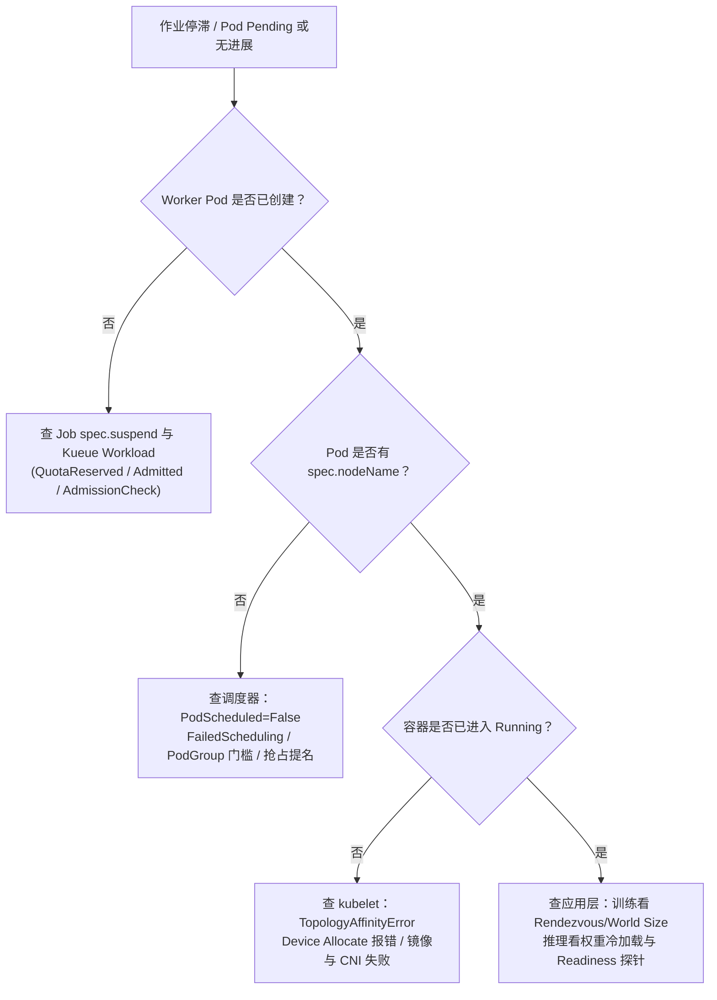

# 作业等待的状态与事件判读

终端里执行 `kubectl get pods`，屏幕赫然挂着一行 `Pending`——或者更让人头大，三个 Pod 全显示 `Running`，但训练步数死活不动、在线推理新副本也迟迟不接流量。

单看 `Pending` 两个字，信息量几乎为零：它可能卡在 Kueue 队列额度、可能卡在调度器反亲和或碎片、可能刚绑上节点就被 kubelet 报 `TopologyAffinityError` 打回，也可能正在拉取上百 GB 权重镜像。高效排障的秘诀只有一条：**沿着交付链路找到“最后一次拿到确凿证据的交接点”，直接去盘问负责下一步的组件**。



*图 15-07-01：按“队列准入 → 调度器 → kubelet → 容器与应用”逐层收窄等待根因的排查路径。*

## 一、连 Pod 都没建出来：查 Job 挂起与 Kueue Workload

如果作业提交后根本查不到任何 worker Pod，别去翻调度器日志——问题还停在**作业准入层**。

在 `Kueue v0.17` 托管 `batch/v1 Job` 的场景下，重点对照 Job 的 `spec.suspend` 与关联 Workload 的两条状态条件：

| Workload 状态组合 | 含义判读 | 下一步核查抓手 |
| --- | --- | --- |
| `QuotaReserved=False`，`Admitted=False` | 队列配额尚未保留，作业还在排队等额度 | 读 condition 的 `reason` 与 `message`；若提示额度不足，核对 `ClusterQueue` 剩余额度与可借额度（如固定 3 节点需 12 卡而队列仅剩 8 卡） |
| `QuotaReserved=True`，`Admitted=False` | 额度已锁定，但被额外的准入检查卡住 | 检查 `status.admissionChecks` 中 `state: Pending` 的检查项名称、消息及对应外部控制器 |
| `Admitted=True`，但仍无 Pod | 队列已经放行，交接卡在 Job 控制器 | 确认 Job 的 `spec.suspend` 是否已改回 `false`，并核对 Job 控制器事件是否报错 |

单看 `Job` 处于挂起状态，前两种场景表面现象一模一样；只有把 `Workload` 调出来看 `QuotaReserved` 与 `admissionChecks`，才能分清“缺额度”还是“等外部检查”。

## 二、Pod 没有 `spec.nodeName`：读懂 `FailedScheduling`

一旦 worker Pod 创建出来却没有 `spec.nodeName`，且状态条件出现 `PodScheduled=False`（`reason: Unschedulable`），就说明球已经传到了调度器脚下。

假设允许跨域的 `train-12` 前两个 worker 已分别绑定到 `h-a1`、`h-a2`，此时另一个小任务顺手占走了 `h-b1` 的 1 张 H100，让 `h-b1` 的余量跌成 3 张。此时对第 3 个 worker 执行 `kubectl describe pod`，会在 `Events` 里看到类似下面的典型汇总：

```text
# kubectl describe pod train-12-2 -n ai（调度器过滤失败典型输出）
Status:           Pending
Conditions:
  Type           Status  Reason         Message
  PodScheduled   False   Unschedulable  0/6 nodes are available: ...
Events:
  Type     Reason            From               Message
  ----     ------            ----               -------
  Warning  FailedScheduling  default-scheduler  0/6 nodes are available:
    1 node(s) didn't match Pod's node affinity/selector,        # a-b3（A100 异构池被排除）
    2 node(s) didn't match pod anti-affinity rules,             # h-a1、h-a2（已有同作业副本）
    1 Insufficient cpu, 1 Insufficient memory,                  # h-b2（CPU 与主机内存不足）
    2 Insufficient nvidia.com/gpu,                              # h-a3(剩2卡)、h-b1(剩3卡<4)
    1 Insufficient example.com/rdma-vf.                         # h-b2（无空闲 RDMA VF）
    preemption: 0/6 nodes are available: 6 Preemption is not helpful for scheduling.
```

> [!tip] 工程直觉：同一台节点可能触发多项失败计数
> `FailedScheduling` 的汇总数字是按“过滤规则”分别累加的——像 `h-b2` 同时缺 CPU、内存和 VF，就会同时出现在三项计数里！因此务必对照第 03 篇的逐节点多维账本，才能精准判断“释放哪台节点的哪项资源”才能真正多出一个落点。

若作业接入了成组调度机制，除了看单个 Pod 的调度事件，还须核查组对象状态——例如在 `Kubernetes v1.36` 原生组调度中检查 `PodGroup` 的 `PodGroupScheduled` 条件，确认是否因为未凑足 `minCount` 而整组等待。

## 三、已绑定节点却起不来：kubelet 拒绝与设备分配失败

当 `spec.nodeName` 已经写上具体主机名（例如 `h-a2`），Pod 却依然起不来甚至直接转入 `Failed`，说明**调度器已经完成任务，拦路虎出在目标节点的 kubelet 本地准入或容器准备阶段**。

最典型的就是第 04 篇的 NUMA 跨侧冲突（GPU 与独占 CPU 在 NUMA 1，唯一空闲 VF 在 NUMA 0）。执行 `kubectl describe pod` 会立刻看到节点本地拒绝记录：

```text
# kubectl describe pod train-12-1 -n ai（kubelet 本地拓扑拒绝典型输出）
Node:             h-a2/10.20.0.12
Status:           Failed
Reason:           TopologyAffinityError
Message:          Resources cannot be allocated with Topology locality
Events:
  Type     Reason                 From               Message
  ----     ------                 ----               -------
  Normal   Scheduled              default-scheduler  Successfully assigned ai/train-12-1 to h-a2
  Warning  TopologyAffinityError  kubelet            Resources cannot be allocated with Topology locality
```

看到这条记录后，立刻锁定同一 **Pod UID** 与时间戳，去目标节点核对 kubelet 生效的 `topologyManagerPolicy`、`topologyManagerScope` 以及各资源管理器给出的实际 NUMA 提示。

有时拓扑检查明明过了，节点准入依然报错——这往往是因为 Device Manager 在向设备插件实际索要设备时翻了车。排查这类故障需按 Pod UID、容器名与资源名对照 kubelet 和设备插件日志，分清两种根因：

- **本地库存不齐**：选设备 ID 时发现本地健康设备数量已低于请求（例如某张卡刚变 Unhealthy）；
- **插件 `Allocate` 报错**：已发起 `Allocate` 调用但收到插件返回的 RPC 错误。若查到已分配记录，可用 PodResources API 核对实际设备 ID。

如果这两步都已过关，容器仍停在 `ContainerCreating`，再顺着事件往下排查容器镜像拉取失败或 Multus / SR-IOV CNI 附加网络准备失败即可。

## 四、容器全在 `Running`，为何训练不动、推理不接流？

当 Pod 内所有容器的 `status.containerStatuses[].state.running` 都已经就绪，基础设施层的设备交付基本完成，此时要按**训练**与**推理**两条路径分别往下挖：

| 负载类型 | 常见“假运行”表象 | 优先核查证据 |
| --- | --- | --- |
| **多机同步训练** | 3 个 worker 容器全 `Running`，但 GPU 利用率长期为 0、无训练步输出 | 查 `torchrun` 日志：① 是否只发现 2 个成员（核对第 3 个 Agent 的会合 ID、端点与连通性）；② 会合后各进程 `WORLD_SIZE` 是否为 12；③ 是否卡在进程组初始化或首次 AllReduce（衔接 [第 05 章](../05_为什么一个作业需要多张GPU/00_内容大纲.md) 与 [第 08 章](../08_NCCL如何组织GPU间的通信/00_内容大纲.md)） |
| **在线大模型推理** | 扩容的新推理 Pod 显示 `Running`，但 **`READY 0/1`**，网关完全不往它分流量 | 查容器启动日志与 Readiness 探针：通常正卡在**百 GB 模型权重冷加载**、KV Cache 显存预分配或 CUDA Graph 编译阶段；若在高峰期连 `Pending` 都过不去，核对 `Preempting` 事件确认是否正在等待被抢占的离线训练 Pod 优雅退出 |

> [!warning] 常见误区：别把“旧 Pod 的陈年事件”安到新 Pod 头上
> 当 `TopologyAffinityError` 或节点异常触发控制器重建替代 Pod 时，新旧 Pod 名字可能相似，甚至同属一个 Job 或 Deployment，但拥有完全不同的 `metadata.uid`。排查 `Pending` 或卡顿时，**绝不能只按 Pod 名字模糊扫一眼事件**，必须拿当前活着的 Pod UID 去匹配。

## 五、一套只读命令按 UID 与时间线串联全证据

日常值守排查时，下面这组只读命令足以把命名空间 `ai` 中的 Job、Kueue Workload、Pod 状态与 `events.k8s.io/v1` 事件完整串起来（将 `train-12-example` 替换为当前实际 Pod 名）：

```bash
# 1. 核对 Job 挂起状态与并行规模
kubectl get job train-12 -n ai -o yaml

# 2. 核对 Kueue Workload 的 QuotaReserved / Admitted / admissionChecks（需集群已装 Kueue）
kubectl get workloads.kueue.x-k8s.io -n ai -o yaml

# 3. 核对所有 worker Pod 的 UID、spec.nodeName、phase 与 containerStatuses
kubectl get pods -n ai -l batch.kubernetes.io/job-name=train-12 -o yaml

# 4. 查看单个 Pod 的绑定结果、条件与近期事件摘要
kubectl describe pod train-12-example -n ai

# 5. 拉取结构化事件，精确核对 regarding.uid、reportingController 与 series 计数
kubectl get events.events.k8s.io -n ai -o yaml
```

解读 `events.k8s.io/v1` 对象时，务必按以下五个字段还原现场：

- **身份与来源**：用 `regarding.uid` 对准当前对象的 `metadata.uid`，并核对 `reportingController`、`reason`、`note` 与 `eventTime`。
- **新旧与时效**：遇到重复报错，用 `series.count` 与 `series.lastObservedTime` 区分“持续失败”还是“早期旧尝试”。事件会过期清理，一旦缺失即下钻控制器、kubelet 或应用日志补齐证据链。

> [!summary] 核心结论
> 看到 `Pending` 别盲猜，先画一根“队列准入 → 调度器绑定 → kubelet 本地准入 → 容器冷启动/应用会合”的标尺，用 **UID + 时间戳**锁住最后一次成功交接，就能在几分钟内把跨层问题精准切到唯一的责任组件。

> [!info]- 参考资料
> - **Kubernetes Pod 状态、事件与调度源码**：[Kubernetes v1.36 · Pod 生命周期](https://v1-36.docs.kubernetes.io/docs/concepts/workloads/pods/pod-lifecycle/)、[Kubernetes v1.36 · Pod 条件](https://v1-36.docs.kubernetes.io/docs/concepts/workloads/pods/pod-lifecycle/#pod-conditions)、[Kubernetes v1.36 · Job 标签与选择器](https://v1-36.docs.kubernetes.io/docs/concepts/workloads/controllers/job/)、[Kubernetes v1.36 · Event API](https://v1-36.docs.kubernetes.io/docs/reference/kubernetes-api/events/event-v1/)、[Kubernetes v1.36.0 · 调度失败状态与事件源码](https://github.com/kubernetes/kubernetes/blob/v1.36.0/pkg/scheduler/schedule_one.go)、[Kubernetes v1.36 · Pod 反亲和](https://v1-36.docs.kubernetes.io/docs/concepts/scheduling-eviction/assign-pod-node/)、[Kubernetes v1.36 · PodGroup 条件](https://v1-36.docs.kubernetes.io/docs/concepts/scheduling-eviction/podgroup-scheduling/#podgroup-conditions)
> - **Kueue 准入与检查状态**：[Kueue v0.17 · Job 集成](https://kueue.sigs.k8s.io/v0.17/docs/tasks/run/jobs/)、[Kueue v0.17 · 准入](https://kueue.sigs.k8s.io/v0.17/docs/concepts/admission/)、[Kueue v0.17 · AdmissionCheck](https://kueue.sigs.k8s.io/v0.17/docs/concepts/admission_check/)、[Kueue v0.17 · WorkloadStatus API](https://kueue.sigs.k8s.io/v0.17/docs/reference/kueue.v1beta2/#workloadstatus)
> - **kubelet 拓扑准入与设备分配源码**：[Kubernetes v1.36 · 拓扑排查](https://v1-36.docs.kubernetes.io/docs/tasks/debug/debug-cluster/topology/)、[Kubernetes v1.36.0 · Pod 作用域准入源码](https://raw.githubusercontent.com/kubernetes/kubernetes/v1.36.0/pkg/kubelet/cm/topologymanager/scope_pod.go)、[Kubernetes v1.36.0 · Device Manager 分配源码](https://raw.githubusercontent.com/kubernetes/kubernetes/v1.36.0/pkg/kubelet/cm/devicemanager/manager.go)、[Kubernetes v1.36 · Device Plugins 与 PodResources](https://v1-36.docs.kubernetes.io/docs/concepts/extend-kubernetes/compute-storage-net/device-plugins/)
> - **PyTorch 启动与会合排障**：[PyTorch 2.9 · torchrun](https://docs.pytorch.org/docs/2.9/elastic/run.html)、[PyTorch 2.9 · Rendezvous](https://docs.pytorch.org/docs/2.9/elastic/rendezvous.html)
