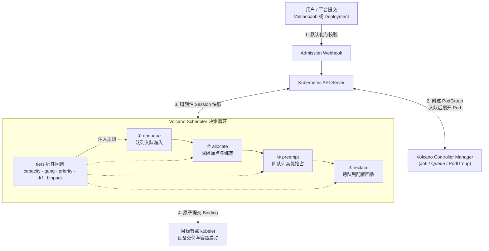
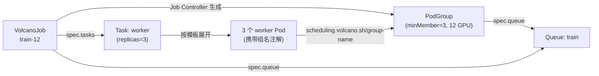

# Volcano 的定位、对象与组件

第 15 章讲清楚了一个痛点：多机训练作业如果被 Kubernetes 默认调度器逐个放置 Pod，很容易陷入“两份作业各占一半节点、谁都凑不齐会合人数”的死锁。

问题随之而来：Kubernetes 原生 `Pod` 对象里，并没有“整组至少凑齐 3 个成员才准启动”的字段，也没有“全集群 GPU 按业务线划队列分账”的账本。

**Volcano**（Kubernetes 批处理与 AI 作业调度系统）正是为了补齐这两块拼图而生的。它把“作业组门槛”和“队列配额账本”沉淀成一等公民 API 对象，再用可插拔的调度循环统一决策。

## 一、用一张架构图建立 Volcano 的直觉

理解 Volcano，不妨把它类比成一家**承接大型团队宴席的餐厅管理系统**：

- **`Queue`（队列）**：餐厅给不同部门划定的**包间与预算账本**。比如高优在线推理区预留专属卡位，离线训练区用剩余与夜间空位。
- **`PodGroup`（成组调度单元）**：一张**整桌预订登记单**。它写明“这桌至少要凑齐 3 个位置、合计 12 张 GPU 才准开席”，调度器只认这张单子是否达标。
- **`VolcanoJob`（批处理作业）**：一份**完整的宴会策划单**。里面记录了不同岗位角色（`Task`，如 worker 或协调者）、各自副本数、重启重试策略以及所属队列。

围绕这三个核心对象，Volcano 部署了三个控制面组件协同工作：

- **Admission Webhook（准入校验器）**：在作业写入 API Server 前补全默认值、拦截非法规格（例如缺失队列或门槛冲突）。
- **Controller Manager（控制器集群）**：包含 Job Controller、Queue Controller 与 PodGroup Controller，负责把 `VolcanoJob` 翻译成 `PodGroup` 和真实 `Pod`，并跟踪队列状态。
- **Volcano Scheduler（调度器）**：按周期开启调度会话（Session），依次执行 **`enqueue → allocate → preempt → reclaim`** 四步核心决策循环，把合格的成员绑定到物理节点。



*图 16-01-01：Volcano 组件分工与 `enqueue → allocate → preempt → reclaim` 四步决策循环。*

> [!summary] 核心结论
> Volcano 把 Kubernetes 单 Pod 调度升级成了“**队列配额准入 + 成组原子放置 + 多策略驱逐**”的三层控制流。控制器负责把声明展开为对象，调度器只看 `Queue` 与 `PodGroup` 做集中算账和绑定。

## 二、最小闭环：单副本作业的组件交接

先去掉多机干扰，看一份最简单的单节点训练作业如何跑通整条链路。假设队列 `train` 处于开放状态，空闲节点 `node-1` 能满足 4 卡 GPU、CPU、内存和高速网卡需求。

提交一份只有 1 个 `worker` 副本、整组门槛为 `1` 的 `VolcanoJob` 后，各组件按顺序完成四次接力：

1. **API 写入与准入校验**：Admission Webhook 为省略的字段补齐默认值（如默认调度器名和角色门槛），校验通过后将 `VolcanoJob` 持久化到 API Server。
2. **建立组对象**：Job Controller 监听到新作业，为其生成同命名空间的 `PodGroup`，写入最低成员数 `1`、最低资源需求（4 GPU 等）与目标 `Queue` 名。
3. **入队放行并创建 Pod**：Volcano Scheduler 在 `enqueue` 阶段确认 `train` 队列余额足够，把 `PodGroup` 从 `Pending` 推进到 `Inqueue`；Job Controller 看到放行信号后，按 `Task` 模板创建唯一一只 worker Pod。
4. **节点绑定与进程启动**：Volcano Scheduler 在 `allocate` 阶段为这只 Pod 选定 `node-1` 并提交绑定；随后 `node-1` 的 kubelet 调用设备插件交付 4 张 GPU 与 RDMA VF，拉起容器。

容器就绪后，单节点场景下可直接用如下命令在容器内拉起 4 个训练进程，各自绑定 1 张可见 GPU：

```bash
# 单节点 4 卡启动：由容器内 1 个 torchrun Agent 管理 4 个本地训练进程
torchrun --standalone --nnodes=1 --nproc-per-node=4 train.py
```

排障时，这套分步接力非常清晰：看 `VolcanoJob` 确认声明写入，看 `PodGroup` 确认是否入队，看 Pod 的 `spec.nodeName` 确认是否落点，最后看容器状态与训练日志确认进程跑通。

## 三、从单副本到三节点 `train-12` 的对象映射

把单副本横向扩展到第 15 章的主线作业 `train-12`：总共需要 3 只 worker Pod，每只独占 4 张 H100 80 GB 整卡、16 CPU、96 GiB 主机内存与 1 个 SR-IOV VF。

下面是一份精简后的 `VolcanoJob` 声明（节点选择、硬反亲和与网络挂载配置在第 02 篇补充）：

```yaml
apiVersion: batch.volcano.sh/v1alpha1   # Volcano 专属批处理 API 组
kind: Job
metadata:
  name: train-12
  namespace: ai-demo
spec:
  schedulerName: volcano                # 交给 Volcano Scheduler，而非默认调度器
  queue: train                          # 归属的集群级 Queue 账本
  minAvailable: 3                       # 整组最低成员数 → 写入 PodGroup.spec.minMember
  tasks:
    - name: worker                      # 角色名（多角色作业可再加 master/ps 等条目）
      replicas: 3                       # 目标创建 3 只 worker Pod
      minAvailable: 3                   # 该角色最低成员数 → 写入 minTaskMember.worker
      template:
        metadata:
          labels:
            infra.example.com/workload: train-12
        spec:
          restartPolicy: Never          # 容器退出后不由 kubelet 静默重启，交由 Job Policy 裁决
          containers:
            - name: trainer
              image: registry.example.com/training/torch:2.9
              resources:
                requests:
                  cpu: "16"
                  memory: 96Gi
                  nvidia.com/gpu: "4"       # 由 GPU Device Plugin 上报的扩展资源
                  example.com/rdma-vf: "1"  # 由 SR-IOV Device Plugin 上报的 VF 资源
                limits:
                  cpu: "16"
                  memory: 96Gi
                  nvidia.com/gpu: "4"
                  example.com/rdma-vf: "1"
```

Job Controller 解析这份规格时，会把作业级 `spec.minAvailable` 写入 `PodGroup` 的 `spec.minMember`，把每个角色的 `minAvailable` 写入 `spec.minTaskMember`，再按单模板资源乘以最低规模汇总出 `spec.minResources`：

| 资源维度 | 单个 worker Pod | 整组最低请求（3 个 worker） |
| --- | ---: | ---: |
| GPU 整卡（H100 80 GB） | 4 | 12 |
| CPU | 16 | 48 |
| 主机内存 | 96 GiB | 288 GiB |
| RDMA VF | 1 | 3 |

对于包含多个角色（如协调者 + 计算节点）的作业，如果要保证每个角色的最小人数都落到位，作业级 `spec.minAvailable` 至少应等于各角色 `minAvailable` 之和。



*图 16-01-02：`VolcanoJob`、`Task`、`PodGroup`、`Pod` 与 `Queue` 的五层对象关联。*

> [!tip] 在线推理服务也能纳入同一套 Volcano Queue 账本
> Volcano 并不局限于 `VolcanoJob`。从 `v1.12+` 到当前 `v1.16.0`，在线 LLM 推理常用的原生 `Deployment` 或 `StatefulSet` 只需指定 `schedulerName: volcano` 并添加 `scheduling.volcano.sh/queue-name` 注解。
>
> 控制器随后会自动为其生成 `PodGroup`，让离线训练与在线推理共享同一套 `Queue` 配额体系，平滑实现隔离与潮汐借还。

> [!warning] 常见误区：混查 Kubernetes 原生 API 与 Volcano API
> 查询对象时务必带上完整 API 组：`VolcanoJob` 属于 `batch.volcano.sh/v1alpha1`，`PodGroup` 与 `Queue` 属于 `scheduling.volcano.sh/v1beta1`。它们与 Kubernetes 原生 `batch/v1` `Job` 及 `v1.36` 原生 `PodGroup` 完全独立。
>
> 排查归属时，应同时核对 Pod 的 `ownerReferences` UID 与组名注解；若 Pod 模板内显式覆写了 `schedulerName`，则以最终 Pod 字段为准。

## 四、调度会话里的 `actions` 与 `tiers` 插件

Volcano Scheduler 并不把调度规则写死在主循环里，而是拆成了两层可配置结构：**`actions` 决定“按什么步骤干活”，`tiers` 插件决定“每一步按什么准则打分和裁决”**。

每个调度周期开始时，调度器先从本地缓存拍一张集群快照（会话 Session），包含所有队列、作业、Pod 和节点状态，然后按 `actions` 列表顺序推进：

- **`enqueue`**：过滤尚在 `Pending` 的 `PodGroup`，调用队列插件（如 `capacity`）判断是否放行入队。
- **`allocate`**：为已入队作业的待放 Pod 执行节点过滤（`predicates`）、节点打分（`nodeorder` / `binpack`）与成组提交判定（`gang`）。
- **`preempt` / `reclaim`**：当集群资源紧张时，分别执行同队列优先级抢占与跨队列配额回收（第 04 篇详细推演）。

下面是本章主线采用的 `volcano-scheduler.conf` 核心配置（外层 ConfigMap 省略）：

```yaml
actions: "enqueue, allocate"      # 本章基础主线先启用入队与放置两步
tiers:
  - plugins:                      # Tier 1：硬规则与高优先裁决，排序回调优先于 Tier 2
      - name: priority            # 按 PriorityClass 比较作业与 Pod 优先级
      - name: gang                # 校验整组与角色 minAvailable 成组门槛
        enablePreemptable: false  # 禁止打断已达标的 Gang 组（仅控抢占路径）
      - name: conformance         # 保护 kube-system 等系统关键 Pod 不被误伤
  - plugins:                      # Tier 2：公平份额、过滤与节点打分
      - name: drf                 # 主导资源公平排序，防单一资源大户垄断队列
        enablePreemptable: false
      - name: predicates          # 复用 K8s 资源、标签、亲和性与污点过滤规则
      - name: capacity            # 按 Queue 的 capability/deserved/guarantee 管账
      - name: nodeorder           # K8s 标准节点评分策略
      - name: binpack             # 装箱打分，鼓励将碎片工作负载凑紧以留出整机
```

当多个插件都注册了作业排序回调时，Volcano 会按 `tiers` 声明顺序依次询问，**采用第一个能分出胜负的插件结论**；而节点打分则会汇总各打分插件的加权分数。

> [!note] 版本与默认配置说明
> Volcano `v1.16.0` 官方 Helm Chart 默认启用 `enqueue, allocate, backfill` 以及 `proportion`、`overcommit` 插件。
>
> 为便于读者直接按 `Queue` 静态字段精确复算入队与份额结果，本章主线选用显式配额插件 `capacity`，并在第 03、04 篇对比 `proportion` 与叠加 `preempt`/`reclaim` 后的效果。

理清了对象映射和插件分工后，下一篇我们把 `train-12` 放进有竞争的真实节点快照里，逐笔核验“入队”和“成组放置”这两道硬门槛。

> [!info]- 参考资料
> - **Volcano 架构与版本基线**：[Volcano v1.16.0 概览](https://volcano.sh/docs/v1.16.0/home/introduction/)、[Volcano v1.16.0 组件架构](https://volcano.sh/docs/v1.16.0/home/architecture/)、[Volcano v1.16.0 发布说明](https://github.com/volcano-sh/volcano/releases/tag/v1.16.0)
> - **Volcano 核心 API 对象与源码**：[VolcanoJob 概念](https://volcano.sh/docs/v1.16.0/concepts/volcanojob/)、[PodGroup 概念](https://volcano.sh/docs/v1.16.0/concepts/podgroup/)、[Queue 概念](https://volcano.sh/docs/v1.16.0/concepts/queue/)、[Pod 创建条件源码](https://github.com/volcano-sh/volcano/blob/v1.16.0/pkg/controllers/job/job_controller_actions.go)、[PodGroup 生成与最低资源计算源码](https://github.com/volcano-sh/volcano/blob/v1.16.0/pkg/controllers/job/job_controller_actions.go#L844-L928)、[角色就绪判定源码](https://github.com/volcano-sh/volcano/blob/v1.16.0/pkg/scheduler/api/job_info.go#L1056-L1098)、[Pod 模板展开源码](https://github.com/volcano-sh/volcano/blob/v1.16.0/pkg/controllers/job/job_controller_util.go)
> - **Volcano 调度器配置与插件回调**：[调度器配置指南](https://volcano.sh/docs/v1.16.0/userguide/user_guide_how_to_configure_scheduler/)、[Capacity 插件配置指南](https://volcano.sh/docs/v1.16.0/userguide/user_guide_how_to_use_capacity_plugin/)、[v1.16.0 Helm 调度配置](https://github.com/volcano-sh/volcano/blob/v1.16.0/installer/helm/chart/volcano/config/volcano-scheduler.conf)、[Session 插件回调源码](https://github.com/volcano-sh/volcano/blob/v1.16.0/pkg/scheduler/framework/session_plugins.go)
> - **Kubernetes 与 PyTorch 协同**：[Kubernetes v1.36 Pod 生命周期](https://v1-36.docs.kubernetes.io/docs/concepts/workloads/pods/pod-lifecycle/)、[Kubernetes v1.36 GPU 调度](https://v1-36.docs.kubernetes.io/docs/tasks/manage-gpus/scheduling-gpus/)、[Kubernetes v1.36 Device Plugin](https://v1-36.docs.kubernetes.io/docs/concepts/extend-kubernetes/compute-storage-net/device-plugins/)、[Kubernetes v1.36 原生 Workload API](https://kubernetes.io/blog/2026/05/13/kubernetes-v1-36-advancing-workload-aware-scheduling/)、[PyTorch 2.9 单节点多卡启动](https://docs.pytorch.org/docs/2.9/elastic/run.html#single-node-multi-worker)
