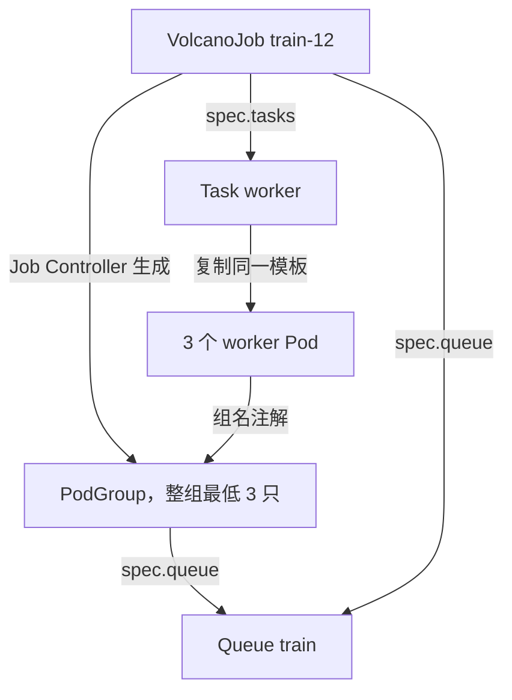

固定规模的多机训练只有在所需进程都到齐后才能开始。例如三只 worker Pod 各启动四个进程，已有两只 Pod 的资源，也还缺一个节点上的四个进程。逐个放置 Pod 可能让两份这样的作业各占两台节点，两份作业都等不到第三台。第 15 章由此引出了成组调度。本章用 **Volcano** 把这组成员、最低规模和队列份额表达成 Kubernetes 对象，再让调度器用它们作决定。 [Volcano v1.16.0 概览](https://volcano.sh/docs/v1.16.0/home/introduction/)

Volcano 是运行在 Kubernetes 上的批作业调度系统，提供作业 API、控制器、准入 webhook 和可配置的调度器。用户用作业 API 声明成员及资源需求，控制器将声明落实成 Pod 等对象，调度器按队列和组的条件决定是否放行以及绑定到哪些节点。目标节点的 kubelet 接着准备设备和容器，容器里的训练启动器再组织应用进程。主线采用 Kubernetes v1.36、Volcano v1.16.0，应用沿用第 05、15 章的 PyTorch 2.9。 [Volcano v1.16.0 组件架构](https://volcano.sh/docs/v1.16.0/home/architecture/) · [v1.16.0 发布说明](https://github.com/volcano-sh/volcano/releases/tag/v1.16.0) · [Kubernetes v1.36 Pod 生命周期](https://v1-36.docs.kubernetes.io/docs/concepts/workloads/pods/pod-lifecycle/)

## 单副本作业的对象与组件交接

设队列 `train` 处于开放状态，向它提交一份只有一个副本的 **VolcanoJob**。作业中有一条名为 `worker` 的 **Task**，包含一份 Pod 模板和副本数。这个副本请求 4 张 GPU，节点 `h1` 空闲，能同时满足 GPU、CPU、内存和网络设备需要。作业要求至少一个成员，内含训练脚本的镜像也已准备好。假定使用本章的入队与放置配置，一次正常交付依次经过以下步骤。

1. **API Server 接收声明。** Volcano 的 Admission webhook 参与默认化和校验，例如为省略的作业字段提供默认值。API 写入成功后，用户可以查询 VolcanoJob。
2. **Job Controller 建立组对象。** 控制器为作业生成 **PodGroup**，在其中写入最低成员数、最低资源请求和所属 **Queue**。Queue 是多个作业共享同一份资源账本的集群级对象。Queue Controller 维护其状态。
3. **Scheduler 放行入队。** Volcano Scheduler 判断 `train` 可以承接一个四卡 Pod 的最低请求，更新 PodGroup 状态。Job Controller 观察到放行，按 Task 模板创建一只 worker Pod。Pod 携带组名注解，由 `spec.schedulerName` 交给 Volcano 调度器。
4. **Scheduler 放置，kubelet 启动。** 调度器为唯一成员找到 `h1`，一人组达到门槛，提交 Pod 绑定。kubelet 和设备插件在 `h1` 交付具体 GPU 和网络设备，再启动容器。用 Pod 的 `spec.nodeName` 确认节点，用容器状态和应用记录确认运行。

这条路径可以分别观察 API 中的作业、已绑定的 Pod 和应用进程的运行。单节点时，容器可以用 `torchrun --standalone --nnodes=1 --nproc-per-node=4 train.py` 启动四个训练进程，其中 `train.py` 代表镜像内的训练脚本。调度器只需凑齐一个 Pod，应用由这个 Pod 获得四个进程和四张卡。 [Volcano v1.16.0 VolcanoJob](https://volcano.sh/docs/v1.16.0/concepts/volcanojob/) · [PodGroup](https://volcano.sh/docs/v1.16.0/concepts/podgroup/) · [Queue](https://volcano.sh/docs/v1.16.0/concepts/queue/) · [v1.16.0 Pod 创建条件](https://github.com/volcano-sh/volcano/blob/v1.16.0/pkg/controllers/job/job_controller_actions.go) · [PyTorch 2.9 单节点启动](https://docs.pytorch.org/docs/2.9/elastic/run.html#single-node-multi-worker)

## VolcanoJob 的 Task 模板与 PodGroup 门槛

把单副本扩为第 15 章的 `train-12`，规模变成三台节点、每台一只 worker Pod。每只 Pod 申请 4 张 H100 80 GB 整卡、16 个 Kubernetes CPU 单位、96 GiB 主机内存和 1 个支持 RDMA（远程直接内存访问）的网卡虚拟功能（VF）。第 13 章介绍过，网卡通过单根 I/O 虚拟化（SR-IOV）提供可单独分配的 VF。GPU 和 VF 由设备插件以扩展资源发布，下面的 `example.com/rdma-vf` 是教学占位资源名。资源请求按设备数计，GPU 型号另由节点标签限定。 [Kubernetes v1.36 GPU 调度](https://v1-36.docs.kubernetes.io/docs/tasks/manage-gpus/scheduling-gpus/) · [Kubernetes v1.36 Device Plugin](https://v1-36.docs.kubernetes.io/docs/concepts/extend-kubernetes/compute-storage-net/device-plugins/)

以下是作业规格摘录，用于从模板推算组规模和资源。镜像地址为占位符，省略实际训练命令、节点选择和反亲和、网络附加配置以及存储声明。单副本示例对应其中两处 `minAvailable` 和 `replicas` 均取 1。

```yaml
apiVersion: batch.volcano.sh/v1alpha1
kind: Job
metadata:
  name: train-12
  namespace: ai-demo
spec:
  schedulerName: volcano
  queue: train
  minAvailable: 3
  tasks:
    - name: worker
      replicas: 3
      minAvailable: 3
      template:
        metadata:
          labels:
            infra.example.com/workload: train-12
        spec:
          restartPolicy: Never
          containers:
            - name: trainer
              image: example.invalid/training/torch:demo
              resources:
                requests:
                  cpu: "16"
                  memory: 96Gi
                  nvidia.com/gpu: "4"
                  example.com/rdma-vf: "1"
                limits:
                  cpu: "16"
                  memory: 96Gi
                  nvidia.com/gpu: "4"
                  example.com/rdma-vf: "1"
```

`replicas` 指这个 Task 的目标副本数。作业的 `spec.minAvailable` 表达全组最低成员数，Task 的 `minAvailable` 表达角色最低副本数。Job Controller 将前者写到 PodGroup 的 `spec.minMember`，将后者写到 `spec.minTaskMember.worker`，并据模板和最低规模计算 `spec.minResources`。本例两道门槛同为 3，只有一个角色，资源向量可逐项相乘。多角色作业若要同时落实各角色的最小规模，应使整组门槛至少等于各角色门槛之和。 [v1.16.0 PodGroup 生成与最低资源计算](https://github.com/volcano-sh/volcano/blob/v1.16.0/pkg/controllers/job/job_controller_actions.go#L844-L928) · [v1.16.0 角色就绪判定](https://github.com/volcano-sh/volcano/blob/v1.16.0/pkg/scheduler/api/job_info.go#L1056-L1098)

| 资源      | 单个 worker | 三个 worker，也是本例最低请求 |
| ------- | --------: | -----------------: |
| GPU 整卡  |         4 |                 12 |
| CPU     |        16 |                 48 |
| 主机内存    |    96 GiB |            288 GiB |
| RDMA VF |         1 |                  3 |



查询作业时看完整 API 组。VolcanoJob 为 `batch.volcano.sh/v1alpha1`，PodGroup 与 Queue 为 `scheduling.volcano.sh/v1beta1`。Kubernetes 自带的 `batch/v1 Job` 和第 15 章的原生 PodGroup 使用各自的 API。Job、PodGroup 与 Pod 同在 `ai-demo`。用 `ownerReferences` 的 UID（对象唯一标识）确认当前作业归属，用 Pod 的组注解确认调度分组。模板若显式设置了调度器，以生成的 Pod 字段为准。 [Volcano v1.16.0 API 对象](https://volcano.sh/docs/v1.16.0/concepts/volcanojob/) · [v1.16.0 Pod 模板展开](https://github.com/volcano-sh/volcano/blob/v1.16.0/pkg/controllers/job/job_controller_util.go) · [Kubernetes v1.36 原生 Workload API](https://kubernetes.io/blog/2026/05/13/kubernetes-v1-36-advancing-workload-aware-scheduling/)

## 调度周期中的 action 与插件回调

调度器以缓存中的作业、队列、Pod 与节点打开一次调度会话（session）。`actions` 排定本轮要执行的步骤，`tiers` 列出参与步骤的插件。插件在会话中注册回调。例如 `enqueue` 要判断一组最低请求能否入队，便调用 `capacity` 提供的队列检查。`allocate` 需要为成员筛选节点、打分并判断整组能否提交，其中 `predicates` 负责节点条件，`nodeorder` 与 `binpack` 参与节点打分，`gang` 提供组门槛检查。作业排序按配置顺序采用第一个能分出先后的回调，节点分数则按打分回调的规则汇总。 [Volcano v1.16.0 调度配置指南](https://volcano.sh/docs/v1.16.0/userguide/user_guide_how_to_configure_scheduler/) · [v1.16.0 回调源码](https://github.com/volcano-sh/volcano/blob/v1.16.0/pkg/scheduler/framework/session_plugins.go)

下面是主例的 `volcano-scheduler.conf` 内容，外层 ConfigMap 省略。Volcano v1.16.0 的 Helm 配置包含 `enqueue, allocate, backfill` 与 `proportion`、`overcommit` 等插件。本章选择 `enqueue, allocate` 和显式份额插件 `capacity`，使主例的入队结果能从队列字段复算。驱逐算例中会另加对应步骤。 [v1.16.0 Helm 调度配置](https://github.com/volcano-sh/volcano/blob/v1.16.0/installer/helm/chart/volcano/config/volcano-scheduler.conf) · [Capacity 配置指南](https://volcano.sh/docs/v1.16.0/userguide/user_guide_how_to_use_capacity_plugin/)

```yaml
actions: "enqueue, allocate"
tiers:
  - plugins:
      - name: priority
      - name: gang
        enablePreemptable: false
      - name: conformance
  - plugins:
      - name: drf
        enablePreemptable: false
      - name: predicates
      - name: capacity
      - name: nodeorder
      - name: binpack
```

一次 `enqueue` 放行以后，控制器还需要观察状态并创建 Pod。调度器会在看到这些 Pod 后继续放置。空池的单副本很容易依次通过两步，三副本在有竞争时可能停在其中任何一步，接下来可以用同一份作业分别验算。
