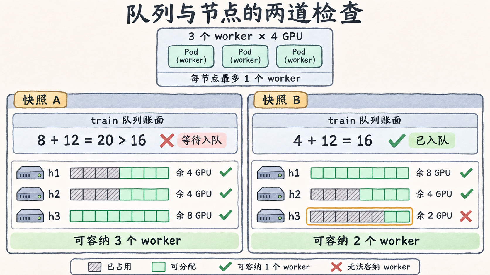

# Queue 入队、Gang 放置与训练启动

很多工程师第一次用 Volcano 排障，都会遇到两种让人摸不着头脑的“干等”现象：

一种是作业明明提交成功了，集群里还有整机空闲，却连一只 worker Pod 都没创建出来；另一种是 3 只 worker Pod 全都创建出来了，集群总计还空着 14 张卡（大于作业所需的 12 张），结果所有 Pod 依然纹丝不动地卡在 `Pending`。

这两种现象，正好对应 Volcano 调度流程里的**两道硬关卡**：第一道是**队列入队（`enqueue`）**，第二道是**节点成组放置（`allocate` + `gang`）**。

## 一、第一道关卡：Queue 有效上限与 `enqueue` 放行

本篇使用三节点单网络域资源池（`node-1`–`node-3`，每台可分配 `8` GPU、`32` CPU、`192 GiB` 内存与 `2` RDMA VF），部署上一篇定义的 `train-12`（3 只 worker，各需 4 卡，每节点最多 1 只）。

队列 `train` 开放接纳作业，其 GPU 配额配置如下（假设其他资源维度充足，且全池无专属保留）：

```yaml
apiVersion: scheduling.volcano.sh/v1beta1
kind: Queue
metadata:
  name: train
spec:
  capability:
    nvidia.com/gpu: "16"    # 队列最高使用上限（硬封顶）
  deserved:
    nvidia.com/gpu: "12"    # 队列应得份额（共享竞争与回收时的基准线）
```

Job Controller 为 `train-12` 生成 `PodGroup` 后，该组最初处于 `Pending`。此时还没有任何 worker Pod 被创建——Volcano 刻意把“创建 Pod”推迟到队列确认有额度之后，避免大量无法运行的空 Pod 撑爆 API Server 与调度器缓存。

在每个调度周期的 `enqueue` 步骤，`capacity` 插件会先确认队列处于开放状态，再对每个资源维度核验入队不等式：

$$\text{新组 } \texttt{minResources} + \text{已分配 } (\text{allocated}) + \text{在途 } (\text{inqueue}) - \text{弹性校正 } (\text{elastic}) \le \text{队列有效上限}$$

式中有两项容易被忽略的账目：

- **在途资源（`inqueue`）**：已经通过入队放行、但尚未全部分配落地的同队列组所占的最低预算（统计时会自动扣除同一组已实际分配的部分，防止重复记账）。
- **弹性校正（`elastic`）**：同队列已有作业中，超出其最低门槛、属于可弹性伸缩的那部分余量。

当本例的 `inqueue` 与 `elastic` 均为 `0` 时，只需检查 `新组 12 GPU + 已分配 ≤ 16 GPU`。只要不等式成立，调度器就把 `PodGroup` 推进到 **`Inqueue`**，Job Controller 随即按模板批量创建 3 只 worker Pod。

## 二、第二道关卡：节点筛选、暂选放置与 Gang 原子提交

Pod 创建出来后，进入 `allocate` 阶段。除了核对四维资源余量，`train-12` 的 Pod 模板还额外附加了卡型选择与“每节点最多一只本作业 worker”的硬性反亲和：

```yaml
# 写入 VolcanoJob 的 spec.tasks[0].template.spec
nodeSelector:
  infra.example.com/gpu-model: h100-80gb        # 限定 H100 80 GB 节点池
affinity:
  podAntiAffinity:
    requiredDuringSchedulingIgnoredDuringExecution:
      - labelSelector:
          matchLabels:
            infra.example.com/workload: train-12 # 匹配同作业所有 worker Pod
        topologyKey: kubernetes.io/hostname     # 按宿主机隔离，每节点至多 1 只
```

由于硬性反亲和生效，一台空出 8 张卡的节点也只能为 `train-12` 贡献 **1 个**落点，而不是 2 个。

下面我们沿三个连续快照，对照跟踪队列账面与三台节点（表格括号内为图内节点简标）的余量变化：

| 快照阶段 | 集群内已有 GPU 占用 | `train` 队列账面（GPU） | `node-1 (h1) / node-2 (h2) / node-3 (h3)` GPU 余量 | 合格 worker 落点数 |
| --- | --- | --- | --- | ---: |
| **快照 A：提交作业** | `train` 在 `node-1`、`node-2` 各占 4 卡 | `8 + 12 = 20 > 16`，阻塞在 `Pending` | `4 / 4 / 8`（共余 16） | 3（仅作容量对照） |
| **快照 B：放行入队后** | `node-1` 旧成员退出归账；新组放置前，`batch` 在 `node-3` 占 6 卡 | `4 + 12 = 16 ≤ 16`，进入 `Inqueue` | `8 / 4 / 2`（共余 14） | **2**（无法凑齐 3 员） |
| **快照 C：节点释卡后** | `node-3` 上 `batch` 的 1 只 2 卡 Pod 退出归账 | 新组 12 卡计入后合计 16 | `8 / 4 / 4`（共余 16） | **3**（达标提交绑定） |



*图 16-02-01：队列与节点的两道检查（图中 `h1`/`h2`/`h3` 依次对应 `node-1`/`node-2`/`node-3`，“可分配”指扣除已计入请求后的调度余量）。快照 A 卡在队列上限，尚未创建 Pod；快照 B 虽已入队且总余 14 卡，却因第三台节点仅余 2 卡而无法凑齐 3 个落点。*

看清快照 B 里的执行细节，就能彻底理解 Volcano 的**事务型放置（Statement）**：

1. `allocate` 读到 3 只待放置的 worker Pod，先校验队列额度允许增量分配。
2. 对第 1、2 只 Pod，调度器依次在调度事务中**暂选** `node-1` 和 `node-2`，并把暂选占用立刻反映到后续判断中。
3. 轮到第 3 只 Pod 时，前两台已被同组硬反亲和排除，而第三台仅余 2 卡（`< 4`），筛选结果为空。
4. 最后由 `gang` 插件核验整组门槛（`minMember=3`）与角色门槛（`minTaskMember.worker=3`）：当前只有 2 个暂选落点，既无已绑定成员也无待释流水线，判定不达标——**调度器直接回滚整个事务，撤销前两只 Pod 的暂选绑定**。

直到快照 C 释放了第三台节点的 2 张卡，余量变成 `8 / 4 / 4`，三台节点各自承接一只 worker，整组与角色门槛同时满足，调度器才一次性原子提交 3 个绑定请求。

> [!summary] 核心结论
> 队列总量达标只让你拿到“入场券”（生成 Pod）；能不能真正落座，要看全组所有必需成员能否在同一轮调度事务中凑齐合格节点。只要差一个落点，已暂选的其他成员也会整体回滚，杜绝死锁。

## 三、绑定之后：kubelet 交付、会合与弹性门槛

调度器提交绑定只是控制面交接的终点。接下来，三台节点的 kubelet 各自并行拉取镜像、向 Device Plugin 申请具体 GPU 与 RDMA VF，并在容器内拉起训练启动器。

三只 Pod 内的 `torchrun` Agent 通过统一的会合后端、会合标识与可达端点完成多机会合（使用 Volcano 可选 `svc` 插件可自动创建 Headless Service 辅助 DNS 发现）：

```bash
# 三只 worker Pod 使用相同的 rdzv-id 与可达会合端点，凑齐 3 节点 × 4 进程 = 12 进程
torchrun --nnodes=3 --nproc-per-node=4 \
  --rdzv-backend=c10d \
  --rdzv-id=train-12-run1 \
  --rdzv-endpoint=rdzv.training.example:29400 \
  train.py
```

只有当全部 12 个进程（`WORLD_SIZE = 3 × 4 = 12`）完成会合、建立进程组并跑通首次集合通信，训练才真正进入计算循环。

如果业务希望在快照 B（仅两台节点够放）时就能降级启动，必须同时对齐 **Volcano 两级门槛**与 **应用启动参数**。下面对比三种修改结果：

| 新提交的作业规格与启动参数 | Volcano 调度行为与训练结果 |
| --- | --- |
| 仅把 Job `minAvailable` 改为 `2`，Task 仍留 `3` | Volcano `v1.16.0` 检测到整组门槛（2）小于各角色门槛之和（3），**跳过逐角色校验**；最低需求按 2 只计（8 GPU），两只 Pod 先绑定，但固定 `--nnodes=3` 的训练进程仍会无限等第三台。 |
| Job 与 Task 的 `minAvailable` 均改 `2`，`replicas` 仍为 `3`，仍用 `--nnodes=3` | 两只 Pod 干净通过双门槛并先绑定，但应用层未放开弹性会合，两个 Agent 依然原地苦等第 3 个节点。 |
| 两级 `minAvailable` 均为 `2`，且启动命令改为弹性 `--nnodes=2:3` | 两个 Agent 先完成会合，以 `WORLD_SIZE = 2 × 4 = 8` 开跑；待第三只 Pod 后续绑定启动后，由框架触发弹性扩员与状态重分片。 |

> [!warning] 常见误区：门槛缩水破坏多角色保障，或忘记对齐应用参数
> 1. 在 Volcano `v1.16.0` 中，如果留空 Task 的 `minAvailable`（且未启用分区策略），Webhook 会默认将其补全为 `replicas`。对于多角色作业，切忌把整组 `minAvailable` 改得比各角色之和还小，否则会绕开逐角色检查，导致关键角色缺失。
> 2. **调度器只负责把容器送进节点，不改写应用命令行**。把成组门槛降为 2 却保留固定 `--nnodes=3`，只会把“调度器排队”变成“两台节点空占 8 张卡干等会合”的资源黑洞。

## 四、只读排查：快速定位卡在哪一道门

当作业迟迟没出训练日志时，先用下面五条只读命令按“作业 → 组 → 队列 → Pod → 事件”拉出完整现场，并按 `regarding.uid` 和时间戳把事件与具体对象对齐：

```bash
kubectl get jobs.batch.volcano.sh train-12 -n ai-demo -o yaml       # 1. 查 Job 阶段与规格
kubectl get podgroups.scheduling.volcano.sh -n ai-demo -o yaml      # 2. 查 PodGroup 阶段、minResources 与条件
kubectl get queues.scheduling.volcano.sh train -o yaml              # 3. 查 Queue 开放状态与 .status.allocated
kubectl get pods -l infra.example.com/workload=train-12 -n ai-demo -o yaml  # 4. 查 Pod 是否已创建及 spec.nodeName
kubectl get events.events.k8s.io -n ai-demo -o yaml                 # 5. 按 regarding.uid 核对失败原因与消息
```

拿到对象快照后，直接按下面四步对照定位当前卡点：

| 当前观察到的现象 | 阻塞阶段 | 下一步核对重点 |
| --- | --- | --- |
| API 中有 `VolcanoJob`，但查不到该 UID 拥有的 `PodGroup` | 控制器建组阶段 | 查 Job Controller 同步错误与 Job `.status.state.phase`；若提交时即报错，核对 Webhook 拒绝消息。 |
| `PodGroup` 停在 `Pending`，集群中没有任何 worker Pod | `enqueue` 队列准入 | 核对 `spec.minResources`、Queue `.status.state` 与 `.status.allocated`；若账面看似够用，排查在途资源 `inqueue`、有效上限或 `Unschedulable` 事件详情。 |
| `PodGroup` 已进 `Inqueue` 且 Pod 已创建，但 `spec.nodeName` 为空 | `allocate` 成组放置 | 查 `PodGroup` `.status.conditions` 与 Pod 调度事件，逐台核对节点四维余量、标签及反亲和是否凑足 `minMember`；若入队后无 Pod，回头查 Job Controller 创建失败事件。 |
| 所有 Pod 已有 `spec.nodeName`，容器启动中或已 `Running` | 节点交付或应用会合 | 用 `PodScheduled`、节点事件和容器 `state` 区分镜像/设备准备；若容器已全部 `Running`，转查 `torchrun` 会合端点、`rdzv-id`、`WORLD_SIZE` 与首次集合通信日志。 |

回看快照 A 和快照 B：快照 A 要疏通的是**队列账本**，快照 B 要疏通的是**具体节点的物理余量**。下一篇，我们就打开队列份额、作业排序与节点装箱三个旋钮，看看多团队、训推混部集群如何合理分配账本与节点空间。

> [!info]- 参考资料
> - **Volcano 动作、队列与入队机制**：[Volcano v1.16.0 Actions](https://volcano.sh/docs/v1.16.0/scheduler/actions/)、[Queue 概念](https://volcano.sh/docs/v1.16.0/concepts/queue/)、[PodGroup 状态](https://volcano.sh/docs/v1.16.0/concepts/podgroup/)、[Capacity 插件配置指南](https://volcano.sh/docs/v1.16.0/userguide/user_guide_how_to_use_capacity_plugin/)、[capacity 入队检查源码](https://github.com/volcano-sh/volcano/blob/v1.16.0/pkg/scheduler/plugins/capacity/capacity.go#L1621-L1667)、[capacity 事件与实现源码](https://github.com/volcano-sh/volcano/blob/v1.16.0/pkg/scheduler/plugins/capacity/capacity.go)、[enqueue 动作源码](https://github.com/volcano-sh/volcano/blob/v1.16.0/pkg/scheduler/actions/enqueue/enqueue.go)
> - **成组放置、事务提交与门槛源码**：[Pod 同步条件源码](https://github.com/volcano-sh/volcano/blob/v1.16.0/pkg/controllers/job/job_controller_actions.go#L400-L414)、[最低资源计算源码](https://github.com/volcano-sh/volcano/blob/v1.16.0/pkg/controllers/job/job_controller_actions.go#L895-L928)、[Task 默认化 Webhook 源码](https://github.com/volcano-sh/volcano/blob/v1.16.0/pkg/webhooks/admission/jobs/mutate/mutate_job.go#L180-L211)、[allocate 动作源码](https://github.com/volcano-sh/volcano/blob/v1.16.0/pkg/scheduler/actions/allocate/allocate.go)、[Gang 组及角色检查源码](https://github.com/volcano-sh/volcano/blob/v1.16.0/pkg/scheduler/plugins/gang/gang.go#L175-L196)、[角色检查分支源码](https://github.com/volcano-sh/volcano/blob/v1.16.0/pkg/scheduler/api/job_info.go#L1056-L1128)、[调度事务 Statement 源码](https://github.com/volcano-sh/volcano/blob/v1.16.0/pkg/scheduler/framework/statement.go)、[Volcano SVC 插件](https://volcano.sh/docs/v1.16.0/userguide/user_guide_how_to_use_svc_plugin/)
> - **Kubernetes 与 PyTorch 会合**：[Kubernetes v1.36 节点选择与 Pod 反亲和](https://v1-36.docs.kubernetes.io/docs/concepts/scheduling-eviction/assign-pod-node/)、[Kubernetes v1.36 Pod 生命周期](https://v1-36.docs.kubernetes.io/docs/concepts/workloads/pods/pod-lifecycle/)、[Kubernetes v1.36 Event API](https://v1-36.docs.kubernetes.io/docs/reference/kubernetes-api/events/event-v1/)、[PyTorch 2.9 torchrun](https://docs.pytorch.org/docs/2.9/elastic/run.html)、[PyTorch 2.9 会合与成员变化](https://docs.pytorch.org/docs/2.9/elastic/rendezvous.html)
