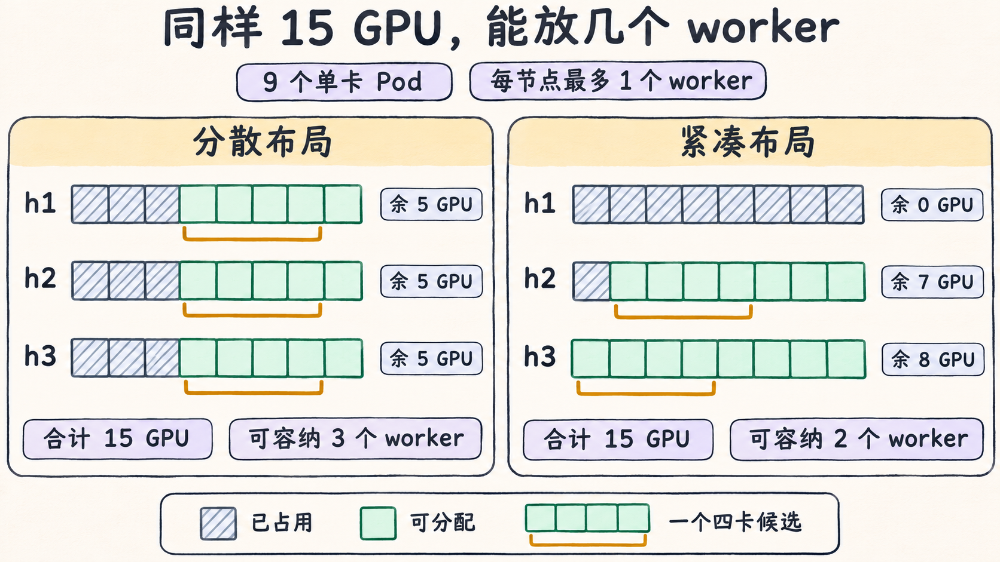

# Queue 份额、作业排序与节点装箱

当集群里同时跑着多个团队的作业，甚至把**在线大模型推理**与**离线批处理训练**放在同一批 GPU 上混部时，单纯问“能不能放得下”已经不够了。

调度器必须连续回答三个顺序问题：**哪个队列先拿资源？队列里哪个作业先被尝试？合格的节点里优先选哪台落脚？** 本篇沿 Volcano `v1.16.0` 的 `capacity`、`priority`、`drf` 与 `binpack` 插件，把这三把尺子逐一拆清。

## 一、`capacity` 三层配额账本与 `proportion` 对照

在 `capacity` 插件下，每个平级 `Queue` 通过三个核心字段界定“能用多少、该得多少、绝不外借多少”：

| `Queue` 字段 | 工程语义 | 3 节点主线示例（24 GPU 池） |
| --- | --- | --- |
| `capability` | 队列的硬上限，同时受集群总容量与其他队列专属保留量封顶。 | `train: 16`，`batch: 24` |
| `deserved` | 队列的应得份额，用于比较相对占用比例，也是跨队列回收的借用基线。 | `train: 12`，`batch: 12` |
| `guarantee.resource` | 为该队列专属保留的绝对底线；只要配置了保留，其余队列可用上限立刻扣除这部分。 | 主线默认均为 `0` |

用两个小算例就能把这三项的关系算透：

- **借用与超额核算**：当 `batch` 占满 `16` GPU 时，它超出了应得份额 `16 - 12 = 4` 卡（属于借用），全池还空 `24 - 16 = 8` 卡。此时空闲的 `train` 申请 `12` GPU，物理缺口恰好是 `4` 卡，与 `batch` 的借用量完全相等——能否收回这 4 卡，取决于下一篇的跨队列回收规则与节点落点。
- **专属保留扣减**：若清空资源池，为 `train` 设置 `guarantee.resource` 为 `4` GPU，则 `capacity` 计算 `batch` 的有效上限时，先从总池扣除其他队列保留，再用自身 `capability` 封顶：

$$\text{有效上限}_{\text{batch}} = \min\big(\text{capability}_{\text{batch}},\; \text{池总容量} - \sum_{\text{其他队列}} \text{guarantee}\big) = \min(24,\; 24 - 4) = 20\text{ GPU}$$

与显式维护静态数值的 `capacity` 不同，Volcano 另有一套默认的动态配额插件 **`proportion`**。它按队列的 `weight` 和实时需求动态切分集群总量：

- 例如两队列 `weight` 为 `1:1` 且需求充足时，24 GPU 池各分 `12` 卡；节点池扩容到 32 GPU 后自动变成各分 `16` 卡。
- 选用 `capacity` 则需要按容量规划显式更新 `deserved`，但账目边界更确定。**两套插件互斥，集群中择一启用**。

## 二、生产实战：训推混部集群的双队列配额设计

在线推理与离线训练具有天然的潮汐互补性：白昼业务高峰需要充足 GPU 保住推理 TTFT 与 TPOT 的 SLO，夜间推理缩容后却有大量整卡闲置。

在一个由 4 台 8 卡节点（`node-1`–`node-4`，共 **32 GPU**）构成的训推混部池中，我们可以利用 `capacity` 的三层字段划分高优在线推理队列与离线训练队列：

```yaml
apiVersion: scheduling.volcano.sh/v1beta1
kind: Queue
metadata:
  name: infer-online              # 高优先级在线推理队列（承接 Deployment / LWS）
spec:
  priority: 100                   # 队列优先级高于离线训练
  reclaimable: false              # 严禁任何其他队列回收在线推理资源
  guarantee:
    resource:
      nvidia.com/gpu: "8"         # 夜间低谷常驻底线（2 个 4 卡副本），绝不外借
  deserved:
    nvidia.com/gpu: "24"          # 白昼高峰应得配额，随时有权收回被借走的 16 卡
  capability:
    nvidia.com/gpu: "32"          # 极端流量突发时可弹性借满全池 32 卡
---
apiVersion: scheduling.volcano.sh/v1beta1
kind: Queue
metadata:
  name: train-offline             # 离线训练批处理队列（承接 VolcanoJob）
spec:
  priority: 10
  reclaimable: true               # 超出 deserved 的借用部分允许白昼平滑回收
  guarantee:
    resource:
      nvidia.com/gpu: "0"         # 不锁死专属空卡，保持全池弹性
  deserved:
    nvidia.com/gpu: "8"           # 全天候保底训练份额（1 台 8 卡节点规模）
  capability:
    nvidia.com/gpu: "24"          # 有效上限 min(24, 32 - 8) = 24，夜间可多借 16 卡
```

对照上面的配置，整座 32 卡集群自动形成了清晰的日夜潮汐分工：

- **夜间低谷期**：`infer-online` 缩容到 `8` 卡底线运行；`train-offline` 的有效上限正好是 `min(24, 32 - 8) = 24` GPU，可以合法借出 `16` 张夜间闲置卡跑大规模预训练或微调。
- **白昼高峰期**：在线推理扩容至 `24` 卡需求时，由于 `infer-online` 用量低于其 `deserved`（24），而 `train-offline` 高于 `deserved`（8）且开启了 `reclaimable: true`，调度器可无缝触发跨队列回收（下一篇展开执行细节）。

> [!tip] 工程直觉：用 `guarantee` 守低谷底线，用 `deserved` 守高峰主权
> 不要把在线推理队列的 `guarantee` 设成白昼峰值 24 卡——一旦设成 `guarantee`，夜间即使推理不用，这 24 卡也会被死锁空转、训练队列一卡都借不走。正确做法是把**低谷底线写进 `guarantee`，高峰配额写进 `deserved`，夜间借用天花板留给 `capability`**。

## 三、队列排序与作业主导份额（DRF）

当多个队列和多个待调度作业同时处于就绪态，Volcano 通过两级排序决定尝试次序：

### 1. 队列排序（`capacity` 回调）

对同样具备分配资格的平级队列，先比较 `Queue.spec.priority`，高者优先；优先级相同时，计算各队列“已分配量 / 应得份额”在各维度上的最大占比，**占比更小的队列优先**。

例如在 GPU 主导的场景中，`train` 已用 4 卡（`4/12`），`batch` 已用 8 卡（`8/12`），调度器会优先把本轮分配机会给 `train`。若其他已配置资源（如 CPU）的占比更高，则按最高维度重算。

### 2. 作业排序（`priority` → `gang` → `drf`）

选定队列后，作业尝试顺序按 `tiers` 中插件的排列依次裁决，第一个分出先后的回调直接拍板：

1. **`priority`**：比较作业引用的 `PriorityClass` 数值，高优先级先试。
2. **`gang`**：同优先级下，优先尝试尚未凑齐成组门槛的作业，让卡在起跑线上的组尽快凑齐。
3. **DRF（Dominant Resource Fairness，主导资源公平）**：前两项打平时，分别用作业已分配的各项资源除以集群同项总量，取最大比例作为**主导份额（Dominant Share）**，份额小者优先：

$$\text{主导份额}_i = \max_{r \in \{\text{GPU},\, \text{CPU},\, \dots\}} \left(\frac{\text{作业 } i \text{ 已分配资源 } r}{\text{集群资源 } r \text{ 总量}}\right)$$

假设集群共 `24` GPU、`96` CPU，同队列内作业 A 与 B 均在等待更多成员，其余维度占比更低：

| 等待中的作业 | 已分配资源 | GPU 占比 | CPU 占比 | 主导份额 |
| --- | --- | ---: | ---: | ---: |
| 作业 A | `4` GPU，`16` CPU | `4/24 = 1/6` | `16/96 = 1/6` | **`1/6`**（优先） |
| 作业 B | `4` GPU，`32` CPU | `4/24 = 1/6` | `32/96 = 1/3` | `1/3` |

若前置回调打平，DRF 先尝试主导份额更小的作业 A；但如果把作业 B 挂上更高的 `PriorityClass`，由于配置中 `priority` 排在 `drf` 之前，B 会反超 A 抢先获得尝试机会。

> [!warning] 常见误区：混淆作业级优先级与 Pod 级优先级
> 排查排优结果时，需同时核对 `PodGroup` 的作业优先级和具体 `Pod` 自身的优先级。此外，所有排序回调只决定**谁先被尝试放置**；排在第一位的大作业若节点余量放不下，仍会让位于排在后面、却能匹配现有空档的小作业。

## 四、Binpack 节点评分与作业形状权衡

选定当前要放置的 Pod 并用 `predicates` 筛出合格节点后，**Binpack（装箱）** 插件会给“放入该 Pod 后资源更满”的节点打更高分。

例如两台 8 卡节点当前分别占用 `3` 卡和 `0` 卡，一个单卡 Pod 放进去后的占用率分别为 `4/8` 与 `1/8`。对 GPU 维度设置正权重后，前者在 GPU 项得分更高，引导零散任务向同一台节点收拢：

```yaml
# volcano-scheduler.conf 的 tiers[].plugins 片段
- name: binpack
  arguments:
    binpack.weight: 1                 # Binpack 插件在总打分中的权重
    binpack.resources: nvidia.com/gpu # 指定参与装箱打分的资源维度
    binpack.resources.nvidia.com/gpu: 2 # 进一步放大 GPU 维度的紧凑倾向
```

然而，**紧凑装箱并不是万能药——它是否有利，直接取决于后续大作业的“形状”**。回到 3 台 8 卡节点池（`node-1`–`node-3`），比较先期运行的单卡 Pod 采用“分散”还是“紧凑”布局时，留给 `train-12`（每节点最多 1 只 4 卡 worker）的落点数：

| 先期单卡 Pod 数 | 布局方式 | `node-1 (h1) / node-2 (h2) / node-3 (h3)` 占用 | 节点 GPU 余量 | `train-12` 四卡落点数 | 单机 8 卡落点数 |
| ---: | --- | --- | --- | ---: | ---: |
| 15 | 分散 | `5 / 5 / 5` | `3 / 3 / 3`（余 9） | 0 | 0 |
| 15 | 紧凑 | `8 / 7 / 0` | `0 / 1 / 8`（余 9） | 1 | **1**（整机空出） |
| 9 | 分散 | `3 / 3 / 3` | `5 / 5 / 5`（余 15） | **3**（可直接成组） | 0 |
| 9 | 紧凑 | `8 / 1 / 0` | `0 / 7 / 8`（余 15） | **2**（差一个落点） | **1** |



*图 16-03-01：九个单卡 Pod 在三节点池中的两种布局对比（图中 `h1`/`h2`/`h3` 依次对应 `node-1`/`node-2`/`node-3`，“可分配”指当前余量，下方橙色括线标出各节点可提供的一个 4 卡落点）。总余量同样为 15 GPU，紧凑布局虽保住了一台完整 8 卡机，却让需要跨 3 台部署的 `train-12` 少了一个落点。*

> [!summary] 核心结论
> 调整装箱权重前，先把集群主力负载的形状算清楚：**单机 8 卡大模型训练和 8 卡 TP 推理**极度依赖 Binpack 腾出整机；**反亲和跨多机部署的 4 卡训练**或**追求故障隔离的在线推理多副本**则对过度挤压敏感。同时切记：打分插件只影响**未来新入场**的 Pod，存量碎片只能等成员退出或通过驱逐重新腾挪。

在紧凑布局下，如果 `node-1` 能腾出 4 张卡，`train-12` 的落点数立刻就能从 2 补齐到 3。调度器到底怎样合法地请走占用者并确保腾出来的卡刚好补齐落点？下一篇我们直击 `preempt` 与 `reclaim`。

> [!info]- 参考资料
> - **Volcano Queue 配额与插件对比**：[Queue 字段说明](https://volcano.sh/docs/v1.16.0/concepts/queue/)、[队列资源管理概览](https://volcano.sh/docs/v1.16.0/keyfeatures/queueresourcemanagement/)、[Capacity 插件配置指南](https://volcano.sh/docs/v1.16.0/userguide/user_guide_how_to_use_capacity_plugin/)、[Proportion 插件说明](https://volcano.sh/docs/v1.16.0/scheduler/plugins/proportion/)、[capacity 有效上限源码](https://github.com/volcano-sh/volcano/blob/v1.16.0/pkg/scheduler/plugins/capacity/capacity.go#L997-L1019)、[capacity 队列排序源码](https://github.com/volcano-sh/volcano/blob/v1.16.0/pkg/scheduler/plugins/capacity/capacity.go)
> - **作业排序与回调优先级**：[Priority 插件说明](https://volcano.sh/docs/v1.16.0/scheduler/plugins/priority/)、[DRF 插件说明](https://volcano.sh/docs/v1.16.0/scheduler/plugins/drf/)、[DRF 作业排序源码](https://github.com/volcano-sh/volcano/blob/v1.16.0/pkg/scheduler/plugins/drf/drf.go)、[Gang 作业排序源码](https://github.com/volcano-sh/volcano/blob/v1.16.0/pkg/scheduler/plugins/gang/gang.go#L127-L151)、[回调比较顺序源码](https://github.com/volcano-sh/volcano/blob/v1.16.0/pkg/scheduler/framework/session_plugins.go#L684-L717)
> - **Binpack 节点打分**：[Binpack 插件说明](https://volcano.sh/docs/v1.16.0/scheduler/plugins/binpack/)、[Binpack 打分实现源码](https://github.com/volcano-sh/volcano/blob/v1.16.0/pkg/scheduler/plugins/binpack/binpack.go#L188-L244)
