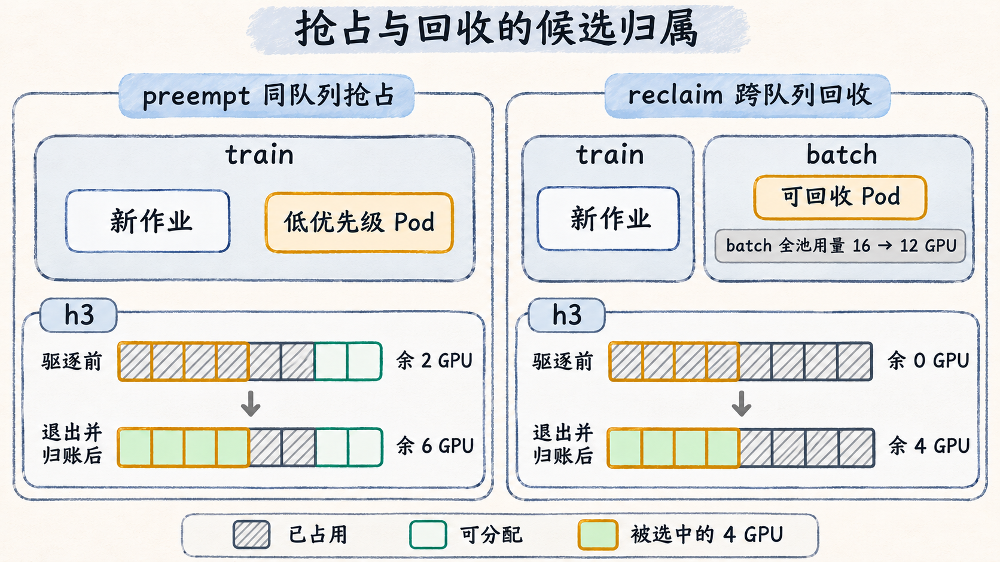
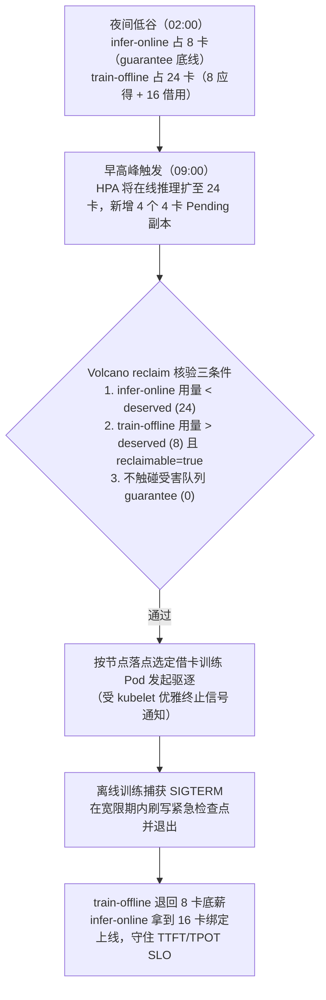

# 同队列抢占与跨队列回收

作业已经通过 `enqueue` 进入队列，可三台物理节点里只有两台够放 4 卡 worker；或者白昼业务高峰到来，在线推理服务急需扩容，但卡全被夜间借用算力的离线训练占着。

队列排序与 Binpack 只能影响未来新 Pod 的落点，无法挪动已经跑起来的存量成员。要从现有占用中合法腾出缺口，Volcano 提供了两条界限分明的驱逐通道：**同队列抢占（`preempt`）** 与**跨队列回收（`reclaim`）**。

## 一、两条驱逐通道的资格条件与插件开关

别把 `preempt` 和 `reclaim` 混为一谈——前者解决**同一队列内部的“重要任务插队”**，后者解决**跨队列之间的“借卡到期归还”**。

| 对比维度 | 同队列抢占（`preempt`） | 跨队列回收（`reclaim`） |
| --- | --- | --- |
| **作用边界** | 申请方与候选受害者**同属一个 Queue**（此处讨论作业间抢占，不含同 Job 内任务间路径）。 | 跨队列：申请队列用量低于其 `deserved`，被回收队列用量超出了自己的 `deserved`。 |
| **核心门槛** | 启用 `priority` 抢占回调时，候选作业优先级必须**严格低于**申请方，且 Pod 本身允许被抢占。 | 受害队列必须显式设置 `spec.reclaimable: true`，`capacity` 判定超额维度可回收，且绝不触碰其 `guarantee` 保留量。 |
| **独立开关** | 受插件的 `enablePreemptable` 控制（如 `gang`、`drf`）。 | 受插件的 `enableReclaimable` 控制，与抢占开关**相互独立**。 |

在生产配置中，要让两条通道按预期协同工作，必须在 `volcano-scheduler.conf` 里显式把两个 action 加入流水线，并逐项核对插件开关：

```yaml
actions: "enqueue, allocate, preempt, reclaim" # 依次尝试入队、放置、抢占与回收
tiers:
  - plugins:
      - name: priority
        enablePreemptable: true    # 允许同队列按优先级筛选低优受害者
      - name: gang
        enablePreemptable: false   # 禁止同队列抢占拆散已达标的 Gang 组
        enableReclaimable: true    # 跨队列回收时，允许在保住受害组门槛的前提下筛选成员
      - name: conformance
  - plugins:
      - name: drf
        enablePreemptable: false
      - name: predicates
      - name: capacity             # 校验队列配额、超额借用量与 guarantee 底线
      - name: nodeorder
      - name: binpack
```

> [!warning] 常见误区：关了 `enablePreemptable` 以为就彻底关闭了驱逐
> 在 Volcano `v1.16.0` 中，抢占路径与回收路径各自读取不同的插件开关。即使你把 `gang` 的 `enablePreemptable` 设为 `false`，只要启用了 `reclaim` action 且未关闭 `enableReclaimable`，超额借用资源的队列成员依然会被跨队列回收路径纳入候选。排障或变更前务必成对核查两项开关。

## 二、未来余量与成组驱逐：为什么必须看准节点

驱逐最怕发生“白杀一场”：把别人正在跑的训练 Pod 杀掉了，腾出来的卡却因为反亲和或位置不对，照样凑不齐申请方的整组门槛。

Volcano `v1.16.0` 的 `preempt` 与 `reclaim` 引入了**未来余量（Future Capacity）** 与 **`JobPipelined` 事务提交** 机制来规避这种浪费：调度器先把候选驱逐和申请方的预期落点都记在临时事务里；只有当“已有余量 + 待释放候选资源”满足整组流水线门槛时，才真正下发驱逐，否则整轮丢弃、一兵不损。

回到三节点主线池（每台 8 GPU，`node-1`–`node-3`，`train` 上限 16 / 应得 12，`batch` 应得 12 且 `reclaimable: true`；其余资源满足，受害作业退出 1 只成员后仍达其组门槛），看两组独立驱逐方案：

| 驱逐场景 | 驱逐前各节点占用与余量 | 选定候选退出并归账后的结果 |
| --- | --- | --- |
| **同队列 `preempt`** | `train` 在 `node-3` 有 1 只低优 4 卡 Pod；`batch` 在 `node-2/3` 占 `4 / 2` 卡。余量 `8 / 4 / 2`。 | 驱逐 `node-3` 的低优 4 卡 Pod，余量变 **`8 / 4 / 6`**（3 落点齐备）；`train` 用量由 4 降为 0，放进 `train-12` 后为 12（`≤ 16`）。 |
| **跨队列 `reclaim`** | `train` 用量 `0`；`batch` 在 `node-1/2/3` 占 `4 / 4 / 8` 卡（共 16 卡，超额 4 卡）。余量 `4 / 4 / 0`。 | 驱逐 `node-3` 上 `batch` 的 4 卡候选，余量变 **`4 / 4 / 4`**（3 落点齐备）；`batch` 总量由 16 回到应得份额 12。 |



*图 16-04-01：同队列抢占与跨队列回收的候选归属与落点变化（图中 `h3` 对应 `node-3`，“可分配”指调度余量，黄色外框标出被选中的 4 GPU 受害 Pod）。两例都精准释放了最紧缺的第三台节点上的 4 张卡，补齐了 `train-12` 的第三个落点。*

做一次反证就能体会**节点位置**有多致命：在右边的跨队列回收里，假如改让 `node-2`（而不是 `node-3`）退出一只同样属于 `batch` 的 4 卡 Pod，会发生什么？

- 从队列总账看，`batch` 同样从 `16` GPU 降回 `12` GPU，看似还清了债；
- 可从物理节点看，三台节点的余量变成了 **`4 / 8 / 0`**；由于硬性反亲和限定每节点至多放 1 只 worker，`node-2` 多出 4 张卡也依然只贡献 1 个落点，`node-3` 还是 `0` 卡——`train-12` **照样凑不齐第三个落点**！

> [!summary] 核心结论
> 评估一次驱逐是否有效，不能只做队列总量的加减法，必须落回**单节点余量 + 反亲和 / 拓扑约束**复算整组落点。Volcano 的 `JobPipelined` 事务机制确保了“只有补得齐整组未来落点，才会真正执行驱逐”。

## 三、生产实战：白昼推理高峰如何平滑回收夜间训练算力

把这套机制接回上一篇设计的 4 节点 32 GPU 训推混部集群（`node-1`–`node-4`）：`infer-online` 配置 `guarantee=8 / deserved=24 / reclaimable=false`，`train-offline` 配置 `guarantee=0 / deserved=8 / capability=24 / reclaimable=true`。

凌晨 2 点，在线推理缩容到 2 个 4 卡副本（占 `node-1` 的 8 卡），离线训练借用 `node-2`–`node-4` 共 24 卡（超额借用 `16` 卡）满速迭代。到了早 9 点流量高峰，HPA 触发在线推理扩容至 6 个 4 卡副本（需要额外 `16` 卡）：



*图 16-04-02：基于 Volcano `reclaim` 与优雅退出检查点的训推潮汐算力回收闭环。*

> [!tip] 工程直觉：把“硬杀”变成“平滑交棒”的三道配合
> 1. **单向防误伤**：务必将在线推理队列设为 `reclaimable: false`，确保高优训练任务无论多紧急，都绝不可能跨队列驱逐正在扛流量的线上推理副本。
> 2. **留足检查点退场时间**：为可被回收的离线训练 Pod 配置合理的 `terminationGracePeriodSeconds`，并在训练脚本中捕获 `SIGTERM` 异步落盘最新权重，避免几小时算力白费。
> 3. **控制反亲和与落点碎片**：在线推理的 4 卡副本同样需要整块空闲卡槽，训练任务在夜间按节点紧凑装箱，早高峰按整机或半机顺序回收时最容易瞬间凑齐连续推理槽位。

## 四、入队阻塞陷阱与驱逐后的证据核对

有一个排障高频坑必须提前标红：如果把场景换回第 02 篇的快照 A（`train` 已用 `8` 卡，新作业需要 `12` 卡，账面 `8 + 12 = 20 > 16`），此时哪怕你把 `preempt` 和 `reclaim` 全开了，还给新作业配了最高优先级，调度器也**纹丝不动**。

原因很简单：启用 `enqueue` 后，这道队列有效上限检查挡在最前面。`PodGroup` 停在 `Pending` 阶段，Job Controller 根本还没创建 worker Pod——后面的 `preempt` 和 `reclaim` 连待放置的成员都看不到，提高优先级无法绕开 `capability` 封顶！

当驱逐真正提交后，按以下只读命令与证据链确认资源已经切实腾出并完成重用：

```bash
# 1. 按受害 Pod 的名称/UID 核对调度器驱逐事件与终止时间戳
kubectl get pod <victim-pod> -n ai-demo -o jsonpath='{.metadata.uid}{"\t"}{.metadata.deletionTimestamp}{"\t"}{.status.phase}{"\n"}'
kubectl get events.events.k8s.io -n ai-demo --sort-by='.lastTimestamp'

# 2. 复算队列最新分配量与申请方新 Pod 是否已拿到目标节点绑定
kubectl get queues.scheduling.volcano.sh train batch -o custom-columns=NAME:.metadata.name,ALLOCATED:.status.allocated
kubectl get pods -l infra.example.com/workload=train-12 -n ai-demo -o wide
```

请留意一个连锁反应：被驱逐的受害 Pod 如果正承载着同步多机训练，它的退出会立刻触发原作业的故障恢复流程。调度器只负责把卡腾出来，接下来作业是原地重试还是整组重建、丢了多少训练步数？这就是下一篇的主题。

> [!info]- 参考资料
> - **Volcano 驱逐动作与候选筛选源码**：[Volcano v1.16.0 Actions](https://volcano.sh/docs/v1.16.0/scheduler/actions/)、[preempt 作业间候选筛选源码](https://github.com/volcano-sh/volcano/blob/v1.16.0/pkg/scheduler/actions/preempt/preempt.go#L150-L217)、[preempt 事务提交源码](https://github.com/volcano-sh/volcano/blob/v1.16.0/pkg/scheduler/actions/preempt/preempt.go#L166-L215)、[reclaim 候选筛选源码](https://github.com/volcano-sh/volcano/blob/v1.16.0/pkg/scheduler/actions/reclaim/reclaim.go#L168-L239)、[reclaim 候选与提交源码](https://github.com/volcano-sh/volcano/blob/v1.16.0/pkg/scheduler/actions/reclaim/reclaim.go#L138-L244)
> - **驱逐插件回调与开关**：[Priority 候选回调源码](https://github.com/volcano-sh/volcano/blob/v1.16.0/pkg/scheduler/plugins/priority/priority.go)、[capacity 回收回调源码](https://github.com/volcano-sh/volcano/blob/v1.16.0/pkg/scheduler/plugins/capacity/capacity.go#L432-L575)、[Gang 受害者筛选回调源码](https://github.com/volcano-sh/volcano/blob/v1.16.0/pkg/scheduler/plugins/gang/gang.go#L90-L119)、[Gang 流水线门槛源码](https://github.com/volcano-sh/volcano/blob/v1.16.0/pkg/scheduler/plugins/gang/gang.go#L189-L196)、[驱逐插件开关源码](https://github.com/volcano-sh/volcano/blob/v1.16.0/pkg/scheduler/framework/session_plugins.go)、[v1.16.0 Helm 调度配置](https://github.com/volcano-sh/volcano/blob/v1.16.0/installer/helm/chart/volcano/config/volcano-scheduler.conf)
> - **Pod 终止与调度缓存回收**：[scheduler 驱逐路径缓存源码](https://github.com/volcano-sh/volcano/blob/v1.16.0/pkg/scheduler/cache/cache.go)、[Kubernetes v1.36 Pod 终止](https://v1-36.docs.kubernetes.io/docs/concepts/workloads/pods/pod-lifecycle/#pod-termination)
