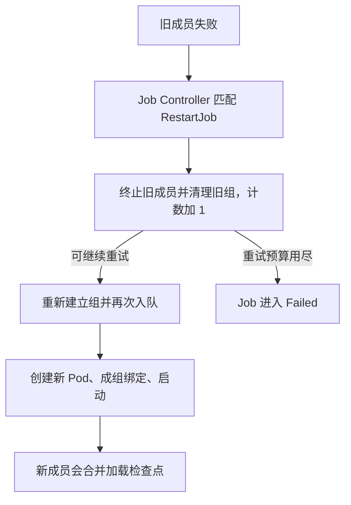

`train-12` 的三只 worker 已在 `h1/h2/h3` 上完成会合。每只 Pod 内有一个 `torchrun` Agent 和四个训练进程，`WORLD_SIZE=12`。当 `h3` 上的一个进程退出，失败可能由启动器消化，也可能传递给 kubelet 和 Volcano Job Controller。判断恢复进度前，先确认是哪一层重建了什么。本篇按 PyTorch 2.9、Kubernetes v1.36 和 Volcano v1.16.0 推演。

## 训练进程、容器与 Pod 的重试层级

| 处理者 | 发生的动作 | 可用证据 |
| --- | --- | --- |
| `torchrun` | 若故障可重试且还在 `--max-restarts` 预算内，停止并重启训练进程组，重新会合。 | Agent 记录重新启动，Pod UID 可以相同，容器 `restartCount` 也可能没变。 |
| kubelet | 容器退出后，若 Pod 的重启策略允许则重启容器。主例 `restartPolicy: Never`，唯一的 trainer 容器非零退出时，Pod 可进入 `Failed`。 | Pod UID 相同而容器 `restartCount` 增加时，结合 `lastState.terminated` 查上一次退出。 |
| Volcano Job Controller | 从 Pod 级事件匹配作业生命周期策略，例如因成员失败而整组重建。 | Job 的 `.status.state.phase`、`.status.retryCount`、控制器事件，以及旧、新 Pod 的 UID。 |

这里「重启训练进程组」指启动器重建同一次作业的应用成员。应用即使重新得到十二个进程，也要自己加载进度。Pod 已失败且仍能查询时，可查退出容器的 `state.terminated.exitCode`。Pod 若已重建，旧容器的退出码要从先前采集的旧 UID 记录取得。 [PyTorch 2.9 故障处理](https://docs.pytorch.org/docs/2.9/elastic/run.html#failure-modes) · [Kubernetes v1.36 Pod 与容器重启](https://v1-36.docs.kubernetes.io/docs/concepts/workloads/pods/pod-lifecycle/)

## RestartJob 策略与整组重建

假定首次运行时，Agent 重试耗尽并退出，Pod 报告失败。下面是 VolcanoJob 的 `spec` 增量，用来说明 Job 级生命周期策略。对于驱逐，如果业务也需要整组重启，应确认控制器收到 `PodEvicted`，并为该事件配置所需的动作。候选遭驱逐后应查调度器和控制器两侧记录。 [Volcano v1.16.0 Job Policy](https://volcano.sh/docs/v1.16.0/userguide/user_guide_how_to_use_job_policy/)

```yaml
maxRetry: 3
policies:
  - event: PodFailed
    action: RestartJob
```

Job 处于 `Running` 时，控制器按 `RestartJob` 终止旧成员、清理旧 PodGroup，将作业推进到 `Restarting` 并增加 `retryCount`。计数达到 `maxRetry` 时，重启状态机转入 `Failed`。本例首次故障后计数为 1，有剩余预算。状态机用总副本数减终止中副本数与最低成员数比较，本例是 `3 − terminating ≥ 3`，所以要等它所见的终止中成员数降为 0，才满足回到 `Pending` 的条件。控制器后续同步重新建立组并创建成员，新组仍要经过调度门槛。以下为正常重试路径的因果简图，各 API 字段可在不同的同步轮次更新。 [v1.16.0 Running 状态](https://github.com/volcano-sh/volcano/blob/v1.16.0/pkg/controllers/job/state/running.go) · [v1.16.0 Restarting 状态](https://github.com/volcano-sh/volcano/blob/v1.16.0/pkg/controllers/job/state/restarting.go) · [v1.16.0 整组终止与清理](https://github.com/volcano-sh/volcano/blob/v1.16.0/pkg/controllers/job/job_controller_actions.go)



控制器按作业、Task 和序号生成 Pod 名。同一个 worker 名可以再次出现，只有 `metadata.uid` 能区分是不是同一对象。例如观察到 Job 的 `retryCount` 从 0 到 1，而且同名的 h3 原成员和重建成员 UID 不同，这支持整组重试的判断。要确认整组，继续核对其余两个旧 UID、控制器事件以及新 Pod 的 owner reference。若新 UID 只是单个替换，而无对应策略或整组证据，仍需查控制器的实际动作。 [v1.16.0 Pod 命名与所有权](https://github.com/volcano-sh/volcano/blob/v1.16.0/pkg/controllers/job/job_controller_util.go)

## 检查点提交与重做步数

检查点（Checkpoint）是应用写到持久存储中的可恢复状态。模型参数和优化器状态决定从什么模型继续，训练的全局步数及数据进度等状态决定继续处理哪些样本。使用分布式检查点时，可读的单个文件只能证明局部写入，应用还需确认整份存档完整可加载。新成员先用本轮一致的会合标识和可达端点组队，再由训练脚本选择检查点、加载并报告实际恢复位置。 [PyTorch 2.9 Distributed Checkpoint](https://docs.pytorch.org/docs/2.9/distributed.checkpoint.html) · [PyTorch 2.9 torchrun](https://docs.pytorch.org/docs/2.9/elastic/run.html)

教学记录显示，三只旧 worker 共同推进到全局第 24,600 步，最新一份已完整提交且各 Rank 可读的检查点位于第 24,000 步。按「已完成的全局优化步」这个统一口径，有 `24,600 − 24,000 = 600` 步需要重做。若另一份第 24,500 步的文件只有部分分片可读，仍从 24,000 复算。总恢复时间还要计入重新排队、镜像及设备准备、会合和加载。要验证推算，找实际加载路径、提交记录和新一轮报告的恢复步数。

## 作业终态、请求归账与设备再分配

三只 worker 都正常退出时，控制器可将 Job 置为 `Completed`。重试预算耗尽则进入 `Failed`。两种终态都要结合成员状态判断剩余占用。先按旧 Pod UID 找 `deletionTimestamp` 或容器终止记录，核对节点侧进程和设备处理。再通过 Queue 的 `.status.allocated` 及节点上仍计入的请求，验证调度账面已释放。最后，如果要确认新作业已经接手，核对新 Pod 的 `spec.nodeName`、容器状态和设备交付。终态 Pod 对象存在时，仍可用它的阶段和 UID 判断它是否为旧成员。 [v1.16.0 作业完成判定](https://github.com/volcano-sh/volcano/blob/v1.16.0/pkg/controllers/job/state/running.go) · [v1.16.0 调度器缓存](https://github.com/volcano-sh/volcano/blob/v1.16.0/pkg/scheduler/cache/cache.go) · [Kubernetes v1.36 Pod 终止](https://v1-36.docs.kubernetes.io/docs/concepts/workloads/pods/pod-lifecycle/#pod-termination)

假设失败前 `train` 共用 16 GPU，其中本作业用 12，其余成员用 4。三只旧 Pod 的请求全数归账，期间没有新分配，账面应降到 4。若查询时已有一份四卡请求重新分配，账面为 8，净降 8 仍可与旧成员释放 12 同时成立。重试前后的资源变化要按 Pod 归属、UID 和时间对账，先区分释放与重新占用，再用应用记录确定训练是否恢复。
