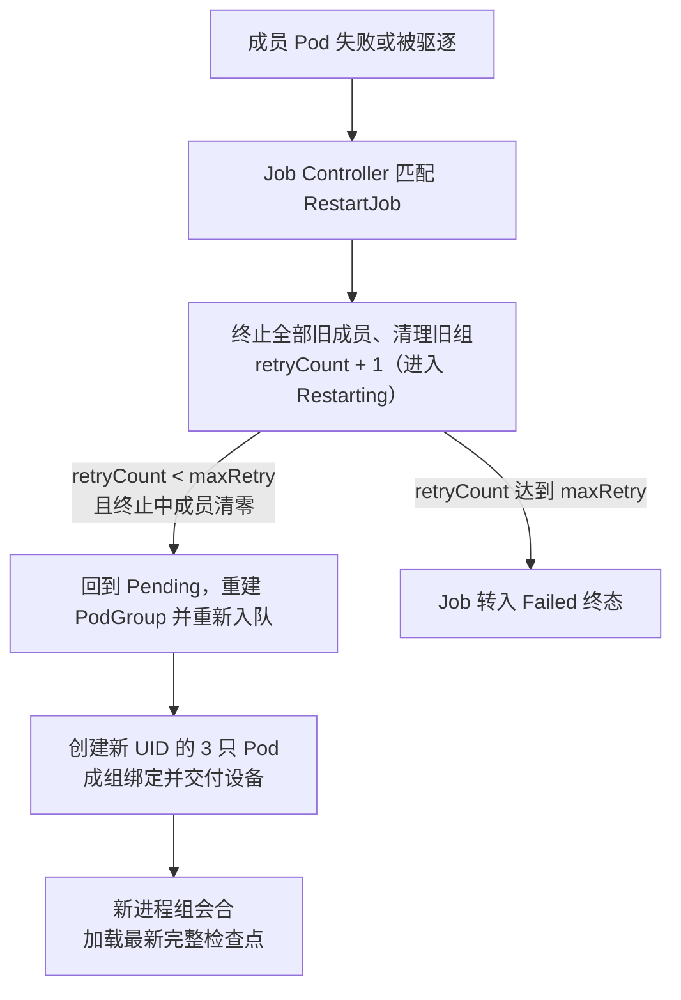

# 成员重试、检查点恢复与资源释放

`train-12` 的 3 只 worker 已经在 `node-1`–`node-3` 上完成会合，12 个训练进程正全速推进。突然间，其中一台节点上的一个训练进程异常退出——也可能是训练作业遭遇了早高峰的跨队列回收。

现场监控只告诉你“作业中断了一会儿又活过来了”。但在动手排查根因、评估损失步数之前，你必须先看清：**到底是谁接住了这次失败？** 它可能被训练启动器内部消化，可能由 kubelet 原地重启容器，也可能惊动了 Volcano Job Controller 推倒整组重建。

## 一、三层重试阶梯：进程、容器与整组 Pod

同一个训练进程退出，会沿着“应用启动器 → 节点 kubelet → 集群 Volcano Controller”逐级上报。每一层动作不同，留下的对象证据也截然不同：

| 重试处理层 | 触发条件与执行动作 | 关键判定证据 |
| --- | --- | --- |
| **`torchrun`（应用层）** | 故障可重试且仍在 `--max-restarts` 预算内时，停止并原地重启本轮训练进程组，重新会合。 | `torchrun` 日志记录重启了 WorkerGroup；**Pod UID 不变**，容器 `restartCount` 通常也不变。 |
| **kubelet（节点容器层）** | 容器进程退出后，仅当 `restartPolicy` 允许重启时由 kubelet 原地拉起新容器。主线设 `restartPolicy: Never`，非零退出直接令 Pod 进入 `Failed`。 | **Pod UID 不变**，但容器 `restartCount` 递增；需从 `lastState.terminated.exitCode` 读上次退出码。 |
| **Volcano Job Controller（集群作业层）** | 捕获 `PodFailed` 或 `PodEvicted` 等 Pod 级事件，按 `policies` 触发整组重建或作业终止。 | Job 的 `.status.state.phase` 与 `.status.retryCount` 变化；**新旧 Pod 虽同名但 UID 完全不同**。 |

> [!warning] 常见误区：看到 Pod 名字没变，就误以为没发生重建
> Volcano Job Controller 严格按 `<jobName>-<taskName>-<index>` 生成成员名，重建后的 worker 会**沿用完全相同的 Pod 名称**。区分“原地重启”还是“推倒重建”的唯一硬凭据是 **`metadata.uid`**。若旧 Pod 已被删除重建，要查清当初的容器退出码，必须回溯此前采集的旧 UID 日志或事件记录。

## 二、`RestartJob` 策略与整组重建状态机

假设 `train-12` 的某个训练进程反复崩溃，`torchrun` 耗尽重启预算后退出，容器以非零状态码结束（因 `restartPolicy: Never`，Pod 进入 `Failed`）。此时，作业生命周期交由 `VolcanoJob` 的 `policies` 规则裁决：

```yaml
# 写入 VolcanoJob 的 spec 顶层字段
maxRetry: 3                 # 作业允许的最大整组重试次数，耗尽则进入 Failed 终态
policies:
  - event: PodFailed        # 任一成员 Pod 失败退出时触发
    action: RestartJob      # 整组重建（而非留着另外两台节点空转）
  - event: PodEvicted       # 若部署在训推混部可回收队列中，驱逐后同样需整组重建
    action: RestartJob
```

当处于 `Running` 阶段的作业命中 `PodFailed → RestartJob` 后，Volcano `v1.16.0` 的状态机按一条非常严谨的链条推进：

1. **终止旧成员与清理旧组**：控制器删除全部 3 只旧 worker Pod 并清理旧 `PodGroup`，将 Job 状态推入 `Restarting`，同时把 `.status.retryCount` 加 1。
2. **核验重试预算**：如果 `retryCount` 已达到 `maxRetry`（本例为 3），状态机不再拉起新组，直接转入 `Failed` 终态。首次失败后计数为 `1`，尚有预算。
3. **等待旧成员彻底退场**：状态机用“总副本数 − 终止中副本数 ≥ 最低成员数”判断是否可以回到 `Pending`。本例总副本数与门槛均为 3，即 `3 - terminating ≥ 3`，这意味着**必须等它观察到的终止中旧成员数降为 0**，作业才会回到 `Pending`。
4. **重新建组并走完两道调度门**：回到 `Pending` 后，控制器创建新 `PodGroup`，新组必须重新通过 `enqueue` 入队检查与 `allocate` 成组绑定，才能拉起新成员。



*图 16-05-01：`RestartJob` 整组重建状态机与检查点恢复链路。*

判断现场是否发生了“整组重建”而不是“单点替换”，不能只看故障那一台的 Pod UID 变了，还应核对另外两只同名 worker 的 UID 是否同步更新、检查新 Pod 的 `ownerReferences` 与控制器事件记录。

## 三、检查点提交与重做步数复算

哪怕 Volcano 已经干脆利落地把 3 只新 worker 重新绑到节点上，训练框架也重新凑齐了 12 个进程——**调度器只负责把算力壳子拉起来，并不知道模型算到了第几步**。

恢复进度全靠应用写到持久存储里的 **Checkpoint（检查点）**，里面保存了模型权重、优化器状态、全局步数以及数据读取偏移。分布式检查点往往由各个 Rank 分片写入，因此存在一条铁律：**只有全部 Rank 完整提交且校验可读的存档，才能作为恢复起点**。

以一次具体的中断记录为例：三只旧 worker 故障前已同步推进到全局第 **24,600** 步；持久存储上最近一份完整提交的检查点位于第 **24,000** 步，另有一份第 **24,500** 步的存档因写入中途被打断、只剩部分分片可读。

按统一的“已完成全局优化步”口径核算，第 `24,500` 步残缺不可用，恢复必须退回到第 `24,000` 步：

$$\text{需重做全局步数} = 24{,}600 - 24{,}000 = 600\text{ 步}$$

别忘了，真实的端到端恢复耗时绝不只是“重跑 600 步的时间”，还要叠加**旧成员退场 + 重新排队入队 + 镜像与设备准备 + 多机会合 + 分布式检查点加载**五段额外开销。

> [!tip] 工程直觉：给训推混部的可回收作业加上优雅退场钩子
> 如果离线训练作业部署在上一篇的 `train-offline` 队列里，可能随时在早高峰收到 `reclaim` 发出的终止信号。与其被动损失 600 步，不如为训练容器配置合理的优雅退出宽限期并捕获 `SIGTERM`，在退出前完成一次原子提交检查点，把重做损失压到趋近于零。

## 四、作业终态、队列归账与设备再分配

作业生命走到尽头有两种终态：全部 3 只 worker 正常以 `0` 退出时，控制器将 Job 置为 **`Completed`**；重试预算用尽时，则进入 **`Failed`**。

无论哪种终态（或是整组重试的清理间隙），确认 GPU 是否真正释放回池子、可以被下一份训练或在线推理服务接手，都要按三步逐层对账：

1. **按旧 Pod UID 查退场状态**：核对旧 Pod 的 `deletionTimestamp` 与容器终止记录，确认节点上的计算进程与设备句柄已清退。
2. **核对队列与节点账面**：查看 `Queue.status.allocated` 及节点剩余可分配量，确认调度器缓存已经注销旧请求。
3. **识别并发新分配导致的“净值假象”**：线上集群随时有其他作业进出，账面绝对值没降满 12 卡，往往只是并发新分配冲抵了净降幅，并非旧卡未还干净。

看一笔典型的并发对账：失败前 `train` 队列共分配了 `16` GPU（`train-12` 占 `12` 卡，其余作业占 `4` 卡）。若 3 只旧 Pod 全部释放归账的同时，同队列另一只 4 卡 Pod 恰好拿到了分配，此时队列总账面为：

$$\text{最新 } \texttt{allocated} = 16 - 12\text{（旧组释放）} + 4\text{（新成员分配）} = 8\text{ GPU}$$

表面看队列用量只净降了 `8` GPU，但这与“旧作业 12 卡全部归账”完全同时成立。日常运维可以用下面的命令把 UID、重试次数和队列账面放在一起交叉核对：

```bash
# 1. 核对 VolcanoJob 当前阶段与累计重试次数
kubectl get jobs.batch.volcano.sh train-12 -n ai-demo \
  -o jsonpath='{.status.state.phase}{"\tretry="}{.status.retryCount}{"\n"}'

# 2. 列出同作业全部 Pod 的名称、UID、所在节点与容器重启次数
kubectl get pods -l infra.example.com/workload=train-12 -n ai-demo \
  -o custom-columns=NAME:.metadata.name,UID:.metadata.uid,NODE:.spec.nodeName,PHASE:.status.phase,RESTARTS:.status.containerStatuses[0].restartCount

# 3. 核对队列当前实时分配总量
kubectl get queues.scheduling.volcano.sh train -o jsonpath='{.status.allocated}{"\n"}'
```

至此，我们已经完整走通了 Volcano 从作业声明、入队、放置、抢占回收直到故障重试与归账的全生命周期。不过在现代 Kubernetes AI 基础设施里，还有另一条被广泛采用的主流调度路线——不替换默认调度器，只在其上方架设配额准入总闸的 **Kueue**。下一篇我们把同一份需求放进 Kueue，彻底划清两者的控制权边界。

> [!info]- 参考资料
> - **Volcano Job 生命周期与重试状态机**：[Volcano v1.16.0 Job Policy 指南](https://volcano.sh/docs/v1.16.0/userguide/user_guide_how_to_use_job_policy/)、[Running 状态与完成判定源码](https://github.com/volcano-sh/volcano/blob/v1.16.0/pkg/controllers/job/state/running.go)、[Restarting 状态源码](https://github.com/volcano-sh/volcano/blob/v1.16.0/pkg/controllers/job/state/restarting.go)、[整组终止与清理源码](https://github.com/volcano-sh/volcano/blob/v1.16.0/pkg/controllers/job/job_controller_actions.go)、[Pod 命名与所有权源码](https://github.com/volcano-sh/volcano/blob/v1.16.0/pkg/controllers/job/job_controller_util.go)、[调度器缓存归账源码](https://github.com/volcano-sh/volcano/blob/v1.16.0/pkg/scheduler/cache/cache.go)
> - **PyTorch 故障处理与分布式检查点**：[PyTorch 2.9 故障模式](https://docs.pytorch.org/docs/2.9/elastic/run.html#failure-modes)、[PyTorch 2.9 torchrun 指南](https://docs.pytorch.org/docs/2.9/elastic/run.html)、[PyTorch 2.9 Distributed Checkpoint](https://docs.pytorch.org/docs/2.9/distributed.checkpoint.html)
> - **Kubernetes Pod 生命周期与终止**：[Kubernetes v1.36 Pod 生命周期](https://v1-36.docs.kubernetes.io/docs/concepts/workloads/pods/pod-lifecycle/)、[Kubernetes v1.36 Pod 终止](https://v1-36.docs.kubernetes.io/docs/concepts/workloads/pods/pod-lifecycle/#pod-termination)
